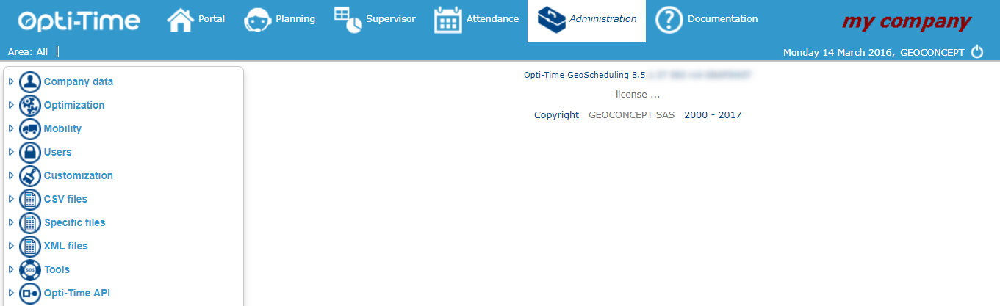

# Home Page

## Overview

To open the Administration menu, do one of the following:

* Click the **Administration** tab in the blue band at the top of the screen. See [The Header Bar](../the-header-bar/guided-help-nfs-reference-guide-1.md).
* Enter the application directly, if your user profile is set up to open NFS in the Administration module. See [Company Data](companydata.md).

## Prerequisites


You must connect with an administrator profile. See [User Handling](userhandling.md).


## Layout of the home page

The home page is divided into three sections:

* The [**band**](../the-header-bar/guided-help-nfs-reference-guide-1.md), at the top of the screen, gives access to the different modules that make up the application.
* The **menu**, on the left of the screen, gives access to the different data so that you can manipulate them.
* A section on the right of the screen displays the different screens relating to the data accessible in the Administration module.


The home page displays the current version number of NFS installed on the server (for example, 9.0.1.42). Note this number down so that you can use it as a reference when you contact the GEOCONCEPT support team. The page also displays the list of modules enabled on the current installation, with details of the current license.


## Menu structure

The Administration module is structured into several dialogue items that give access to the different information items the application needs. The dialogue items are:

* [Company data](companydata.md)
* [Optimization](optimisation.md)
* [Mobility](mobility.md)
* [Users](userhandling.md)
* [Customization](customization.md)
* [CSV files](csvfiles.md)
* [Tools](tools.md)

To open a function or data item, click the corresponding link in the left-hand menu. The data and functions are classified as follows:

* **Company data**
  * [Human resource](companydata.md)
  * [Function](companydata.md)
  * [Job type](companydata.md)
  * [Subcontractor](companydata.md)
  * [Equipment](companydata.md)
  * [Product family](companydata.md)
    * [Product](companydata.md)
  * [Team](companydata.md)
  * [Domain](companydata.md)
  * [Area](companydata.md)
  * [Worksite](companydata.md)
  * [Sector](companydata.md)
  * [Unavailability type](companydata.md)
  * [Exceptional location type](companydata.md)
  * [On-call duties](companydata.md)
    * [Day template](companydata.md)
    * [Week template](companydata.md)
  * [Skill](companydata.md)
  * [Authorization](companydata.md)
  * [Intervention group](companydata.md)
    * [Mission type](companydata.md)
  * [Targets](companydata.md)
  * [Activities follow up](companydata.md)
    * [Completion status](companydata.md)
    * [Follow-up](companydata.md)
  * Typology
  * Calendars
    * [Public holidays](companydata.md)
    * [Day template](companydata.md)
    * [Week template](companydata.md)
    * [Sales Period](companydata.md)
* **Optimization**
  * [Optimization parameters](optimisation.md)
  * [Optimization planning](optimisation.md)
  * [Activate/Deactivate an area](optimisation.md)
  * [Import/Export optim](optimisation.md)
* **Mobility**
  * [Vehicles](mobility.md)
  * [Tracking service](mobility.md)
  * [Assignments](mobility.md)
  * [Tracking utils](mobility.md)
  * [Settings](mobility.md)
* **Users**
  * [Profile](userhandling.md)
  * [Collection of rights](userhandling.md)
  * Access rights
  * [Alert subscriptions](userhandling.md)
* **Customization**
  * [Application settings](customization.md)
  * [Colors](customization.md)
    * Referentials colors
    * Application colors
* **CSV files**
  * [Import CSV file](csvfiles.md)
  * [Export CSV file](csvfiles.md)
  * [Global CSV import/export](csvfiles.md)
  * [CSV import/export template](csvfiles.md)
  * [Circulation listeners](csvfiles.md)
  * [Predefined export links](csvfiles.md)
  * **Specific files**
    * [Export of TomTom POI](csvfiles.md)
    * [Export of Masternaut POI](csvfiles.md)
    * [Export of Garmin POI](csvfiles.md)
    * [Export of KML POI](csvfiles.md)
  * [Export OT-Strategic files](csvfiles.md)
  * **XML Files**
    * [Optimization file](csvfiles.md)
    * Reference files
    * Appointment request file
    * [Circulation file](csvfiles.md)
    * [Customization file](csvfiles.md)
* **Tools**
  * [Advanced tools](tools.md)
  * [Recompute distance](tools.md)
  * Check server state
  * SQL query
  * [Logs](tools.md)
  * [JVM thread dump](tools.md)
* **Nomadia API**
  * Documentation
  * CSV export/import templates
* **MyGeoconcept**


The most frequently used dialogue items are [Company Data](companydata.md), [Optimization](optimisation.md), [User Handling](userhandling.md) and [CSV Files](csvfiles.md).

