# Company Data

## Overview

NFS stores the day-to-day organization and planning of each mobile resource, so that appointments can be allocated according to availability and logistical constraints. Data such as resource identities, team composition and geographic location are gathered in one place: the company data.

This topic describes each object of the company data and its fields.

## Human resource

A human resource is the representation in NFS of each resource (or mobile consultant) who can deliver a service or attend an appointment. You can also save details of non-skilled resources who can still fulfill appointments, for example tele-operators, administrators or department managers. For these resources, not all information items are required (usual location, journey duration, and so on).

You can create, consult and edit a human resource. For the general procedures, see [General Principles](generalprinciples.md).


To deactivate a resource, declare an end-of-activity date for the resource in the **Information** tab.


### List of human resources

To open the human resource management interface, click the **Human resource** link in the **Company data** dialog.

Before the list of human resources is displayed, you must run a search on the database.

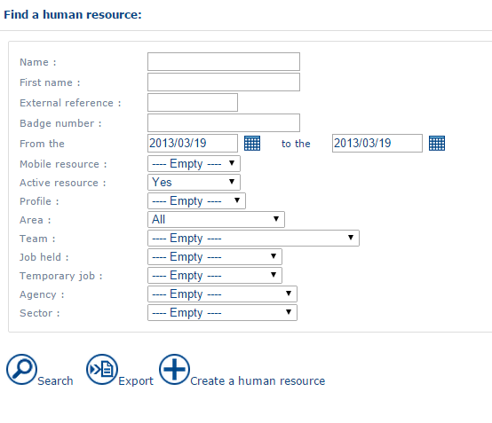

The search interface offers the following filters:

* **Name** or **Forename**: the first letters of, or a sequence within, the name or forename. The search is not case-sensitive. For example, a search finds both «MARC» and «Matthew».
* **From** and **To**: dates that filter resources who no longer work for the company (**Length of time in company** field).
* Other fields: they correspond to fields in the resource form.


Leave the search fields empty to display the full list of resources.


If the search returns more than 20 lines, a **Next** link lets you navigate through the results.

Click the 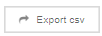 button to export the search result in `.csv` format. The export contains the following information: Name, First name, Login, Profile, Area, Identifier and Badge number.

### Resource form

The **Human resource** form has the following tabs: **Information**, **Affiliation**, **Address**, **User**, **Perimeter**, **Standard week**, **Limits**, **Stop points**, **Skills**, **Authorizations**, **Priorities**, **Posts** and **Vehicle**.

#### Information tab

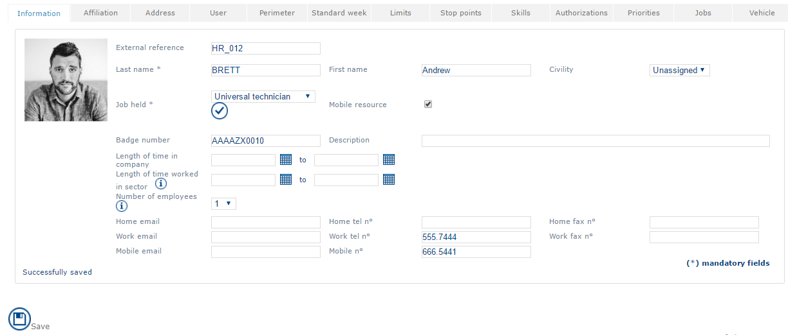

* **Photo**: on the left of the screen, you can import a photo of the resource. Move the mouse pointer over the photo. Click the  button to import a photo, or the  button to delete it.
* **External reference**: external reference of the mobile resource.
* Identification: **Name**, **First name**, **Company ID** (the company ID corresponds to the [external identifier](../glossary/glossary.md) of the resource), **Badge number** and **Description**.
*   **Job held**: specifies the function of the resource. This information determines the type of intervention (or offering) that the resource can provide when an appointment is made. An intervention type depends on two criteria: the type of post occupied and the skills the resource has. The skills of the resource are described in the **Skills** tab.

    

When you select the 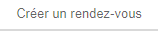 check box, the information about the function is retrieved in the resource form.

* **Mobile resource**: declares the resource as mobile. Select this check box to allow appointments to be taken for the resource, as a mobile resource. This parameter mainly distinguishes mobile resources (or advisors in the field) from other people (managers, supervisors, online advisors) who are never called upon to fulfill appointments.
* **Length of time in company**: start and end date of the work contract. This information is used to handle the life cycle of the work contract: arrival in the company and departure (resignation, retirement, and so on). Company transfers are handled by "stopping" a mobile resource on a given date (for a given area, for example) and re-creating it for another assignment (another area, for example).
* **Period of availability**: start and end date from which the resource is taken into account in the planning process. This lets you set a delay between the start of the work contract and the availability of the resource for appointments made by NFS. If you enter no date, the resource is considered available from the start of the work contract, so an appointment can be taken for the resource from day 1 of employment.
* **Number of employees**: number of employees associated with this resource. This lets you create multi-employee resources. A team (pair) is a resource made up of two employees.
* Home contact details: **Personal email**, **Personal fax** and **Home telephone number**.
* Professional contact details: **Professional email**, **Professional fax** and **Professional telephone number**.
* Mobile contact details: **mobile email address** (some operators offer email addresses that can be read on a mobile phone) and **telephone** **mobile** (for text messages).

#### Assignment tab

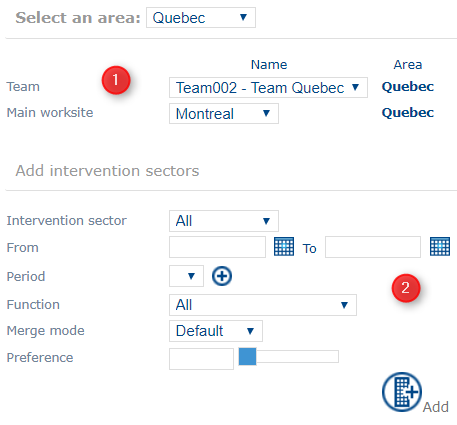

Part 1: each resource can be affiliated to two entities defined globally in NFS.

* **Team**: name of the team of affiliation. This is the hierarchical affiliation within the overall structure. This information does not feature in the optimization constraints. It also gives you the **Area** of affiliation, when each team is affiliated to an area.
* **Worksite**: name of the main worksite. A resource has one worksite of affiliation, and can intervene at each of the other worksites. This lets the user define the position of the resource for tasks to accomplish on one of these worksites. A worksite can be an office, a branch office, an agency, a depot, and so on.

Part 2: affiliation of a resource to one or several secondary worksites.

You can add or delete secondary worksites for the resource (see [General Principles](generalprinciples.md)). Each secondary worksite is assigned to the resource with a function and a preference. A resource that has a secondary worksite can perform an intervention located on this worksite even if it is not the main worksite of affiliation.

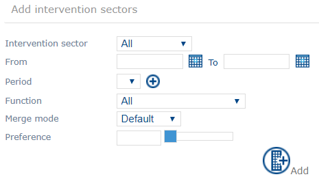

* **Intervention sector**: name of the secondary worksite. It can be a worksite or a sector.
* **From** and **To**: start and end dates from which the resource is taken into account in the plannings of the secondary worksite. If you enter no date, the sector is permanently assigned to the resource.
* **Period**: defines a customized period of time. To create a period, click the  button to the right of the drop-down list.
* **Function**: the profile that is assigned to the resource during this period, in other words the different priorities with which the intervention types can be scheduled for the resource.
* **merge mode**: defines whether the selected resource type replaces the other resource types assigned during this period (_exclusive_ mode) or is added to them (_default_ mode).
* **preference**: assigns a lower or higher weight (from 0 to 100) to this secondary worksite when an appointment is scheduled for this resource.

The list of intervention sectors is displayed at the bottom of the screen.

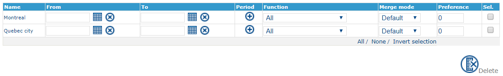

#### Address tab

This tab usually defines the start and arrival points of each daily itinerary. For example, it can be the home address of the resource.

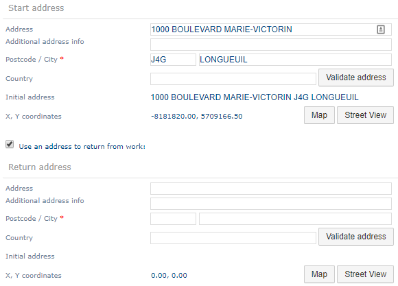

To fill in the start address, see the Address section of this guide.


If you do not enter this information, NFS uses the worksite address.



To verify that the address is correctly validated, check that the X and Y coordinates are not 0.


Click **Access Plan** to display a map that locates the geocoded addresses.

Select **Use a Return from work address** to declare a return-from-work address that differs from the start point. For example, the resource can start the route from home and finish it at the depot.

#### User tab

Use this tab to define a resource as a user.

* **Identifier**: the internal identifier of the resource (not modifiable).
* **Profile**: a profile is the sum of the access rights granted to the user. See [User Handling](userhandling.md).
* **Identification mode**: declares whether the user is handled by an external provider (LDAP, SSO, other). In this case, the **Password** field is not used.
* **User**: the login that lets the resource connect to NFS and so become a user. To bind the user to a Single Sign-On (SSO) provider account, the login must be the email address declared for this third-party account, in lowercase.
* **Password**: each user can have a specific password. This field is not used for a connection through an external identification provider.
* **Point of entry to the application**: depending on the profile of the resource, the administrator can define the home page on which the resource works in NFS (the portal, call center, supervision module, attendance module, and so on). You must first choose a profile to select an entry point.


See also:

* EXPLOITATION > Configuring SSO access in NFS
* REFERENCE GUIDE > Introduction > Running the application > [Running the Application](../introduction/runningtheapplication.md) (section "Authenticating through Single Sign-On (SSO)")


#### Perimeter tab

Depending on the user rights assigned, this tab lets you select favorites for the area, the team and the worksite, to build a perimeter for this resource.

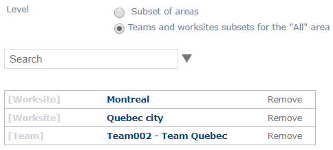

You can apply this perimeter in the Planning and Attendance modules, so that only objects that belong to the perimeter are displayed, regardless of the area of affiliation of the resource defined in the **Affiliation** tab.

#### Typical week tab

Use this tab to save the **Working hours** of each resource according to the **Day of Week**. Each resource has a standard working week. The tab stores the working hours for Monday, Tuesday, and so on.


There is only one typical Monday per resource, one Tuesday, and so on. Variations are handled by unavailabilities entered by the resource, or by team leaders through the general portal of NFS.


First, select the **local time zone** to which the resource is affiliated.

Part 1: "Typical working week"

* **Day of the Week**: Monday, Tuesday, and so on.
* **Working hours**: the maximum length of the working day, for example 08:00-20:00.
*   **Lunch break** and **Length of break**: the start and end times of the lunch break give the period during which the break must be taken. Example: a one-hour break to be taken between 12:00 and 14:00.

    

A value of 00:00 means that the parameter is not taken into account in the optimization.

* **Worked day**: indicates whether the resource can perform interventions that day.
* **Night away possible**: indicates whether the optimization engine can schedule a night away for that day.


To use nights away, define the number of nights away possible in the **Limits** tab.


Part 2: "Custom hours"

You can add specific work days or specific weeks (see [General Principles](generalprinciples.md)). Custom days are days on which the hours worked differ from the usual working hours of the resource.

* **Custom day**: link to the day template to use.
* **Custom week**: link to the week template to use.
* **From**, **To**: start and end date of the custom day or week.
* **During**: defines a duration for the use of the custom day or week.
* **Every X weeks**: defines a periodicity. For example, **every** 1 **week** applies the chosen template each week during the defined period.

#### Limits tab


This tab can be pre-filled if a function is associated with the resource in the **Information** tab.


Use this tab to define maximum quantities.

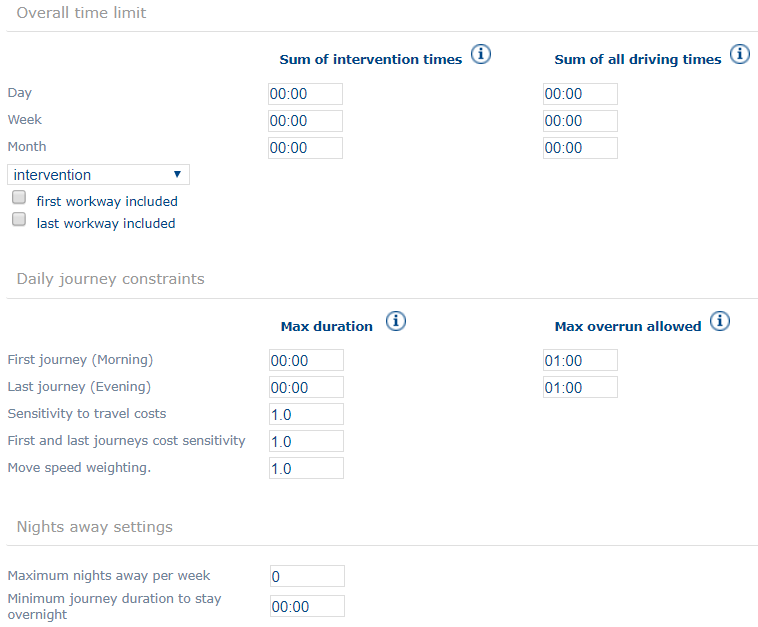

**Overall time limit**

* Sum of intervention times:
  * **Day**: the maximum number of hours, for example 7 hours, to be worked between the start and end time of the day.
  * **Week**: the maximum number of hours per week.
  * **Month**: the maximum number of hours per month.
* Sum of all driving times:
  * Maximum **daily** travel time: a time limit for travel between home and the workplace in one day.
  * Maximum **weekly** travel time: a time limit for travel between home and the workplace in one week.
  * Maximum **per month** travel time: a time limit for travel between home and the workplace in one month.
*   Drop-down list: selects the calculation mode for the cumulated total.

    

This field is in fact changed in the application settings. To modify it, go to the <a href="customization.md">Customization</a> menu (application settings) and replace the value of the <strong>Optimization tab > Batch > OPTIM_DISPATCHER > MAX_WORK_TIME_TYPE</strong> setting with the value you want.

    * **Intervention**: only the duration of interventions is included in the calculation.
    * **Journey time + intervention**: travel times are also counted, depending on the options selected below the item.
* **first workway included**: when selected, the first journey is included in the work time. When cleared, you must fill the **Max overrun allowed** field.
* **last workway included**: when selected, the last journey is included in the work time. When cleared, you must fill the **Max overrun allowed** field.


If the first (or last) journey is counted and the morning (or evening) **Max overrun allowed** field is selected, NFS assumes that the departure point of the resource is the first intervention location (or that the resource finishes the working day at the location of the last intervention). The first (or last) journey is not taken into account in the optimization.


**Daily journey constraints**

* **Max duration**
  * Gives the maximum time for the **first journey** of the day to arrive as planned at the first appointment.
  * Gives the maximum time for the **last journey** of the day to arrive as planned at the point of return.
* **Max overrun allowed**
  * Gives an additional authorized time for the **first journey (morning)**.
  * Gives an additional authorized time for the **last journey (evening)**.
* **Sensitivity to travel costs**: gives extra weight to the kilometers traveled. Increase it if the resource must only perform interventions close by. Reduce it if the resource must perform interventions further away.
* **First and last journey sensitivity**: gives extra weight to the first and last journeys, so that they have a minimum duration.
* **Move speed weighting**: artificially increases or reduces travel speed (as a percentage).

**Configuring nights away**

Define for the resource the **maximum number of nights away (overnight stops) authorised per week** and the **Minimum journey duration to stay away**.


A value of 00:00 means that the parameter is not taken into account in the optimization.


#### Stop points tab

Use this tab to configure an express unavailability that is available in the unavailabilities tooltip of the Planning module (see [The Planning](../planning/theplanning.md)).

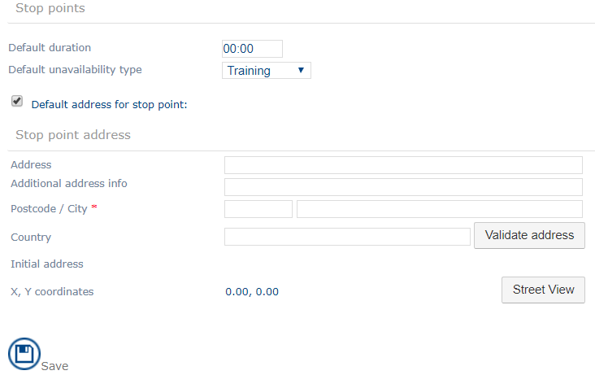

The tab has two parts:

* **Stop points**:
  * **Default duration**: the duration of the express unavailability.
  * **Unavailability type**: the list of saved unavailability types. It defines the type of express unavailability.
* **Stop point address**: the address of the unavailability to enter.


In earlier versions of NFS, this tab is called **Call in at depot**.


#### Skills tab

Use the **Skills** tab to associate with a resource an experience level, a weighting for the fulfilment speed, and the skills the resource has according to training and experience.

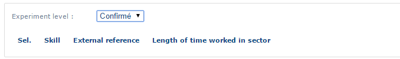

* **Experience level**: choose one of three levels: junior, confirmed or expert. This parameter is taken into account when appointments are optimized. When two resources are possible for one appointment, the resource with the higher experience level is chosen.
* **Execution speed weighting**: artificially increases or reduces the appointment fulfilment speed (as a percentage).
* **Sel:**: quickly adds or deletes skills.
* **Skill**: the saved skills.
* **External reference**: external reference of the skill.
* **Length of time worked in sector**: start and end date of the acquisition of the skill. These dates can correspond to an apprenticeship (in this case, a start date) or to a period of availability for a specific item of equipment or tooling. To add or delete periods, click the  and  buttons (see [General Principles](generalprinciples.md)).


If a skill is required to perform an intervention and the resource does not have this skill, the intervention cannot be planned on the resource in [batch optimization](../glossary/glossary.md) and optimized modes.


#### Authorizations tab

Authorizations correspond to characteristics of a customer, for example the password or key to access a block of flats, or nationality. An authorization is not a skill.

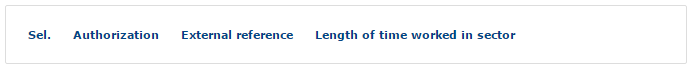

* **Sel:**: quickly adds or deletes an authorization.
* **Authorisation**: the saved authorizations.
* **External reference**: external reference of the authorization.
* **Length of time worked in sector**: start and end date of the acquisition of the authorization. These dates can represent the period of availability of a particular entitlement, skill or authorization. To add or delete periods, click the  and  buttons (see [General Principles](generalprinciples.md)).


If an authorization is required to perform an intervention and the resource does not hold this skill, the intervention cannot be planned on the resource in [batch optimization](../glossary/glossary.md) and optimized modes.


#### Priorities tab


This tab can be pre-filled if a function is associated with the resource in the **Information** tab.


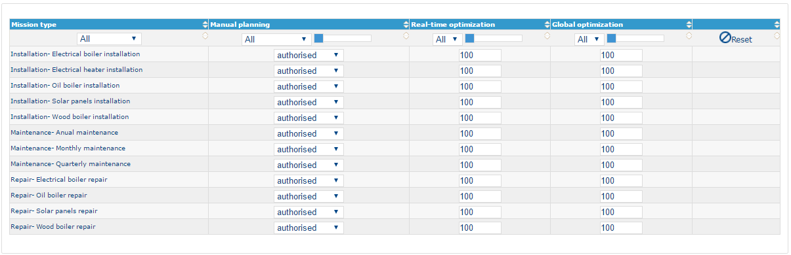

* **Intervention type**: name of the intervention type, among the saved intervention types.
* **Manual planning**: allows or prevents the planning of an appointment in manual mode for an intervention type.
* **Real Time Optimisation**: the priority of real-time optimization processing (from 0, minimum priority, to 100, maximum priority).
* **Global optimization** (in batch mode): the priority given to global optimization processing by the optimization engine (from 0, minimum priority, to 100, maximum priority).

In the table header, you can:

* Filter on intervention type by selecting it in the header.
* Filter on the priority in manual, real-time or global mode by selecting it in the list in the header.
* Modify the priorities of all lines in the table by moving the cursor in the table header.
* Reset the priorities by clicking the **Reset** button in the header.
* Authorize all planning modes for a line by clicking the **Allow** button, which is displayed when you move the mouse pointer over the last column of the table.

#### Posts tab

Use the **Jobs** tab to define temporary or periodic posts for a resource. Posts are associated with a list of intervention types. This lets you define a set of temporary or periodic intervention types for a resource (see the Job type and Function sections).

To add or delete temporary posts, click the  and  buttons (see [General Principles](generalprinciples.md)). You can also add and delete the post types associated with a resource.

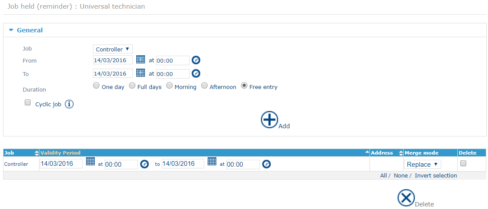

The line at the top summarizes the post occupied by the resource.

Fields:

* **Post**: the job type or function to assign to the resource for the specified period.
* **From**: start date of the secondary post type.
* **To**: end date of the secondary post type.

To add a cyclical post type, select the **Cyclical task** check box. The following fields then appear:

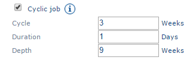

* **Cycle**: repetition period of the post type.
* **Duration**: duration, in days, of the post type in the defined period.
* **Depth**: duration of the repetition period.

The list of temporary posts with their validity period is displayed at the bottom of the page.

#### Vehicle tab

Use this tab to choose the vehicle associated with the resource (see [Mobility](mobility.md)).

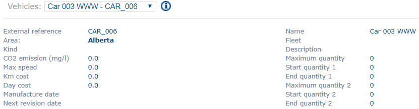

The information about the vehicle is displayed on screen.


You must enter at least one vehicle in the **Vehicles** menu of the Administration module (see [Mobility](mobility.md)).


## Function

A function (resource type) lets you save information about a resource in advance, such as the intervention types it can perform. You can use this information, for example, to add temporary posts to a resource.

You can create, consult, duplicate or deactivate a function. For the general procedures, see [General Principles](generalprinciples.md).

### List of functions

To open the list of functions, click the **Function** link in the menu of the **Company data** dialog.

You can filter the list of resource types by area of affiliation.

### Form for the function

The function form has the **Information**, **Work week**, **Limits** and **Priorities** tabs.

#### Information tab

The tab shows the following data for each function:

* **Name**: the name of the function. It is unique.
* **Abbreviation**: an abbreviation for the function.
* **Color**: the color of the function.
* **Area**: the area in which the resource type is available. This field is mandatory.
* **Description**: a description of the function.
* **Default location**: the default location of the resource type. It overwrites the address of the technician defined in the **Address** tab of the resource.

#### Work week tab

Select the week template that applies to this resource type from the list of week templates.

The fields are described in the **Standard week** tab of the human resource (see [Typical week tab](companydata.md#typical-week-tab)).

#### Limits tab

This tab is the same as the **Limits** tab of the human resource (see [Limits tab](companydata.md#limits-tab)).

#### Priorities tab

This tab is the same as the **Priorities** tab of the human resource (see [Priorities tab](companydata.md#priorities-tab)).

## Job type

Job types (post types) let you save information about a resource in advance, such as the intervention types it can fulfill. This simplifies data entry in the **Priorities** tab of the resource form.

You can create, consult, edit, duplicate or deactivate a job type. For the general procedures, see [General Principles](generalprinciples.md).


You can consider a job type as a human resource template.


### List of job types

To open the list of job types, click the **Job type** link in the menu of the **Company data** dialog.

You can filter the list of job types by area of affiliation.

### Form for the job type

The job type form has the **Information**, **Work week** and **Priorities** tabs.

#### Information tab

The tab shows the following data for each job type:

* **Identifier**: the identifier of the job type. It is unique.
* **External reference**: the external reference of the job type. You must enter it in any data exchange project with an external system.
* **Name**: the name of the job type.
* **Colour**: gives a job type a custom color in the plannings.
* **Area**: the reference area of the job type. This field is required.
* **Description**: a concise description of the job type.
* **Default location**: the default location of the job type. It overwrites the address of the technician defined in the **Address** tab of the resource.

#### Work week tab

This tab is the same as the **Standard week** tab of the human resource (see [Typical week tab](companydata.md#typical-week-tab)).

#### Priorities tab

This tab is the same as the **Priorities** tab of the human resource (see [Priorities tab](companydata.md#priorities-tab)).

## Subcontractor

Defining subcontractors lets you assign an intervention to a subcontractor. This is useful to keep a trace of an appointment without managing its life cycle (see [The different statuses for appointments in NFS](../introduction/thedifferentstatusesforappointmentsinnfs.md)).

You can create, consult, duplicate or deactivate a subcontractor. For the general procedures, see [General Principles](generalprinciples.md).

### List of subcontractors

To open the list of subcontractors, click the **Subcontractor** link in the menu.

You can filter the list of subcontractors by area of affiliation.

### Form for the subcontractor

The subcontractor form has one tab. It shows the following for each subcontractor:

* **Name**: the name of the subcontractor. It is unique.
* **Abbreviation**: an abbreviation for the subcontractor.
* **Area**: the area in which the subcontractor is available. This field is mandatory.
* **Worksite**: the worksite of the subcontractor.
* **Description**: a concise description of the subcontractor.

## Equipment

Equipment is what is needed to fulfill an intervention, for example a tool or a spare part.

You can create, consult, duplicate or deactivate an equipment item. For the general procedures, see [General Principles](generalprinciples.md).

### List of equipments

To open the list of equipment items, click the **Equipment** link in the menu.

You can filter the list of equipment items by area of affiliation and worksite.

### Form for the equipment

The equipment form has one tab. It shows the following data for each equipment item:

* **Name**: the name of the equipment. It is unique.
* **Abbreviation**
* **Area**: the area in which the equipment is available. This field is mandatory.
* **Worksite**: the worksite at which the equipment is available.
* **Description**
* **Duration**
* **Stock**: shows the available spare parts.
* **Loading**
* **Number of staff**: the number of employees needed to use the equipment.
* **Priority**
* **Attached files**: associated multimedia files, according to the rights assigned to the user. To access this function, the NFS administrator must assign you the corresponding [rights](userhandling.md): Administration > Others > `ADMIN_ADD_DOCUMENTS` and `ADMIN_DELETE_DOCUMENTS`.


At the time of writing, these data are not used for planning calculations.


## Product family

A product family is a family of products to deliver.

You can create, consult, duplicate or deactivate a product family. For the general procedures, see [General Principles](generalprinciples.md).

### List of product families

To open the list of product families, click the **Product family** link in the menu.

You can filter the list of product families by area of affiliation.

### Form for the product family

The product family form has one tab. It shows the following data for each family:

* **Name**: the name of the family. It is unique.
* **Abbreviation**
* **Area**: the area in which the product family is available. This field is mandatory.
* **Description**

## Product (Product family)

A product can be a product to deliver, or the product used to fulfill the intervention.

You can create, consult, duplicate or deactivate a product. For the general procedures, see [General Principles](generalprinciples.md).

### List of products

To open the list of products, click the **Product** link located beneath the **Product family** item in the menu.

You can filter the list of products by area of affiliation.

### Form for the product

The product form has one tab. It shows the following data for each product:

* **External reference**: the external reference of the product.
* **Name**: the name of the product. It is unique.
* **Abbreviation**
* **Area**: the area in which the equipment is available. This field is mandatory.
* **Worksite**: link to the associated worksite.
* **Family**: link to the associated product family.
* **Description**
* **Duration**
* **Stock**: shows the available spare parts.
* **Loading**
* **Number of staff**: the number of staff needed to use the product.
* **Priority**
* **Attached files**: associated multimedia files, according to the rights assigned to the user. To access this function, the NFS administrator must assign you the corresponding [rights](userhandling.md): Administration > Others > `ADMIN_ADD_DOCUMENTS` and `ADMIN_DELETE_DOCUMENTS`.


At the time of writing, these data are not used for planning calculations.


## Team

A team is the hierarchical representation of resources. A team is made up of resources or sub-teams, and is managed by a team leader.

You can create, consult, duplicate or deactivate a team. For the general procedures, see [General Principles](generalprinciples.md).


The team is not taken into account in the optimization constraints. It is used to define particular user profiles (where the user can only see data about their team), for the display in the agenda and for statistical calculations.


For example, resources are grouped into teams under the responsibility of a team leader. The teams are grouped, within the field sales force, by area (or regional sales team). The regional sales teams are grouped into a National Sales Team (parent team).

### List of teams

To open the list of teams, click the **Team** link in the menu of the **Company data** dialog.

The interface first offers to consult the teams that belong to a single area. Choose an area in the drop-down list to display the list of associated teams.

### Form for the team

The team form has the following tabs: **Information**, **Members**, **Team Leader** and **Parent team**.

#### Information tab

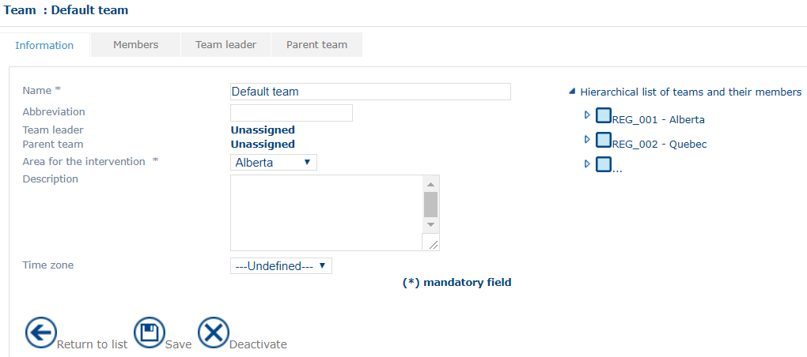

* **Identifier**: a unique reference for the team. It is read-only and assigned automatically by NFS when the team is created.
* [**External reference**](../glossary/glossary.md)
* **Name**: the name of the team. NFS uses this name each time it mentions a team, so choose a representative name. An empty string is not permitted.
* **Team Leader**: the name of the team leader. It is displayed when a team leader is designated in the **Team leader** tab.
* **Parent team**: the name of the parent team. It is displayed when a parent team is designated in the **Parent team** tab.
* **Area of intervention**: the value can be _Non-assigned_ or a saved area.
* **Description**: free text describing the team.
* **local time zone**: the time zone to which the team is affiliated.


To choose members that belong to different areas, choose _Non-assigned_ in **Area of intervention**.


#### Members tab

The list of members displays the **Last name**, **First name** and **Mission sector** of the team members.

You can add and delete members by clicking the  and  buttons (see [General Principles](generalprinciples.md)).

Click  to display the list of resources that are not yet assigned to the team and that work in the area to which the team is affiliated.

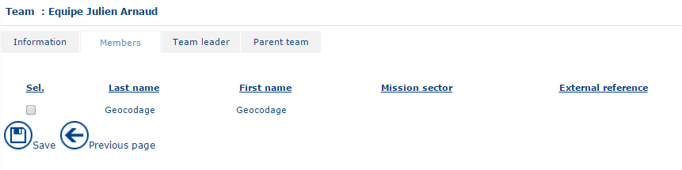

#### Team leader tab

Assigning a team leader is not mandatory.

To add a team leader, select a member in the drop-down list and click **Save**.

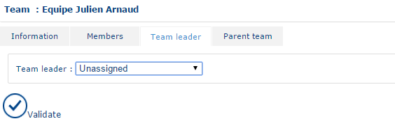

#### Parent team tab

Assigning a parent team is not mandatory.

To add a parent team, select a team in the drop-down list and click **Save**.

For example, a regional team acts as the parent team of "simple" teams, and itself has a parent team, the national team.

## Domain

A domain is a grouping of areas. You can create, consult and edit a domain. For the general procedures, see [General Principles](generalprinciples.md).

### List of domains

To open the list of domains, click the **Domain** link in the menu of the **Company data** dialog.

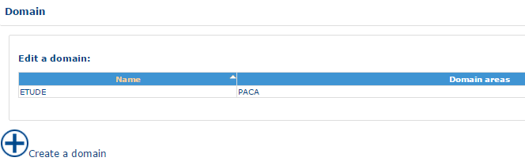

### Domain form

The domain form is made up of two blocks.

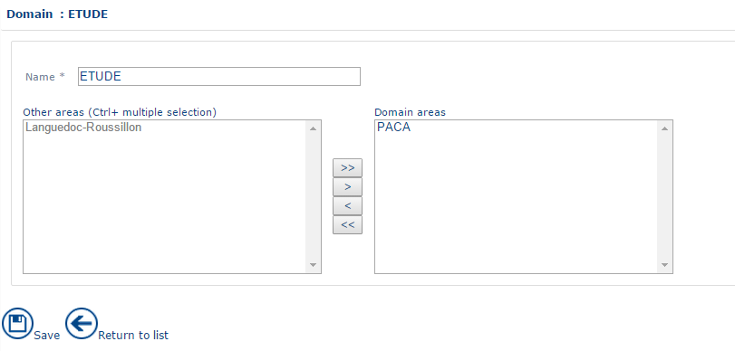

* To associate an area with a domain, select the area in the **Other areas** block and click `>`. Click `>>` to move all the areas.
* To withdraw an area from a domain, select the area in the **Areas of the domain** block and click `<`. Click `<<` to move all the areas.

## Area

An area is the representation in NFS of the geographic zone or zones in which each team resource intervenes to perform appointments. Areas of intervention are established from a list of towns. Towns are assigned to an area through a sector, using the Geoconcept mapping tool. A resource cannot perform an appointment outside its area.


An area can be linked to several teams. Under normal circumstances, it includes at least one team. An area is broken down into sectors. A sector cannot depend on just one area. Areas are disparate entities.


You can create, consult, duplicate or deactivate an area. For the general procedures, see [General Principles](generalprinciples.md).

### List of areas

To open the list of areas, click the **Area** link in the menu.

You can filter the list of areas by domain.

### Form for an area

The area form has the following tabs: **Information**, **Teams**, **District**, **Town**, **Worksites** and **Resources**.

#### Information tab

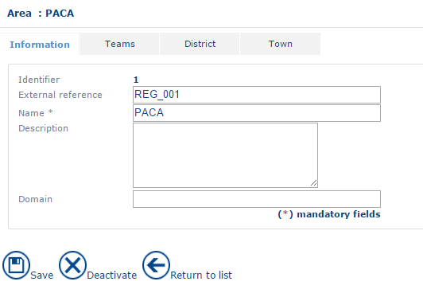

* **Identifier**: the unique identifier of the area. It is read-only and determined automatically by NFS when the area is created.
* [**External reference**](../glossary/glossary.md): the external reference of the area.
* **Name**: the name of the area. You must enter an area name.
* **Description**: free text describing the area.
* **Domain**: the name of the domain the area is affiliated to.
* **local time zone**: the time zone to which the area is affiliated.

#### Teams tab

You can add and delete teams by clicking the  and  buttons (see [General Principles](generalprinciples.md)).

Click the  button to display the list of all teams that are not already assigned to an area.

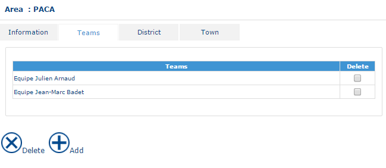

To unassign teams from the area, select them in the list and choose the **Delete** command.

#### District tab

This tab lists the administrative departments that make up the area. Each administrative department can belong to only one area.

This section is for information only. It is determined automatically by the existing joins in the NFS database. Towns are assigned to a sector, and several sectors are assigned to an area of intervention. The list of sectors attached to an area is returned when you establish the list of sectors from the area of intervention link in the Sector entity.

#### Town tab

This tab lists the towns that make up the area. Each town can belong to only one area. The list comes from the Geoconcept mapping application and is described in the documentation about sectorization.

## Worksite

A worksite is the representation of a site shared by several resources: an agency, a depot, a retail outlet, and so on. It is not the same as a sector, which is a domain of intervention that can be geographic or a business domain.

You can create, consult or duplicate a worksite. For the general procedures, see [General Principles](generalprinciples.md).


The customer must be affiliated to the same worksite as the resource for the resource to be able to perform the intervention for this customer.


### List of worksites

To open the list of worksites, click the **Worksite** link in the menu of the **Company data** dialog.

You can filter worksites on:

* **Area**: the area of affiliation of the worksite.
* **Type**: the type of worksite (agency, standard or sector).

### Worksite form

The worksite form contains the following information:

* **Identifier**: the unique identifier of the worksite. It is read-only and generated automatically by NFS.
* [**External reference**](../glossary/glossary.md): the external reference of the worksite.
* **Name**: the name of the worksite. This information is mandatory.
* **Type**: the type of worksite. It can be _Agency_ or _Standard_.
* **Description**: free text describing the worksite.
* **Area**: this information can be deduced from the post code of the worksite. When you create a worksite, you can choose the area of affiliation in the list.
* **Local time zone**: the time zone of the worksite.
* **Address**: see the chapter about address fields.
* Geocoding information: the result of geocoding the worksite, displayed as **X Coordinate** and **Y coordinate**. These items are read-only.


When resources have no start address, NFS uses the address of the worksite to which they are affiliated as the start point of routes.


## Sector (or Intervention sector)

A sector is the representation in NFS of the geographic zone or zones in which each resource must intervene as a priority to fulfill an appointment.

You can create, consult, duplicate or deactivate a sector. For the general procedures, see [General Principles](generalprinciples.md).

### List of sectors

To open the list of sectors, click the **Sector** link in the menu.

The interface first offers to consult the sectors that belong to a single area. Choose an area in the drop-down list to display the list of associated sectors.

### Form for a sector

The sector form has the following tabs: **Information**, **Address**, **Towns** and **Resources**.

#### Information tab

* **Identifier**: the unique number attributed to each sector.
* **External reference**: the external reference of the sector.
* **Name**: the name of the sector.
* **Colour**: gives the sector a custom color in the plannings.
* **Area**: the area to which the sector belongs. A sector is always included in an area.
* **Function**: the function in this sector.
* **Description**: free text about the sector.

#### Address tab

See the address fields section of this documentation.

#### Towns tab

This tab lists the towns that make up the sector.

* To add a town, click **Validate address**, then click .
* To delete a town, click .

For the general procedures, see [General Principles](generalprinciples.md).


In France, some towns have the same post code and some towns have several post codes. To be sure to add the right town, use the government-assigned one (which contains the INSEE code).



Each town can belong to only one sector.


#### Resources tab

This tab lets you view the resources that use the sector as their main or secondary sector (see the resource form in [Human resource](companydata.md#human-resource)).

* **Resource**: the first name and surname of the resource.
* **Start date** and **End date**: the start and end dates of the assignment of the resource to this sector.
* **Preference**: the preference, out of 100, of the resource for the sector.

## Unavailability type

The interface offers the full list of unavailability types known to NFS. An unavailability lets NFS take into account, in the plannings of human resources, events such as holidays, a prolonged business trip or a meeting. When a resource is unavailable, NFS does not propose any appointment for this resource during that period.

You can create, consult, edit, duplicate or deactivate an unavailability type. For the general procedures, see [General Principles](generalprinciples.md).

### List of unavailability types

To open the list of unavailability types, click the **Unavailability type** link in the menu.

You can filter the list of unavailability types by area of affiliation.

### Unavailability type form

The form of an unavailability type has one tab. It shows the following data:

* **Identifier**: the identifier of the unavailability type. It is unique.
* **External reference**: the [external reference](../glossary/glossary.md) of the unavailability type.
* **Name**: the name of the unavailability type.
* **Colour**: gives the unavailability type a custom [color](customization.md) in the plannings.
* **Area**: the area in which the unavailability type is available. This field is required.
* **Description**: a concise description of the unavailability type.
* **Effective work**: shows whether the unavailability is counted in the working hours.
* **Multi-resources**: indicates whether this unavailability concerns several resources.
* **Localisation by default**: indicates where the resource is located during the unavailability. The source mentions four possibilities but lists three:
  * _Blank, but mandatory_: you must enter the address.
  * _At home_: the default address is the home address of the resource.
  * _On the worksite_: the default address is the address of the main worksite.
* **Default duration**: pre-fills the duration when you create an unavailability of this type.
* **Minimum duration**: a minimum duration below which the planning manager cannot enter an unavailability of this type.
* **Maximum duration**: a maximum duration above which the planning manager cannot enter an unavailability of this type.
* **Units of duration**: _minutes_, _hours_ or _days_. The units in which the durations above are defined.

## Exceptional location type

You can create, consult, duplicate or deactivate an exceptional location type (see [Objects in the Planning Module](../planning/objectsintheplanningmodule.md)). For the general procedures, see [General Principles](generalprinciples.md).

### List of exceptional location types

To open the list of exceptional location types, click the **Exceptional location type** link in the menu.

You can filter the list of exceptional location types by area of affiliation.

### Form for the exceptional location type

The form is made up of a first part and an address part. The first part shows the following data:

* **Name**: the name of the exceptional location type. It is unique.
* **Abbreviation**
* **Area**: the area in which the equipment is available. This is a mandatory field.
* **Description**
* **Allow overrun**: allows or prevents the journey time from encroaching on the exceptional location.
* **Work start time**: defines a default time for the start of the exceptional location.
* **Work end time**: defines a default time for the end of the exceptional location.

The address part is described in the "Geocoding" chapter.

## On-call duties

An on-call duty defines a time window assigned to the fulfilment of one or several given intervention types. For example, a morning assigned to fulfilling emergency interventions.

During these on-call duty time windows, NFS schedules only the interventions that correspond to the authorized intervention types.

To open the list of on-call duties, click the **On-call duties** link in the menu. You can then manage on-call duty day templates or on-call duty week templates. For the general procedures, see [General Principles](generalprinciples.md).

### On-call duty template

You can create, consult, duplicate or deactivate an on-call duty day template.

#### List of on-call duty days

To open the list of day on-call duties, click **On-call duties** > **Day template** in the menu.

You can filter the list of templates by area of affiliation and worksite. Click  to apply your choice.

#### On-call duty form

The on-call duty form has one tab. It shows the following data:

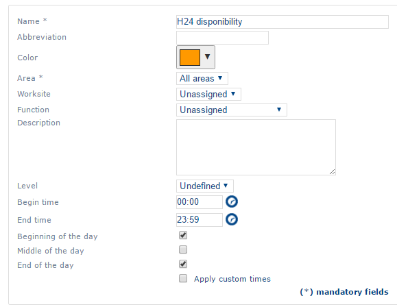

* **Name**: the name of the on-call duty. It is unique.
* **Abbreviation**
* **Colour**: customizes the color of an on-call duty in the plannings.
* **Area**: the reference area of the on-call duty. This field is mandatory.
* **Worksite**: the worksite to which the resource provides the on-call service.
* **Function**: the function with which the resource is on duty.
* **Description**
* **Level**: a priority level for the on-call duty (information field).
* **Begin time**: the start time of the on-call duty.
* **End time**: the end time of the on-call duty.
* **Beginning of the day**: indicates whether the on-call duty must be scheduled at the start of the day.
* **Middle of the day**: indicates whether the on-call duty must be scheduled in the middle of the day.
* **End of the day**: indicates whether the on-call duty must be scheduled at the end of the day.
* **Apply custom times**: when selected, you can define the on-call duty hours more precisely.

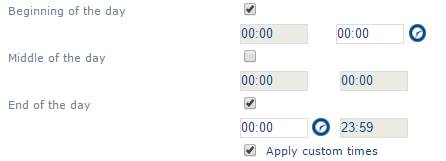

### On-call duties, week template

You can create, consult, duplicate or deactivate an on-call duty week template.

#### List of on-call duty weeks

To open the list of week on-call duties, click **On-call duties** > **Week template** in the menu.

You can filter the list of templates by area of affiliation and worksite. Click  to apply your choice.

#### On-call duties week form

The on-call duty week form has one tab. It shows the following data:

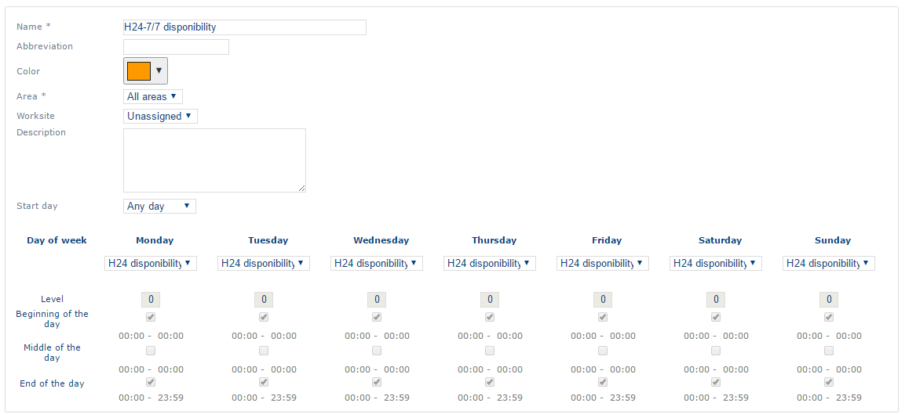

* **Name**: the name of the on-call duty. It is unique.
* **Abbreviation**
* **Colour**: assigns a custom color to the on-call duty in the plannings.
* **Area**: the reference area of the on-call duty. This field is mandatory.
* **Worksite**: the worksite to which the resource provides the on-call service.
* **Description**
* **On-call duty start day**: defines the first day on which the on-call duty applies.
* A calendar, in which each day of the week is associated with an on-call duty day template.

## Skill

Skills declare to NFS the different tasks that a human resource in the company can perform (for example TV repairs, white goods repairs, computer repairs). You confirm the skills in the **Skills** tab of the human resource form.

You can create, consult, edit, duplicate or deactivate a skill. For the general procedures, see [General Principles](generalprinciples.md).

### List of skills

To open the list of skills, click the **Skills** link in the menu.

You can filter the list of skills by area of affiliation.

### Skill form

The skill form has one tab. It shows the following data:

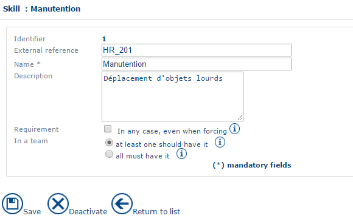

* **Identifier**: the identifier of the skill. It is unique.
* [**External reference**](../glossary/glossary.md): the external reference of the skill.
* **Name**: the name of the skill.
* **Description**: a concise description of the skill.
* **Mandatory**: when selected, an appointment that requires this skill cannot be placed in the agenda of a resource that lacks it, even in manual planning mode. When cleared, the appointment cannot be placed in [batch](../glossary/glossary.md) or real-time optimization mode, but it can be inserted in manual planning mode.
* **In a team**: for multi-resource appointments, resources can share the skills needed to perform an appointment.

## Authorization

Authorizations declare to NFS the different entitlements that a human resource in the company can hold (for example a key to the premises, a passport). You enter them in the **Authorizations** tab of the human resource form.

You can create, consult, edit, duplicate or deactivate an authorization. For the general procedures, see [General Principles](generalprinciples.md).

### List of authorizations

To open the list of authorizations, click the **Authorisation** link in the menu.

You can filter the list of authorizations by area of affiliation.

### Authorization form

The authorization form has one tab. It shows the following data:

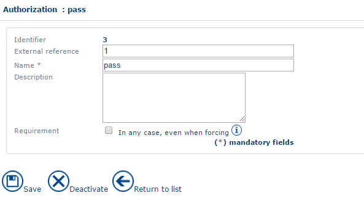

* **Identifier**: the identifier of the authorization. It is unique.
* **External reference**: a reference to the corresponding authorization described in an external application.
* **Name**: the name of the authorization.
* **Description**: a concise description of the authorization.
* **Mandatory**: when selected, an appointment that requires the authorization cannot be placed on a resource that does not have it, even in manual planning mode. When cleared, you can assign an appointment in manual mode to a resource that does not have the necessary authorization.

## Interventions group

An intervention group declares to NFS the different business activities of the company (for example after-sales service, installation, quotation). An intervention group is an association of several intervention types.


The intervention group improves the legibility of the call center interface when an appointment is taken.


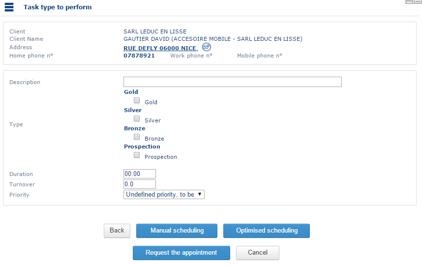

You can create, consult, duplicate or deactivate an intervention group. For the general procedures, see [General Principles](generalprinciples.md).

### List of intervention groups

To open the list of intervention groups, click the **Intervention group** link in the menu.

You can filter the list of intervention groups by area of affiliation.

### Interventions group form

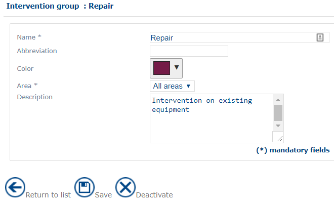

The form has the following fields:

* **Identifier**: the identifier of the intervention group. It is unique.
* **External reference**: a reference to the corresponding intervention group as described in an external application.
* **Name**: the name of the intervention group.
* **Colour**: gives the intervention group a custom color in the plannings.
* **Area**: associates the intervention group with an area. The group, and all the intervention types associated with it, are not visible in the other areas. With _All areas_, the group and its intervention types are available in every area.
* **Description**: a concise description of the group.

## Intervention type (Intervention group)

An intervention type corresponds to the task to be accomplished during the appointment (for example repairs, quotation). For each intervention type, a resource needs certain skills to be assignable to the appointment.

You can create, consult, duplicate or deactivate an intervention type. For the general procedures, see [General Principles](generalprinciples.md).

### List of intervention types

To open the list of intervention types, click the **Mission type** link located beneath the **Intervention group** item in the menu.

You can filter the intervention types by group of affiliation.

### Intervention type form

The form has the following fields:

* **Identifier**: the identifier of the intervention type. It is unique.
* [**External reference**](../glossary/glossary.md): the external reference of the intervention type.
* **Name**: the name of the intervention type.
* **Area of intervention**: associates the intervention type with an area. The intervention type is not visible in the other areas. With _All areas_, the group and its intervention types are available in every area.
* **Description**: a concise description of the intervention type.
* **Average intervention duration**: pre-fills the duration of an appointment of this type when you take the appointment.
* **Favourite days**: favors placing an appointment of this type on days for which the value is 1.
* **Skills required**: specifies the skills needed for each intervention type.

Create or modify the intervention type with the **Save** command. The **Back to the list** action cancels any modifications you made.

## Targets

You can define, by worksite, resource or function, an objective such as appointments taken, appointments fulfilled or income forecast, for a given intervention type or group.

You can create, consult, duplicate or deactivate a target. For the general procedures, see [General Principles](generalprinciples.md).

### List of targets

To open the list of targets, click the **Targets** link in the menu.

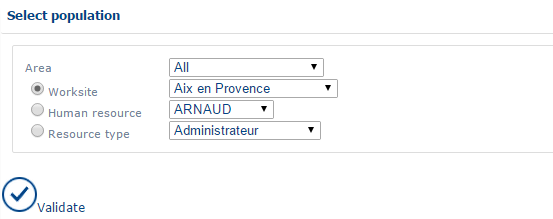

Before you consult or create a target, define the following filters:

* **Area**: the area on which the target depends.
* A **worksite**, a **human resource** or a **function**: select one in the corresponding drop-down list.

The list of targets shows the following information:

* **start** and **end** dates: the period of the target.
* **type**: the type of target.
* **intervention group**: the intervention group associated with the target.
* **type of intervention**: the intervention type associated with the target.
* **value**: the value of the target.

.png>)

### Form for a target

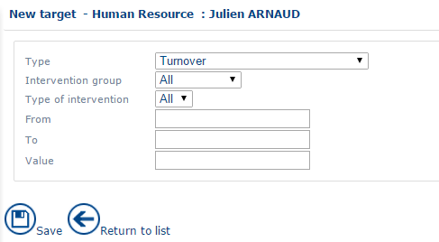

The form has the following fields:

* **Type**: the type of objective to target. The drop-down list contains the following values:
  * _Revenue or Turnover_
  * _Number of appointments taken_
  * _Number of appointments_
  * _Daily turnover_
  * _Daily number of appointments_
  * _Daily number of appointments made_
  * _Number of weekly meetings_
* **interventions group**
* **interventions type**
* **From**, **To**: the start and end date of the period.
* The value of the target.


- The turnover is visible in the weekly planning by depot, as a gauge. Appointments with a status of _Fulfilled_ and _Confirmed_ are used to compare the turnover achieved with the target.
- When a target is reached, for example a target for the number of appointments, you can no longer plan appointments of this type in [batch](../glossary/glossary.md) or real-time optimization mode.


## Follow-up

To open the activity tracking list, click the **Follow-up** link in the menu. You can then manage the completion status or the required follow-up action. For the general procedures, see [General Principles](generalprinciples.md).

### Completion status

Completion statuses are customizable statuses for appointments, used in the appointment form (see [Objects in the Planning Module](../planning/objectsintheplanningmodule.md)).


Completion statuses can communicate the progress of the operation by the resource.


#### List of completion statuses

To open the list of completion statuses, click the **Completion status** link in the menu.

You can create or deactivate a completion status.

#### Completion status form

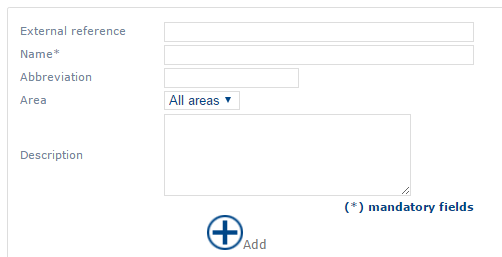

The form has the following fields:

* **External reference**: a reference described in an external application.
* **Name** (mandatory)
* **Abbreviation**
* **Area**: associates the completion status with an area.
* **Description**: a concise description.

### Follow-up actions

Follow-up actions are customizable statuses for an appointment, used in the appointment form (see [Objects in the Planning Module](../planning/objectsintheplanningmodule.md)).

To open the list of follow-ups, click **Activity tracking** > **Follow-up** in the menu.

The principle is the same as for completion statuses.


Follow-up actions can serve as a reminder of which follow-up to assign to the appointment. For example, remind the customer or send a document.


## Typology

## Calendars

### Public holidays

You can create, consult, duplicate or deactivate a public holiday. For the general procedures, see [General Principles](generalprinciples.md).


NFS never suggests an appointment on a public holiday unless the user forces it. To take appointments on a public holiday, the user needs the corresponding right (see [User Handling](userhandling.md)).


#### List of public holidays

To open the list of public holidays, click the **Public holidays** link, under the **Calendars** item, in the menu.

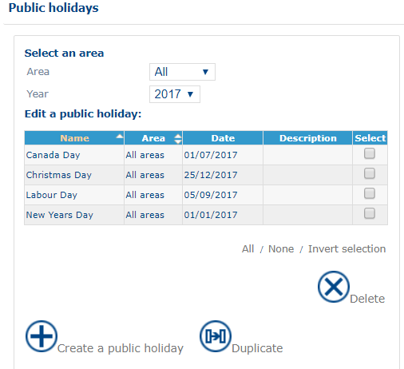

You can filter the list of public holidays by area of affiliation, for the whole year.

#### Form for a public holiday

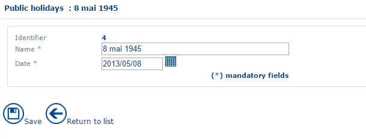

The form has the following fields:

* **Identifier**: the unique identifier of the public holiday. It is read-only and attributed by NFS when the public holiday is created.
* **Name**: the name of the public holiday. This information is mandatory.
* **Area**: the area of affiliation of the public holiday.
* **Worksite**: the worksite for which the public holiday is defined.
* **Date**: the date of the public holiday. This information is mandatory and must be in the format `DD/MM/YYYY` (for example, `02/03/2014` for 2 March 2014).

### Day template

Use the day template to define typical days. You can use them to:

* create standard weeks that you can use in the resource form (see [Week template](companydata.md#week-template));
* assign days for which the working hours differ from the usual hours in the **Typical week** tab of the resource form.

You can create, consult, duplicate or delete a day template. For the general procedures, see [General Principles](generalprinciples.md).

#### List of day templates

To open the list of day templates, click the **Day template** link, under the **Calendars** item, in the menu.

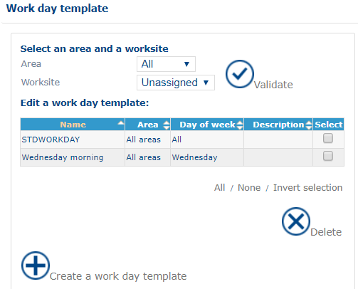

You can filter the list of templates by area of affiliation and worksite. Click  to apply your choice.

#### Day template form

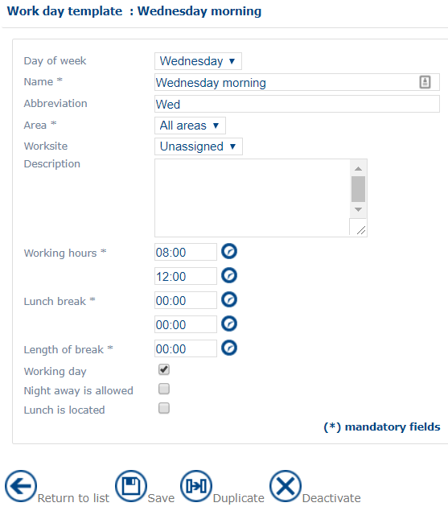

The form has the following fields:

* **Identifier**: the unique identifier of the day template. It is read-only and attributed by NFS when the day template is created.
* **Day of the week**: the day on which the day template can be based. If you select _All_, the template can be applied to any day of the week.
* **External reference**: the [external reference](../glossary/glossary.md) of the day template.
* **Name**: required.
* **Area**: the area in which the template is available. This field is required.
* **Worksite**
* **Working hours**: mandatory. Defines the start and end times of the working day.
* **Lunch break**: mandatory. Defines the earliest start time of the lunch break and the latest end time of the break.
* **Lunch break duration**: mandatory.
* **Worked day**: select it if the resource works on this day.
* **Possible night away**: select it if the resource can fulfill a night away on this day.


The external reference is notably used to assign a particular type of working day to a resource.


### Week template

Use the week template to define typical weeks. You can use them to:

* assign the same typical week to several resources without configuring each day one by one, in the **Typical week** tab of the resource form;
* assign weeks for which the working hours differ from the usual hours in the **Typical week** tab of the resource form.

You can create, consult, duplicate or delete a week template. For the general procedures, see [General Principles](generalprinciples.md).

#### List of week templates

To open the list of week templates, click the **Week template** link, under the **Calendars** item, in the menu.

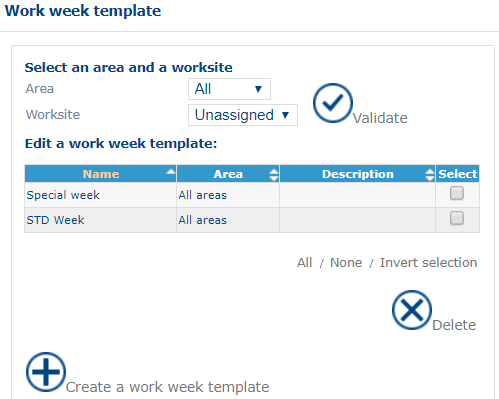

You can filter the list of templates by area of affiliation and worksite. Click  to apply your choice.

#### Week template form

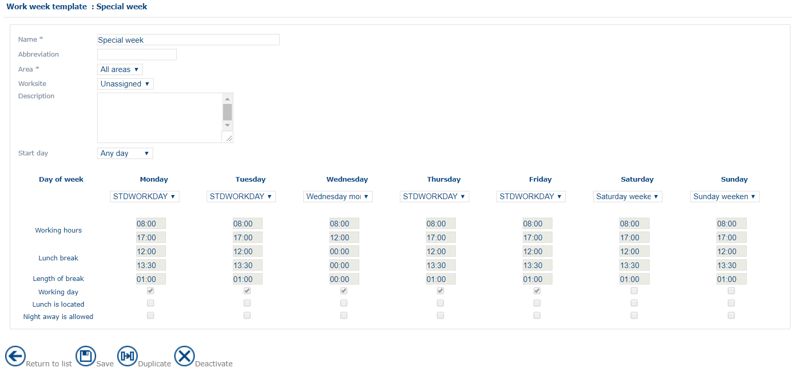

Use the drop-down lists to select a day template for each day of the week, from the saved day templates (see [Day template](companydata.md#day-template)).

You cannot modify the other fields. They are described in [Day template form](companydata.md#day-template-form).

### Sales period

A sales period declares to NFS the timespans during which [batch optimization](../glossary/glossary.md) is possible in the configuration of the optimization (see [Optimisation](optimisation.md)).


You can use this function, for example, for a company that wants to configure a regular batch optimization from the first Monday of the month to the last Friday of the month.


You can create, consult or duplicate a sales period. For the general procedures, see [General Principles](generalprinciples.md).

#### List of sales periods

To open the list of sales periods, click the **Period of sale** link in the menu.

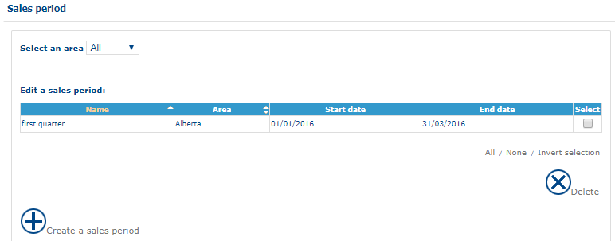

You can filter the list by area.

#### Form for a sales period

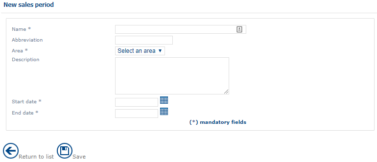

The form has the following information:

* **Identifier**: the unique identifier of the sales period. It is attributed automatically when you create a new sales period.
* [**External reference**](../glossary/glossary.md): the external reference of the sales period.
* **Name** (mandatory field): the name of the sales period.
* **Area** (mandatory field): the area to which the sales period applies.
* **Description**: a concise description of the sales period.
* **Start date** (mandatory field): the start date of the sales period.
* **Finish date** (mandatory field): the end date of the sales period.
