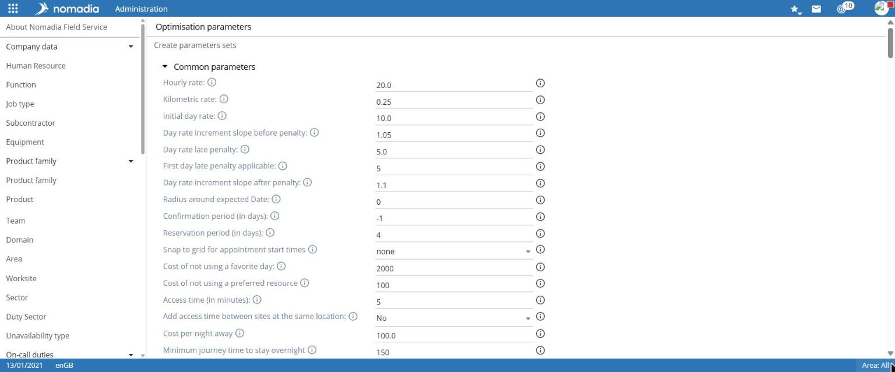
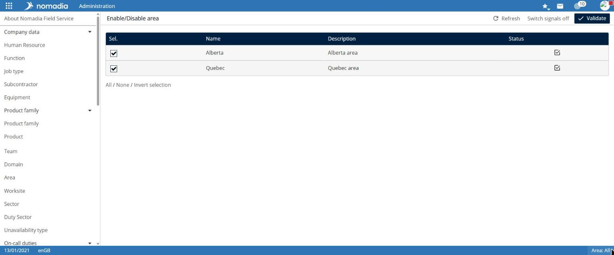

# Configure optimization

The **Optimization** group includes settings for Nomadia Field Service optimization engines:

* **parameter profiles**, which express the costs and constraints considered;
* **optimization scheduling**, which defines when and for which scope an optimization runs;
* **area activation**;
* **exporting and importing** a global optimization.

## Before you begin

These settings change optimization results for every affected area. Have each change validated by the configuration owner, and test it over a limited period.

## Access the feature

| Entry                         | Navigation                                                      |
| ----------------------------- | --------------------------------------------------------------- |
| Optimization parameters       | `Administration > Optimization > Optimization parameters`       |
| Optimization scheduling       | `Administration > Optimization > Optimization scheduling`       |
| Activate/Deactivate an area   | `Administration > Optimization > Activate/Deactivate an area`   |
| Import/export an optimization | `Administration > Optimization > Import/export an optimization` |

## Edit a parameter profile

1. Open **Optimization parameters**.
2. Under **Select the parameter profiles to view/edit**, select the relevant profile or profiles.
3. Open the required section:
   * **Parameters shared by the various optimization modes**;
   * **Parameters for real-time optimization**;
   * **Parameters for batch optimization**.
4. Edit the values. The information icon on each row displays parameter help.
5. Select **Save**.

Common parameters include **Hourly cost**, **Kilometer cost**, **Initial cost of the day**, **Late penalty**, **Confirmation delay (in days)**, **Reservation delay (in days)**, **Cost of a non-favorite day**, **Cost of a non-favorite resource**, **Cost of a night away from home**, and **Minimum travel duration to justify an overnight stay**.

The **Global changes** row lets you **Change all parameters of** one profile **using as a model** another profile, then **Save**.

## Schedule an optimization

The **Optimization scheduling** page contains the following tabs:

| Tab                   | Content                                                                                                                        |
| --------------------- | ------------------------------------------------------------------------------------------------------------------------------ |
| **Service**           | Optimization service status, ongoing optimizations, and available optimizations, with a **Start** button for each optimization |
| **Optimization**      | List of scheduled optimizations, with **Create an optimization** and **Delete** buttons                                        |
| **Trigger event**     | List of events (**Name**, **Detail**, for example a daily schedule), with **Create a trigger event** and **Delete** buttons    |
| **Activation period** | List of activation periods, with **Create an activation period** and **Delete** buttons                                        |
| **Remote server**     | Optimization servers, with their **Priority level**, **Type**, and **Status**                                                  |
| **Journal**           | Search the optimization journal by **Result**, **Area**, **Name**, and **Period**                                              |
| **Viewer**            | Viewer tab                                                                                                                     |

In the **Service** tab, the **Possible manual optimizations** area offers **Filter resources**, **Choose a new interval**, **Choose a new duration**, and **Choose the heuristic** before starting an optimization with **Start**.

### Create a scheduled optimization

The **Optimization** tab lists scheduled optimizations with their **Name** and **Area**.

1. In the **Optimization** tab, select **Create an optimization**, or select an optimization from the list.
2. Enter the **Name**, **Area**, **Worksite**, and **Optimization parameters** profile.
3. Define the **Optimization period**:
   * **From**: `t0 +` a number of days, with an **Offset** and a time, which gives `t1`;
   * **To**: `t1 +` a number of days, with an **Offset** and a time, which gives `t2`.
4. Enter the **Optimization duration** in minutes and, if needed, select **Preparation time included**.
5. Set the options: optimization engine, **Active**, **Optimization type** (**Fast** or **Total**), **Simulation**, **Generate recurring appointments before optimization**, **Generate overnight stays before optimization**, **Move visits as early as possible**, **Use sales periods**.
6. Add a **Trigger event** and, if needed, an **Activation period**.
7. Select **Save**.

According to the tooltips:

* `t1`, the period start, is calculated from the optimization trigger time (`t0`), shifted by a number of days;
* `t2`, the period end, is calculated in days from `t1`;
* when **Preparation time included** is selected, the optimization duration includes preparation time and time spent finding an optimization server; otherwise, it only includes the time spent optimizing.

## Activate or deactivate an area

The **Activate/Deactivate an area** page lists areas with their **Status**.

1. Select the areas in the **Sel.** column.
2. Select **Validate**.

The **Refresh** and **Cut signals** buttons are also available.

## Export or import a global optimization

The **Global optimization** page contains two tabs.

* **Export**: choose the **Export to** format, area, **Worksite**, **Resources**, **Optimization period**, **Optimization type**, and **Optimization model**, then select **Validate**.
* **Import**: select the file using the Folder button, then select **Update**.


The **Stop service** button in the **Service** tab stops the optimization service. Use it only with the operations manager's agreement.

