# CSV Files

## Overview

The functions in this section let you manage the data presented in this guide in the form of CSV files.

For example, instead of entering the mobile resources of the company one by one, you can import a single CSV file.

These functions also let you retrieve a data set, for example to archive it, or to modify a large quantity of data quickly. To do the latter, [export](#exporting-a-csv-file) a CSV file, modify the fields you want, and then [re-import](#importing-a-csv-file) the file.

## Importing a CSV file

To open this function, click the **Import CSV file** link under the **CSV files** item.

The interface is divided into three sections:

* a section where you define the import format, which must correspond to the format of the file to import
* a section where you select the file to import
* a **Previous result** button

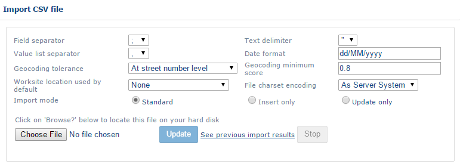

### Import format

Define the following information:

* **Field separator** – the character that separates the different columns (`,` `;` `\t` `:` `|`).
* **Text delimiter** – the character that delimits a text zone (`"` `'` or empty).
* **Separator of lists of values** – the character that separates the values in one list in a single column (`,` `;` `\t` `:` `|`). This separator must be different from the field separator.
* **Dates format** – the format of date data. By default, dates are in the format `dd/mm/yyyy` (for example, `21/03/2016`).
* **Geocoding tolerance** – the lowest geocoding quality accepted, for data that includes address fields. For the term, see [Glossary](../Glossary.md). The options are:
  * **On street number** – data for which the address does not include any street number is not imported.
  * **Exclusively on street number** – data for which the address does not include the street number is not imported.
  * **On streets** – data for which the address does not include the street name is not imported.
  * **Exclusively on streets** – data for which the address does not include the street name is not imported, and more precise addresses are placed at the middle of the street.
  * **On towns** – data for which the address does not include the town name is not imported.
* **Minimum geocoding score** – defines a minimum accepted geocoding quality. The geocoding score is complementary to the **Geocoding tolerance**.
* **Worksite used by default**
* **Charset of file encoding** – the encoding format of the file to import (**As Server System** or **utf8**).
* **Importation mode** – the mode used to import data from the file:
  * **Standard** – existing data is modified and new data is added.
  * **Insertions only** – existing data is not modified.
  * **UPDATE only** – new data is not imported.

### Import a file

1. Click the **Folder** button to select the file to import.
2. Click **Update**.

The file must include the expected columns, which correspond to the [Import/export CSV template](#importexport-csv-template).

If the file does not include the expected columns, the following error message is displayed:

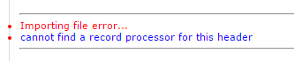

At the end of the import, an error report and a summary of the import are generated. You can download them on the same page at the end of the import. For earlier imports, click **Previous result**.


The number of days that imported files are kept on record is defined in the application settings: the `delayBeforeDeleteReports` parameter, located in application settings > **Application** > **Import date** > `import.setting`.


## Exporting a CSV file

To open this function, click the **Export a CSV file** link under the **CSV files** item.

The export of a CSV file has three parts: **Entities to export**, **CSV Formatting** and **Filtering**.

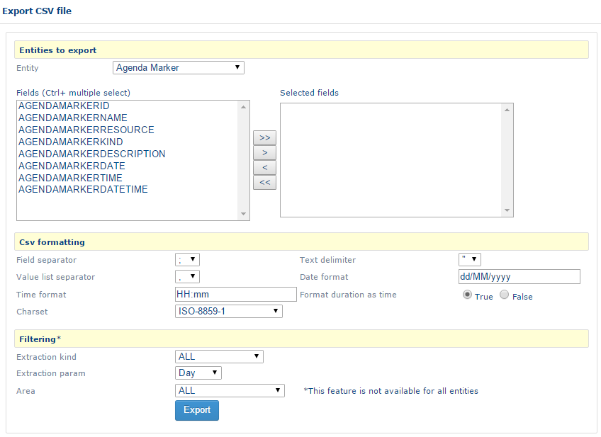

### Entities to export

This section lets you select the fields to export.

The **Entity** drop-down list contains the different types of data that you can export (for example: Customer, Appt, Human resource).

When you select a type of data under **Entity**, the **Fields** list is updated with all the fields that you can export.

* To select fields, click a field and then click the **>** button. Click the **>>** button to select all fields.
* To deselect fields, click a field in the **Selected fields** section and then click the **<** button. Click **<<** to deselect all fields.

### CSV formatting

In this section, you define the format of the exported file.

The screen contains the following information:

* **Field separator** – the character that separates the different columns (`,` `;` `\t` `:` `|`).
* **Text delimiter** – the character that delimits a zone of text (`"` `'` or empty).
* **Separator of lists of values** – the character that separates the values in one list in a single column (`,` `;` `\t` `:` `|`). This separator must be different from the field separator.
* **Date format** – the format of date data. By default, dates are in the `dd/mm/yyyy` format (for example, `21/03/2016`).
* **Time format** – the format of time data. By default, times are in the `hh:mm` format (for example, `01:15`).
* **Format the duration as a time**
* **Charset** – the encoding format of the file (**As Server System** or **utf8**).
<!-- REVIEW: source describes the export "Charset" as the encoding format "for the file to import" -->

### Filtering

In this section, you filter the data to export.

The screen contains the following information:

* **Type of extraction** – the quantity of data to export: all (`ALL`) or the latest modified (`LASTUPDATED`).
* **Extraction parameter** – `Day`, `Week` or `Minute`. This applies only with the `LASTUPDATED` type of extraction.
* **Area** – the area of affiliation of the entity.

When you have filled in the fields, click **Export** to export the data.

## Global CSV import/export

This function lets you export and import all the application data in one go.

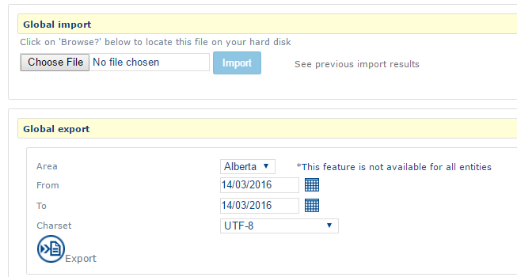

The first part (global import) imports all elements from the repository.

1. Select a data file on your computer.
2. Click **Import**.


The file to import must be a `.zip` file that contains the `.csv` files to import. See [Importing a CSV file](#importing-a-csv-file).


The second part exports all the application data. To configure the export:

1. Choose the **area** to export.
2. Choose the **dates** of the elements to export.
3. Choose the character format.
4. Click **Export**.

A `.zip` file that contains all the application files is generated.

## Import/export CSV template

This section has two parts:

* A summary page that gives access to the different object templates.
* A section that contains the list of fields in the template.

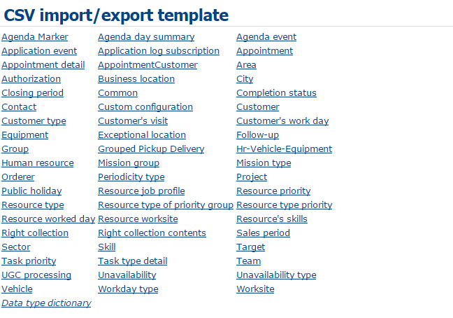

Click a link in the summary to go to the corresponding object. The last link in the summary, **Dictionary of the data types**, goes to the Type section.

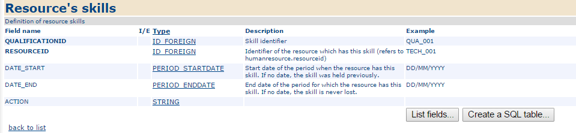

Each field is described by the following information:

* **Fieldname** – the name of the field as it must appear in the imported files.
* **I/E** – whether the field is available only on import (`I`) or only on export (`E`). If this column is empty, the field is available on both import and export.
* **Type** – the type of data (ID, STRING, etc.). Click a type of data to go to the **Dictionary of types of data** section at the end of the page.
* **Description** – the description of the field.
* **Example**
* **By default** – the default value, used if the field is empty.


The fields in bold are mandatory.


The Type section has the following columns:

* **Type name** – the name in the application.
* **Single type** – the standard name (in a DBMS).
* **Family** – the family name in the application.
* **Super type** – the name of a type cluster in the application.
* **SQL format** – another standard name (in a DBMS).
* **Description** – the description of the type.

## Circulation listeners

You can run certain flow modules from this interface. They are defined inside the flow files. See [Flows file](#flows-file).

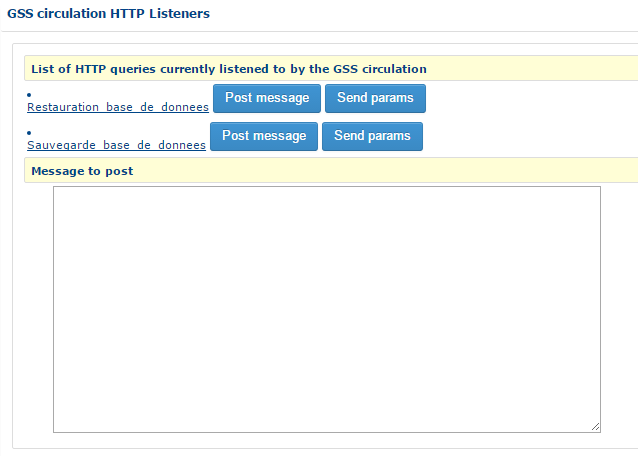

To run an action, click the HTTP link in the list. Some actions require parameters. In this case, fill in the **message to send** part and click the **Post message** or **Send params** link.

## Predefined export links

The predefined export links are created in the circulation. See [Flows file](#flows-file).

A predefined export link performs a predefined action. For example, it can execute a script in a database, import data or save the database.

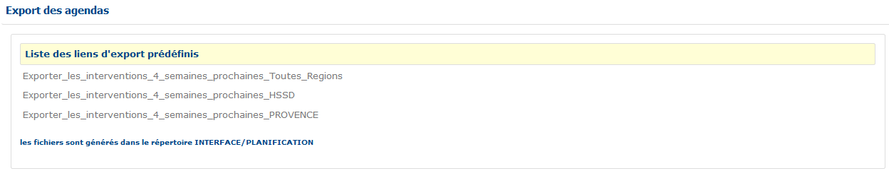

## Specific files

### Export of TomTom POI

Use this points of interest (POI) export function to export data in `.ov2` format.

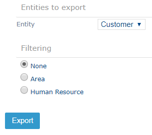

1. Choose the **entity** to export from the drop-down list.
2. If needed, filter the export on **Area** or on **Human resource**. Select the corresponding option button, and then choose the area or human resource in the drop-down list that is displayed.
3. Click **Export**.

The **Export** button creates a file in `.ov2` format.

### Export of Masternaut POI

This page works in the same way as [Export of TomTom POI](#export-of-tomtom-poi).

The **Export** button creates a file in `.txt` format.

### Export of Garmin POI

This page works in the same way as [Export of TomTom POI](#export-of-tomtom-poi).

The **Export** button creates a file in `.gpx` format.

### Export of KML POI

This page works in the same way as [Export of TomTom POI](#export-of-tomtom-poi).

The **Export** button creates a file in `.kml` format.

## Export to OT Strategic

Use this function to export a file for the Strategic module.

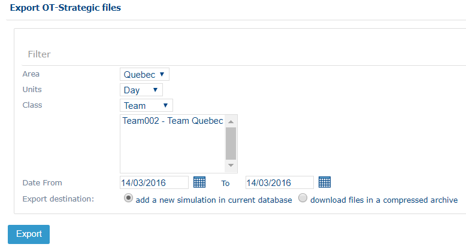

On this page, you filter the export, which has the smoothing module (Strategic) as its destination, on an **Area**, a **Unit** (time unit for the base display perimeter), a **Class** (organizational unit for the base display perimeter) and a **Period**.

The **Export** button creates a new simulation in the current database, as a `.zip` compressed archive of files in `.csv` format. For the simulation, see the Strategic module.

## XML files

A group of parameters and data is defined in a series of external XML files. The administrator can modify these files locally and then send them to the application server so that the application takes them into account.


If you are not sure which method to use to modify one of the files described in this section, contact the GEOCONCEPT support team.


### Basic principles

The XML file functions are **Download** and **Update**.

**Download** retrieves the configuration file located on the application server.

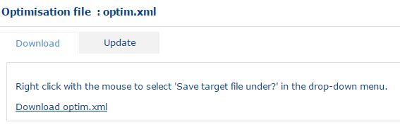

**Update** updates the configuration file located on the application server.

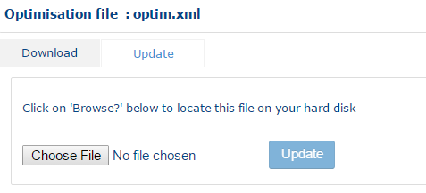


Certain parameters require you to restart the application for the update to take effect. Contact your NFS administrator to perform this kind of update.


### Optimization file

To open this function, click the **Optimisation file** link under the **XML files** item.

This file, called `optim.xml`, contains optimization parameters that you can also modify from the interface. See [Optimization](optimisation.md).

You can download and update it. See [Basic principles](#basic-principles).

### Flows file

To open this function, click the **Flow file** link under the **XML files** item.

This mode is reserved for administrators who configure exchanges of XML files between NFS and an external application. The flow principle is explained in the relevant documentation.

In addition to download and update (see [Basic principles](#basic-principles)), you can view the file in schema form on the **View** tab.

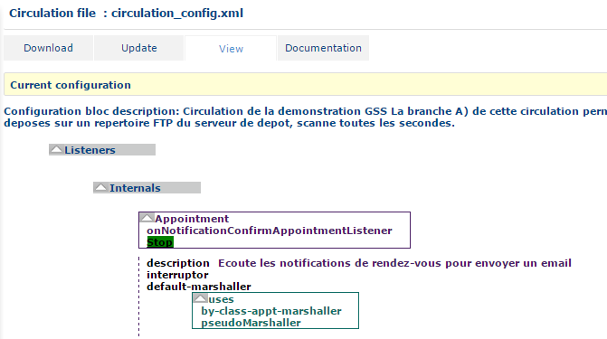

The **Documentation** tab gives a link to the associated documentation.

Certain calculations include calls to functions via HTTP links available in the application. See [Circulation listeners](#circulation-listeners).

### XML customization file

To open this function, click the **Customisation file** link under the **XML files** item.

This mode is reserved for administrators who want to customize how the application works.

You can download the file and update it through an import operation. See [Basic principles](#basic-principles).
