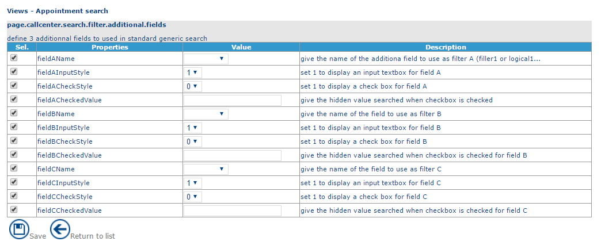
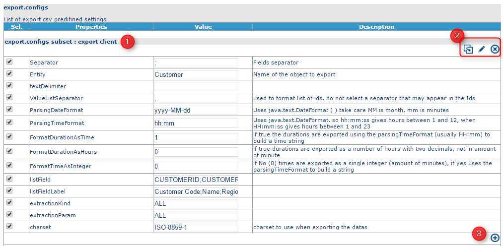
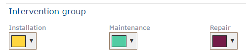
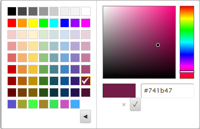

# Customization

## Overview

Parameters are organized in groups, distributed over the following tabs:

* **VIEWS** – manages parameters relating to views.
* **DISPLAY** – manages parameters relating to display.
* **OPTIMIZATION** – manages parameters relating to optimization.
* **APPLICATION** – manages global application parameters, such as the **NFS Mobile** parameters.
* **MY\_ACTIONS** – manages parameters relating to customized actions.
* **OTHERS** – manages other parameters.

Click **Save** to save the parameters in the database.


These parameters influence the general behavior of the application (imports, optimizations, interface, etc.). Handle them with care.


## Modify a parameter

1.  On the page of parameter groups, click a line to display the list of associated parameters.

    
2. Select the parameter to modify in the first column.
3. Modify the **Value** field.
4. Click **Save**.

The columns of the list are:

* First column – select a parameter to modify.
* **Properties** – the name of the parameter.
* **Value** – the value of the parameter. You can modify it.
* **Description** – a description in English of the behavior of the parameter.


Parameters that are not selected (check box cleared in the first column) use the value defined in the `custom.xml` file. See [CSV Files](csvfiles.md).



In earlier versions of the application, these parameters were contained in the `custom.xml` file. See [CSV Files](csvfiles.md).


### Configurable fields

Some parameters can be customized. For example, export parameters:

1. Name of the predefined export.
2. Buttons to:
   * duplicate the predefined export
   * modify the name of a predefined export
   * delete the predefined export
3. Add a parameter.

## Colors

This section lets you define colors for items in the planning. See [The Planning](../planning/theplanning.md).

To modify a color:

1. Click the color to modify.
2. Choose the color, either by selecting it or by entering its HTML code in the right-hand section. To access this option, click the **>** button.
3. Click **Save**.

The colors are then visible in the planning. See [The Planning](../planning/theplanning.md).

For example: intervention groups.

Here, the repair intervention group is displayed in purple and the installation intervention group in yellow. For intervention groups, see [Company Data](companydata.md).

Choosing a color:

The **Colours** function has two links that let you modify the following information.

### Referential colors


The **Area** drop-down list lets you define the different color palettes for each area. See [Company Data](companydata.md).


* Intervention groups
* Job types (see [Company Data](companydata.md))
* Functions (see [Company Data](companydata.md))
* Unavailability types (see [Company Data](companydata.md))
* Day templates (see [Company Data](companydata.md))
* Week templates (see [Company Data](companydata.md))
* Agenda markers (see [Objects in the Planning Module](../planning/objectsintheplanningmodule.md))
* Sectors (see [Company Data](companydata.md))
* Customer types (see [Objects in the Planning Module](../planning/objectsintheplanningmodule.md))
* Customer kinds (see [Objects in the Planning Module](../planning/objectsintheplanningmodule.md))

### Application colors

* The unavailability type (worked/non-worked)
* Appointment states (see [The different statuses for appointments in NFS](../introduction/thedifferentstatusesforappointmentsinnfs.md))
* The other elements in the planning, such as night away, lunch break, holidays and journey
* The color of the band (see [The Header Bar](../guided-help-nfs-reference-guide-1/))
