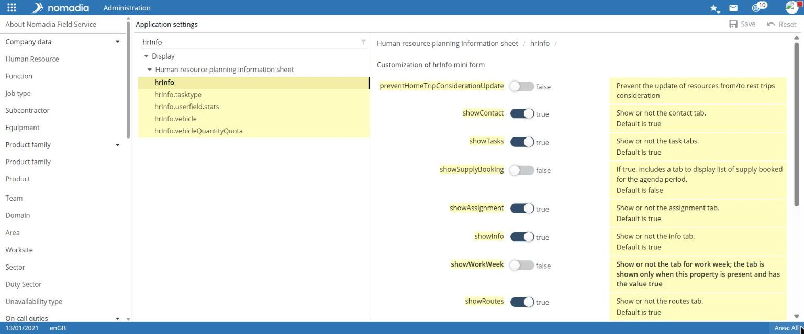
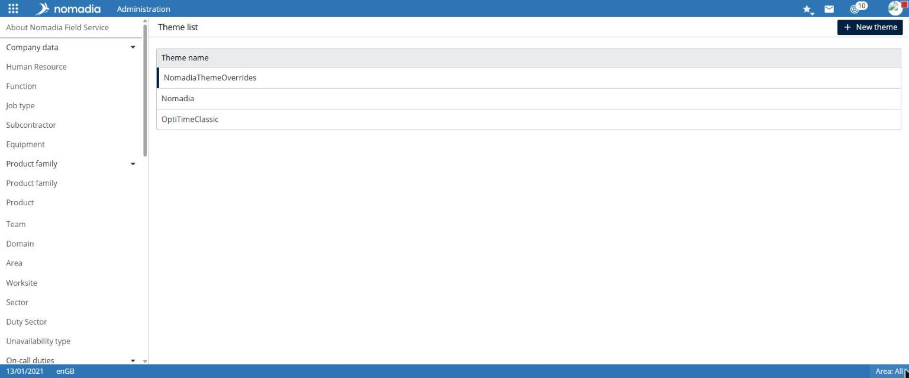
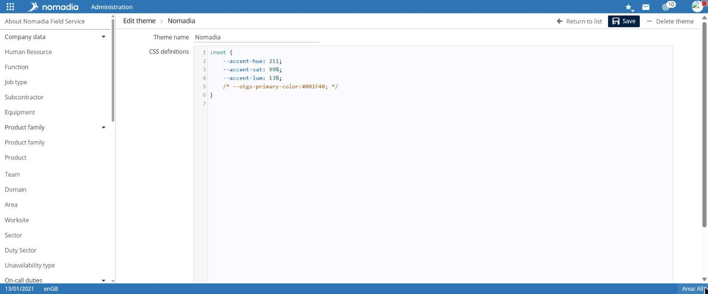
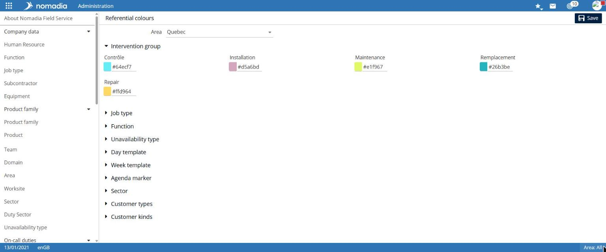
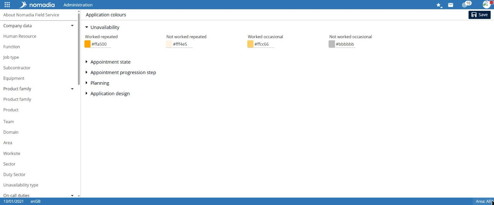

# Customize the application

The **Customization** group adapts the application to your organization: operating settings, displayed labels, graphic themes, and colors.

## Before you begin

These settings apply to all users. Record a setting's original value before changing it.

## Access the feature

| Entry                     | Navigation                                                        |
| ------------------------- | ----------------------------------------------------------------- |
| Application configuration | `Administration > Customization > Application configuration`      |
| Labels                    | `Administration > Customization > Labels`                         |
| Themes                    | `Administration > Customization > Themes`                         |
| Reference data colors     | `Administration > Customization > Colors > Reference data colors` |
| Application colors        | `Administration > Customization > Colors > Application colors`    |

## Change an application setting

1. Open **Application configuration**.
2. Enter part of the setting name in the filter field at the top of the tree.
3. In the tree, select the settings group. Items matching the filter are highlighted.
4. In the right pane, change the value. The help displayed beside each setting describes its effect and possible values.
5. Select **Save**.

The **Reset** button is available next to **Save**.


A changed setting affects the entire application. Change only settings whose effects you understand, and test the result.


## Download and update labels

The **Label Files** page has two tabs.

* **Download**: each label file (`.properties`) is listed with the **Download label file** button.
* **Update**: select the changed file with the Folder button (**Choose a file…**), then select **Update**.

## Manage themes

The **Theme List** page displays the **Theme Name** of each theme.

1. Select **New theme**, or select a theme from the list.
2. Enter the **Theme Name**.
3. Enter the **CSS Definitions** in the editor.
4. Select **Save**.

On the **Edit theme** page, the **Delete theme** button deletes the displayed theme.

## Change reference data colors

The **Reference data colors** page assigns a color to each company data item. Items are grouped into collapsible sections: **Task group**, **Job type**, **Resource type**, **Unavailability type**, **Day template**, **Week template**, **Milestone**, **Sector**, **Customer Types**, and **Customer Categories**.

1. Filter by **Region** if needed.
2. Open the relevant section.
3. Choose the color with the picker, or enter its hexadecimal code, for example `#2944a3`.
4. Select **Save**.


Loading this page can take several seconds.


## Change application colors

The **Application colors** page defines common display colors in four sections:

* **Unavailability**: **Recurring working**, **Recurring non-working**, **One-time working**, **One-time non-working**;
* **Appointment status**: one color per status, such as **Scheduled**, **Confirmed**, **Completed**, or **Abandoned**;
* **Schedule**: travel time, public holiday, lunch break, non-working hours, days of the week, appointment markers…;
* **Application appearance**: **Banner**.

Select **Save** to apply the changes.
