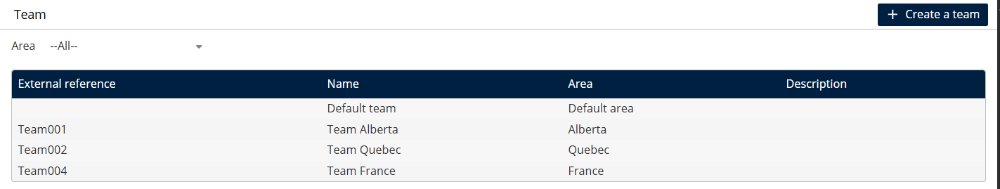
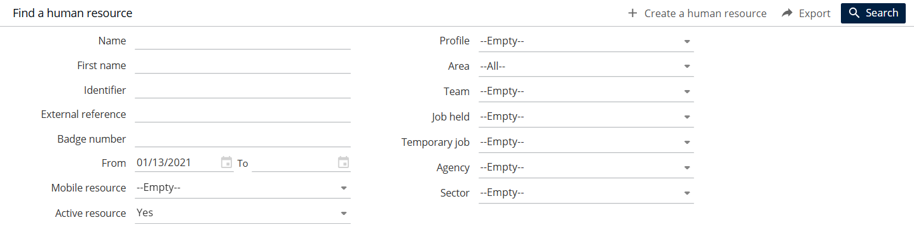
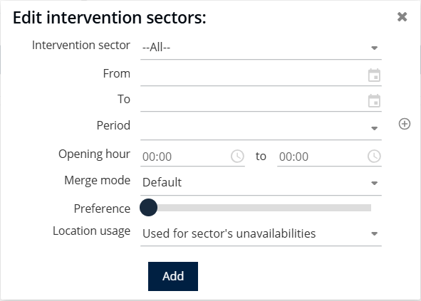
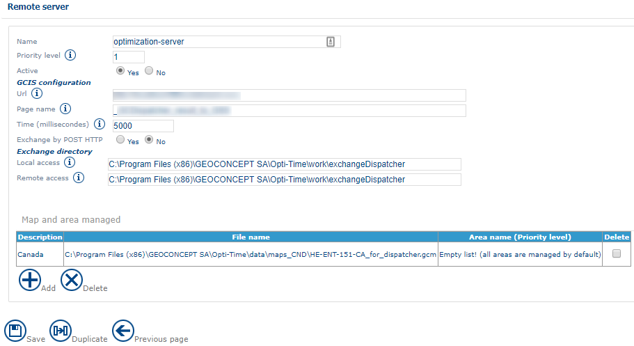
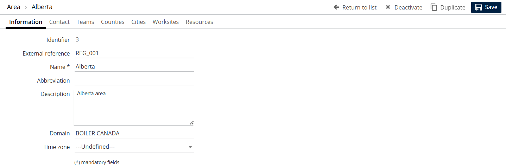
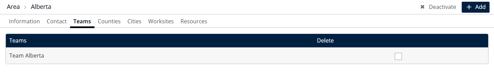
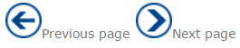

# General Principles

## Overview

Administration module data are presented in the same way:

* A home page gives access to records and functions.
* A form contains the information relating to the data item you are viewing.


Access to data, and the actions you can apply in the form of a data item, depend on your access rights. See [User Handling](userhandling.md).


## Data home page

The data home page contains the list of records present in the database.

The data in the list correspond to fields in the data item form. The definition of these fields is therefore given in the **form** part of the corresponding topic.

The list can contain a header that you use to restrict its display. For example, filtering on teams:

In some cases, a preliminary search screen shows different filters that restrict the list display. For example, searching for human resources:

The  button opens the list of filtered data.

From this list, you can:

* create a new data item
* consult or modify an existing data item
* delete or deactivate a data item

## Data form

The form contains the saved information associated with the data item.

At the top of the screen, the record you are editing is displayed. In the example below, the type of role is "Controller".

For example: modifying a type of post.


Mandatory fields are indicated by a star.


To save a data item, click the  button at the bottom of the form.


When you save a data item, a unique identifier is created automatically. It cannot be modified afterwards. Only the external identifier can be modified via the interface.


From the data item form, you can:

* delete or deactivate the data item (see [De-activating / deleting a data item](generalprinciples.md#de-activating--deleting-a-data-item))
* duplicate the data item (see [Duplicating a data item](generalprinciples.md#duplicating-a-data-item))

## Create a new data item

At the bottom of the data list, click the  button to enter a new data item. The application displays a blank creation form.

For example: creating a new team.

## Consult or edit an existing data item

Click a line in the data list to open the form of the corresponding data item. You can then edit it.

When you create or consult a data item whose form has several tabs, the first tab of the form is displayed.

## Adding data

Some data items require you to add extra fields. For example, you can add extra intervention sectors to the resource's existing sectors of affiliation.

1. Fill in the complementary data required.
2. Click **Add**.

For example: adding a secondary intervention sector.

## Duplicating a data item

In certain cases, you can duplicate a data item.

1. In the form of the data item, click **Duplicate**.
2. Click  to save the new data item.

For example: duplicating a planning server.


Give the duplicated object a different external reference. Otherwise, it replaces, and thereby deletes, the source object.


## De-activating / deleting a data item

To delete or deactivate a data item, click  in the form of the data item.

For example: de-activating an area.

In certain cases, you can deactivate a data item from the list of records. Select the **Delete** check box and click . For example, deleting a team:

## Navigation

Navigation in the repository uses arrows:


The **Return to list** action during a modification invalidates any modifications made.


The remaining topics describe, for each data item, how to access the data, the search filters (which can vary from one data item to another) and the specifics of managing that data item.
