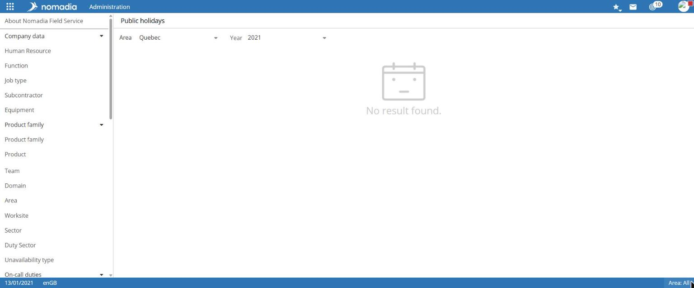
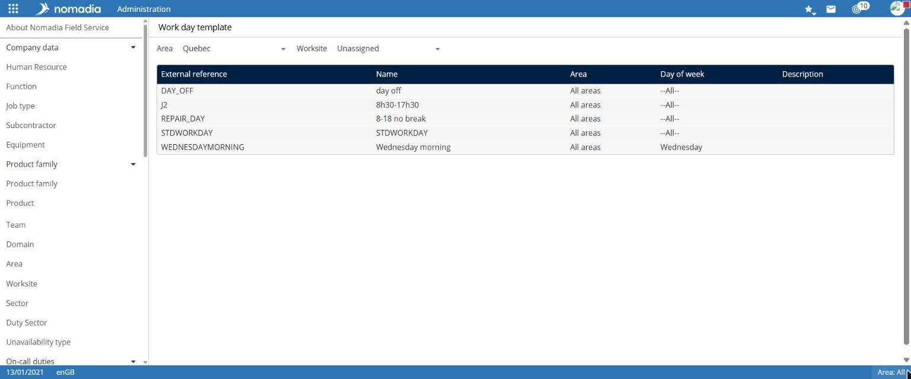
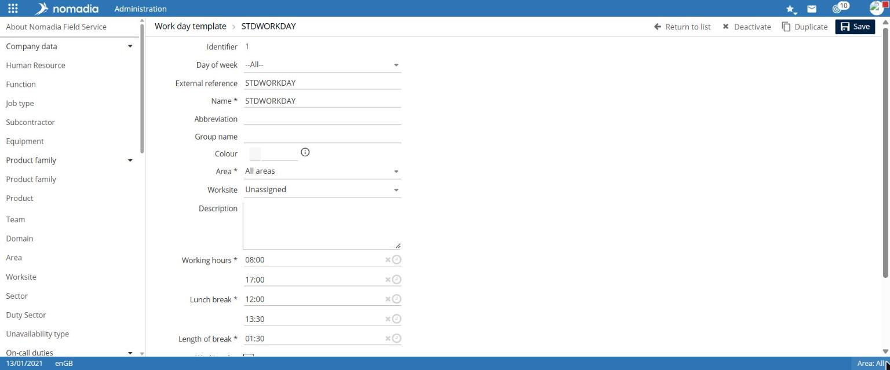
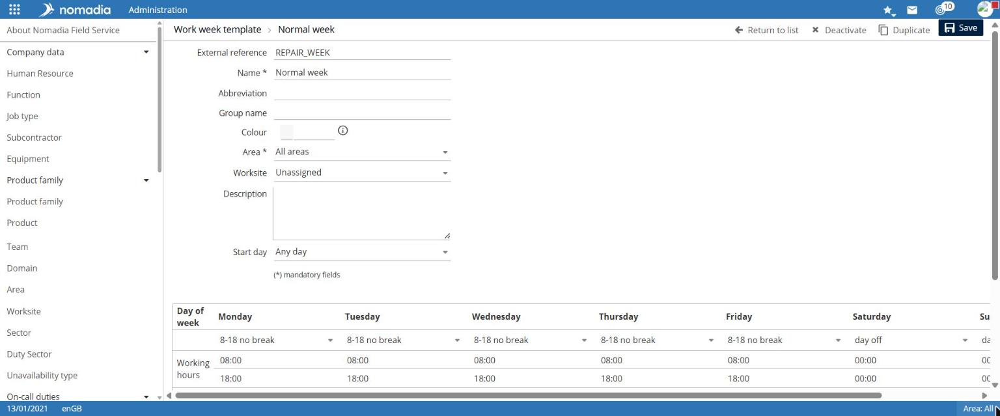

# Manage calendars

Calendars define the reference working time:

* **public holidays** for each region;
* **day templates** and **week templates** for working time, then applied to human resources, worker types, or areas;
* **sales periods**, which are named date ranges.

## Access the feature

| Entry           | Navigation                                                    | List filters     |
| --------------- | ------------------------------------------------------------- | ---------------- |
| Public holidays | `Administration > Company Data > Calendars > Public Holidays` | Region, Year     |
| Day template    | `Administration > Company Data > Calendars > Day Template`    | Region, Worksite |
| Week template   | `Administration > Company Data > Calendars > Week Template`   | Region, Worksite |
| Sales period    | `Administration > Company Data > Calendars > Sales Period`    | Region           |

## Manage public holidays

For the selected year, the list displays each public holiday's **Name**, **Region**, **Date**, and **Description**.

To create a public holiday:

1. Select **Create public holiday**.
2. Enter the **Name**, **Region**, and **Date**. If needed, enter the **Abbreviation** and **Description**.
3. Select **Save**.

According to its tooltip, **Duplicate** copies the public holidays from the displayed year to the following year.

## Create a day template

The list displays each template's **Name**, **Region**, **Day of the week**, and **Description**.

1. Select **Create workday template**.
2. Choose the **Day of the week** for the template, or `--All--`.
3. Enter the **Name** and **Region**. If needed, enter the **Abbreviation**, **Group name**, **Color**, **Worksite**, and **Description**.
4. Enter the **Working hours**, **Lunch break** range, and **Break duration**.
5. Select **Working day**, **Overnight stay away from home possible**, **Located lunch break**, **Ignore on-call duty at lunchtime**, and **Night work** as required.
6. Select **Save**.

## Create a week template

1. Select **Create workweek template**.
2. Enter the **Name** and **Region**. If needed, enter the **Abbreviation**, **Group name**, **Color**, **Worksite**, **Description**, and **Start day**.
3. In the table, select a day template for each day of the week. The selected template's hours appear in the column.
4. Select **Save**.

You can select a week template for a human resource, worker type, or area.

## Create a sales period

1. Select **Create sales period**.
2. Enter the **Name** and **Region**. If needed, enter the **Abbreviation** and **Description**.
3. Enter the **From** and **To** period.
4. Select **Save**.

## Points of attention

* Create day templates before week templates.
* The public-holiday and template lists provide **All**, **None**, and **Invert selection** links for selecting multiple rows.
