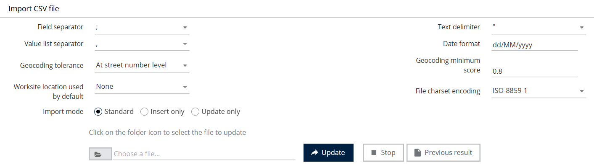
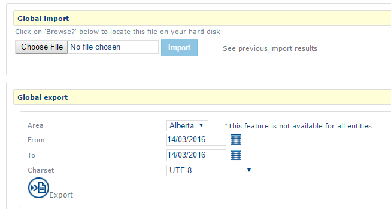
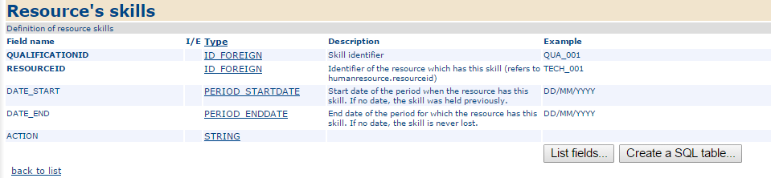

# Manage exchange files

In addition to [Import a CSV file](../imports-and-exports/import-a-csv-file.md) and [Export a CSV file](../imports-and-exports/export-a-csv-file.md), Administration provides other data-exchange tools.

## Before you start

An import changes application data. Check the file and test it with a small data set before a full import.

## Access the feature

| Entry                      | Navigation                                                |
| -------------------------- | --------------------------------------------------------- |
| Semi-automatic import      | `Administration > CSV Files > Semi-automatic Import`      |
| Global CSV import/export   | `Administration > CSV Files > Global CSV Import/Export`   |
| CSV import/export template | `Administration > CSV Files > CSV Import/Export Template` |
| Circulation listeners      | `Administration > CSV Files > Circulation Listeners`      |
| Predefined export links    | `Administration > CSV Files > Predefined Export Links`    |
| Specific files             | `Administration > Specific Files > …`                     |
| XML files                  | `Administration > XML Files > …`                          |

## Use semi-automatic import

**Semi-automatic import** runs through several steps shown by a progress bar.

1. Drop the file in the **Drop file here** area. Alternatively, choose **A file (Excel…)**, **Google Sheets**, or **Other sources** under **Import from…**.
2. Select **Next** and follow the steps.

## Import or export all data

* **Global import**: select the file with the Folder button (**Choose a file…**), then select **Update**. **Previous result** displays the last import result.
* **Global export**: select the **Area**, **From** / **To** period, and **Charset**, then select **Export**.


Global export is unavailable for some entities.


## View the CSV import/export template

The **CSV import/export template** page describes the exchange format for each entity.

1. At the top of the page, select an entity, such as **Customer**, **Appointment**, or **Human resource**.
2. Read its description and the **Exchange template fields** table: **Field name**, **I/E**, **Type**, **Description**, and **Example**.

The **Dictionary of data types** link describes used data types.

This page is also available from `Administration > Nomadia Field Service API > CSV Import/Export Template`.

## Other entries

| Entry                                                                               | Content                                                                                                                                                                    |
| ----------------------------------------------------------------------------------- | -------------------------------------------------------------------------------------------------------------------------------------------------------------------------- |
| **Circulation listeners**                                                           | Lists HTTP circulation listeners. **No listeners** appears when none are configured.                                                                                       |
| **Predefined export links**                                                         | The **Export calendars** page lists export links, such as appointments from the next four weeks for all regions or one region.                                             |
| **Specific Files > Export TomTom / Masternaut / Garmin POIs or export POIs to KML** | On **Entities to export**, choose the **Entity** and **Filtering** (**None**, **Region**, or **Human resource**), then select **Export**.                                  |
| **Specific Files > Import a GTM simulation**                                        | Set **Filling mode**, **NFS–GTM field mapping**, **Allow creation of missing sectors**, and **Allow creation of missing cities**. Select the file, then select **Upload**. |
| **XML Files > Optimization file**                                                   | Use **Download** and **Update** for the optimization-configuration file.                                                                                                   |
| **XML Files > Circulation file**                                                    | Use **Download**, **Update**, **View**, and **Documentation**. After updating, a message confirms whether the configuration is valid.                                      |
| **XML Files > Circulation examples**                                                | Lists configuration-file examples.                                                                                                                                         |
| **XML Files > Journals**                                                            | Set the **Logging level**, then select **View journals** or **Apply**.                                                                                                     |


Optimization and circulation files control application behavior. Download the current version before uploading a replacement.

