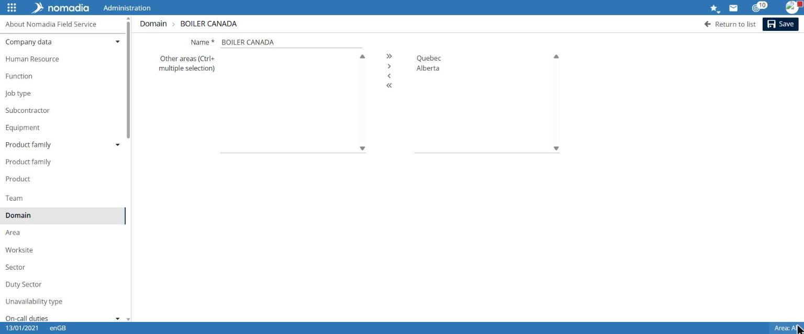
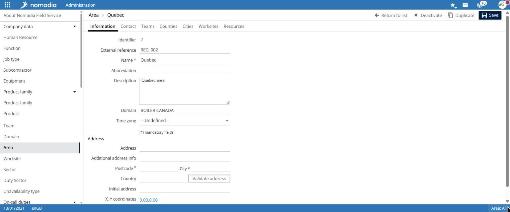
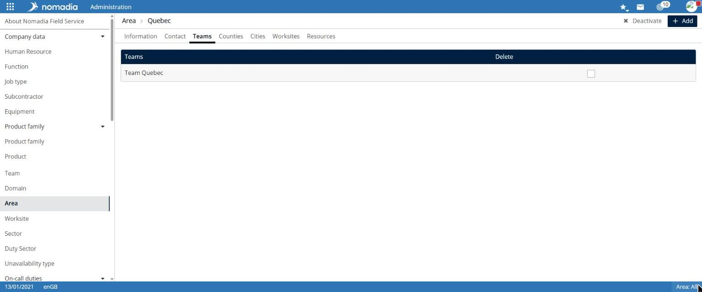
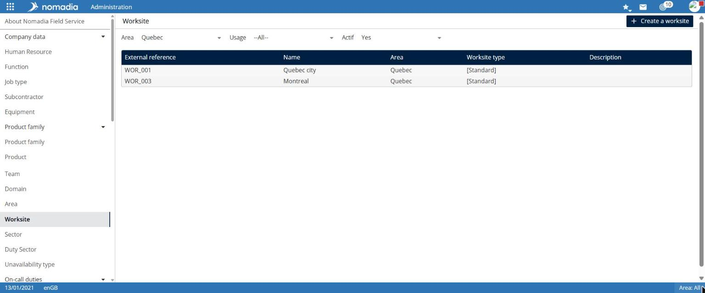
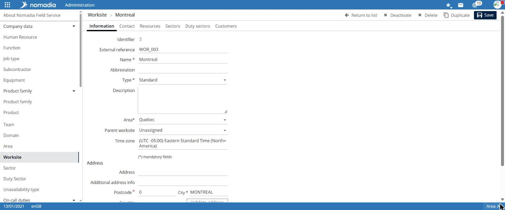
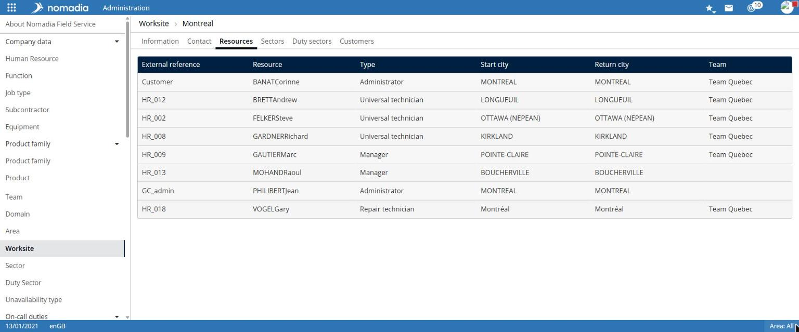

# Manage geographic organization

Geographic organization structures application data:

* a **domain** groups regions;
* a **region** is the assignment area for resources, teams and configuration data;
* a **work site** is a shared workplace for several resources, such as an agency, depot or store;
* a **sector** and an **on-call sector** divide activity, for example by city.

## Access the feature

| Entry          | Navigation                                       | List filters        |
| -------------- | ------------------------------------------------ | ------------------- |
| Domain         | `Administration > Company data > Domain`         | —                   |
| Region         | `Administration > Company data > Region`         | Domain              |
| Work site      | `Administration > Company data > Work site`      | Region, Use, Active |
| Sector         | `Administration > Company data > Sector`         | Region, Work site   |
| On-call sector | `Administration > Company data > On-call sector` | Region, Work site   |

## Domain

A domain record contains **Name**\* and two lists:

* **Other regions (Ctrl+ multi-select)**: available regions;
* on the right, the domain's regions.

Select one or more regions. Use **>** and **<** to move the selection, or **>>** and **<<** to move every region. Then select **Save**.

## Region

The list displays each region's **Name**, **Domain** and **Description**. The record contains these tabs:

| Tab             | Content                                                                                                                      |
| --------------- | ---------------------------------------------------------------------------------------------------------------------------- |
| **Information** | Name\*, Abbreviation, Description, Domain, Time zone and **Address** section                                                 |
| **Contact**     | Contact 1 and Contact 2: Title, First name, Last name, Job title, Mobile phone, Office phone, Business email and Description |
| **Teams**       | Teams assigned to the region                                                                                                 |
| **Departments** | Region departments                                                                                                           |
| **Cities**      | Region cities                                                                                                                |
| **Work sites**  | Region work sites                                                                                                            |
| **Resources**   | Region resources                                                                                                             |

In the **Teams** tab, select **Add** to assign a team. Select a team in the **Delete** column to remove it.

## Work site

The list displays **Name**, **Region**, **Work site type** and **Description**. By default, the **Active** filter is set to `Yes`.

The record has **Information**, **Contact**, **Resources**, **Sectors**, **On-call sectors**, **Customers**, **Preferences** and **Stock** tabs.

The **Information** tab contains:

* **Name**\*, **Abbreviation**, **Type**\* such as `Standard`, **Description**, **Region**\*, **Parent work site** and **Time zone**;
* the **Address** section, with **Validate address**, **Map** and **Street View** buttons.

The **Resources** tab lists resources assigned to the site, with their **Type**, **Start city**, **Return city** and **Team**. A second list contains **Secondary resources**.

The **Customers** tab lists customers assigned to the work site. The **Stock** tab contains **Stock** and **Stock2** fields.

**Deactivate**, **Delete** and **Duplicate** are available on a work-site record.

## Sector

1. Select **Create a sector**.
2. Enter the **Name** and **Region**.
3. Optionally complete **Abbreviation**, **Color**, **Parent work site**, **Resource type**, **Week template** and **Description**.
4. Select **Save**.

After saving, the record displays **Information**, **Contact**, **Preferences**, **Address**, **Cities**, **Resources** and **Customers** tabs.

In the **Cities** tab, enter **City**, **Government code**, **Postcode** and **Country**. Select **Validate address**, then **Add**. The **cities belong only to this sector** checkbox appears beneath the list.

## On-call sector

An on-call sector record has **Information**, **Contact**, **Address**, **Cities** and **Customers** tabs. The **Information** tab contains **Name**\*, **Abbreviation**, **Color**, **Region**\*, **Work site** and **Description**.

## Things to note

* Use **Validate address** to check addresses before saving.
* To manage teams, see [Manage teams](manage-teams.md).
