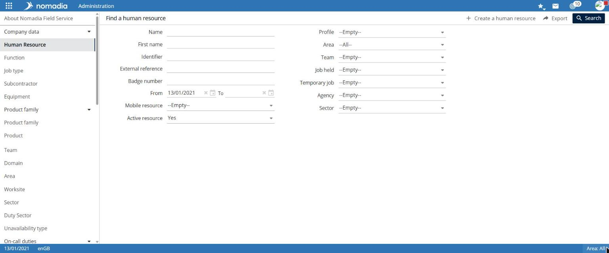
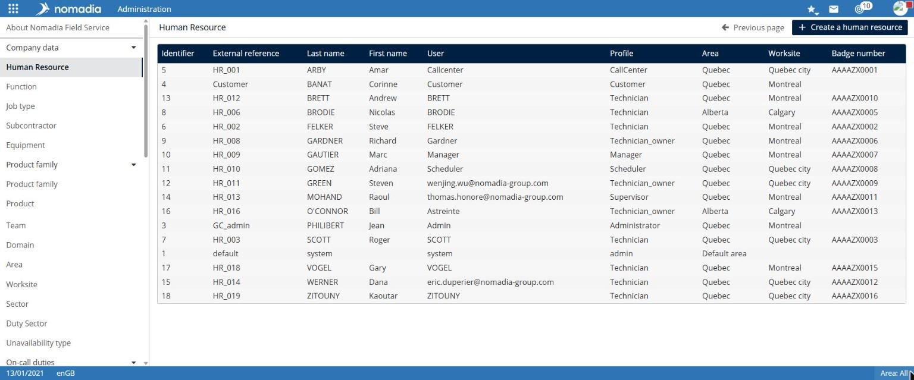
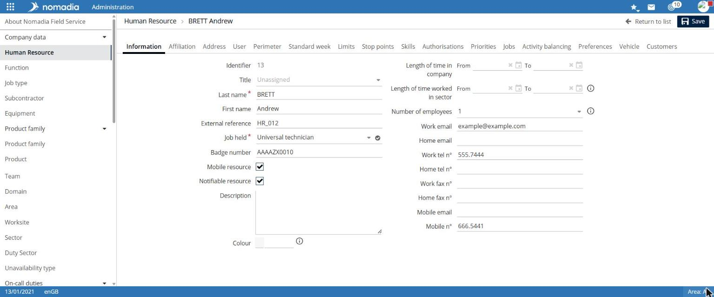
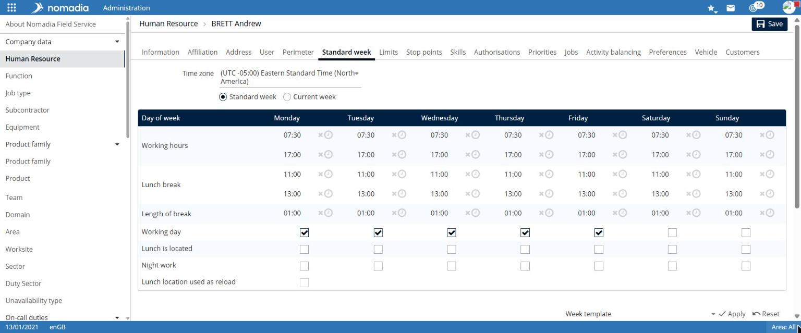

# Manage human resources

A human resource represents a person in the organization: a field worker, planner, or administrator. Their record contains their information, assignment, user account, working hours, and skills.

## Access the feature

**Navigation:** `Administration > Company data > Human resource`

## Search for a human resource

The **Search for a human resource** page provides the following criteria: **Last name**, **First name**, **External reference**, **Badge number**, **From** / **To**, **Mobile resource**, **Active resource**, **Profile**, **Region**, **Team**, **Job position**, **Temporary position**, and **Agency**.

1. Enter the desired criteria.
2. Select **Search**.

The list displays **Last name**, **First name**, **User**, **Profile**, **Region**, **Workplace**, and **Badge number**.

The **Create a human resource** and **Export** buttons are available at the top of the search page.

## View a resource record

Select a row in the list. The **Human resource** record opens on the **Information** tab.

The record contains these tabs: **Information**, **Assignment**, **Address**, **User**, **Scope**, **Typical week**, **Limits**, **Relay point**, **Skills**, **Authorizations**, **Priorities**, **Positions**, **Activity smoothing**, **Preferences**, **Vehicle**, and **Customers**.

| Tab              | Main fields                                                                                                                                                                   |
| ---------------- | ----------------------------------------------------------------------------------------------------------------------------------------------------------------------------- |
| **Information**  | Title, Last name\*, First name, Job position\*, Badge number, Mobile resource, Description, Color, Company period, Activity period, Employee count, emails, and phone numbers |
| **Assignment**   | Assigned region, Team, Main workplace, Secondary workplaces, On-call sectors                                                                                                  |
| **User**         | Profile, Identification mode: local account, LDAP directory, or SSO authentication; User\*, require password change on next login, Application landing page                   |
| **Typical week** | Time zone, daily working hours and lunch break, working days, week template, exceptional working days                                                                         |
| **Limits**       | Working-time definition, cumulative intervention time per day, week, and month, plus other constraints                                                                        |
| **Skills**       | Experience level, execution-speed weighting, and skills list with activation period                                                                                           |

## Define the typical week

The **Typical week** tab provides a table for each day of the week:

* **Working hours**: start and end;
* **Lunch break**: time range and **Break duration**;
* **Working day**;
* **Overnight stay possible**, **Lunch break location**, and **Night work**.

Below the table:

* The **Week template** list, with **Apply** and **Reset**, applies a template.
* The **Exceptional working days** section adds an exceptional day or week for a period.

Select **Save** to save changes to the record.
