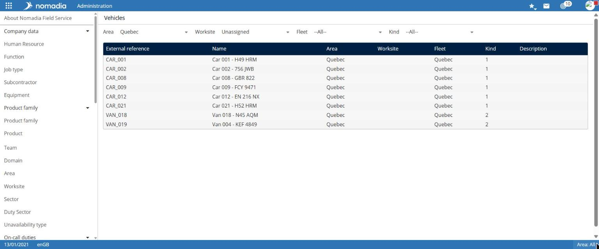
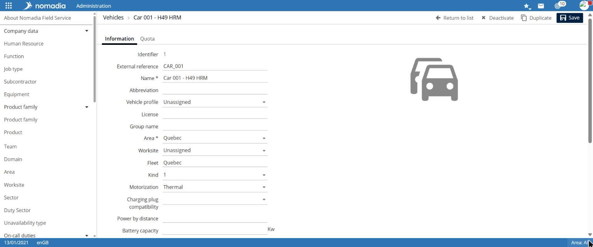
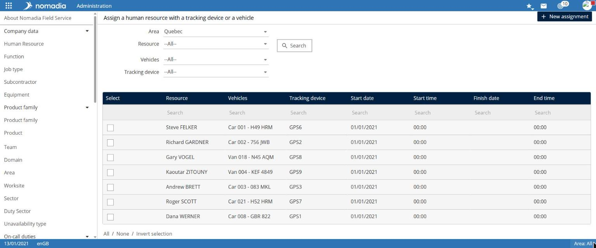

# Manage mobility

The **Mobility** group describes vehicles and tracking equipment, such as GPS units, and assigns them to field workers.

## Access the feature

| Entry              | Navigation                                       |
| ------------------ | ------------------------------------------------ |
| Vehicles           | `Administration > Mobility > Vehicles`           |
| Tracking equipment | `Administration > Mobility > Tracking equipment` |
| Assignments        | `Administration > Mobility > Assignments`        |
| Tracking utilities | `Administration > Mobility > Tracking utilities` |
| Settings           | `Administration > Mobility > Settings`           |

## Manage vehicles

The list can be filtered by **Region**, **Work site**, **Fleet**, and **Type**. It displays each vehicle's **Name**, **Region**, **Work site**, **Fleet**, **Type**, and **Description**.

1. Select **Create a vehicle**, or select a vehicle from the list.
2. On the **Information** tab, enter the **Name** and **Region**.
3. Complete other useful fields:
   * **Abbreviation**, **Vehicle profile**, **License**, **Group name**, **Work site**, **Fleet**, **Type**, and **Powertrain**;
   * for an electric vehicle: **Charging-station compatibility**, **Power per distance**, **Battery capacity**, **Distance range**, and **Battery commissioning date**;
   * **CO2 emission**, **Maximum speed**, **Cost per km**, and loads (**Maximum load 1**, **Initial load 1**, **Final load 1**…).
4. Complete the **Quota** tab if needed.
5. Select **Save**.

## Manage tracking equipment

The list displays each equipment item's **Name**, **Region**, and **Description**. To create equipment, select **Create tracking equipment**, enter the **Name** and **Region**, then add the **Abbreviation** and **Description** if needed, and select **Save**.

## Assign a vehicle or tracking equipment to a field worker

The **Assign a field worker to tracking equipment or a vehicle** page lists existing assignments.

1. Filter by **Region**, **Field worker**, **Vehicles**, or **Tracking equipment** if needed, then select **Search**.
2. To create an assignment, select **New assignment**.

The list displays the **Field worker**, **Vehicle**, **Tracking equipment**, and assignment period (**Start date**, **Start time**, **End date**, **End time**). Each column has a **Search** field.

## Configure tracking

* In **Tracking utilities**, select **Allow daily tracking**, then select **Save**.
* In **Settings**, enter the **Position server** and three thresholds, then select **Save**:
  * **Radius within which moving field workers are considered to be on their ideal route** (in metres);
  * **Radius within which stationary field workers are considered to have reached their destination** (in metres);
  * **Time limit before a position is considered stale** (in minutes).
