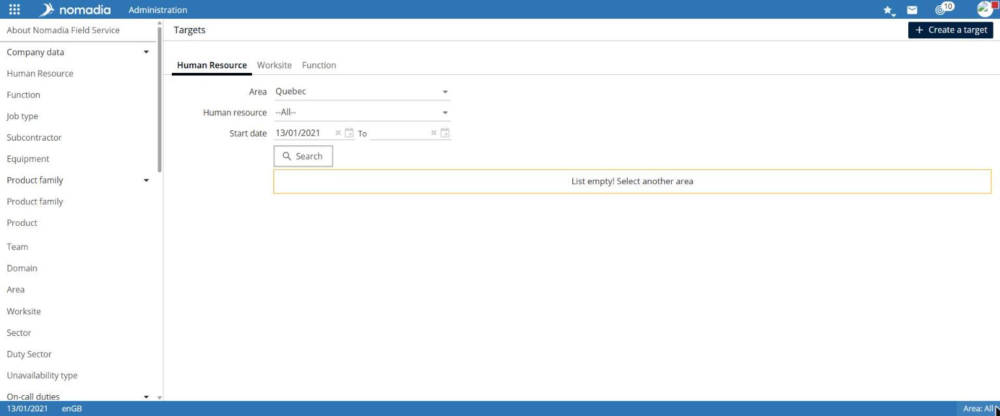
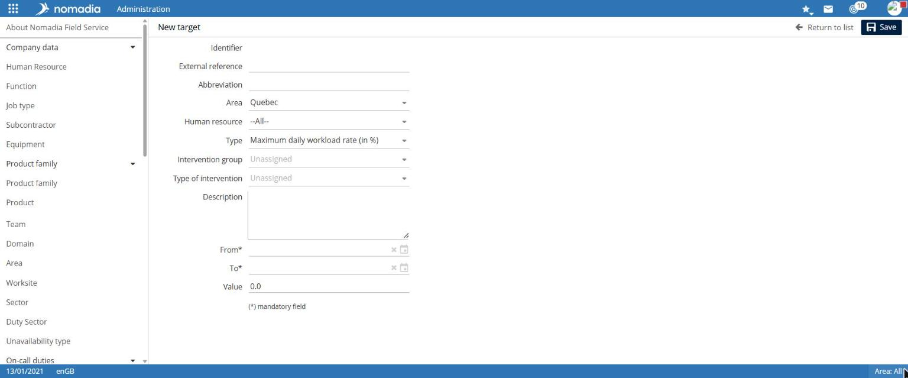
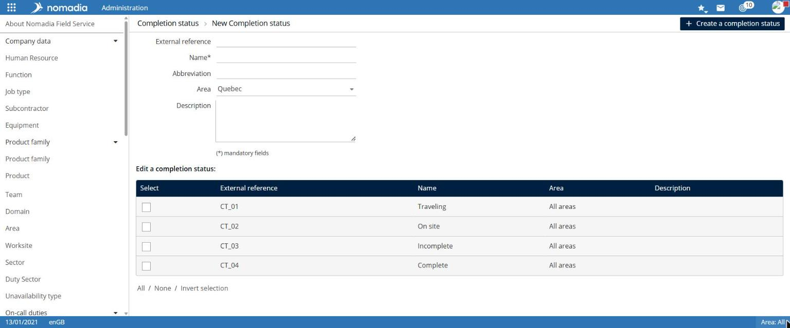

# Manage objectives, activity monitoring, and typologies

These entries complete the activity configuration:

* **objectives** set a target value over a period for a resource, worksite, or resource type;
* **completion statuses** and **follow-up actions** are customizable value lists for appointment monitoring;
* **typologies** are value lists attached to an entity field.

## Access the feature

| Entry             | Navigation                                                                |
| ----------------- | ------------------------------------------------------------------------- |
| Objectives        | `Administration > Company data > Objectives`                              |
| Completion status | `Administration > Company data > Activity monitoring > Completion status` |
| Follow-up action  | `Administration > Company data > Activity monitoring > Follow-up action`  |
| Typology          | `Administration > Company data > Typology`                                |

## Search objectives

The **Objectives** page has three tabs: **Human resource**, **Worksite**, and **Resource type**.

1. Select the tab matching the objective level.
2. Enter the **Region**, the relevant item, such as **Human resource**, and the **Start date** / **To** period.
3. Select **Search**.

## Create an objective

1. Select **Create an objective**.
2. Enter the **Region** and relevant item, such as the **Human resource**.
3. Choose the objective **Type**.
4. If needed, specify the **Intervention group** and **Intervention type**.
5. Enter the **From** / **To** period and the **Value**.
6. Select **Save**.

The **Type** field includes **Maximum daily working-time occupancy rate (in %)**, **Revenue**, **Number of appointments booked**, **Number of appointments**, **Daily revenue**, **Daily number of appointments**, **Daily number of appointments booked**, and **Daily number of meetings**.

## Limit the number of appointments per day

A **Daily number of appointments** objective defined on a human resource acts as a limit. When searching for time slots, scheduling, and optimizing, a slot that would exceed this value on a given day is not offered for the resource.

* With an **Intervention group** and an **Intervention type**, only appointments of that type are counted.
* With a group and **--All--**, all the appointments of the group are counted.
* Appointments without an intervention group are not counted.

**Example:** so that a field worker carries out only one appointment of the "Morning" type and one of the "Evening" type per day, create two **Daily number of appointments** objectives with a value of 1: one for the "Morning" type, the other for the "Evening" type.


The limit is daily. Appointments that are already scheduled are not removed from the schedule when you create the objective. Do not confuse **Daily number of appointments** with **Daily number of appointments booked**.


## Manage completion statuses and follow-up actions

Both entries work the same way: the entry form appears at the top of the page and the list of existing values appears below.

1. Open **Completion status** or **Follow-up action**.
2. Enter the **Name**, then, if needed, the **Abbreviation**, **Region**, and **Description**.
3. Select **Create a completion status** or **Create a follow-up**.

The **Save completed** notification appears and the value appears in the list below the form.

By default, **Region** is `All regions`. The **All**, **None**, and **Invert selection** links help select rows.

## Create a typology

1. Select **Create a typology**.
2. Enter the **Name** and **Region**.
3. Choose the **Entity name**, such as `APPOINTMENT`, `CUSTOMER`, `RESOURCE`, or `WORKSITE`, then the **Field name**.
4. If needed, choose a **Parent field** and enter a **Description**.
5. Select **Save**.

<!-- REVIEW: the Limit the number of appointments per day section is translated from the updated French topic. The objective type names (Daily number of appointments, Daily number of appointments booked) and the --All-- value were not verified in the application. -->
