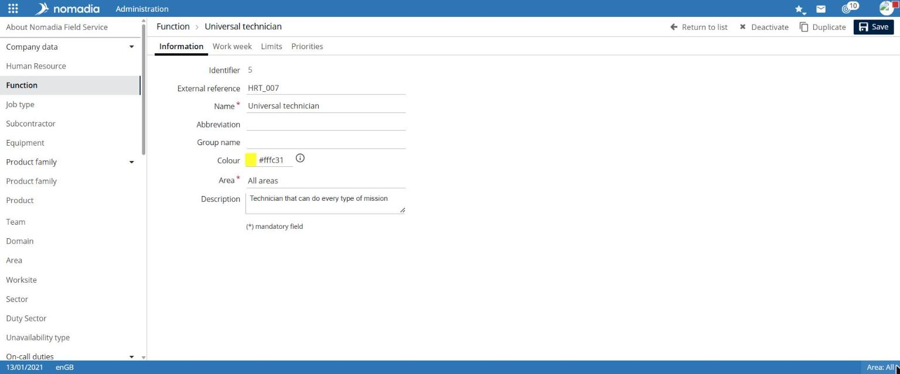
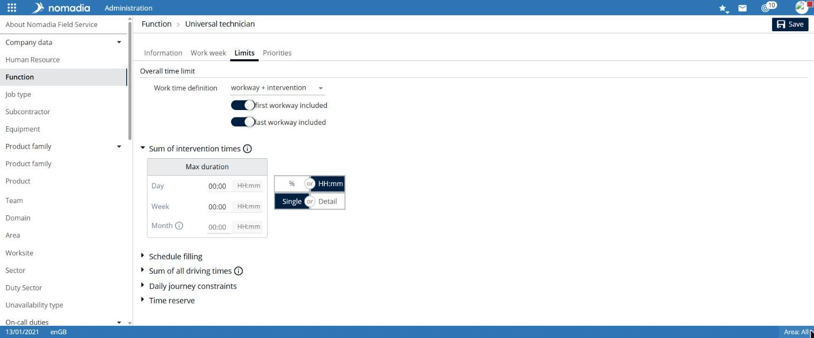
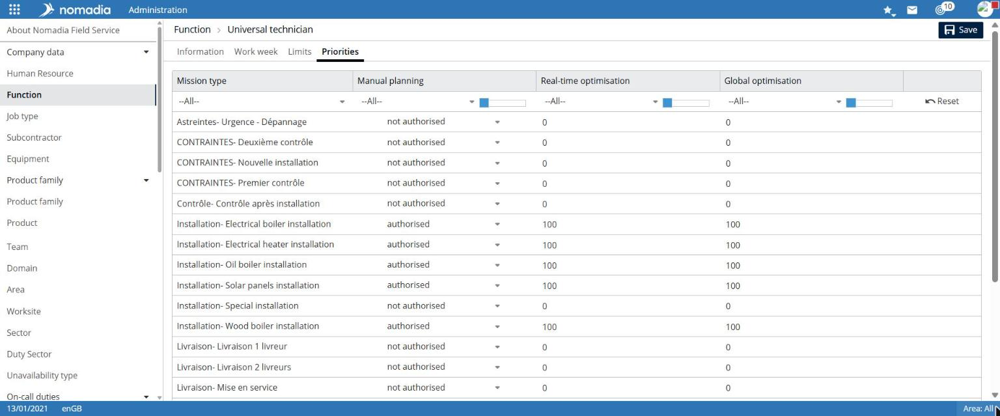
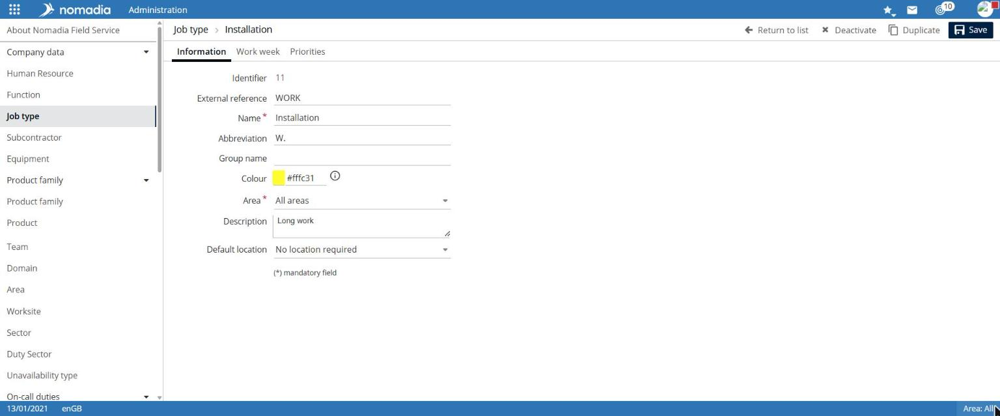

# Manage resource and job types

A resource type and a job type describe a human resource's role. They provide default values for the work week, limits, and priorities. You can then refine these values in each resource record.

## Access the feature

**Navigation:** `Administration > Company data > Resource type`

**Navigation:** `Administration > Company data > Job type`

Each list displays the **Name**, **Region**, and **Description** columns. Use the **Region** filter to restrict the list.

## Configure a resource type

1. Select **Create a resource type**.
2. On the **Information** tab, enter the **Name** and **Region**. Add the **Abbreviation**, **Group name**, **Color**, and **Description** if needed.
3. Select **Next page** to open the **Work week**, **Limits**, and **Priorities** tabs.
4. Select **Save**.

To edit an existing type, select its row in the list. All tabs then become directly available.

The record contains these tabs:

| Tab             | Content                                                                                                                                        |
| --------------- | ---------------------------------------------------------------------------------------------------------------------------------------------- |
| **Information** | Name\*, Abbreviation, Group name, Color, Region\*, Description                                                                                 |
| **Work week**   | **Week template** list and daily table: Working hours, Lunch break, Break duration, Working day, Lunch break location, Overnight stay possible |
| **Limits**      | Overall time limit and working-time constraints                                                                                                |
| **Priorities**  | Scheduling permission and optimization priority by intervention type                                                                           |

### Limits tab

The **Overall time limit** section provides:

* **Working-time definition**, such as `travel + intervention`;
* **count first journey** and **count last journey** options.

The following collapsible sections complete the configuration: **Cumulative intervention time** with maximum duration per **Day**, **Week**, and **Month**, expressed as `%` or `HH:mm`, in **Single** or **Detailed** mode; **Schedule fill rate**; **Cumulative travel time**; **Daily travel constraints**; **Overnight stay settings**; and **Time reserve**.

### Priorities tab

The table lists each intervention type, preceded by its group, with three columns:

* **Manual scheduling**: `authorized` or `not authorized`;
* **Real-time optimization**: priority value;
* **Global optimization**: priority value.

Column filters restrict the list. **Reset** clears the filters.

## Configure a job type

Creating a job type uses several pages.

1. Select **Create a job type**.
2. On the **Information** tab, enter the **Name** and **Region**. Add the **Abbreviation**, **Group name**, **Color**, **Description**, and **Default location** if needed.
3. Select **Next page** to open the **Work week** tab, then the **Priorities** tab. Select **Previous page** to return.
4. Select **Save**.

**Default location** provides these values: **Position not entered but required**, **At home**, **At the workplace**, and **No position required**.

The **Work week** and **Priorities** tabs work like those of a resource type.

## Notes

* **Name** and **Region** are required.
* After saving, **Deactivate** and **Duplicate** are available.
* To assign a type to a resource, see [Manage human resources](manage-human-resources.md).
