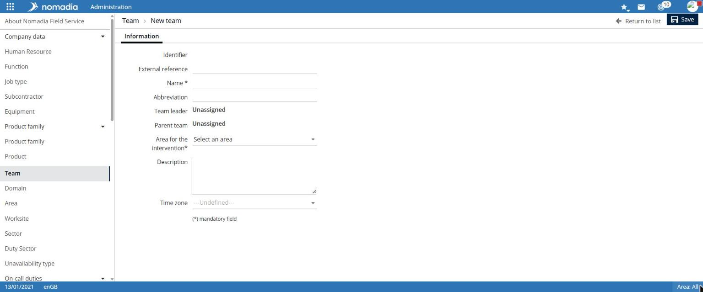
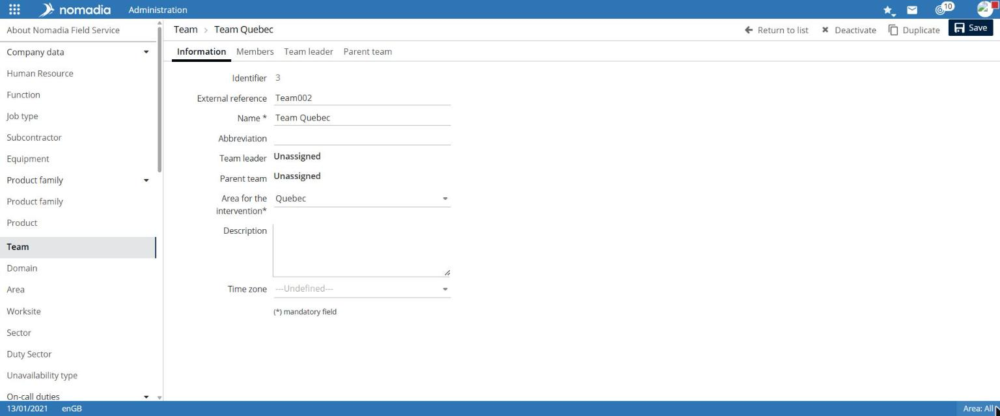
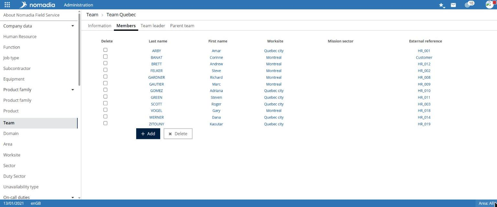

# Manage teams

A team groups human resources. Teams are used, in particular, to display the schedule by team.

## Access the feature

**Navigation:** `Administration > Company data > Team`

The teams list displays the **Name**, **Region** and **Description** columns. Use the **Region** filter to narrow the list.

## Create a team

1. Select **Create a team**.
2. In the **Information** tab, enter the **Name**.
3. Select the **Service region**.
4. Optionally complete **Abbreviation**, **Description** and **Time zone**.
5. Select **Save**.

**Name** and **Service region** are required.

## Result

The **Save completed** notification appears. The team record displays the **Information**, **Members**, **Team leader** and **Parent team** tabs, as well as the **Return to list**, **Deactivate**, **Duplicate** and **Save** buttons.

## View members

Select the **Members** tab. For a new team, the list displays **Empty list!**. The **Add** button is available beneath the list.

