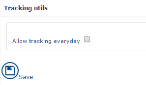
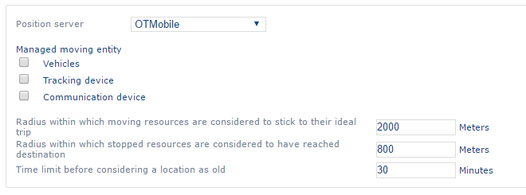

# Mobility

## Overview

The Mobility menu groups the vehicles, tracking devices, assignments, tracking utilities and settings used to upload GPS positions and to track journeys.

For how to create, consult or delete a record, and how lists and forms work, see [General Principles](generalprinciples.md).

## Vehicles

Vehicles are used to declare a CO2 emissions rate, which is used in the application statistics. You can also track the journeys of a vehicle by adding a tracking device to it.

You can create, consult or delete a vehicle.

### List of vehicles

To open the list of vehicles, click **Mobility** > **Vehicles** in the menu.

### Vehicle form

The vehicle form has one tab. It shows the following data for each vehicle:

* **Name** – the name of the vehicle. It is unique.
* **Abbreviation**
* **Routing profile** – a drop-down list of preconfigured vehicles: car, truck, light delivery vehicle, delivery van, bus, emergency vehicle, emergency lorry or truck, taxi, bicycle, pedestrian. Each has technical specificities (average speeds, accessibility to different types of roads, etc.) that are taken into account when tailored itineraries are calculated.
* **Area** – the area in which the vehicle is available. This field is mandatory.
* **Fleet** – a descriptive field indicating the fleet to which the vehicle belonged.
* **Kind** – a figure between 1 and 5 that differentiates the vehicles.
* **Description** – a brief description of the subcontractor.
* **CO2 emissions** – the CO2 emissions rate of the vehicle.
* **Maximum speed of the vehicle** – the speed restriction for the vehicle, used for route calculations.
* **Kilometer cost** – the cost per kilometer of the vehicle.
* **Daily cost** – the daily cost of the vehicle.
* **Manufacture date** – the manufacture date of the vehicle.
* **Next MOT date** – the date of the next MOT of the vehicle.
* **Maximum quantity, at the time of departure, and on return** (two quantity fields, 1 and 2) – define the vehicle capacity and the quantity loaded at the departure and arrival of the vehicle.
<!-- REVIEW: "Description of the subcontractor" in the vehicle form looks like a copy-paste from another form -->

## Tracking devices

Tracking devices enable the upload of GPS coordinates.

You can create, consult or delete a tracking device.

### List of tracking devices

To open the list of tracking devices, click the **Tracking device** link in the menu.

### Tracking device form

The tracking device form has one tab. It shows the following data for each device:

* **External reference**
* **Name** – the name of the device. It is unique.
* **Abbreviation**
* **Area** – the area in which the team is available. This field is mandatory.
* **Description** – a concise description.

## Assignments

Assignments establish the link between the resources, vehicles and tracking devices. For the resource data, see [Company Data](companydata.md).

You can create, consult or delete an assignment.

### List of assignments

To open the list of assignments, click the **Assignments** link in the menu.

### Assignment form

The assignment form has one tab. It shows the following data for each assignment:

* **Resource** – the resource to which the vehicle and the tracking device are assigned.
* **Area** – the area concerned by the assignment.
* **Only show unassigned vehicles and tracking devices** – select this check box to filter the **Vehicle** and **Tracking device** drop-down lists.
* **Vehicle**
* **Tracking device**
* **Date** and **time** of the start of the assignment.
* **Date** and **time** of the end of the assignment.

## Tracking utils

To access the tracking devices, click **Mobility** > **Tracking devices** in the menu.

## Settings

The settings enable the upload of GPS positions.

You can define the following parameters:

* **Positions server** – select the position server that corresponds to your device. By default, the drop-down list contains the following items: OTMobile, Calendrier Office 365, TomTom Webfleet, TomTom Webfleet SOAP, Masternaut, Orange, Simulateur, Ornicar, Ocean.
* **Managed moving entity** – defines which object serves as a reference for GPS coordinates. You can select one of the following objects:
  * Vehicles
  * Tracking device
  * Communication device
* **Radius within which moving resources are considered to stick to their ideal trip** – defines an alert when a resource deviates from its planned itinerary.
* **Radius within which stopped resources are considered to have reached destination** – defines an alert if a resource has stopped at a certain distance from the appointment location.
* **Time limit before considering a location as old** – defines an alert for resources whose location has not been refreshed for a certain time.

Click  to save the parameters.
