# Optimization

## Overview

NFS supports two optimization modes: real time optimization and global batch optimization (see [Glossary](../glossary/glossary.md)). The optimization engines apply the parameters that you define in the Administration module in both modes.

The optimization of appointments in NFS depends on a group of parameters that express the cost of a solution and particular constraints. Use these parameters to express preferences or constraints. For example, the enterprise does not accept that a resource spends a night in a hotel if the distance is below a given threshold. You define this threshold in the optimization parameters.

This topic describes how to:

* configure optimization parameters and optimization profiles;
* plan and monitor optimizations, including trigger events, activation periods and remote servers;
* activate or deactivate an area;
* import and export optimizations.

## Optimisation parameters

To open the optimization parameters, click the **Optimisation parameters** link in the menu.

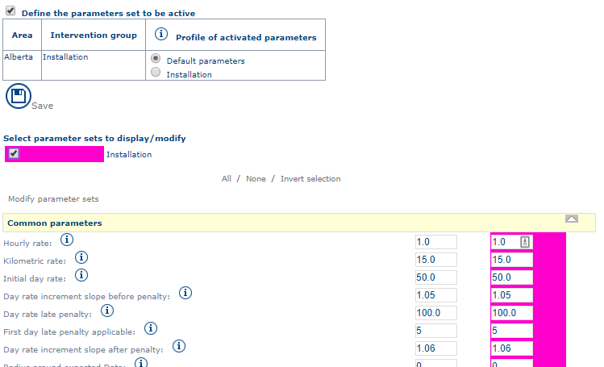


**Types of parameter values**

Certain values have clear units (for example, the maximum number of nights away from the site), but this is not always the case. The values of the parameters fall into four types:

* **A value with a unit**: the unit is written between brackets. For example, **Confirmation time (in days)**.
* **A cost value**: a comparative value (not a real value) that represents the preference. For example, the value of the **Cost per night away from the site** parameter is comparative. In general, it is 5 times higher than an hourly rate.
* **A rate**: for example, the **Increase in appointment cost for each late day**.
* **Options**: you choose the value from a limited series of values. For example, the **Night used** parameter indicates whether a resource can sleep away from the site. Only **Yes** or **No** are possible answers.


### Management of optimization profiles

NFS is supplied with a default optimization profile that is valid for all areas defined in the application. The administrator can create other optimization profiles to harmonize the optimization parameters with the characteristics of an area.

If no association exists between an optimization profile and an area, the **Default Optimisation Profile** applies.

#### List of optimization profiles

To open the list of optimization profiles, click the **Modify parameter profiles** link.

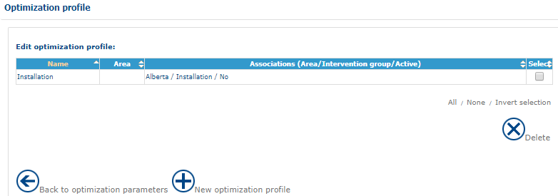

You can create, consult or delete optimization profiles. For the procedures, see [General Principles](generalprinciples.md).

#### Optimization profile form

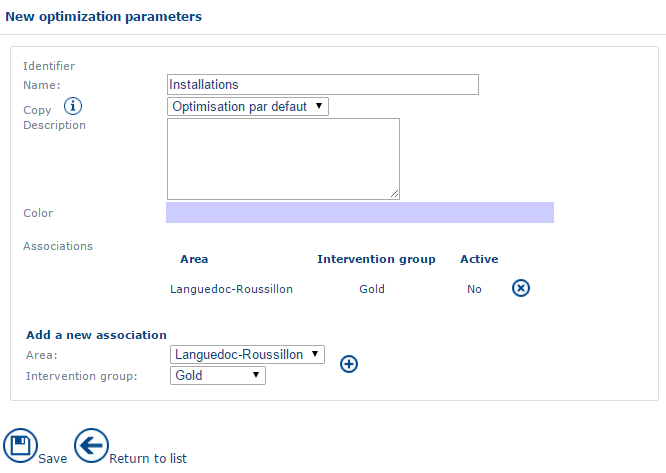

The form for an optimization profile (see [General Principles](generalprinciples.md)) includes the following fields:

* **Identifier** – the internal identifier of the optimization profile.
* **Name** – the name of the optimization profile.
* **Description** – a few words describing the optimization profile.
* **Colour** – the color of the optimization profile.

You can add and delete areas and intervention groups (see [General Principles](generalprinciples.md) and [Company Data](companydata.md)).

### Description of optimization parameters


The optimization parameters steer the results of optimizations. Great care and expertise are required when you change these parameters.



Each cost enters into the calculation of a solution to the optimization problem submitted to the optimization engine. This problem may result in the insertion of an appointment in a route (real time optimization) or the optimization of a series of appointments on a given number of days and resources. The engine generates different solutions. It uses the global cost to rank the suggestions (real time) or to choose the best solution (batch).


The full list of optimization parameters is available in [Optimization Parameters](../appendices/optimizationparameters.md).

### Parameters that are common to both optimization modes

* **Hourly cost** – cost of one hour of travel or intervention in a route.
*   **Kilometer cost** – cost of a kilometer traveled by a resource on a route.

    

Ratio between hourly cost and kilometer cost: 1 hour corresponds to 50 km for an average speed of 50 km/h. To give priority to the distance over the duration, the kilometer cost must be 50 times greater than the hourly cost.

* **Initial day rate** – adds a per-day cost for the days elapsed between the earliest date for the appointment and the first day of the optimization.
*   **Parameters linked to late penalties** – the following parameters make up a table of penalties and costs as a function of days elapsed. An example follows the list.

    * **Rate of increase in daily cost (before late penalties)** – multiplication factor that increases the cost for each day elapsed before the **First day of application of late penalty**. In the example below, the value is 1.05, so the cost increases by 5% each day before the day of application of the late penalty.
    * **Late penalty** – numeric constant that adds weight to the other parameters and so influences the general score. The higher this value, the more the score is adversely affected. In the example below, the value is 10.
    * **First day of application of late penalty** – number of days after which the late penalty is applied. In the example below, the value is 5.
    * **Rate of increase in the daily cost after a late penalty** – multiplication factor that increases the cost for each day after the **First day of application of late penalty**. In the example below, the value is 1.06, so the cost increases by 6% each day after the first day of application of the late penalty.
    * **Radius around expected date** – number of days possible around the expected date. If the value is 0, the expected date is exclusive. If it is -1, all days are accepted. In any event, the expected date minimizes the late cost function.

    **Example:** for a resource with an empty planning (each day is equivalent from the point of view of travel, and the total cost is equal to c), the costs are as follows. Day 0 is the first day of the optimization.

    | Day     | 0  | 1     | 2        | 3          | 4          | 5                    | 6                     |
    | ------- | -- | ----- | -------- | ---------- | ---------- | -------------------- | --------------------- |
    | Formula | c  | 1.05c | (1.05)²c | (1.05)^3.c | (1.05)^4.c | 1.1((1.06)^4.c + 10) | 1.1²((1.06)^4.c + 10) |
    | Cost    | 10 | 10.5  | 11       | 11.5       | 12         | 19                   | 20.5                  |

    

If you set the values of the parameters <strong>Coefficient before application of late penalties</strong> and/or <strong>Coefficient after the application of late penalties</strong> to zero, the cost calculation on these parameters is equal to zero (see the formula above). To avoid taking these parameters into account, set them to 1. To make the cost increase over time, give them a value higher than 1. To make the cost decrease over time, give them a value between 0 and 1.

* **Confirmation delay (in days)** – number of days before a reserved appointment passes automatically to the confirmed status.
* **Reservation period (in days)** – number of days before a planned appointment passes automatically to the reserved status.
*   **Snap to grid for appointment start times** – forces the application to suggest start times for the appointment at a regular interval in minutes. For example, for an appointment that is possible from 8:23 am onwards, the application proposes 8:25 am for a 5-minute step, or 8:30 am for a 10-minute step. The available steps are none, 5m, 10m, 15m, 20m, 30m and 60m.

    

This parameter can add a gap between appointments in the agenda. It therefore reduces the optimization performance.

* **Cost of not using a favourite day** – cost added when the day is not a favorite day of the customer. You configure favorite days in the handling of known customers (see the Planning module). For example, a customer prefers to be visited on Mondays. The suggestions for appointments on the other days are penalized with an additional cost.
* **Cost of not using a preferred resource** – cost added for the use of a non-preferred resource compared with the use of a preferred resource. A customer can be assigned to preferred resources. The application can propose non-preferred resources when there is no other choice, which retains some flexibility. This cost penalizes the choice of a non-preferred resource.
*   **Access time (in minutes)** – the sum of two durations:

    * the time between stopping the vehicle and arriving at the customer's premises;
    * the time between the end of the visit to the customer and the departure of the vehicle.

    This field measures the accessibility of a site, so the time can vary according to the customer. The content of this field is duplicated on route stops.
*   **Add the fixed duration between two appointments with the same location** – **Yes** adds the access time between two appointments at the same geographic location. **No** does not add the access time when two appointments are at the same place, so the travel times and access times are null.

    

This parameter adds a gap between appointments in the agenda.

* **Parameters linked to the handling of nights away**
  * **Cost of a night away from home** – if this cost is lower than the cost of returning to the address registered for the end of the working day, a night away from home is suggested.
  * **Minimum journey duration to justify a night away** – minimum travel time above which a night away can be suggested. Reducing this time increases the suggestions for nights away. The parameters for the resource (**Limits** tab, see [Company Data](companydata.md)) override it.
  * **Maximum number of nights away per week** – maximum number of nights away suggested. The parameters for the resource (**Limits** tab, see [Company Data](companydata.md)) override it.
  * **Overrun ratio for journey overlap on overnight morning** – percentage of overrun on the authorized time that allows an overlap on the days after nights away.
  * **Overrun ratio for journey overlap on overnight morning** – percentage of overrun on the authorized time that allows an overlap on the evenings of nights away.
  * **Journey gain factor expected for overnight away** – factor (as a percentage) of the gain in travel time obtained by using nights away. Increasing this value reduces the number of nights away.

### Parameters relating to a real time optimization

* **Number of solutions found** – maximum number of slots that the optimization suggests for an appointment.
  * **Maximum number per day** – maximum number of timeslots suggested per day. The best timeslots are suggested. If the value is 0, the parameter is not used.
  * **Only one day per resource** – **Yes**: only one timeslot is suggested per day and per resource. **No**: there is no limit.
  * **Time grid step (in minutes)** – step (in minutes) that defines a time grid for the following parameters. If the value is 0, the parameter is not used.
    * **Time start of grid** – origin of the grid step. By default, the step is applied from midnight (00:00).
    * **Step extended to all days** – **Yes**: the step is extended to all the days being searched (the time grid covers all days). **No**: the grid is the same for all days (the time grid is independent of the day).
    * **Maximum number per cell** – maximum number of slots presented in each cell of the grid. The best slots are suggested. If the value is 0, the parameter is not used.
    * **Maximum number per resource and per cell** – maximum number of slots suggested per resource in each cell of the grid. The best slots are suggested. If the value is 0, the parameter is not used.
    * **Solutions suggested at each step** – **Yes**: slots are suggested at each step of the grid to fill the maximum number of cells. The parameter that limits the number of suggested slots is not used in this case.
  * **Presentation of solutions with the same cost** – sorts solutions with the same cost chronologically, in reverse chronological order, or by limiting the time spent with other activities in the planning.
  * **Position of suggested timeslots** – position of suggested timeslots other than at the start or end of the day, on filled days or on empty days. The timeslots are suggested between two locations L1 and L2. The choices are: exclusively close to the time of L1; exclusively close to the time of L2; both close to the time of L1 and the time of L2; or exclusively close to the geolocation with the shortest journey time from the appointment to schedule.
    * **First timeslots in a filled day** – position of suggested timeslots at the start of a day that already contains geolocated activities. The timeslots are suggested between two geolocations L1 and L2. The choices are the same as for **Position of suggested timeslots**.
    * **Last timeslots for a filled day** – position of suggested timeslots at the end of a day that already contains geolocated activities. The timeslots are suggested between two geolocations L1 and L2. The choices are the same as for **Position of suggested timeslots**.
    * **After a non-worked unavailability** – position of suggested timeslots after a non-worked unavailability. The timeslots are suggested between two geolocations L1 and L2. The choices are the same as for **Position of suggested timeslots**.
    * **Before a non-worked unavailability** – position of suggested timeslots before a non-worked unavailability. The timeslots are suggested between two geolocations L1 and L2. The choices are the same as for **Position of suggested timeslots**.
  * **Maximum cost of the suggested timeslot** – maximum cost authorized for the suggested timeslot. If this value is exceeded and greater than 0, the timeslot is not suggested.
  * **Maximum number of minutes for the outward journey** – maximum number of minutes of travel authorized for the outward journey to the appointment. If this value is exceeded and greater than 0, the timeslot is not suggested.
  * **Maximum number of minutes for the return journey** – maximum number of minutes of travel authorized for the return journey from the appointment. If this value is exceeded and greater than 0, the timeslot is not suggested.
  * **Maximum number for the total minutes (Outward/Return)** – maximum number of minutes of travel authorized for the sum of the outward and return journeys. If this value is exceeded and greater than 0, the timeslot is not suggested.
  * **Maximum number of minutes journey time per day** – maximum travel time authorized per day. If this value is exceeded and greater than 0, the timeslot is not suggested.
  * **Maximum number of kms for the outward journey** – maximum number of kilometers authorized for the outward journey to the appointment. If this value is exceeded and greater than 0, the timeslot is not suggested.
  * **Maximum number of kms for the return journey** – maximum number of kilometers authorized for the return journey from the appointment. If this value is exceeded and greater than 0, the timeslot is not suggested.
  * **Maximum number of kms total (Outward/Return)** – maximum number of kilometers authorized for the sum of the outward and return journeys. If this value is exceeded and greater than 0, the timeslot is not suggested.
  * **Maximum number of kms per day** – maximum number of kilometers of travel authorized per day. If this value is exceeded and greater than 0, the timeslot is not suggested.
  * **Maximum cost of the timeslot suggested without any alert** – maximum cost authorized without alert for the suggested timeslot. If this value is exceeded and greater than 0, the timeslot is suggested with an alert.
  * **Maximum number of minutes for the outward journey without alert** – maximum cost authorized without alert for the suggested timeslot. If this value is exceeded and greater than 0, the timeslot is suggested with an alert.
  * **Maximum number of minutes for the return journey without an alert** – maximum number of minutes of travel authorized without alert for the return journey from the appointment. If this value is exceeded and greater than 0, the timeslot is suggested with an alert.
  * **Maximum number of minutes in total (Outward/Return) without alert** – maximum number of minutes of travel authorized without alert for the sum of the outward and return journeys. If this value is exceeded and greater than 0, the timeslot is suggested with an alert.
  * **Maximum number of journey minutes per day without alert** – maximum travel time in minutes authorized per day without alert. If this value is exceeded and greater than 0, the timeslot is suggested with an alert.
  * **Maximum number of kms for the outward journey without alert** – maximum number of kilometers authorized without alert for the outward journey to the appointment. If this value is exceeded and greater than 0, the timeslot is suggested with an alert.
  * **Maximum number of kms for the return journey without an alert** – maximum number of kilometers authorized without alert for the return journey from the appointment. If this value is exceeded and greater than 0, the timeslot is suggested with an alert.
  * **Maximum number of kms in total (Outward/Return) without alert** – maximum number of kilometers authorized without alert for the sum of the outward and return journeys. If this value is exceeded and greater than 0, the timeslot is suggested with an alert.
  * **Maximum number of kms per day without alert** – maximum number of kilometers of travel authorized per day without alert. If this value is exceeded and greater than 0, the timeslot is suggested with an alert.
*   **Method to set slipping time interval for confirmed appointments (only for confirmed or reserved appointments)** – defines how the theoretical time of passage is communicated.

    

The available methods are:
<ul><li><strong>None</strong>: no information is given.</li><li><strong>On the day</strong>: the appointment takes place during the day in question.</li><li><strong>On the half day</strong>: the appointment takes place during the morning or the afternoon.</li><li><strong>Maximum delay</strong>: the appointment must take place at the latest at a given time.</li><li><strong>Maximum advance</strong>: the appointment must take place at the earliest at a given time.</li><li><strong>More or less</strong>: the indicated visit time is plus or minus a time defined by the <strong>Slipping time interval for communicated appointments</strong> parameter. For example, the application calculates a theoretical visit time of 11:30 am. If the interval is 60 minutes, the communicated timeslot is a probable visit time between 10:30 am and 12:30 pm.</li><li><strong>By timeslot</strong>: the indicated visit time takes into account the <strong>Slipping time interval for communicated appointments</strong> parameter and the <strong>Reference times</strong> parameter for the calculation of the arrival time interval of communicated appointments. This lets you communicate rounded visit times to the customer. For example, the theoretical visit time is 10:23 am, the <strong>Reference time of slipping interval</strong> parameter is 00:00 and the <strong>Slipping time interval</strong> duration is 120 minutes. The timeslot to communicate to the customer is a probable visit time between 10 am and 12 noon.</li></ul>

    * **Slipping time interval duration (confirmed appointments)** – duration in minutes of the time interval used by the previous parameter (**Method to set slipping time interval for communicated appointment**). It is taken into account only in the modes **More or less**, **Maximum advance**, **Maximum delay** and **By slot**.
    *   **Reference time of slipping intervals (confirmed appointments)** – reference time from which the slots are calculated. If the value is 00:00, the slots are calculated from 00:00.

        For example, if you choose **By timeslot** with a duration of 2 hours, the calculated slots are 00:00-02:00, 02:00-04:00, 04:00-06:00, and so on. If a visit is planned for 10:16, the slot to communicate is 10:00-12:00.
* **Method to set slipping time interval for planned appointments** – applies only to appointments with the planned status.
  * **Slipping time interval duration (planned appointments)** – applies only to appointments with the planned status.
  * **Reference time of slipping interval (planned appointments)** – applies only to appointments with the planned status.
* **Method to set slipping time interval for planned appointments** – delay to apply in minutes (with an offset of 5 minutes, 14:55 is considered as belonging to the time interval 15:00-15:15 if the timespan is set to 15 minutes).
* **Appointment duration taken into account in the baseline time**:
  * **Yes** – the suggested timeslot covers the whole appointment. For a **Slipping time interval duration** of 60 minutes and an appointment defined at 10:30 for a duration of 2 hours, the application suggests the timeslot 10:00-13:00.
  * **No** – the suggested timeslot contains the start time of the appointment. For a **Slipping time interval** of 60 minutes and an appointment defined at 10:30 for a duration of 2 hours, the application suggests the timeslot 10:00-11:00.


The next four parameters prefill the search interface for a timeslot (planning of an appointment).


* **Earliest appointment time** – earliest start time of planned appointments.
* **Latest appointment time** – latest start time of planned appointments.
* **Alternative earliest appointment time** – another default value for the earliest appointment start time.
* **Alternative latest appointment time** – another default value for the latest appointment start time.
* **Search start day** – number of days (counting from today) from which the search for free timeslots starts in a real time optimization.
* **Search last day** – number of days (counting from today) at which the search for free timeslots ends in a real time optimization.
* **Search day** – default value for the search day in relation to the current day, for an appointment optimized on a chosen day.
* **Factor applied to prioritise the type of intervention** – cost added for a difference of 1% between the priorities of two resources for the same type of task (see priority of resources in [Company Data](companydata.md)).
* **Out of sector surcharge** – cost associated with an appointment located out of sector.
*   **Split appointment surcharge** – cost added per split appointment (divided into several parts in the day).

    

A high value prevents the engine from splitting an appointment to place it in the schedule. This can reduce the quality of the optimization.

* **Parameters linked to the handling of multi-day appointments**
  * **Minimum duration of a multi-day appointment** – minimum duration that an appointment must have to be splittable at the end of a working day.
  * **Minimum duration placed on first/last day for a multi-day appointment** – when an appointment must be split to be performed over several days, the parts of this appointment placed on the first and last days may not exceed the value defined in this field.
  * **Add free time before fist slot** (appointment of at least 2 days) – offsets a multi-slot appointment (of at least 2 days) so that there is significant time for an appointment that would have started at least the day before. The offset is applied on the morning of the start of the appointment and therefore frees up some free time. The application tries to offset the appointment to respect the minimum duration of a split timeslot. The possible values are **yes** (accept the addition of a free time interval) or **no** (do not accept it).
  * **A single activity performed on the first day of a multi-day appointment** – prevents the scheduling of another appointment on the first day of an appointment scheduled over several days.
  * **Maximum duration of appointment on last day to force it back to previous day** (appointment of at least 2 days) – maximum duration of the appointment (on the last day) that can be brought back to the previous day while increasing the working day of the day before. If this value is 0, forcing it to the day before is impossible.
* **Cost of days discontinuity** – cost added to an appointment scheduled over several days. If a solution is possible without splitting the appointment over several days, it has priority.
  * **An appointment on several days can be interrupted by a full-day unavailability** – option to stagger an appointment over several days so it can be finished after one or several daily unavailabilities.
  * **An appointment on several days can be interrupted by another** – option to stagger an appointment over several days, in between other appointments.
  * **An appointment on several days can be interrupted** – option to interrupt an appointment that takes place over several days to insert another appointment. The time lost on that appointment is made up as a priority on the last day of the intervention. If this is insufficient, the appointment is forced each evening using the value of the **Maximum duration for last timeslot, that can be forced the day before**.
    * **Possible interruption possible for a whole day** – option to interrupt an appointment and not fulfill it for a full day, to insert another appointment in its place.
    * **Ability to complete the appointment one day later** – option to end an appointment lasting several days one day late, to insert another appointment during the period.
  * **An appointment on several days can continue the next day before the client opens** – option to start the appointment earlier, before the customer opens, every day except the first day of the appointment. On the first day, the resource always has to arrive within the customer's opening hours.
  * **An appointment on several days can continue after the customer closes** – option to continue an appointment over several days after the customer closes. This is possible every day the appointment continues.
  * **An appointment on one day can continue after the customer closes** – option to continue an appointment on one day after the customer closes.
* **Minimum slot duration (split appointment)** – when an appointment must be split to be performed in several parts within a single day (for example, on either side of the lunch break), the sections of this appointment have the value defined in this field as a minimum duration.
*   **Mobilisation cost for a resource (common override)** – fixed cost added for each new route. When a value is present in the batch optimization parameter **Cost of mobilisation of a resource**, the value defined in this field takes precedence.

    

A high value for this field favors the filling of routes (fewer resources mobilized). A low value favors the mobilization of resources.

* **Cost of mobilising the resource at D0** – cost added to the first appointment of the resource's current working day in real time optimization.
* **Cost of an appointment not placed today** – cost added for an appointment that is not suggested for today (the current working day). This cost gives priority to appointments that fit in the whole working day.
* **Costs linked to unplanning an appointment**
  * **Cost of unplanning a planned appointment** – fixed cost added for each unplanned appointment so that another appointment can be planned in its place. It specifies the cost of unplanning an appointment to make room for another.
  * **Cost per hour of unplanning a planned appointment** – cost added for each hour of an appointment with the planned status that is unplanned so another appointment can be scheduled in its place.
  * **Cost of unplanning a reserved appointment** – fixed cost added for each reserved appointment that is unplanned to schedule another appointment in its place.
  * **Cost per hour of unplanning a reserved appointment** – cost added for each hour of a reserved appointment that is unplanned to schedule another appointment in its place.
  * **Cost of unplanning a confirmed appointment** – fixed cost added for each confirmed appointment that is unplanned to schedule another appointment in its place.
  * **Cost per hour of unplanning a confirmed appointment** – additional fixed cost for each hour of a confirmed appointment that is unplanned to schedule another appointment in its place.
  * **Possible unplanning of reserved appointments on RTO search +** – lets you choose whether reserved appointments can be taken out of the planning to schedule another appointment in real time optimization mode.
  * **Possible unplanning of confirmed appointments on RTO "search +"** – lets you choose whether confirmed appointments can be taken out of the planning to schedule another appointment in real time optimization mode.
  * **Possible unplanning of appointments with meeting on RTO "search +"** – lets you choose whether interventions with appointments can be taken out of the planning to schedule another appointment in real time optimization mode.
  * **Possible unplanning of marked appointments on RTO "search +"** – lets you choose whether marked appointments can be taken out of the planning to schedule another appointment in their place in real time optimization mode.
  * **Cost of unplanning a work-related unavailability** – cost above which a worked unavailability can be unplanned (by scheduling an appointment in real time).
  * **Cost per hour of unplanning a work-related unavailability** – fixed cost added per hour of worked unavailability. The total cost for this unavailability defines the cost above which it can be unplanned (by scheduling an appointment in real time).
  * **Cost of unplanning a non-work related unavailability** – cost above which a non-worked unavailability can be unplanned (by planning an appointment in real time).
  * **Cost per hour of unplanning a non-worked unavailability** – fixed cost added per hour of non-worked unavailability. The total cost for this unavailability defines the cost above which it can be unplanned (by scheduling an appointment in real time).
* **Cost for non-delivery** – cost above which an appointment is not planned. It is the cost of an unfulfilled intervention with a 50% priority. By default, the value is 0 and the duration of the intervention does not affect the cost of non-delivery.
*   **Hourly rate for non-delivery** – cost added per hour of appointment, so it is proportional to the duration of the appointment. The total cost is a threshold above which the appointment is not planned. It is the hourly cost of an unfulfilled standard priority intervention. By default, the value is 0 and the appointment duration does not affect the cost of non-delivery.

    

If this value is too low, certain appointments may not be scheduled in batch optimization (see <a href="../glossary/glossary.md">Glossary</a>) mode.

* **Maximum cost of a journey without alert** – cost above which an alert is displayed when the appointment is suggested. The parameter is not used if it is 0.
* **Maximum radius (in km)** – maximum radius (in kilometers) of the circle centered on the departure point for the day. It defines the circle in which appointments are possible. The parameter is not used if the value is 0.
  * **Radius calculated by the road** – **Yes**: the radius is calculated along the road network. **No**: it is calculated as a straight line (as the crow flies).
* **Minimum time between two appointments considered too far apart** – limit value (in minutes) above which two appointments are considered too far apart, which applies the associated cost. The parameter is not used if it is 0.
  * **Time overcost for two appointments considered too far apart** – hourly surcharge added when two appointments are considered too far apart (see the previous parameter).
* **Minimum distance between two appointments considered too far apart** – limit value (in kilometers) above which two appointments are considered too far apart, which applies the associated cost. The parameter is not used if it is 0.
  * **Kilometer overcost for two appointments considered too far** – kilometer overcost added when two appointments are considered too far apart (see the previous parameters).
* **Cost of not using a mission type favorite weekday (real-time context)** – cost added for an appointment scheduled on a non-favorite day in relation to the intervention type (see [Company Data](companydata.md)).
* **Favorite first days** – favorite first days of a multi-day appointment, as days of the week numbered from 1 to 7 (Monday = 1, Sunday = 7), separated by semicolons. An additional cost applies to the non-favorite days (see the next parameter).
  *   **Cost of not using a favorite first day** – cost added when a multi-day appointment starts on a day that is not listed in the previous parameter.

      

To prevent a multi-day appointment from being scheduled on a Friday and so being split by a weekend, enter <code>1;2;3;4</code> in <strong>Favorite first days</strong> and enter a high value in <strong>Cost of not using a favorite first day</strong>.

* **Favorite last days** – same as **Favorite first days**, for the last day of a multi-day appointment.
  *   **Cost of not using a favorite last day** – same as **Cost of not using a favorite first day**, for the last day of a multi-day appointment.

      

To prevent a multi-day appointment from finishing on a Monday and so being split by a weekend, enter <code>2;3;4;5</code> in <strong>Favorite last days</strong> and enter a high value in <strong>Cost of not using a last favorite day</strong>.

* **Night away used** – activates or deactivates the scheduling of nights away with real time optimization.
  * **Non-favorite night away used** – activates or deactivates the scheduling of a night away that is not defined in the resource form and the **Limits** tab (see [Company Data](companydata.md)). This parameter lets the optimizing staff member suggest a night away when it was initially not authorized.
    * **Cost of non-favorite night away** – cost added for scheduling an appointment on an evening that is not defined in the resource form and the **Limits** tab (see [Company Data](companydata.md)).
* **Scheduling with compressed journey time (Utilisation subject to certain limitations!)** – scheduling with the possibility of reducing journey times. Use it with care: this type of use limits, or even prevents, a later global optimization.
  * **Maximum number of compressed minutes** – maximum number of minutes allowed for reducing a journey time.
  * **Maximum percentage of compression** – maximum percentage of a journey duration that can be used to reduce a journey.
  * **Minimum number of minutes** – minimum number of minutes for the journey after compression.
  * **Cost of the compression of journeys** – fixed cost added for scheduling an appointment with compressed journey time.
  * **Cost per minute of compression of journeys** – cost added per minute of journey compression, that is, per minute of reduced journey time.
* **Scheduling with compressed duration (Utilisation subject to certain limitations!)** – scheduling with the option to reduce the appointment duration. Use it with care: this use limits, or even prevents, a later global optimization.
  * **Maximum number of compressed minutes** – maximum number of minutes authorized for reducing the appointment duration.
  * **Maximum compression percentage** – maximum percentage of the initial appointment duration that can be removed.
  * **Minimum number of minutes** – minimum number of minutes for the appointment after compression. The smallest authorized value for an appointment is 1 minute.
  * **Compression cost for an appointment** – fixed cost added for scheduling an appointment with reduced intervention duration.
  * **Cost per minute for compression of an appointment** – cost added per minute of compression of an appointment, that is, per minute of reduced appointment.
* **Alert for an already scheduled client** – an alert given when an appointment is taken on a chosen day and the resource has already visited the customer or will visit this customer in the next few days.
  * **Number of days before** – maximum number of days before the chosen day for making an appointment. An alert is raised if the resource has already visited this customer, or will visit this customer shortly, in this interval before the chosen day.
  * **Number of days maximum after** – maximum number of days after the chosen day for making an appointment. An alert is raised if the resource has already visited this customer, or will visit this customer soon, in this interval after the chosen day.
* **Display solution cost as a chart** – displays raw costs in the suggestions during a real time optimization (set the value to **no**) or assigns stars (set the value to **yes**). A suggestion with five stars is the most effective (low cost solution) and a suggestion with one star is the least effective (very costly). If you choose the graphical representation, configure the following parameter.
  * **Intervals used to display the solution cost on chart** – defines the cost ranges that correspond to the different stars (graphical display mode for costs). For example, a cost between 0 and 100 corresponds to a 4-star graphical representation, and so on. You can redefine the delimiters to reflect company policy.
* **Second customer availability slots** – **Yes**: an input zone for a second time window for customer availability is suggested on the real time appointment page.
* **Search for a staggered appointment solution** – often called "Push through". When set to **Yes**, the application can force appointments that are already planned to suggest more solutions.

### Parameters relating to batch optimization

* **Earliest time for batch** – earliest time a planned batch appointment can start.
* **Latest time for batch** – latest time a planned batch appointment can start.
* **Hourly rate for non-delivery** – cost added per hour of appointment, so it is proportional to the duration of the appointment. The total cost is a threshold above which the appointment is not planned. It is the hourly cost of an unfulfilled standard priority intervention. By default, the value is 0 and the appointment duration does not affect the cost of non-delivery.
* **Priority cost for type of intervention (overdefined for a batch optimization)** – cost added for a 1% difference between the priorities of two resources for the same type of task (see resource priority in [Company Data](companydata.md)).
* **Cost of mobilising the resource** – special cost for the first appointment of a resource in the day. It is a multiplication factor. Set it lower than 1 to favor filling empty days, or higher than 1 to favor filling days that have already started.
* **Grade cost** – multiplication factor that increases the cost in relation to the experience of the resource (junior, confirmed, expert) (see the **Skills** tab in the resource form in [Company Data](companydata.md)). The more experienced the resource, the lower the cost. With a high cost, the optimization engine gives more priority to experienced resources to perform interventions.
* **Cost of not using a mission type favorite weekday (overdefined for a batch optimization)** – cost added for an appointment scheduled on a non-favorite day in relation to the intervention type (see [Company Data](companydata.md)).
* **Overcost per kilometer on first or last journey** – kilometer cost added to the first and last journey. If negative, it favors long journeys toward a group of distant visit points. This cost is assigned through the sensitivity of the resource to the first and last journeys, and must be high enough to be taken into account.
* **Start-up time (in minutes)** – duration before departure to get to the next appointment. For example, the end of the appointment is 2:30 pm, but the resource departs for the next visit at 2:40 pm, in time to reach the vehicle and perform tasks such as putting away equipment or tools.
* **Origin of delay cost curve** – position of the minimum late cost during the period of fulfilling the appointment.
* **Day bonus rate for overdue appointments** – method for calculating the bonus that lowers the daily cost of past or late appointments in relation to the search period.
  * **Bonus for outdated cancellation time** – day from which the bonus for an outdated appointment is 0. It is expressed as a percentage of the search period (0.5 of a period of 30 days means the 15th day).
* **Lead/lag ratio** – the lead/lag ratio used in the stagger templates. If it is 1, a day in advance is equivalent to a day behind. If it is 0, only late days are taken into account.
* **Assignment to sites ignored if the appointment has a required resource** – if an appointment has a required resource, the worksite assignment constraint is no longer verified (true by default).
* **Skills ignored if the appointment has a required resource** – if an appointment has a required resource, the skill requirements are no longer verified (true by default).
* **Ignore task types if visit has a required resource** – if an appointment has a required resource, the preferences for task types are not taken into account (true by default).

## Optimisation planning

To manage optimizations, click the **Optimisation planning** link in the menu.

The interface has six tabs: **Service**, **Optimisation**, **Trigger event**, **Activation period**, **Remote server** and **Journal**.

### Service tab

Use this tab to stop or restart the service. You can also run optimizations manually.

Click the  button to refresh the page content.

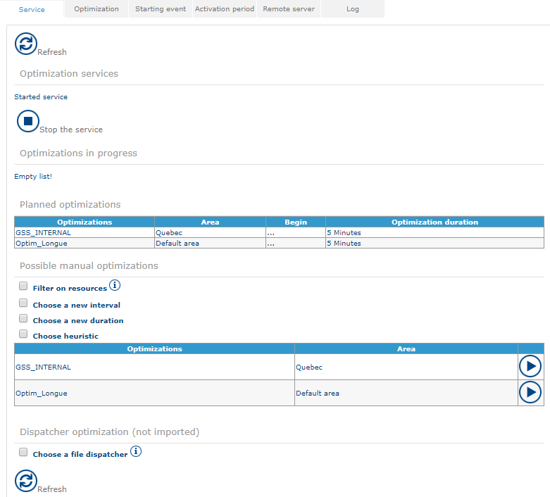

#### (1) Optimization services

This part indicates whether the service is started or stopped.

* Click **Start the service** to activate automated optimization.
* Click **Stop the service** to deactivate automated optimization.

After you apply modifications, click **Restart the service** so that they are taken into account.

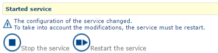


When you restart the service, all optimizations in progress are stopped and lost.


#### (2) Optimisations in progress

This part lists all optimizations that are currently running.

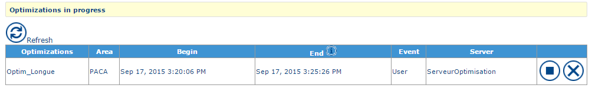

For each optimization, you can view its name, the area it applies to, its programmed start and end times, the triggering event (automated or user-triggered) and the optimization server.

* Click **Stop** to interrupt the optimization in progress. A certain time elapses before the optimization stops. A result is imported after this action.
* Click the  button to cancel the optimization. No result is imported.

#### (3) Planned optimisations

This part lists all optimizations that can run automatically.

#### (4) Possible manual optimisations

This part lists all optimizations that you can trigger manually. You can filter the resources used for the optimization and the dates between which the optimization can modify the agendas of resources.

You can also redefine the optimization duration and the heuristic.

Click the  button to start the optimization.


If you define no filter, the options defined in the **Optimisation** tab are used. The list of heuristics is given under **Advanced parameters** in the next section.


### Optimisation tab

Use this tab to define which optimizations to apply, either automatically or manually (see the **Service** tab).

You can create, consult or modify an optimization with the standard procedure (see [General Principles](generalprinciples.md)).

#### List of saved optimisations

The interface displays the list of saved optimizations (see [General Principles](generalprinciples.md)).

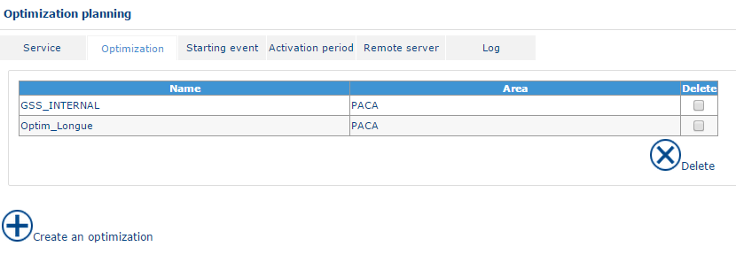

#### Optimisation form

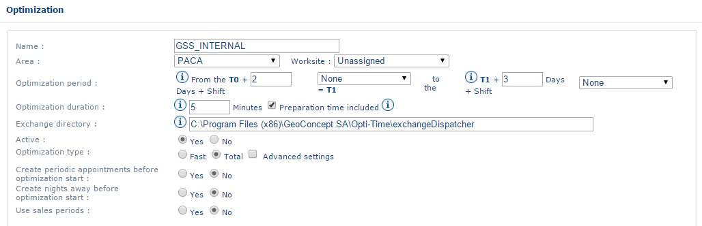

The optimization form (see [General Principles](generalprinciples.md)) contains the following fields:

* **Name** – the name of the optimization.
* **Area** – the area to optimize.
* **Optimisation period** – two values. The first is the offset of the optimization period from the date of its triggering. The second is the number of calendar days, counted from the first value, that the optimization takes into account.
* **Optimisation duration** – the duration of the optimization by the optimization engine, in minutes. This is the maximum optimization duration granted.
* **Exchange directory** – the file path of the exchange directory for the files generated by the optimization engine, on the server on which NFS is installed.
* **Active** – **yes**: the optimization is functional. **no**: the optimization is in standby mode.
* **Type of optimisation** – **Rapid**: only requested appointments are processed, and the other appointments already in the plannings are not modified. **Total**: all appointments (except confirmed appointments) are re-optimized.
* **Generation of recurring appointments before optimisation** – **Yes**: the appointments of regular customers (see the management of known customers) are generated automatically in the optimization period defined above. **No**: no appointment for regular customers is generated in the optimization period.
* **Generation of nights away before optimisation** – **Yes**: nights away are added during the optimization as a function of the parameters defined in the resource form (see [Company Data](companydata.md)) and the optimization parameters. **No**: no night away is generated during the optimization.
* **Utilisation of sales periods** – **Yes**: the sales periods are respected in the optimization period defined above (you must create a sales period). **No**: the sales periods are not taken into account.
* **Status of optimisation period results** – the number of days after the start of the optimization period during which appointments automatically progress to the confirmed status. You can also define a delay for the following days, as the number of days during which appointments have the reserved status. For example, all appointments at D-2 must be confirmed (the time and the resource are known), and between D-2 and D-5 all appointments are reserved (the time is known, but not the resource). In this case, enter the values 2 and 3 respectively.

Click **Advanced parameters** to display the following additional fields.

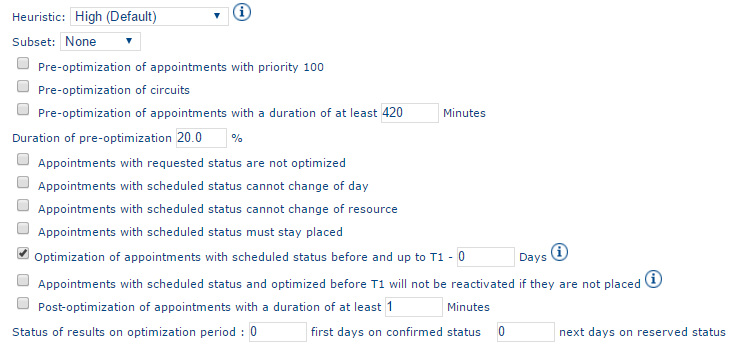

* **Heuristic**:
  * **High (Default)**
  * **Fill with routes (H5)**
  * **Improvement (H4)**
  * **Insert by visit (H1)**
  * **Add visit (H2)**
  * **Fill with visits (H6)**
  * **Addition by sector (H9)**
  * **Low** – uses the real time optimization engine.
*   **Subset**:

    * **None** – by default, the optimization is not split into sections.
    * **Resource** – the optimization is divided into several packets (one per resource).
    * **Worksite** – the optimization is divided into several packets (one per worksite).

    

Splitting the optimization into subsets is recommended in the following cases: customers are always visited by the same resource (subset: <strong>Resource</strong>), or resources do not have a worksite or secondary sector (subset: <strong>Worksite</strong>).

* **Pre-optimisation of rounds (circuit routes)** – adds a phase before the optimization that positions linked appointments or circuits.
* **Pre-optimisation of appointments having a duration of at least** – adds a phase before the optimization that schedules long appointments.
* **Duration of the pre-optimisation** – duration of the scheduling phase for long appointments, as a percentage of the optimization duration.
* **Appointments with requested status are not optimised** – the optimization does not take into account appointments with the requested status (see [The different statuses for appointments in NFS](../introduction/thedifferentstatusesforappointmentsinnfs.md)).
* **Appointments with a planned status cannot change day** – appointments with the planned status cannot change day during the optimization (see [The different statuses for appointments in NFS](../introduction/thedifferentstatusesforappointmentsinnfs.md)).
* **Appointments with a planned status cannot change resource** – you cannot change the resource of an appointment with the planned status during the optimization (see [The different statuses for appointments in NFS](../introduction/thedifferentstatusesforappointmentsinnfs.md)).
* **Appointments with planned status will remain scheduled** – you cannot unplan appointments with the planned status during the optimization (see [The different statuses for appointments in NFS](../introduction/thedifferentstatusesforappointmentsinnfs.md)).
* **Optimisation of appointments with a planned status before, and up to T1 -** – enables re-optimization of appointments with the planned status that date from before the optimization period. The value in days determines the date (T1) from which the planned appointments remain in the planning.
* **Appointments with an optimised planned status before T1 will not be reactivated if they have not been scheduled** – appointments with the planned status scheduled before and up to T1 are not unplanned during an optimization if it is not possible to replan them (see [The different statuses for appointments in NFS](../introduction/thedifferentstatusesforappointmentsinnfs.md)).
* **Post-optimisation of appointments having a duration of at least** – adds a phase after the optimization that schedules long appointments.
* **Status of results over the optimisation period**:
  * **first days in confirmed status**
  * **subsequent days with reserved status**


The optimization parameter **Minimum duration for a multi-day appointment** defines the minimum duration for an appointment to be considered long (see the optimization parameters above). If you select neither **Pre-optimisation of appointments with duration of at least** nor **Post-optimisation of appointments with duration of at least**, multi-day appointments are not optimized.


#### Trigger event and Activation period

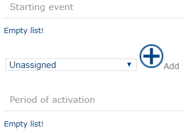

The optimization is launched by the chosen trigger event.

The optimization is visible in the **Service** tab only during the chosen period of activation.

### Trigger event tab

Define trigger events to run a series of optimizations automatically. Several optimizations can share a trigger event if you want them all to start automatically at the same time.

You can create, consult or delete a trigger event (see [General Principles](generalprinciples.md)).

#### List of trigger events

The interface displays the list of trigger events (see [General Principles](generalprinciples.md)).

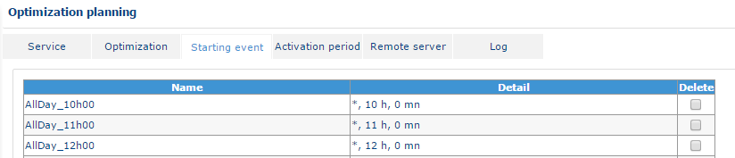

#### Trigger event form

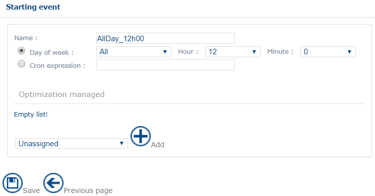

The trigger event form (see [General Principles](generalprinciples.md)) contains the following fields:

* **Name** – the name of the trigger event. You choose the name, but it must not include any special characters (space, and so on).
* **Day of the week** – the days on which the optimization runs.
* **Time in hours and minutes** – the time of day at which the optimization runs.
* **Triggered optimisation** – in this section, you can add one or several optimizations to this trigger event and delete one or several associated optimizations (see [General Principles](generalprinciples.md)).


You can also define a trigger for an optimization in the optimization form (**Optimisation** tab).


### Activation period tab

Use this tab to declare to the application the possible automated optimization periods that are available for the different optimizations (see the **Optimisation** tab).

You can create, consult or delete an activation period (see [General Principles](generalprinciples.md)).

#### List of activation periods

The interface displays the list of activation periods (see [General Principles](generalprinciples.md)).

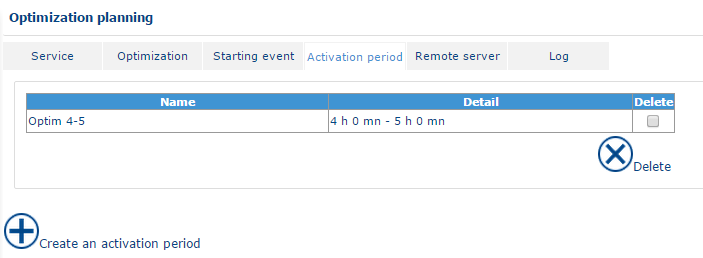

#### Form for an activation period

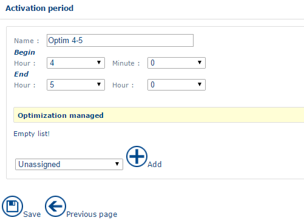

The activation period form (see [General Principles](generalprinciples.md)) contains the following fields:

* **Name** – the name of the activation period.
* **Period of activation** – two values. The first is the offset of the optimization period in relation to its trigger date. The second is the number of calendar days, counted from the first value, that the optimization takes into account.
* **Triggered optimisation** – in this section, you can add one or several optimizations to this activation period and delete one or several associated optimizations (see [General Principles](generalprinciples.md)).


You can also define the period of activation for several optimizations in the optimization form (**Optimisation** tab).


### Remote server tab

Use this tab to tell NFS the locations of all servers from which batch optimizations are performed.

You can have several remote servers so that several optimizations run simultaneously.

You can create, consult or delete access to a remote server (see [General Principles](generalprinciples.md)).

#### List of remote servers

The interface displays the list of remote servers (see [General Principles](generalprinciples.md)).

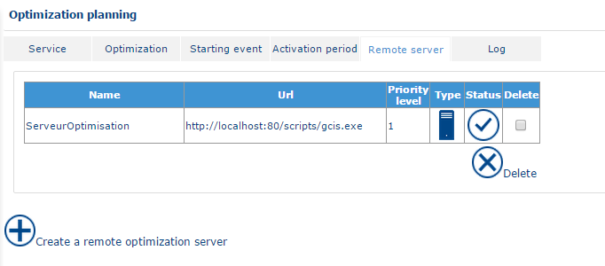

#### Form for a remote optimization server

The remote server form (see [General Principles](generalprinciples.md)) contains the following fields:

* **Name** – the name of the remote optimization server. You choose the name, but it must not include any special characters (space, and so on).
* **Priority level** – priority of the remote server in relation to the other remote servers that handle the same area.
* **Active** – **Yes**: the optimization server is available to handle optimizations. **No**: it is not available.
* **URL** – the path to access GCIS (for example, `http://monserveur:port/Scripts/gcis.exe`).
* **Page Name** – the name of the GCIS page. This is the page that was saved in the GCIS administration at installation.
* **Delay** – the period between two requests from NFS to the optimization engine about the progress of the optimization. The default value is 5,000 milliseconds.
* **Local access** – the local file path for the files that the optimization engine generates at the end of the optimization (for example, `C:\OptimisationFiles`).
* **Remote access** – the file path that lets NFS retrieve the files that the optimization engine generates on the remote server (for example, `c`).
* **Map and areas handled** – see below.

#### Map and areas handled

A remote server stores one or several areas to optimize. You assign one priority to each area on each remote server.

An area can be stored on several remote servers with a different priority. When the optimization is launched, the system examines each of the areas to optimize and triggers the work after examining the priority.


If an area is stored on different remote servers, optimize different periods without any overlap. This is strongly recommended.


You can add, consult or delete a managed map (see [General Principles](generalprinciples.md)).

Add the map before you associate an area with it.

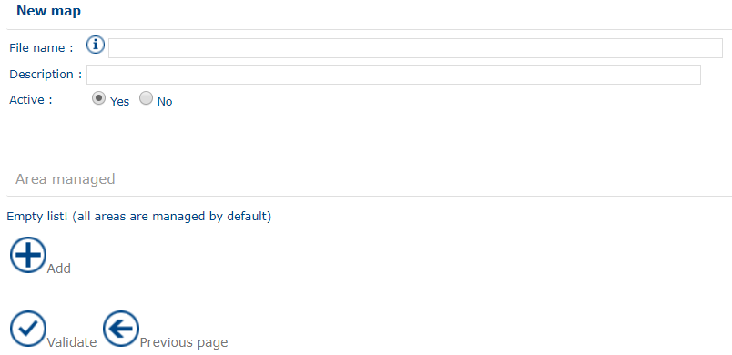

The form of a managed map contains the following fields:

* **Access path** – the directory of cartographic files (`.GCM`/`.GCR`).
* **Description** – free field.
* **Active** – **Yes**: the map is used for the optimization. **No**: the map is not used.
* **Areas managed** – this section lets you associate areas with this map and delete associations (see [General Principles](generalprinciples.md)).


You assign a priority to the areas to be treated at this point.


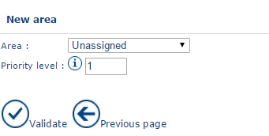

The form for an associated area contains the following fields:

* **Area** – the name of the area to assign (see [Company Data](companydata.md)).
* **Priority level** – the priority of the area in relation to other managed areas.


Priority level 1 takes precedence over priority level 2.


### Journal tab

The results of previous optimizations are stored on the server. You can consult them from this tab.

You can filter the list of optimization results (see [General Principles](generalprinciples.md)).

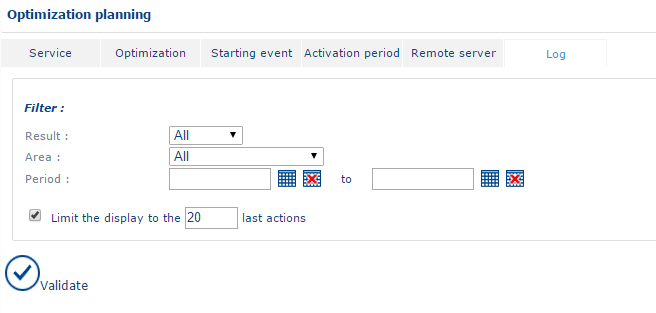

* **Result**:
  * **All** – displays all optimization journals.
  * **In error** – displays only the optimization journals in error (the result has not been imported).
  * **OK** – displays the optimization journals for which the result has been imported.
* **Area** – limits the display to the optimizations for an area (see [Company Data](companydata.md)).
* **Period** – filters on the optimization date.
* **Limits the display to the n last actions** – displays the number of lines defined in the corresponding box.

Click **Validate** to display the reports.

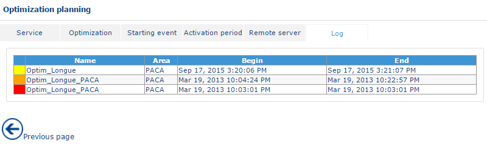

Click the report of an optimization result to open a new window with the report on the optimization.

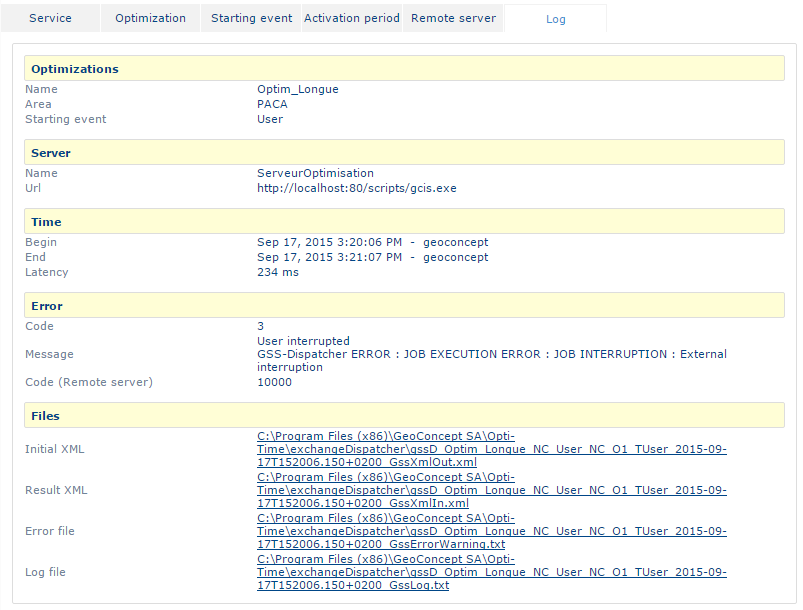

The optimization report contains the following items:

* **Optimisation** – the name of the optimization, of the optimized area and of the trigger event.
* **Server** – the name and URL of the server where the optimization runs.
* **Time** – the start and the end of the optimization.
* **Error** – the code and error messages if an error occurred during the optimization.
* **GssXmlOut.xml** – the source file for the optimization before the optimization engine treats it.
* **GssXmlIn.xml** – the result file, before its import into the application.
* **GssErrorWarning.txt** – a text file that describes all error and warning messages that can occur during optimization.
* **GssLog.txt** – the journal file that describes all actions from the export to the optimization engine to the import of appointments into NFS, as well as the whole optimization process in the optimization engine.

You can also use the following links:

* **Download files** – downloads all files as a compressed archive.
* **Download the summary** – downloads the summary file for the optimization. It includes general information about the optimization (duration, number of scheduled appointments, non-scheduled appointments, and so on).

## Activate/Deactivate an area

**Activate/Deactivate an area** lists the areas and gives their status. The administrator can manually deactivate or re-activate an area. You can also see whether an automated optimization process has deactivated an area.

To open the function, click the **Activate/Deactivate an area** link in the menu.

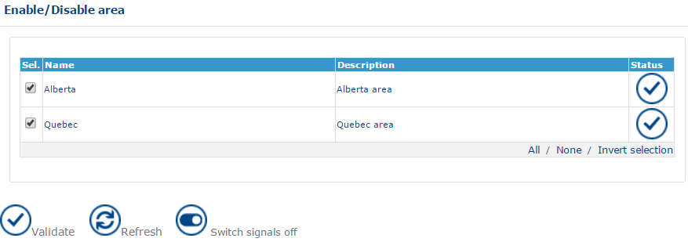

The **Status** column can take the following values:

* **V** – the area is activated.
* **X** – the area is deactivated.
* **X with a panel** – the area is temporarily deactivated by an automated optimization process.

To activate or deactivate an area:

1. Select or clear the check boxes of the areas to activate or deactivate.
2. Click **Validate**.


Deactivating an area prevents users from using all functions linked to the plannings (confirm, plan, unplan, appointments, add or modify unavailabilities, and so on).


A message also warns the user that the area is locked. Users can still enter requested appointments, because no scheduling or planning is involved at that stage.

## Import/Export optim

This function lets you create [Global Optimization](../portal/globaloptimization.md) items by file.
