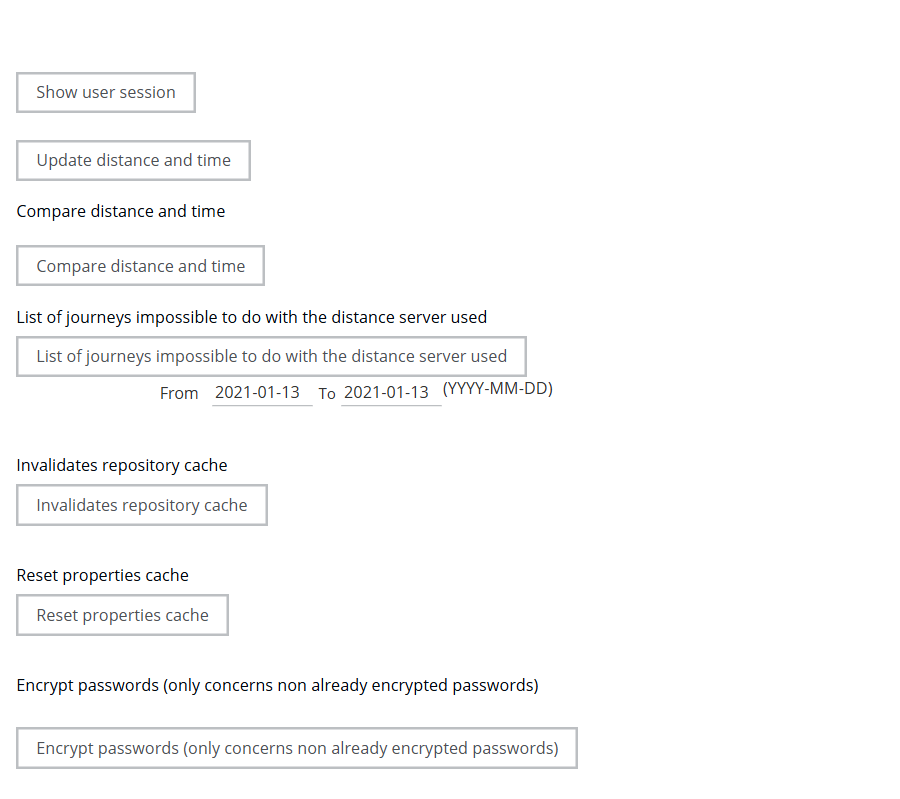
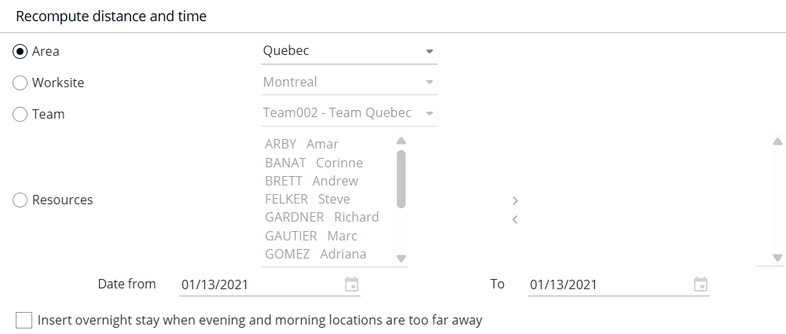
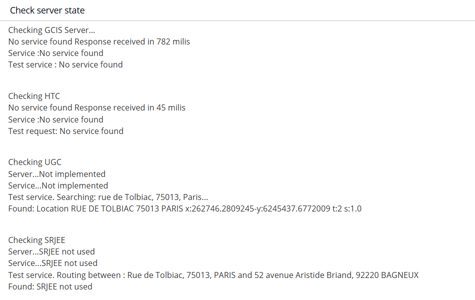
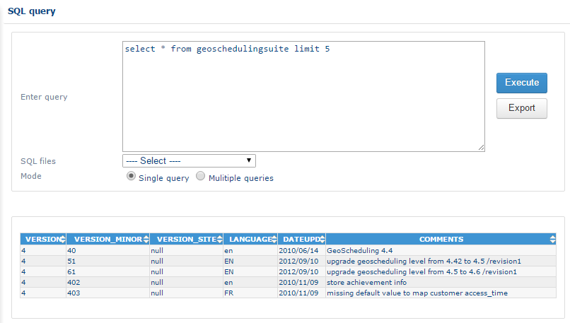
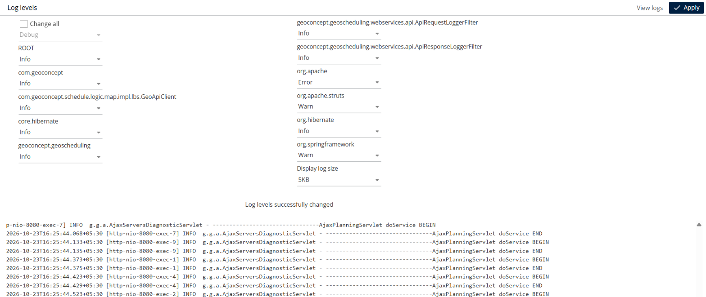

# Tools

## Overview

The Tools menu groups the advanced database tools, the distance recomputation, the server status check, the SQL query tool, the journals and the JVM thread dump.


This section is reserved for expert administrators. The actions applied in this section can have an irreversible impact on data.


## Advanced tools

To open the function, click the **Advanced tools** link in the **Tools** menu.

This section lets you apply the following modifications in the database.

### Stagger dates

This tool moves or delays all appointments by a certain number of days.


Do not use this function in a production context.


### Update journey distances and times

This function recalculates journey distances and times between appointments.


The function recalculates all the journey times for the application. It can take some tens of minutes.


### List of journeys that are impossible with the distance server used

This function exports a CSV file that lets you detect any appointments that overlap with other elements in the planning. You can also define the number of minutes of overlap, which is useful for resizing appointments so that there are no overlap problems.

### Renew the repository cache

Following a database update, this function refreshes the interface.

## Recompute distance and time

To open this function, click the **Recompute distance** link in the **Tools** menu.

This interface lets you recompute, for a given perimeter (area, site, team or resource for a given period), the journey distances and times between appointments in the routes of this perimeter.

This function is useful, for example, when the speed of travel of a resource has changed: the tool updates the corresponding agendas.

## Verify server status

To open the interface for verifying the server status, click the **Verification of server status** link in the **Tools** menu.

This interface lets you verify the status of the geographic services (GCIS), the cartographic services (H) and the geocoding services (UGC). In the example shown, the services are functional and their status is OK.

## SQL query

To open the SQL query interface, click the **SQL Query** link in the **Tools** menu.

This tool lets you query the database directly.

## Journals

To open the journals interface, click the **Journals** link in the **Tools** menu.

This tool lets you view the application logs directly in the interface. You can also change the journalization mode, which sets the level of detail in the logs.

The fields in the interface are as follows:

* **Modify all** – updates all drop-down lists at once.
* **org.hibernate**
* **geoconcept.geoscheduling**
* **org.apache.struts**
* **com.geoconcept**
* **Display the journal size** – modifies the number of lines to display.


The log levels, from the most detailed to the least detailed, are: `All`, `Debug`, `Info`, `Alert`, `Warn`, `Error`, `Severe`, `Fatal`.


Click **See journals** to display the logs.

Click **Apply** to update the log level.

## JVM thread dump

This function displays the file of JVM threads.


You can be asked for this information when a software bug needs to be resolved.

