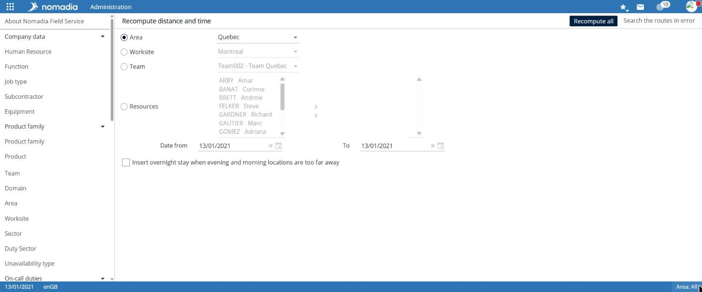

# Use administration tools

The **Tools** group contains maintenance functions: travel-time recalculation, service checks, journals, and map settings. The **Nomadia Field Service API** group provides access to the API documentation.

## Before you start

These tools affect the entire application. Restrict them to administrators and use them with Nomadia support.

## Access the feature

| Entry                      | Navigation                                                                |
| -------------------------- | ------------------------------------------------------------------------- |
| Advanced tools             | `Administration > Tools > Advanced tools`                                 |
| Recalculate distance       | `Administration > Tools > Recalculate distance`                           |
| Check server status        | `Administration > Tools > Check server status`                            |
| Journals                   | `Administration > Tools > Journals`                                       |
| JVM thread dump            | `Administration > Tools > JVM thread dump`                                |
| Mapping services           | `Administration > Tools > Mapping services`                               |
| API documentation          | `Administration > Nomadia Field Service API > Documentation`              |
| CSV import/export template | `Administration > Nomadia Field Service API > CSV import/export template` |

## Recalculate distances and journey times

1. Open **Recalculate distance**.
2. Choose the scope: **Area**, **Worksite**, **Team**, or **Resources**. For resources, select them from the left list and use the arrows to add them.
3. Enter the **Date from** / **To** period.
4. If needed, select **Insert an overnight stay when evening and morning locations are too far apart**.
5. Select **Recalculate**.

**Search routes in error** is also available.

## Advanced tools

The following actions are available, each with its own button:

* **Update distances and journey times**;
* **Compare distances and journey times**;
* **List impossible journeys with the distance server used**, over a **From** / **To** period;
* **Renew the repository cache**;
* **Reset the property cache**;
* **Encrypt passwords** (applies only to passwords that are not already encrypted).


These actions affect the entire application. Use them only at support's request.


## Configure mapping services

The **Mapping settings** page has **General**, **Geocoding**, **Routing**, and **Mapping** tabs. The **General** tab contains **Plate**, **SRS**, and **Coordinate source**. Select **Save** after changing settings.

## Other tools

* **Check server status** displays a test report for the services used by the application.
* **Journals** displays the **Logging level** page: level by component, **Modify all** button, recent-log display, and **View logs** and **Apply** buttons. The same page is available from the **XML files** group.
* **JVM thread dump** is a technical support tool.

## View the API documentation

* **Documentation** opens Nomadia Field Service API documentation.
* **CSV import/export template** describes exchange fields for each entity. See [Manage exchange files](manage-exchange-files.md).
