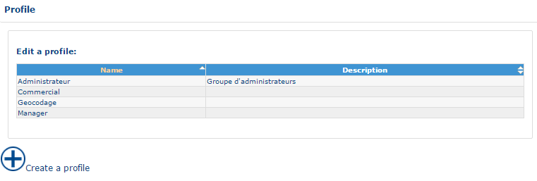
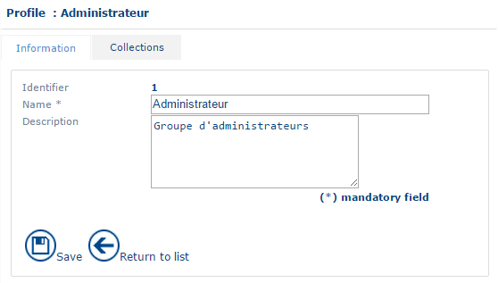
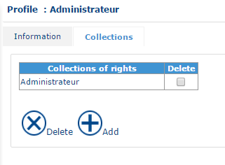
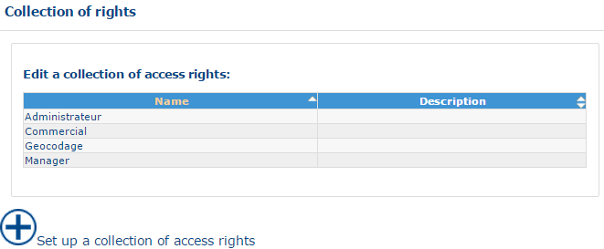
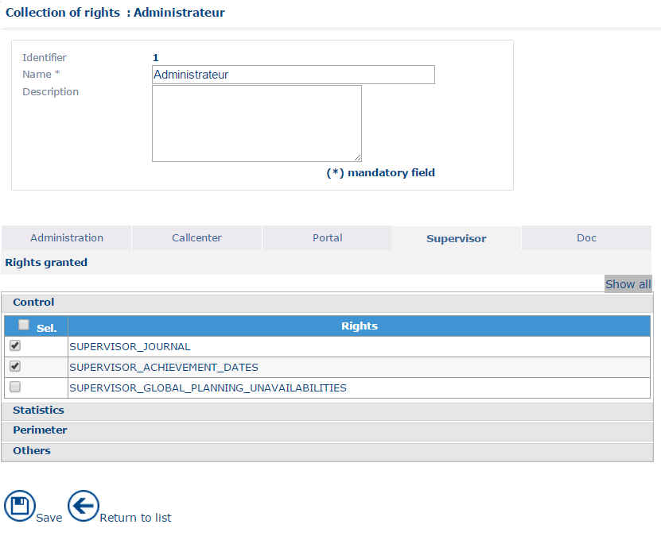
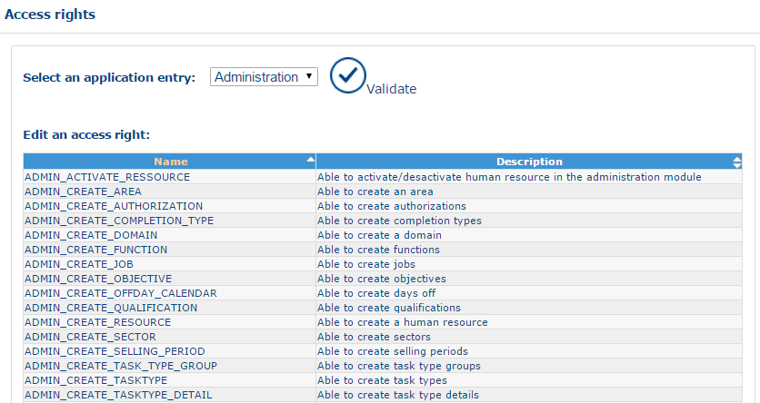
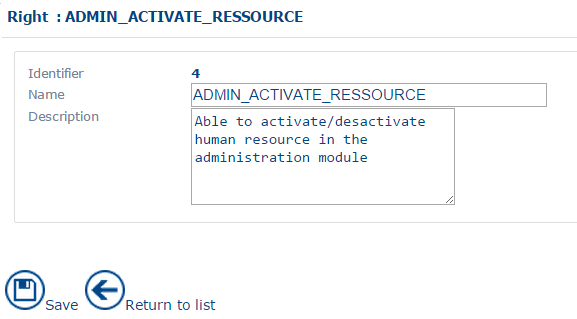
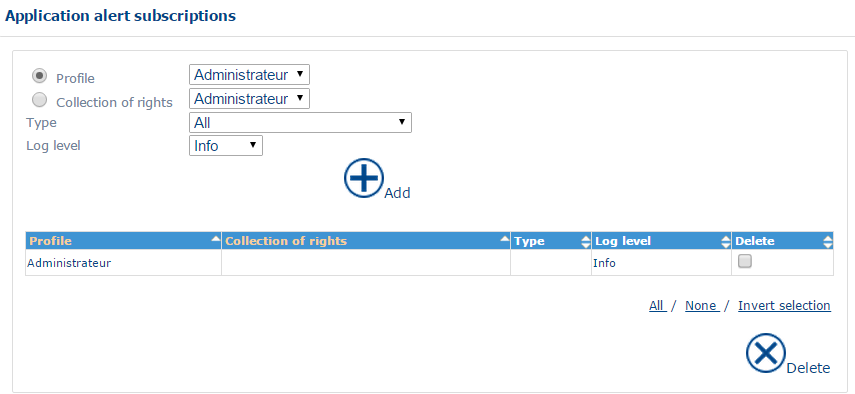

# User Handling

## Overview

Users are defined in the human resource section in the same way as the resources. See [Company Data](companydata.md).

Each resource present in the application can have a user profile, or not.

In NFS, user rights manage each function. When you associate a profile with a user, you define the functions that the user has the right to use. All users with the same profile have the same rights in the application.

The principle for handling user rights depends on two items:

* The collection of rights, which determines a list of accessible functions.
* The user profile, which groups a collection of rights and therefore defines the series of functions accessible to a user with this profile.


Planning managers must be entered in the application, even if they do not have an agenda to optimize. See [Company Data](companydata.md). Conversely, mobile resources who do not have a planning role can have a profile that lets them consult their agendas.


For how to use lists and forms (create, consult, edit, add, delete), see [General Principles](generalprinciples.md).

## Profile

A profile represents all users of the application who have the same access rights to use the application.

To open the list of profiles, click the **Profile** link in the menu.

You can create, consult or edit a profile.


You can define, for example, an Online Advisor profile, a Supervisor profile and a Call Centre Manager profile. The Supervisor and Call Centre Manager profiles have access to the Supervision module, while the Online Advisor profile does not.


### List of profiles

The interface displays the list of profiles currently saved in the application.

### Profile form

The profile form is made up of the **Information** and **Collections** tabs.

#### Information tab

Each profile stores the following information:

* **Profile Identifier** – a read-only unique identifier that the application assigns automatically when you validate the creation of the profile.
* **Profile Name** – the profile name as it appears in the resource form. See [Company Data](companydata.md).
* **Profile Description** – a free text item.

#### Collections tab

The **Collections** tab lets you associate one or several collections of rights with a profile.

You can add and delete collections of rights.

## Collection of rights

A collection of rights represents the group of collections of access rights defined at system level. Each collection of rights is a group of basic access rights that fulfil a generic requirement. For example, you can define an **Edit team planning** collection of rights for a team manager user.

You can create, consult or edit a collection of rights.

### List of collections of rights

To open the list of collections of rights, click the **Collection of rights** link, under the **Users** branch, in the menu.

The interface displays the list of collections of rights currently saved in the application.

### Collection of rights form

The form for the collection of rights presents the following information:

* **Identifier** – a unique, read-only identifier that the application assigns automatically when you validate the creation of the collection of rights.
* **Name** – the name of the collection of rights. This information is mandatory.
* **Description** – a free text item. This text appears in a popup on each collection of rights line in the list of collections of rights in the **Profiles** branch.
* **Rights granted** – see below.

The **Rights granted** section is organized into tabs that correspond to the different modules of the application (Portal, Planning, Supervisor, Attendance, Strategic, Administration, Documentation, etc.).

Each tab contains the list of basic access rights associated with this tab. The rights that are selected in the interface are assigned. The rights that are cleared are not assigned.

For better legibility, the basic rights are grouped into themes. The full list of access rights is available in [Access Rights](../appendices/accessrights.md).

#### Planning

* **Customer** – defines access to customer management functions.
* **Appointment** – defines access to appointment management functions.
* **List of appointments** – defines access to functions in the lists of appointments.
* **Planning** – defines access to scheduling functions.
* **Interactions with agenda** – defines access to agenda functions.
* **Agenda** – defines access to agenda viewing functions.
* **Communication** – defines access to export and roadbook functions.
* **Cartography** – defines the functions available in the map.
* **Night away** – defines access to functions for scheduling nights away.
* **Real time tracking** – defines access to tracking functions for journeys undertaken by resources.
* **Resource management** – defines access to management functions for resource posts.
* **Unavailabilities** – defines access to functions for scheduling unavailabilities.
* **Perimeter** – defines access to the module and to the different levels of data (area, domain, team, worksite).
* **Customized action**
* **Others** – other access rights.

#### Portal

* **Agenda** – defines access to functions and parameters for the portal agenda.
* **Communication** – defines access to functions related to the road book.
* **Optimisation** – defines access to functions related to optimizations.
* **Unavailabilities** – defines access to functions for scheduling unavailabilities in the portal.
* **Perimeter** – defines access to the module and lets you define the information levels to which the user has access.

#### Supervision

* **Control** – defines access to the journalization functions of the supervisor.
* **Statistics** – defines access to statistics on appointments, unavailabilities, the taking of appointments and the achievement of targets.
* **Perimeter** – defines access to the administration module and to different levels of data (area, domain, team, worksite).
* **Others** – other access rights.

#### Attendance

* **Perimeter**
* **Resource**
* **Post**
* **On-call duty day**
* **On-call duty week**
* **Unavailability**
* **Marker**
* **Working day**
* **Working week**
* **Reports**
* **Print**
* **Communication**
* **Others**

#### Administration

* **Global access** – defines access to the main functions of an administration module.
* **Resource** – defines access to human resource management functions. See [Company Data](companydata.md).
* **Post** – defines access to management functions for types of post. See [Company Data](companydata.md).
* **Team** – defines access to management functions for teams. See [Company Data](companydata.md).
* **Worksite** – defines access to worksite management functions. See [Company Data](companydata.md).
* **Domain** – defines access to management functions for domains. See [Company Data](companydata.md).
* **Sub-contractor**
* **Equipment**
* **Area** – defines access to management functions for areas. See [Company Data](companydata.md).
* **Sector** – defines access to management functions for sectors. See [Company Data](companydata.md).
* **Unavailability type** – defines access to management functions for types of unavailability. See [Company Data](companydata.md).
* **On-call duty template**
* **Product**
* **Product family**
* **Vehicle**
* **Tracking device**
* **RH vehicle assignment**
* **Skill** – defines access to skills management functions. See [Company Data](companydata.md).
* **Authorisation** – defines access to management functions for authorizations. See [Company Data](companydata.md).
* **Intervention type** – defines access to management functions for types of intervention. See [Company Data](companydata.md).
* **Target** – defines access to management functions for targets. See [Control Panel – Targets](../supervisor/controlpanel-targets.md).
* **Activity tracking** – defines access to activity tracking management functions. See [Company Data](companydata.md).
* **Calendar** – defines access to calendar functions (public holidays, day templates, week templates and sales periods). See [Company Data](companydata.md).
* **Configuration** – defines access to the management of XML and CSV files. See [CSV Files](csvfiles.md).
* **Optimisation** – defines access to optimization management functions. See [Optimization](optimisation.md).
* **Perimeter** – defines access to the administration module and to different levels of data (area, domain, team, worksite).
* **Technical exchanges** – defines access to the management of CSV files and to the TomTom export. See [CSV Files](csvfiles.md).
* **Exceptional localisation type**
* **Typology**
* **Others** – other access rights.

#### Modules

* **Modules**

#### Documentation

* **Perimeter** – defines access to the online documentation and the WalkMe display. See [The Header Bar](../the-header-bar/guided-help-nfs-reference-guide-1.md).

#### My applications

* **My applications**

## Access rights

An access right represents the group of elementary access rights defined at system level. The full list of access rights is available in [Access Rights](../appendices/accessrights.md). Each identifier is pre-saved in the application. Only the names and descriptions are editable.

You can consult or edit an access right.


The system knows each right exclusively by its identifier, and these identifiers are predefined. Choose names for rights with great care, and retain a meaning equivalent to the original.


### List of access rights

To open this function, click the **Access rights** link in the menu.

The interface displays the list of access rights, classified by activity, currently saved in the application.

The list includes a **Description** field that gives the definition of each right.

### Access right form

The access right form contains the following information:

* **Identifier** – a unique, read-only identifier that the application assigns permanently.
* **Name** – the name of the access right. Do NOT modify the name or, if you modify it, retain the same meaning.
* **Description** – a free text item. This text appears in a popup on each access right line in the list of rights granted in the **Collection of rights** branch.

## Subscription to alerts

Alerts warn users in certain cases, for example an error during an import operation, an update of a configuration, or the start or end of a process.

Alerts are available in the Planning module, in the **Application alerts** menu. See [Menu](../planning/menu.md).

When you subscribe to an alert, you receive the corresponding flow of information. You can add or delete a subscription to an alert.


Without the relevant subscription to the service, the user does not see the corresponding alert.


To open the list of subscriptions, click the **Subscription to alerts** link in the menu.

The interface displays the list of alerts currently saved in the application.

The fields available in the interface are:

* **Profile** – lets you choose a user profile that follows the alerts. All users with this profile follow the alerts.
* **Collection of rights** – lets you choose which collections of rights to associate with alerts. All users with this collection of rights can track alerts.
* **Type** – lets you select the alert to subscribe to:
  * `All`
  * `Optimization Batch warning`
  * `Export warning`
  * `Import warning`
  * `Entity creation`
  * `Entity disabling or deletion`
  * `Optimization batch error`
  * `Export error`
  * `Import error`
  * `Communication warning event`
  * `Communication error event`
  * `Service call event`
  * `Process start event`
  * `Process end event`
  * `Service failed event`
  * `Service completed event`
  * `Entity update`
  * `Optimization settings updated`
  * `Settings updated`
  * `Export summary`
  * `Import summary`
  * `Optimization batch summary`
  * `Tracking summary`
  * `User session`
* **Level of journalisation** – lets you define the level of detail of historical information, from the most detailed to the least detailed: `All`, `Debug`, `Info`, `Alert`, `Warn`, `Error`, `Severe`, `Fatal`.
