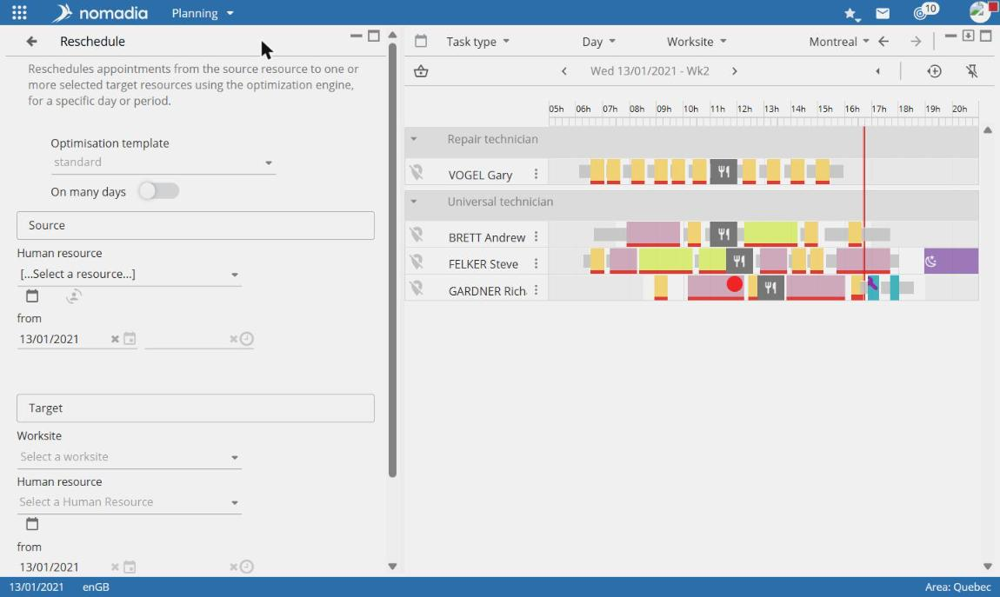

# Process several appointments at once

Several functions process all the appointments of a field worker, or of a selection, in a single operation. They are useful for an unplanned absence, an overload, or a reorganization.

| Function                          | What it does                                                                                                                                         |
| --------------------------------- | ---------------------------------------------------------------------------------------------------------------------------------------------------- |
| **Swap**                          | Swaps the routes of two field workers for the same day. The appointments are exchanged, without reoptimization.                                      |
| **Reschedule**                    | Reschedules the appointments of a source field worker to one or more target field workers, with the optimization engine, for a day or a period.     |
| Scheduling a selection            | Submits the appointments of the list of selected appointments to the optimization engine.                                                            |

## Access the feature

**Navigation:** `Planning > Appointments menu > Swap` or `Planning > Appointments menu > Reschedule`

## Swap two field workers' routes

1. Open `Planning > Appointments menu > Swap`.
2. In **Source**, choose the resource and the date.
3. In **Target**, choose the resource and the date.
4. Select **Apply**.

## Reschedule a field worker's appointments

1. Open `Planning > Appointments menu > Reschedule`.
2. Choose the **Optimisation template**.
3. Turn on **On many days** to process a period rather than a single day.
4. In **Source**, choose the **Human resource** and the date (**from**).
5. In **Target**, choose the **Worksite** and the target **Human resource**, then the date.
6. Select **Apply**.


The more target resources and the longer the period, the more likely the engine is to reschedule all the appointments. The source and the target can be the same field worker: the field worker's schedule is then reoptimized over the period.


## Schedule the selected appointments

1. Add the appointments to the selection list from a results list, the map, or the schedule.
2. Open `Planning > Appointments menu > Selected appointment list`.
3. Run the action to schedule several appointments.
4. Choose the period (**Start**, **End**) and the field workers, by **Team**, **Worksite**, or **Field worker**.
5. Confirm.

The list of selected appointments also lets you reassign resources to the selected appointments (**Required**, **Preferred**, or **Undesirable** resource). This action applies only to appointments with the **Requested** status.

## Points to note


Scheduling a selection does not transfer appointments that are already scheduled: it submits them to the engine again. A **Requested** appointment is searched over the whole period you enter, and a **Planned** appointment only within its possible completion period. Some appointments can therefore stay with their original field worker.


<!-- REVIEW: the following were not verified in the application: the Swap entry (not displayed in the test environment menu; the Planning overview lists it as Swap), the Apply button on Swap and Reschedule, the name of the action that schedules several appointments, and the fields of the scheduling window (Start, End, Team, Worksite, Field worker). The Planning overview and the appointment statuses topic call the Reschedule entry Replan. -->
