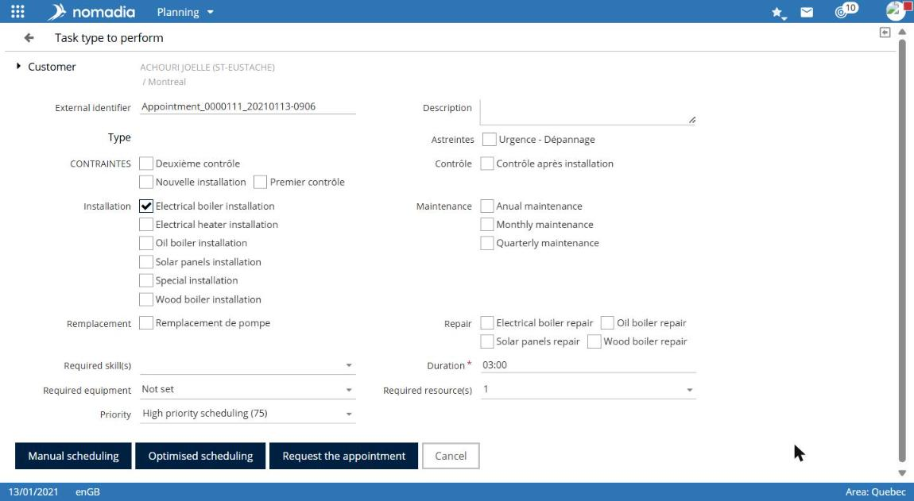
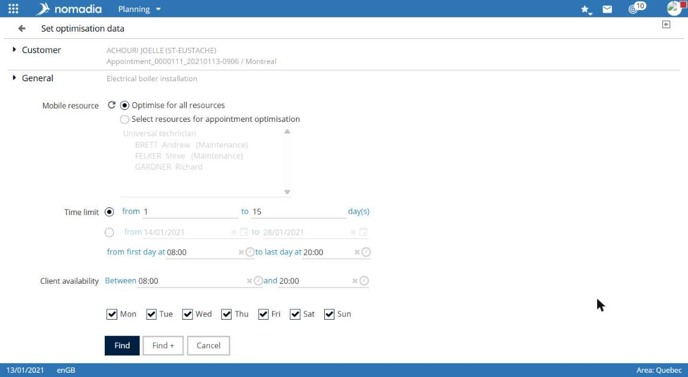
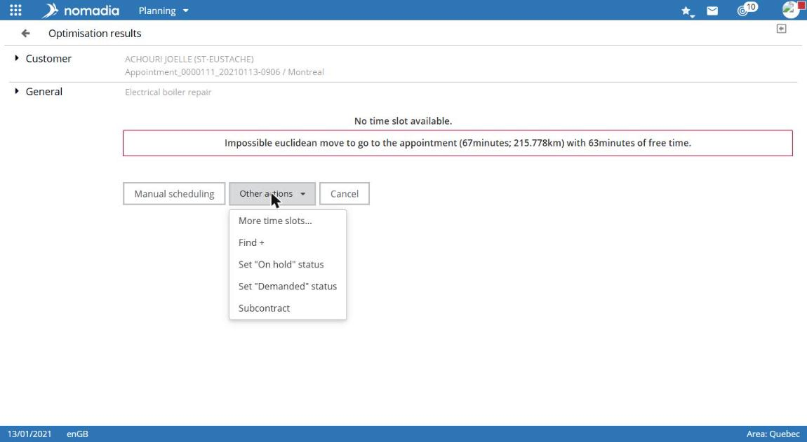

# Schedule an appointment

Use this procedure to create a customer appointment, receive time slots proposed by optimization, then schedule the selected slot.

## Before you start

The customer must exist in the application. For more information, see [Create a customer](../customers/create-a-customer.md).

## Access the feature

**Navigation:** `Planning > customer record > Create an appointment`

Open the customer record, for example from [Search for a customer](../customers/search-for-a-customer.md), then select **Create an appointment**.

## Describe the service

The **Service type to perform** screen appears.

1. Check the **External reference**. It is proposed automatically.
2. Enter a **Description** if needed.
3. Select one or more service types to perform. They are grouped by service group.
4. Check the **Duration**. It is prefilled from the selected service type.
5. If needed, complete **Required skill(s)**, **Required field worker(s)**, and **Priority**.

6. Choose the scheduling mode:

| Button                     | Use                                                            |
| -------------------------- | -------------------------------------------------------------- |
| **Manual scheduling**      | Set the appointment field worker, date, and time manually.     |
| **Optimized scheduling**   | Optimize the appointment in real time.                         |
| **Request an appointment** | Enter the appointment request. Optimize the appointment later. |

The rest of this page describes **Optimized scheduling**. For manual scheduling, see [Schedule an appointment manually](schedule-an-appointment-manually.md).

## Configure optimization

The **Optimization settings** screen appears.

1. Check the **Optimization model**.
2. Under **Field worker**, select **Optimize across all field workers** or **Select field workers to optimize**, then select field workers from the list.
3. Under **Period**, set the search period:
   * by number of days, with **From** and **To**;
   * or between two dates.
4. Adjust **first day from** and **last day to** times.
5. Adjust **Customer availability**, with **Between** and **and**.
6. Select or clear weekdays, **Mon** through **Sun**.
7. Select **Search**.

The **Save these values for future reoptimization** checkbox is selected by default.

## Choose a time slot

The **Optimization results** screen lists **Found slots**. Each slot shows the **Slot to communicate**, **Relevance** as stars, **Time**, and **Field worker**.

1. Select the required slot row.
2. Select **OK** on that row.

If no slot is suitable, **Other actions** offers **Set status to Suspended**, **Set status to Requested**, and **Subcontract**. **Manual scheduling** is also available.

## Confirm the appointment

The appointment record appears with the **Scheduling in progress** status. The following buttons validate the slot. **Cancel** is also available.

| Button               | Effect                                                         |
| -------------------- | -------------------------------------------------------------- |
| **Schedule**         | Schedules the appointment as planned.                          |
| **Reserve**          | Reserves the appointment and sets its time.                    |
| **Accept**           | Accepts the appointment. Its assignment must no longer change. |
| **Confirm**          | Confirms the appointment.                                      |
| **Confirm and send** | Confirms and sends the appointment.                            |

1. Select the required button, such as **Schedule**.
2. Select **OK** in the confirmation message.

## Result

The **Appointment is scheduled.** message appears and the appointment status becomes **Scheduled**. The appointment appears in the field worker’s schedule, and the customer record’s **Next visit date** is updated.
