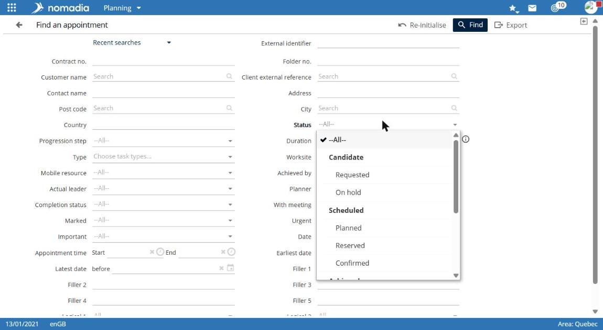
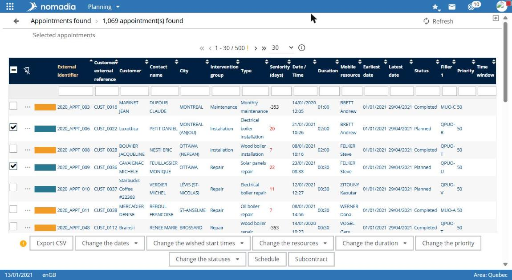

# Search for appointments

Appointment search lets you find appointments with many criteria, then open their record or apply an action to several appointments.

## Access the feature

**Navigation:** `Planning > Appointments menu > Search for appointments`

You can also select the **SEARCH FOR APPOINTMENTS** shortcut on the module home screen.

## Enter criteria

The **Search for an appointment** panel provides these criteria:

* **External reference**, **Customer name**, **Customer reference**, **Contact**;
* **Postcode**, **City**;
* **Status**, **Service type**, **Work site**;
* **Field worker**, **Completed by**, **With appointment**;
* **Date**, **From** / **To**, and **Appointment time**, **Start** / **End**;
* **Earliest date**, **Latest date**, **Entry date**;
* **Miscellaneous 1** through **Miscellaneous 3**, and **Additional logic 1**.

1. Enter one or more criteria.
2. Select **Search**.

**Reset** and the **Recent searches** list are also available at the top of the panel.


A search without criteria can return many appointments and take time. Enter at least a date or status to narrow the results.


## Use results

The **Appointments found** page shows the number of appointments found and displays them in pages. Set the rows per page above the table.

* Sort a column with arrows in its header.
* Filter a column with the field below its header.
* Select **•••** at the beginning of a row to open the appointment record.
* **Refresh** is available above the list.

## Act on several appointments

1. Select the relevant appointments.
2. Select an action below the list:
   * **Export to CSV**;
   * **Announce**;
   * **Edit dates**, **Edit field workers**, **Edit skills**, **Edit duration**, **Edit priority**, **Edit work site**, **Edit additional data**, or **Edit statuses**;
   * **Schedule**;
   * **Subcontract**.

## Points to note

* Use the panel expand icon to display all result columns.
* The **View services in the selection list** link appears above the results.
