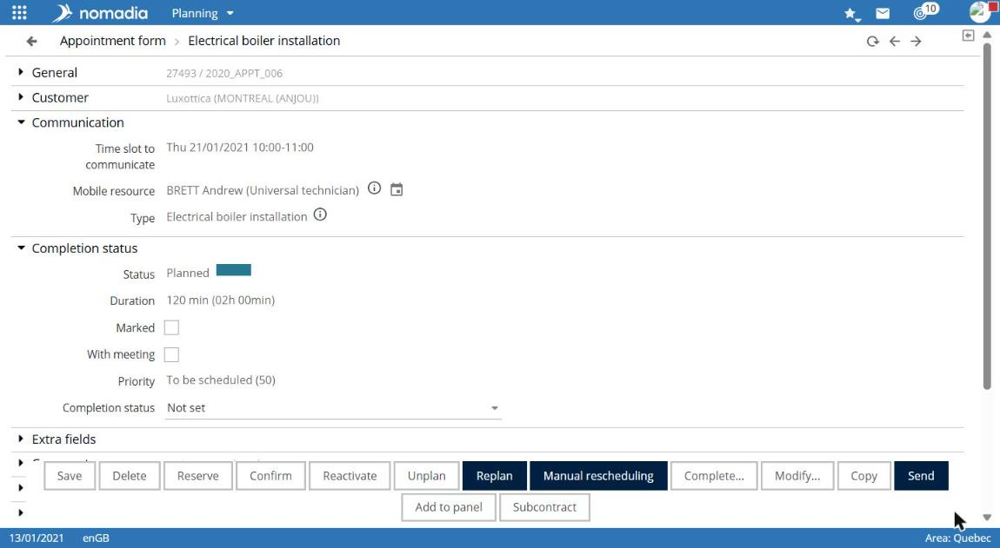

# View an appointment record

An appointment record brings together appointment information and actions available for its status.

## Access the feature

You can open an appointment record:

* From search results, with **•••** at the beginning of the row.
* From the schedule, with the **Open service record** icon.
* From a customer’s appointment list.

## Read the record

The **Appointment record** title is followed by the service type. Information is organized into collapsible sections:

| Section               | Content                                                                                                                                                                  |
| --------------------- | ------------------------------------------------------------------------------------------------------------------------------------------------------------------------ |
| **General**           | Identifier, Description.                                                                                                                                                 |
| **Customer**          | Customer identifier, customer name, address, primary contact.                                                                                                            |
| **Communication**     | Slot to communicate, field worker, service type.                                                                                                                         |
| **Completion status** | Status, duration, marked, with appointment, urgent. For completed appointments: actual start and end dates, actual duration, completed by, progress, and service report. |
| **Additional data**   | Linked documents, quantities, and miscellaneous fields.                                                                                                                  |
| **Comments**          | Route-sheet comments and internal comments.                                                                                                                              |
| **Messages**          | Messages linked to the appointment.                                                                                                                                      |
| **History**           | Appointment history.                                                                                                                                                     |

## Use scheduled-appointment actions

The following buttons are available at the bottom of a scheduled appointment record. Their descriptions match the application tooltips.

| Button                                      | Action                                                                                       |
| ------------------------------------------- | -------------------------------------------------------------------------------------------- |
| **Save**                                    | Saves appointment comments.                                                                  |
| **Delete**                                  | Deletes the appointment.                                                                     |
| **Reserve**, **Accept**, **Confirm**        | Changes the appointment status.                                                              |
| **Suspend**, **Reactivate**, **Unschedule** | Removes the appointment from the schedule or makes it available for scheduling again.        |
| **Reschedule**                              | Reschedules the appointment with real-time optimization or a selected date and field worker. |
| **Manual rescheduling**                     | Reschedules the appointment manually.                                                        |
| **Complete...**                             | Completes the appointment.                                                                   |
| **Split...**                                | Splits the appointment.                                                                      |
| **Edit...**                                 | Changes appointment data, such as customer, time, duration, and address.                     |
| **Copy**                                    | Copies the appointment.                                                                      |
| **Announce**                                | Sends an announcement to field workers or customers for the appointment.                     |
| **Send**                                    | Sends a notification to the field workers assigned to the appointment.                       |
| **Add to basket**                           | Adds the appointment to the appointment basket.                                              |
| **Set a milestone**                         | Sets a milestone for the appointment.                                                        |
| **Subcontract**                             | Sends the appointment to a subcontractor.                                                    |

For status changes, see [Understand appointment statuses](../introduction/appointment-statuses.md).

## Points to note

* Available buttons vary by appointment status. For example, a completed appointment record provides **Save**, **Unschedule**, **Cancel completion**, and **Copy**.
