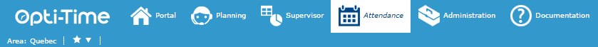

# Attendance

## Overview

The Attendance module is designed for managers and planning personnel. It lets you:

* view the plannings in the selection, according to the temporary post assigned to each resource;
* apply manual modifications to the resources' plannings quickly and easily.

## Prerequisites

You can access the Attendance module only if the [corresponding rights](../administration/userhandling.md) are associated with your user profile: in the **Attendance** tab, `ATTENDANCEMANAGER_GUEST`, `ATTENDANCEMANAGER_SHOW_AREA` and either `ATTENDANCEMANAGER_SHOW_WORKSITES` or `ATTENDANCEMANAGER_SHOW_TEAMS`.

## Access the Attendance module

Click **Attendance** in the header bar at the top of the page (see [The Header Bar](../the-header-bar/guided-help-nfs-reference-guide-1.md)).

In addition to the current area (see [Change the Area](../the-header-bar/change-area-nfs-reference-guide.md)), you can enable or disable favorites for the area in the favorites management pane. The favorites filter on a selection of teams or worksites. By default, this selection corresponds to the one defined in the area form (see [Company Data](../administration/companydata.md)), but you can adjust and redefine it here.

If the [corresponding right](../administration/userhandling.md) (**Availabilities** tab > **Communication** > `ATTENDANCEMANAGER_VIEW_MESSAGE` right) is associated with your user profile, you can also access any unread messages sent to you (see [Menu](../planning/menu.md)), using the  icon. This icon disappears once no unread messages remain.
