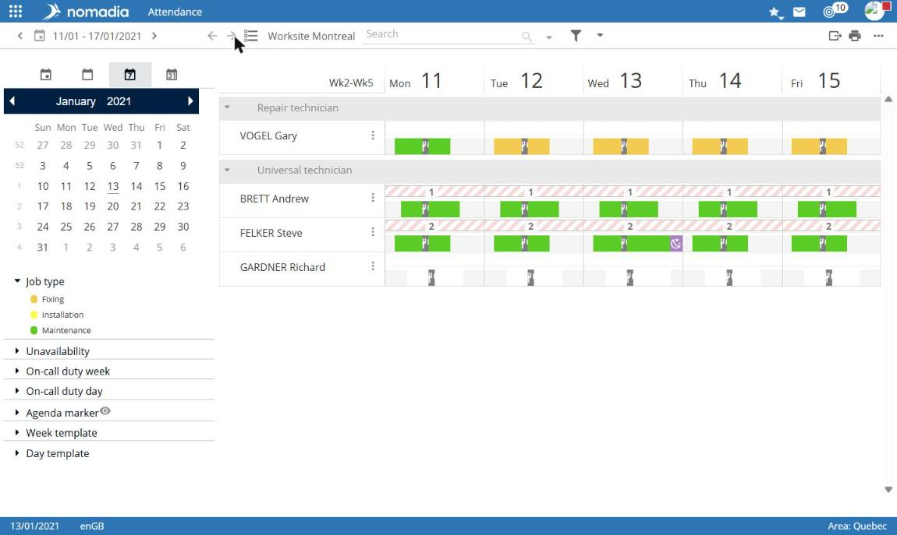

# Edit the attendance planning

The Availabilities module lets you edit the field workers' attendance planning directly: place an unavailability, apply a week or day template, place an agenda marker, then repeat or delete these items.

## Before you begin

* The items offered in the left panel depend on the templates and types created in Administration: unavailability types, day and week templates, marker types. For more information, see [Manage calendars](../administration/manage-calendars.md).
* Each action requires the corresponding right. If you do not have the necessary right, the message "You are not authorized to perform this action." appears.

## Access the feature

**Navigation:** `Application launcher > Availabilities`

## Add an item by drag and drop

1. In the left panel, select the item to place, for example an unavailability type or a week template.
2. Drag it into the schedule:
   * onto a field worker's name: the item applies to the whole period displayed for that field worker;
   * onto a column header: the item applies to all the field workers displayed for that period;
   * onto a cell: the item applies to the field worker and the period of the cell.
3. Release. If a creation window opens, for example for an unavailability, check its settings, then confirm.

## Repeat or delete items

1. Select a field worker's name, a column header, or a cell to select the items it contains. Hold the **Ctrl** key for a multiple selection.
2. Use the commands offered:
   * **Repeat the selection**: define the recurrence of the selected items;
   * **Cancel the selection**: deselect the items;
   * **Delete the selection (click, or drop items)**: select the button, or drop the selection on it, then confirm.

## Produce a report

1. Open the **Navigate between services** icon, then **Reports**.
2. Choose the report from the configured templates. It covers the displayed scope.
3. Export the report if your profile allows it.

The **Export the schedule** and **Print the schedule** icons export or print the displayed schedule.

## Display customer schedules

With the corresponding right, the **Customer** view displays the customers' schedules instead of the field workers'. You can then place closure periods in it. Then return to the field workers' view.

## Points to note


Changes made in the Availabilities module apply directly to the schedules used by scheduling and optimization.


* To view the schedule and add an unavailability from a hover window, see [Availabilities](availability.md).

<!-- REVIEW: this topic has no screenshot of the drag-and-drop or of the creation window, because dragging would change data in the test environment. The names of the commands Repeat the selection, Cancel the selection, and Delete the selection, the Reports entry, and the Customer view are translated from the French topic and were not verified in the application. The module is named Attendance in the test environment's application launcher. -->
