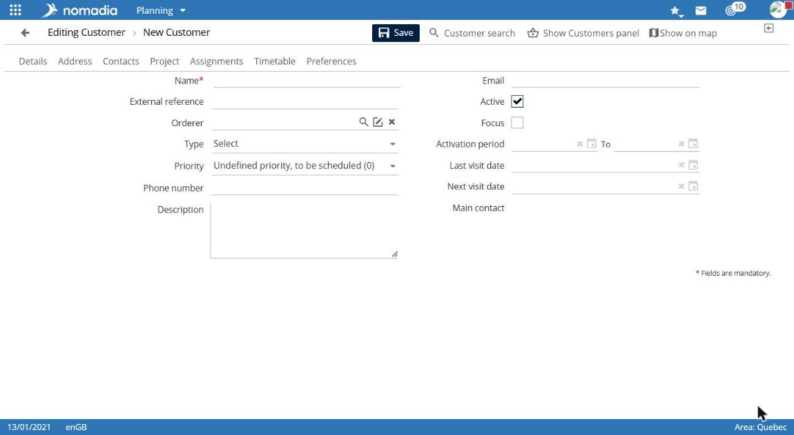
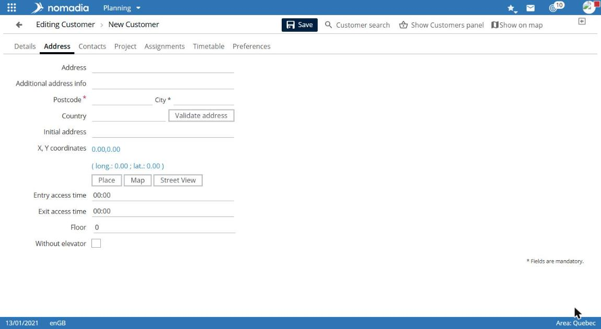
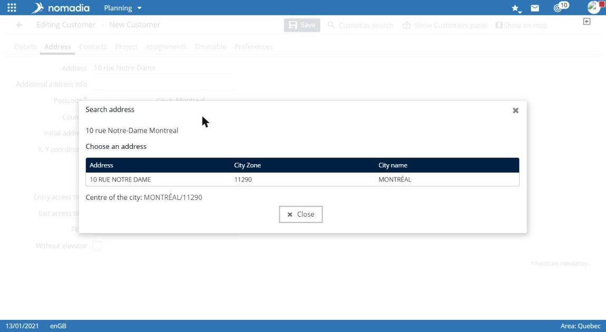
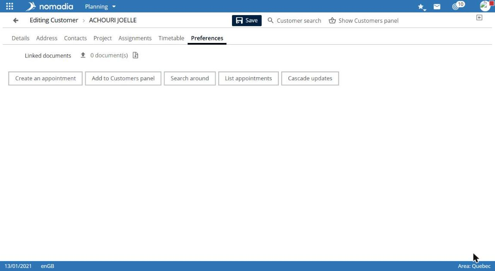

# Create a customer

Use this procedure to create a customer and validate their address. The customer can then be located on the map and scheduled.

## Access the feature

**Navigation:** `Planning > Customers menu > Create a customer`

**Create a customer** is also available in the customer-search panel.

## Enter general information

The **Edit customer > New customer** screen opens on the **Details** tab.

1. Enter the **Company name**. This field is required.
2. If needed, complete **External reference**, **Requester**, **Nature**, **Type**, **Priority**, and **Description**.
3. If needed, enter the **Last visit** and **Next visit date**.

## Enter and validate the address

1. Select the **Address** tab.
2. Enter the **Address**, **Postcode**, **City**, and **Country**. Postcode and city are required.
3. Select **Validate address**.

4. In the **Address search** window, select the matching address under **Choose an address**.

The address, postcode, city, and **X, Y coordinates** are then filled in. **Initial entry** keeps the text you entered.

**Locate**, **Map**, and **Street View** are available below the coordinates.

## Complete other tabs

| Tab             | Content                                                                                                                                                            |
| --------------- | ------------------------------------------------------------------------------------------------------------------------------------------------------------------ |
| **Contacts**    | Create a contact: primary contact, title, description, abbreviation, work email, first name, last name, work phone, mobile phone, field-worker type, and home fax. |
| **Project**     | Customer projects and **Add a project**.                                                                                                                           |
| **Assignments** | Customer **Work site** and **Required**, **Preferred**, or **Undesirable** field workers.                                                                          |
| **Schedule**    | **Opening hours** switch, morning and afternoon hours by day, and **Closure periods**.                                                                             |
| **Preferences** | **Miscellaneous 1** through **Miscellaneous 3**, **Logic 1**, and **Logic 2**.                                                                                     |

## Save the customer

Select **Save**.

## Result

The **Saved successfully...** message appears. The screen title shows the customer name. New buttons appear at the bottom of the record, including **Create an appointment**.

For the next steps, see View and use a customer record.
