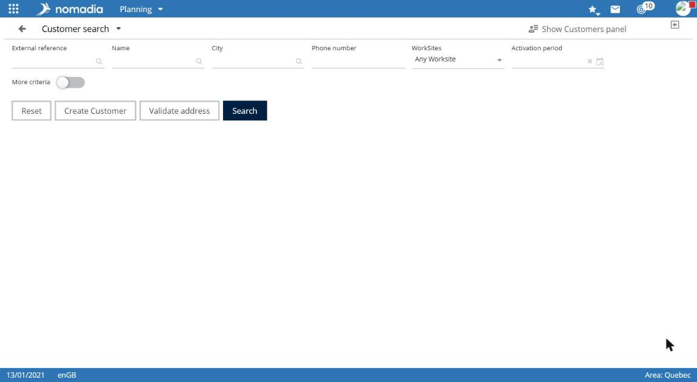
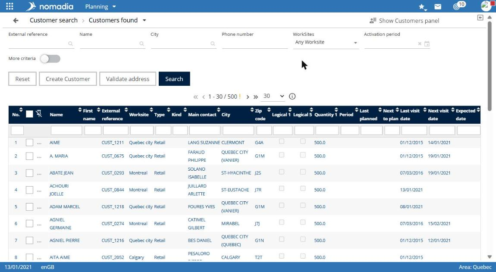

# Search for a customer

Customer search lets you find a customer, view their record, or schedule an appointment.

## Access the feature

**Navigation:** `Planning > Customers menu > Search for customers`

You can also select the **SEARCH FOR CUSTOMERS** shortcut on the module home screen.

## Use the feature

1. Enter one or more criteria: **External reference**, **Company name**, **Postal code**, **Type**, **Work sites**, **Miscellaneous 1**, **Miscellaneous 2**, and **Activation period**.
2. Enable **More criteria** to display additional criteria.
3. Select **Search**.

The additional criteria are **Additional information**, **City**, **Phone**, **Main contact**, **Address**, **Country**, **Intervention type**, **Project work site**, **Priority**, and **Recurring customers**. The available options are **All**, **Visit scheduled**, and **Visit to schedule**.

## Result

The title shows the number of customers found. The table displays the **Company name**, **External reference**, **Work site**, **City**, **Address**, and **Postal code**.

## Notes

* The **Export**, **Reset**, **Create Customer**, and **Validate address** buttons are available below the criteria.
* The **View the selected customer list** link appears at the top of the panel.
