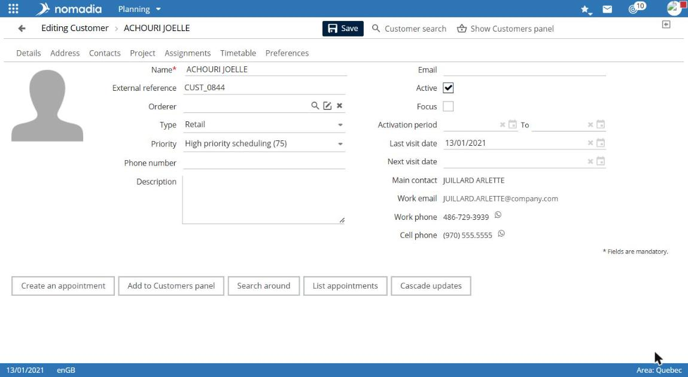
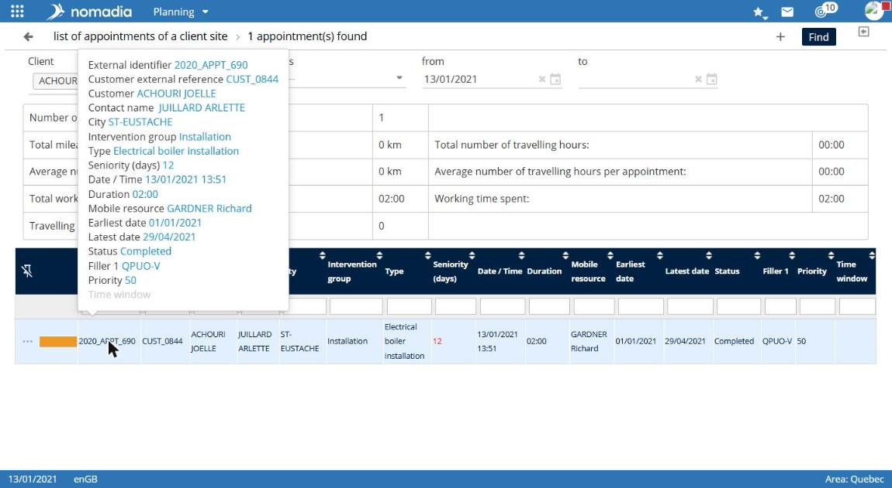

# View and use a customer record

The customer record displays customer information and gives access to related actions.

## Access the feature

Open the record from a [customer search](search-for-a-customer.md) result. The record also appears after creating a customer.

## Identify the record tabs

At the top of the record, the menu offers **Save**, **Search for a customer**, **View the selected customer list**, and **Show on the map**. The information is spread across tabs. The display of each tab depends on your rights.

| Tab             | Content                                                                                                  |
| --------------- | -------------------------------------------------------------------------------------------------------- |
| **Details**     | **Company name** (required), **External reference**, **Requester**, **Nature**, **Type**, **Priority**, **Description**, **Last visit**, **Next visit date** |
| **Address**     | The customer's geocoded address. For more information, see [Geocode an address](../introduction/geocode-an-address.md). |
| **Contacts**    | List of contacts and the **New contact (to be saved)** form                                              |
| **Project**     | Recurring visits to generate for the customer, with the **Add a project** button                         |
| **Assignments** | The customer's work site and field-worker preferences                                                    |
| **Schedule**    | Opening hours by day (morning and afternoon) and **Closure periods**                                     |
| **Preferences** | Additional fields and linked documents                                                                   |

### Details tab

* The **External reference** identifies the customer in your information system. It must be unique.
* The **Requester** is managed with the icons to the right of the field: **Search** to choose one, **Edit** to open its record or create one, **Remove** to detach it from the customer.
* The **Priority** influences where the customer's appointments are placed when schedules are full: **Priority not defined; to be placed (0)**, **Not a priority (5)**, **Placement desirable (25)**, **To be placed (50)**, **Priority placement (80)**, **Placement required (100)**. The higher the value, the more likely the appointments are placed. Reserve **Placement required** for the most important appointments.

### Contacts tab

1. Fill in the **New contact (to be saved)** form: **Title**, **Last name**, **First name**, **Work email**, phone numbers, and so on.
2. Select **Primary contact** if this is the main contact.
3. Save the customer record.

### Project tab

A project describes recurring visits to generate for the customer, for example an annual inspection or two visits per month. The project list shows the **External reference**, **Name**, **Intervention type**, **Periodicity**, **Duration**, **Start date**, and **End date**.

Select **Add a project** to create one.

### Assignments tab

1. Choose the customer's **Work site**. The **Get work sites sorted by distance** icon suggests the sites closest to the customer's address.
2. Select one or more field workers, then use **Add selected resources** to place them in the column you want.
3. Save the record.

| Column            | Effect                                                                                  |
| ----------------- | --------------------------------------------------------------------------------------- |
| **Required**      | The customer's appointments are assigned only to one of the required field workers.     |
| **Preferred**     | Preferred field workers are favored, but the others remain possible.                    |
| **Undesirable**   | The customer's appointments are never assigned to this field worker.                    |

## Use record actions

The following buttons appear below the customer information:

* **Create an appointment**;
* **Add to selected customer list**;
* **Search nearby**;
* **List appointments**;
* **Propagate updates**;
* **Weekly calendar**;
* **Monthly calendar**.

To schedule an appointment, see [Schedule an appointment](../appointments/schedule-an-appointment.md).

**Propagate updates** applies the changes made to the customer to its appointments that are not yet scheduled. Appointments that are already scheduled are not changed.

## List customer appointments

1. Select **List appointments**.
2. Adjust the **Status**, **From**, and **To** filters if needed, then select **Search**.

The page shows these indicators for the period: **Number of appointments**, **Total mileage**, **Average mileage per appointment**, **Total work duration**, **Travel time / Appointment time ratio**, **Total travel hours**, **Average travel hours per appointment**, and **Work time spent**.

The appointment list appears below the indicators. Hover over a row to display appointment details. Select **•••** to open its record.

## Notes

* After scheduling an appointment, the customer record's **Next visit date** field is updated.
* The **Linked documents** field on the **Preferences** tab shows the number of documents linked to the customer.

<!-- REVIEW: the tab contents, the Priority values and the Assignments tab labels are translated from the updated French topic and were not verified in the application. The Priority labels in particular need to be checked against the Priority list on the Details tab. -->

