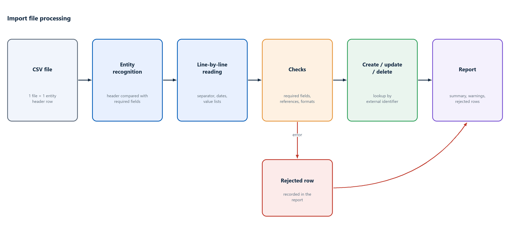

# Import data

## Principle

An import file contains a single entity. The first row is the header: it lists the field names of the exchange model. The file does not declare its entity: Nomadia Field Service deduces it from the header, by looking for the entity whose required fields are all present.

Several entities share similar required fields. Always include all the required columns of the target entity and check the recognized entity in the report (the "Header" line).

## Where to import

| Entry point | Description |
| --- | --- |
| `Administration > CSV files > Import a CSV file` | Import of one file, with a choice of encoding, separators, date format, import mode, and geocoding options. |
| `Administration > CSV files > Global CSV import/export` | Import of a ZIP archive containing one CSV file per entity (global export format). UTF-8 encoding is mandatory. |
| entities web service (SOAP or REST) | Operations SetEntitiesFromCsv, SetEntityFromProperties, and setEntities (REST). See [Integration APIs and web services](integration-apis-and-web-services.md). |
| Circulation | Automated import of files, SQL queries, or messages (see the Circulation module<!-- TODO-LINK: module-circulation/module-circulation -->). |

<!-- REVIEW: menu labels (CSV files, Import a CSV file, Global CSV import/export) are translated from the French menu names; check them against the English UI. -->

## CSV file format

### Default parameters

The format parameters are configurable. Their default values differ depending on the channel:

| Parameter | Import through the interface (gui.import.format) | Server, web service, and Circulation import (import.setting) | Export through the interface (gui.export.format) |
| --- | --- | --- | --- |
| Field separator | ; | , | ; |
| List separator (multiple values) | , | ; | , |
| Text delimiter | " | none | " |
| Date format | dd/MM/yyyy | yyyy/MM/dd | dd/MM/yyyy |
| Time format | HH:mm | HH:mm | HH:mm |
| Encoding | ISO-8859-1 offered by default | — | ISO-8859-1 |

The SetEntitiesFromCsv web service has its own default values (XSD schema): separator ;, delimiter ", date dd/MM/yyyy, list separator ,. Always specify the format parameters explicitly in your calls and configuration files.

### Encoding

* For an import through the interface, you choose the encoding in the form; a UTF-8 byte order mark (BOM) at the start of the file is removed automatically.
* The global import (ZIP) reads the files as UTF-8.
* Exports are produced in the configured encoding (ISO-8859-1 by default), without a BOM.

### Separators, delimiters, and rows

* Field separator: a single character, chosen from , ; | : - or the tab character in the interface. It must be different from the list separator.
* Text delimiter: ", ' or none. A doubled delimiter inside a value represents the character itself; a delimited value can contain a line break.
* Line endings: CR, LF, and CRLF are accepted.
* A row that contains fewer values than the header is padded with empty values; a row that contains more is rejected.
* Leading and trailing spaces in a value are removed.

### Header

* Column names are case-insensitive and ignore extra spaces.
* Unknown columns are ignored without an error: a typo in a column name therefore loses the data without any alert. Check your headers against the exchange model.
* The synonyms declared by the entity are accepted.
* A column of the form `ENTITY.FIELD` (with a dot) triggers the import of a related entity.

### Values

| Type | Import rule | Export rule |
| --- | --- | --- |
| Boolean | True: 1, TRUE, Y, O (case-insensitive) or a value listed in import.setting.logical.yes. Any other non-empty value is false. An empty cell keeps the default value. | 1 or 0 |
| Decimal number | The period and the comma are accepted as the decimal separator. If the comma is also the field separator, delimit the value. | Decimal point |
| Date | Import date format (for example dd/MM/yyyy). An invalid date rejects the row. | Export date format |
| Date-time | Date in the configured format, a space, then the time HH:mm or HH:mm:ss. | Date and time separated by a space |
| Time | HH:mm, or an integer number of minutes since midnight. | Export time format |
| Duration | Minutes (recommended format, used in the examples of the model). | Minutes, or hours if the "duration in hours" option is selected |
| List of identifiers | Identifiers separated by the list separator. | Export list separator |

The parsing.rigorous parameter makes the checks stricter: an invalid integer, decimal, or Boolean value then rejects the row instead of being ignored with a warning.

## Creation, update, and deletion

### Creation or update (default behavior)

Nomadia Field Service looks for the object by its external identifier. If it exists, it is updated; otherwise it is created. If a DEPRECATEDID field is supplied, Nomadia Field Service also looks for the object under this old identifier, which lets you rename an identifier.

### Partial update

| Situation in the file | Effect on the stored value |
| --- | --- |
| Column absent from the header | Value kept. |
| Column present, cell filled in | Value replaced. |
| Column present, cell empty | Value cleared (reset to empty). For a reference, reset to empty if the field allows it; otherwise the row is rejected. |
| Required column present, cell empty | Row rejected, even for an update. |

If you export a file, edit it, and import it again, every value left empty is cleared. To update only a few fields, include only the columns to change (with the identifier).

Exception: in the global import (ZIP), empty cells are ignored and do not change the stored value.

### Import modes

| Mode | Behavior | Activation |
| --- | --- | --- |
| STANDARD | Creation or update. | Default. |
| INSERTONLY | Creation only; a row that matches an existing object is rejected. | Option in the import form (ModeOfImport parameter). |
| UPDATEONLY | Update only; a row that matches no object is rejected. | Option in the form, or an identifier column suffixed with $ID. |

The $ID suffix replaces the first occurrence of ID in the name of the identifier field: CUSTOMERID becomes CUSTOMER$ID, APPOINTMENTID becomes APPOINTMENT$ID. With this column, the other required fields are not required in the header.

### Deletion

You request deletion row by row with the value DELETE in the ACTION column, for the entities that support it (customer, contact, appointment, unavailability, resource skills, priorities, public holidays, and so on; see the description of the ACTION field in the exchange model reference<!-- TODO-LINK: guide-dintegration-des-donnees/reference-modele -->). There is no generic deactivation through the ACTION column: deactivation uses the ACTIVE field (0) of the entities that have it, or the disabledEntities web service.


For an appointment, DELETE is a physical deletion.


## Geocoding

For each located entity, Nomadia Field Service determines the position in the following order:

1. if the position already exists and the address has not changed, it is kept;
2. if X and Y (map projection) are supplied, they are used as they are;
3. otherwise, if XGEO/YGEO (longitude and latitude in WGS 84) or XYNMEA are supplied, they are converted;
4. otherwise, the address is geocoded according to the configured tolerance and minimum score (interface defaults: "at street number" tolerance, score 0.8);
5. if geocoding fails, the position of a fallback work site is used if one was chosen; otherwise the row is rejected ("Invalid Location, cannot geocode").

| Tolerance (web service) | Meaning |
| --- | --- |
| AT\_STREET\_NUMBER | At the street number (default). |
| AT\_STREET\_NUMBER\_STRICT | At the street number, strict. |
| AT\_STREET | At the street. |
| AT\_STREET\_STRICT | At the street, strict. |
| AT\_CITY | At the city. |

GEOCODING\_TYPE is 5 when the coordinates were supplied and 0 when the position of the fallback site was used (the city is then prefixed with "Error Geocoding : "). GEOCODING\_SCORE contains the geocoding score.

## Global import (ZIP archive)

The global import accepts a ZIP archive containing one CSV file per entity, in the format produced by the global export (NN\_<Entity>.csv). The archive can contain at most one subfolder. The following specifics apply:

* UTF-8 encoding;
* empty cells are ignored;
* the XGEO, YGEO, and XYNMEA columns are neutralized (positions are taken from X/Y or geocoded);
* a file reduced to RESOURCELASTNAME and RESOURCEID creates the resources as non-optimizable.

The processing order of the files in the archive depends on their names and on the file system; it is not recalculated from the dependencies. Keep the NN\_ numbering of the global export.

## Transactions and synchronous processing

* Each row is committed in its own transaction: a row in error does not roll back the rows already imported.
* An import from the interface is synchronous: it runs within the HTTP request and the file is read row by row, with no background processing.
* No limit on the number of rows is defined.
