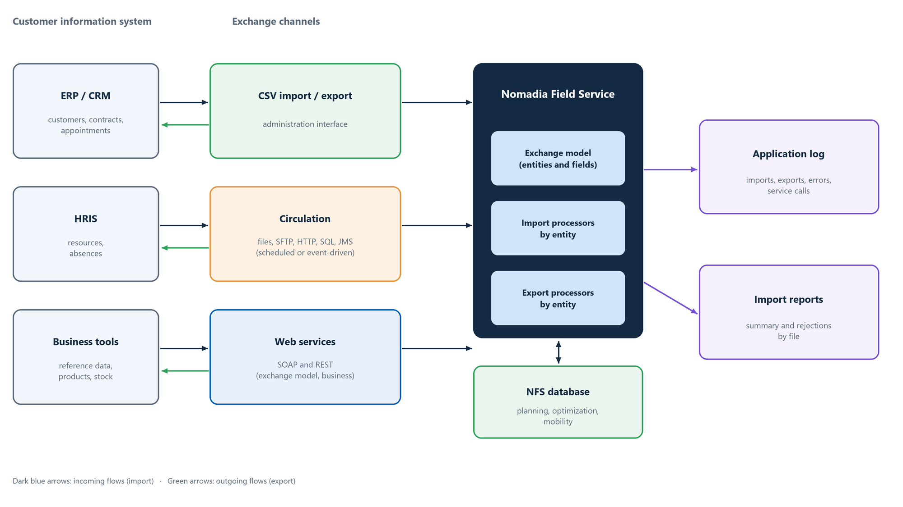
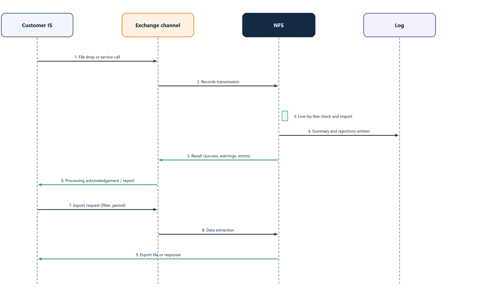

# Integration overview

## Principle

Nomadia Field Service exchanges its data with the customer information system (IS) through a single exchange model. This model describes each entity (customer, resource, appointment, and so on) as a list of fields named in uppercase (for example `CUSTOMERID`, `CUSTOMERNAME`). The same model is used for import and export, whichever channel you use.

A dedicated processor handles each entity. It checks the values, resolves the references to other entities, and creates, updates, or deletes the corresponding objects.

## Exchange channels

| Channel | Typical use | Format | Trigger |
| --- | --- | --- | --- |
| CSV import / export (administration interface) | Initial data load, one-off corrections, checks | CSV | Manual |
| Global import / export (ZIP archive) | Full copy of an environment, multi-entity data load | ZIP of CSV files | Manual |
| Exchange web services (`entities`, `exportEntities`, `exchangeModel`) | Application connector, single-record or batch flows | SOAP (XML), REST (JSON or XML) | Call from the customer system |
| Business web services (appointment booking, optimization, geocoding, and so on) | Real-time integration of a portal or an appointment-booking tool | SOAP, REST | Call from the customer system |
| Circulation | Automated flows: file drop, SFTP, HTTP, SQL database, JMS, sending entities to a webhook | CSV, XML, JSON, SQL | Scheduled or event-driven |

Circulation (the automated flow engine) has its own documentation: see the Circulation module<!-- TODO-LINK: module-circulation/module-circulation -->. This guide presents only its role. All channels rely on the same exchange model described here.

## Architecture and exchange flows

The following diagram shows the overall architecture of the exchanges between the customer information system and Nomadia Field Service.

Incoming data always goes through the exchange model before it reaches the Nomadia Field Service database. Import and export processing feeds the application log, which you can view in the administration interface or export (entities `ApplicationEvent` and `Journal`).

## Typical integration sequence

The following diagram shows the typical sequence of an import followed by an export.

