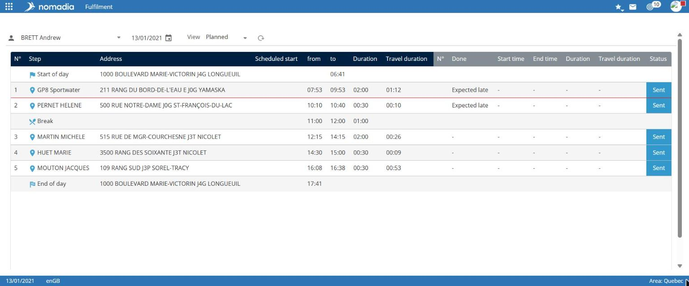

# Fulfilment

The Fulfilment module displays the planned stages of a resource's day and their completion for a selected date.

## Access the module

**Navigation:** `Application launcher > Fulfilment`

## Use the feature

1. Select the resource from the list at the top left.
2. Select the date using the calendar.
3. Check that **View** is set to **Fulfilment**.

## Read the table

The table has two parts.

* The left part describes the plan: **No.**, **Stage**, **Address**, **Scheduled on**, **from**, **to**, **Duration**, and **Driving duration**.
* The right part describes completion: **No.**, **Completed**, **Start time**, **End time**, **Duration**, **Driving duration**, and **Status**.

Stages include **Start of day**, **Break**, numbered appointments, and **End of day**. The **Status** column displays a coloured label, such as **Received** or **Sent**.

## Notes

* The icon to the right of the **View** list refreshes the display.
