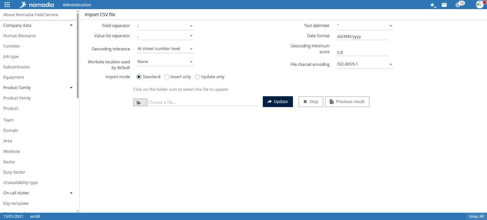

# Import a CSV file

This feature imports a CSV file into Nomadia Field Service.

## Access the feature

**Navigation:** `Administration > CSV Files > Import a CSV File`

## Use the feature

1. Check the file-reading settings: **Field separator**, **Text delimiter**, **Value list separator**, **Date format**, and **File encoding charset**.
2. Check the geocoding settings: **Geocoding tolerance** and **Minimum geocoding score**.
3. Choose the **Default work location**.
4. Choose the **Import mode**: **Standard**, **Insert only**, or **Update only**.
5. Select the folder icon to choose the file.
6. Select **Update**.

## Important notes

* **Stop** and **Previous result** are available beside **Update**.


An import changes application data. Check the file content and import mode before selecting **Update**.

