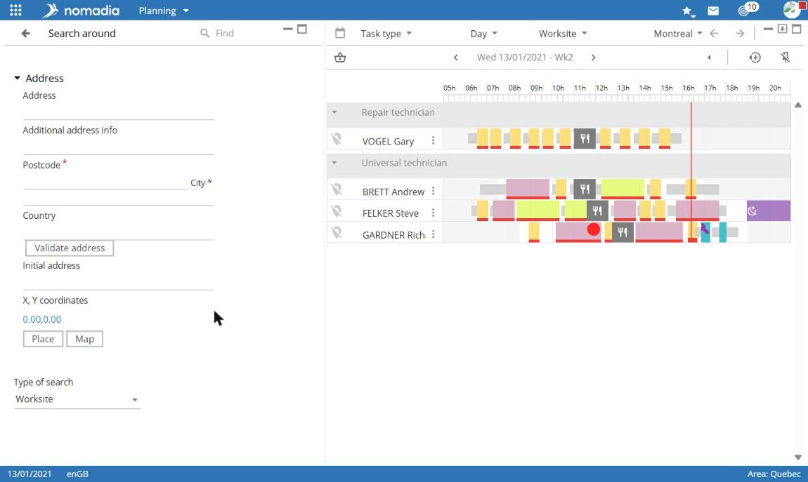
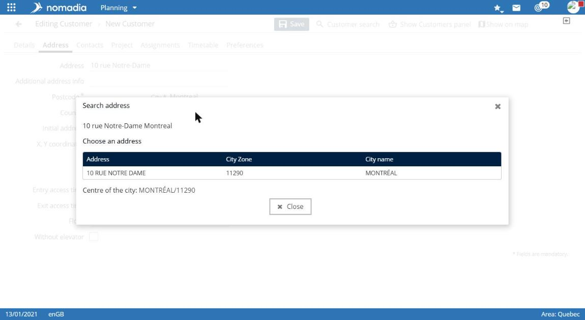

# Geocode an address

Geocoding places an address on the map by calculating its geographic coordinates. Nomadia Field Service uses this position to display the object on the map, calculate travel times, and optimize schedules.

A poorly geocoded address distorts travel times, and therefore the proposed time slots. Check the address each time you create or edit an object.

## Objects with an address

Customers, appointments, resources, work sites, unavailabilities, and other located objects share the same address block.

| Field                       | Purpose                                                                                                                   |
| --------------------------- | ------------------------------------------------------------------------------------------------------------------------- |
| **Address**                 | Street number and street name.                                                                                            |
| **Additional address info** | Practical information about the place, such as building, floor, or access code. This field is not used for geocoding.     |
| **Postcode** and **City**   | Town of the address. Both are required.                                                                                   |
| **Country**                 | Country of the address.                                                                                                   |
| **Initial entry** (or **Initial address**) | Text you entered before validating the address. This field is read-only.                                   |
| **X, Y coordinates**        | Position calculated on the map.                                                                                           |

## Validate an address

1. Enter the **Address**, **Postcode**, **City**, and **Country**.
2. Select **Validate address**.
3. In the **Address search** window, select the matching address under **Choose an address**.

4. Check the **X, Y coordinates**, then save the record.

## Result

The address, postcode, city, and coordinates are updated. **Initial entry** keeps the text you entered.

Below the coordinates, depending on the screen and your rights:

* **Locate** (or **Place**) positions the object by selecting a point on the map;
* **Map** displays the access map of the address;
* **Street View** opens the address in Google Street View. An internet connection is required.

## Notes


Start the **Address** field with the street number and street name. Mentions such as "c/o Ms. Martin" or "Lilac Residence" at the start of the address prevent correct geocoding. Enter them in **Additional address info** instead.


* For a complete example, see [Create a customer](../customers/create-a-customer.md).

<!-- REVIEW: the labels differ between screens in the application. The customer record uses Initial entry and Locate (as in Create a customer), while the Search around, Compute a route, and Convert screens use Initial address and Place. The Street View button is not displayed on those screens. This topic names both labels. -->

