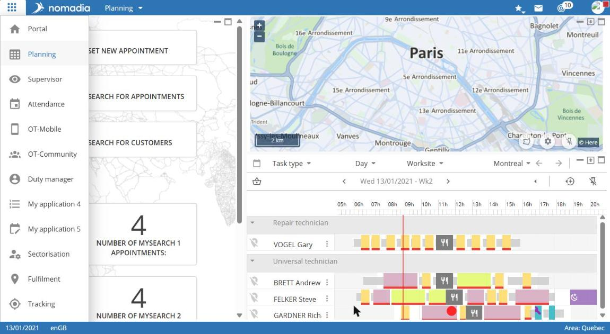
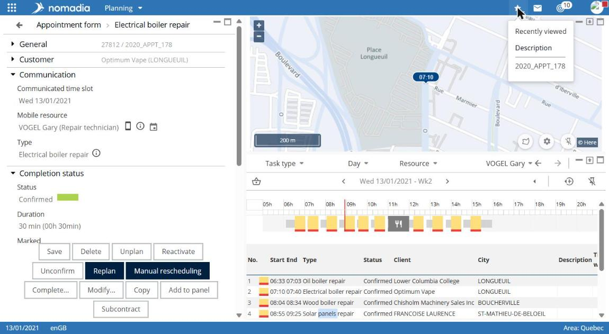
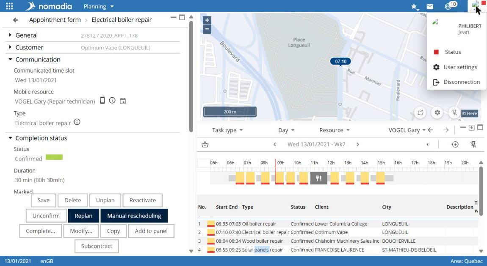
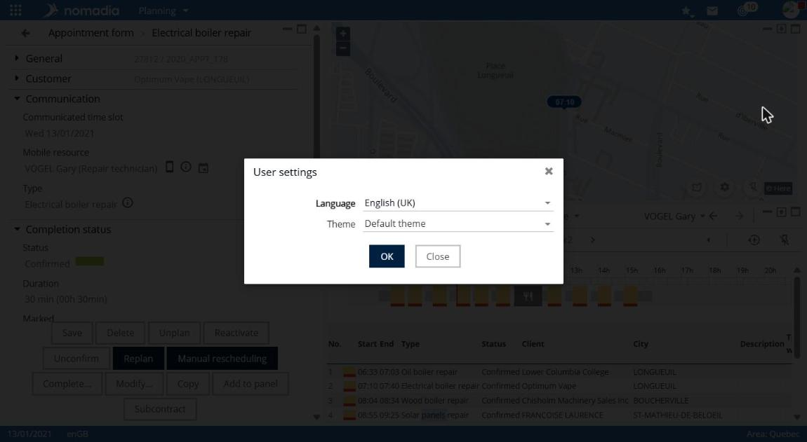

# Navigate the application

All Nomadia Field Service modules share a top bar and a bottom status bar.

## Top bar

| Element                          | Location             | Role                                                                  |
| -------------------------------- | -------------------- | --------------------------------------------------------------------- |
| Application launcher (grid icon) | Left                 | Opens the module list                                                 |
| Module name                      | Left, after the logo | Identifies the open module. In **Planning**, it opens the module menu |
| Star                             | Right                | Displays the **Recently viewed** list                                 |
| Funnel                           | Right                | **Enable favorites**                                                  |
| Envelope                         | Right                | **List unread messages**                                              |
| Triangle with counter            | Right                | Accesses customers with alerts                                        |
| Question mark                    | Right                | Opens the online documentation in a new tab                           |
| User icon                        | Right                | Opens the user menu                                                   |

## Status bar

The bottom bar displays today's date and language on the left. It shows the active region on the right (**Region:**).

## Change modules

1. Select the application launcher at the top left.
2. Select the module to open.

## View recently viewed items

1. Select the star in the top bar.
2. In the **Recently viewed** list, select the item to reopen.

## Use the user menu

Select the user icon at the top right. The menu displays your username and these entries:

* **User settings**;
* **Region favorites**;
* **Sign out**.

## Change the language or theme

1. Open the user menu.
2. Select **User settings**.
3. Choose the **Language** and **Theme**.
4. Select **OK** to apply, or **Close** to cancel.

## Expand or collapse a panel

Some screens, including **Planning**, contain several panels. Use the icons at the top right of each panel to collapse it or expand it to the screen's full width.
