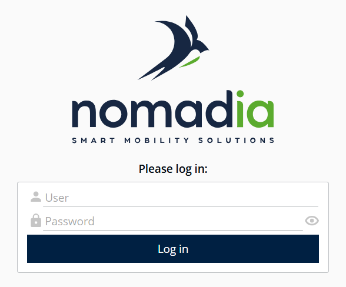
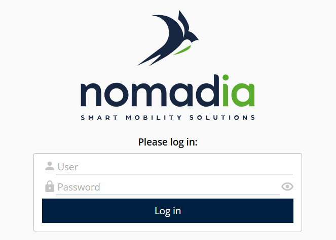
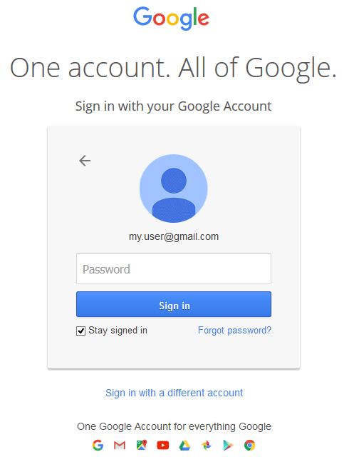
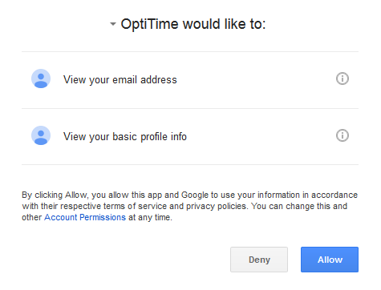
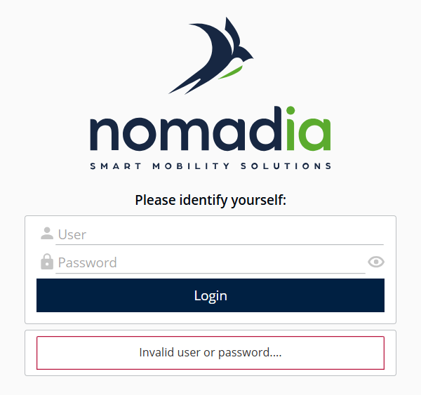

# Running the Application

## Overview

You can access NFS through a web browser or the mobile application, depending on the deployment.

## Access NFS in a web browser

1. Open a supported web browser.
2. Enter the NFS URL provided by your site administrator. The URL typically has the following format: `http://server:port/application/`
3. Enter your login credentials when prompted.

<figure><figcaption>
Access portal
</figcaption></figure>

Once you have entered your credentials, you gain access to the application.

## Access NFS in the mobile application

1. Open the NFS mobile application.
2. Enter the **login** and **password** associated with your user account.
3. Sign in to access the application.

## Authenticate through Single Sign-On (SSO)

This section describes a sample authentication use case.


Prerequisites: enable SSO and its Google Apps provider only, in the application instance settings.


### Sign in with Google

1. Open the NFS application URL in your web browser.
2. On the login page, click **Login with Google**.
3. You are redirected to the Google sign-in page to authenticate with your Google account.
4. Enter your Google account credentials and complete the authentication process.
5. After successful authentication, you are redirected to the NFS application.

<figure><figcaption>
Login page with the Google sign-in option
</figcaption></figure>

* Enter your Google Workspace or Gmail account credentials and submit the form. If the credentials are valid, you are authenticated and redirected back to the NFS application.

* If no NFS user account is associated with your Google account email address, access to the application is denied.

<figure><figcaption>
Access denied message
</figcaption></figure>

* If an NFS user account is associated with your Google account email address, NFS grants access using the corresponding user account.

## Sign in to the application

Once you are authenticated, NFS redirects you, depending on your profile, to one of the following modules: [Portal](../portal/portal.md), [Planning](../planning/planning.md), [Supervisor](../supervisor/planning-1.md), [Attendance](../attendance/attendance.md), the Strategic module or [Administration](../administration/administration.md).


See also: EXPLOITATION > Configuring SSO access in NFS, and REFERENCE GUIDE > Administration > Company data > Human resources > [Company Data](../administration/companydata.md) (**User** tab).

