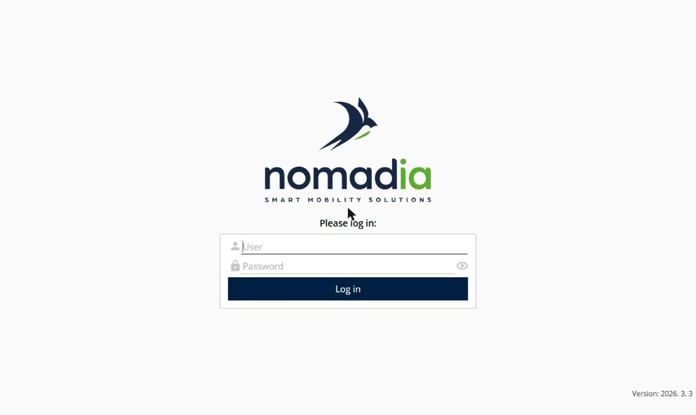

# Sign in

The sign-in page lets you access Nomadia Field Service with your username and password.

## Before you start

Have the application address and your credentials ready. Your administrator provides them.

## Sign in with a username and password

1. Open the Nomadia Field Service address in your browser.
2. Under **Please identify yourself:**, enter your username.
3. Enter your password. Use the eye icon to display the entered password.
4. Select **Sign in**.

If an error occurs, a message appears below the form.

## Reset a forgotten password

If your administrator has enabled sending codes by email, the **Forgot your password?** link appears on the sign-in page.

1. Select **Forgot your password?**.
2. Enter your username, then request the code.
3. Open the email you received and enter the code in the **Code received by email** field.
4. Enter and confirm your new password.
5. Confirm, then return to the sign-in page.


The code is sent only if your account has an email address. It is valid for a few minutes and for a limited number of attempts. If you have no email address, contact your administrator.


If your administrator asks you to renew your password, the change page appears directly after you sign in.

## Sign in with single sign-on

If your organization uses single sign-on, select **Sign in with SAML**.

With single sign-on (SSO), you sign in with your company account, without a separate Nomadia Field Service password.

1. On the sign-in page, select the button of your identity provider, for example **Sign in with SAML**.
2. Authenticate on the provider's page.
3. You are then redirected to Nomadia Field Service.

Only the providers configured for your environment are displayed. Access is denied if the identifier sent by the provider, usually your email address, does not match any Nomadia Field Service user.

## Result

The application opens on the module configured as your account's entry point, such as the **Portal**. Otherwise, it opens on a module that your profile gives you access to.

If no module is available to you, the message "You do not have access to any module" appears. Contact your administrator.


The application version number appears at the bottom right of the sign-in page.


## Sign out

1. Select the user icon at the top right of the screen.
2. Select **Sign out**.

Signing out or closing the browser does not stop processes that are already running, such as an optimization or an import: they continue on the server.

You can also sign out from the Portal by using the **Sign out** button. For more information, see Portal.

<!-- REVIEW: the sign-in screenshot shows the labels "Please log in:" and "Log in" (browser language of the test session), while this topic says "Please identify yourself:" and "Sign in". The forgot-password flow, the SSO buttons, and the "You do not have access to any module" message are translated from the French topic and were not verified, because email codes and SSO are not enabled in the test environment. Add a screenshot of the password reset form. -->
