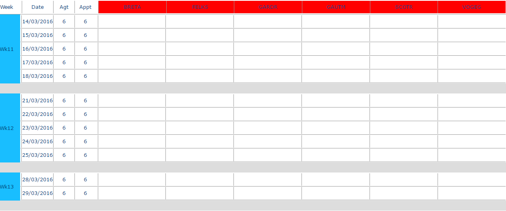

# Analyses - Unavailabilities Global Planning

## Overview

Use this analysis to view the unavailabilities of resources.

## Display the unavailabilities planning

1. Choose a team and the time window in dates.
2. Click the  button to display the table.

A new page opens that contains the unavailabilities planning for the selected team in `.html` format.

