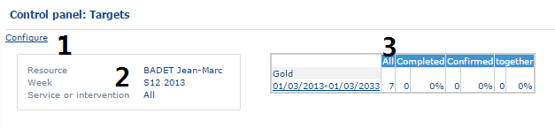

# Control Panel - Targets

## Overview

This page provides a summary table of statistical information on the objectives.

## Prerequisites

Configure the control panel first. See [Control Panel - Configure](controlpanelconfigure.md).

## Sections of the table

The table is divided into three sections.

1. **Configure** – click it to return to the previous configuration step. See [Control Panel - Configure](controlpanelconfigure.md).
2. Information about the resource for which the table is calculated. The period or date is displayed, as well as the area, worksite or team. This section recaps the type of offers selected during the configuration. See [Control Panel - Configure](controlpanelconfigure.md).
3. The table in the right-hand part of the screen, which summarizes the objectives by activity, according to the parameters defined in the configuration of the control panel.

## View the detail of the objectives

1. In table (3), click the weekly objectives for a given activity.
2. In the **Detail by** section, choose the display type you want.
3. Click **Refresh**.

## Fields and options

The **Detail by** section lets you view the objectives according to several criteria:

* **Activity type** – returns indicators for all the intervention types that make up an activity type.
* **Intervention type** – returns indicators on each type of intervention.
* **Resource** – returns indicators on each resource from the same platform.
* **Resource type** – returns indicators by role type.

<!-- REVIEW: the text introducing the detail options names "Activity type, Job type, Resource or Resource type", while the list describes "Activity type, Intervention type, Resource, Resource type"; kept as in source -->
