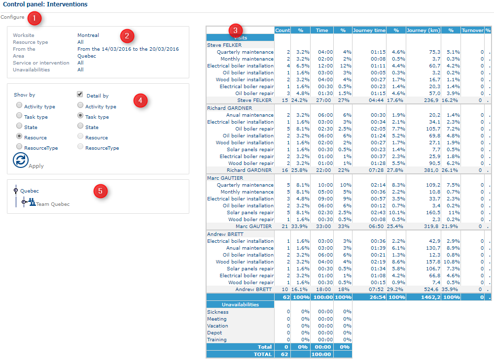

# Control Panel - Interventions

## Overview

This page shows a summary table of the different interventions configured previously.

## Prerequisites

Configure the control panel first. See [Control Panel - Configure](controlpanelconfigure.md).

## Sections of the table

The interventions table is divided into five sections.

1. **Configure** – click it to return to the previous configuration step. See [Control Panel - Configure](controlpanelconfigure.md).
2. A summary of the parameters specified in the configuration step. See [Control Panel - Configure](controlpanelconfigure.md).
3. The interventions table, in the right-hand part of the screen.
4. The display and detail selectors, which let you browse interventions according to several criteria.
5. The hierarchical tree of resources.

### Interventions table (3)

The table displays all interventions selected during the configuration, including **appointments** and **unavailabilities**, along with the selected time-related options, such as **journey time** and **free time**.

For each item, the table displays:

* The **number of appointments or unavailabilities**.
* The corresponding **time duration**, expressed in hours and minutes.
* The **percentage** of each intervention type based on the number of items and the total time.

The combined percentages of appointments and unavailabilities add up to **100%**.

**Journey time** and **free time** are displayed separately in a dedicated table. Journey time distinguishes between:

* Time spent travelling to **fulfilled appointments**.
* Expected journey time for **confirmed appointments** that are yet to be fulfilled.

Journey time is displayed in hours and minutes and is calculated from the distance travelled on the road network.

**Free time** is added to complete the overall time distribution to **100%**.

Sometimes explicit alert messages complete the table to inform you of a situation.

### Display and detail (4)

1. Select the type of display you want:
   * **Activity type** retrieves indicators for all the intervention types that make up an activity type.
   * **Intervention type** returns indicators on each type of intervention.
   * **Status** returns indicators according to the appointment's status.
   * **Resource** returns indicators on each resource from the same platform.
   * **Resource type** returns indicators by role type.
2. To obtain detailed indicators, select the **Detail by** check box, and then select the type of detail you want:
   * **Activity type** works only with the display by **Status**, **Resource** or **Resource type**.
   * **Task type** works with all displays, except **Task type**.
   * **Status** works with all displays, except **Status**.
   * **Resource** works with all displays, except **Resource**.
   * **Resource type** works with the display by **Activity type**, **Task type** or **Status**.
3. Click the  button to update the table (3).

<!-- REVIEW: the display list says "Intervention type" but the detail list says "Task type"; the terms may refer to the same item - kept as in source -->

### Hierarchical tree

The hierarchical tree shows all the resources of the reference area, organized by team. Click an entity to update the corresponding table (3). Expand or collapse the tree as required.

## Notes, tips and limitations


The time spent corresponds to the number of hours and minutes worked in addition to the legal working hours.

