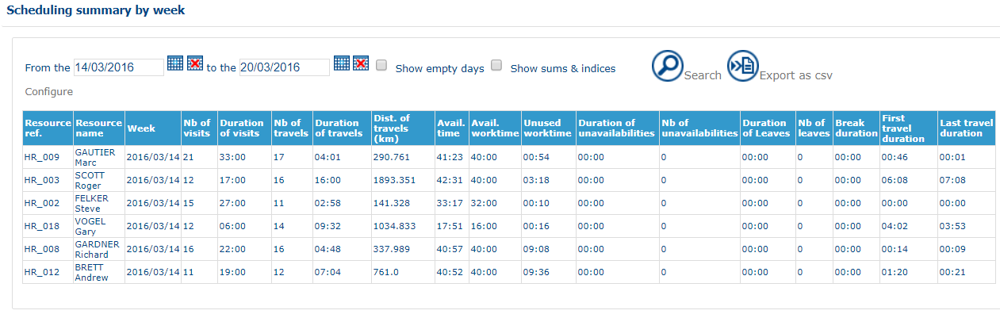

# Control Panel - Scheduling Summary by Week

## Overview

This page shows a summary table of statistics linked to the travel of the resources configured previously: kilometers traveled, journey time, number of visits fulfilled, visit time, unused working time and so on.

It is identical to [Control Panel - Scheduling Summary by Day](controlpanelschedulingsummarybyday.md), except that the statistics are aggregated by week instead of by day.

## Prerequisites

Configure the control panel first. See [Control Panel - Configure](controlpanelconfigure.md).

## Display the summary

1. Define the search period for the plannings. To change the table display, click **Configure**. See [Control Panel - Configure](controlpanelconfigure.md).
2. To display all plannings, even empty ones, select the **Display empty days** check box.
3. To add columns of totals and indices and a total line at the end of the table, select the **Display totals and indices** check box.
4. Click the  button to run a search on plannings.

To export the data from the table to a text file, click .

## Fields and options

When you select **Display totals and indices**, the following columns are added:

* `Journey (kms)/nb of visits`
* `Travel duration/Visit duration`
* `Visit duration/Working time`
* `Period worked / Working hours`
