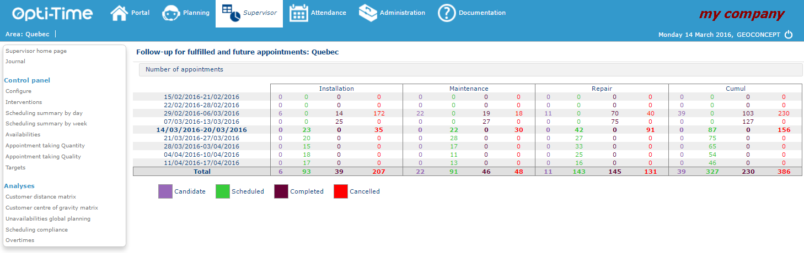

# Home Page

## Overview

Open the Supervisor module in one of two ways:

* Click the **Supervisor** tab in the blue toolbar at the top of the screen.
* Enter the application directly, if your user profile is configured to open NFS on this module. See [Company Data](../administration/companydata.md).

## Prerequisites


You must be connected with a profile that has access to the Supervisor role. See [User Handling](../administration/userhandling.md).


## Supervisor home page

The Supervisor home page contains a menu on the left of the screen and a table on the right.

### Menu

The Supervisor module menu has two parts:

* The **Control panel** section displays statistical summaries about appointments and unavailabilities, so that you can track and steer the activities of the mobile workforce. See [Control Panel](controlpanel.md).
* The **Analyses** section generates reports and indicators on completed appointments and on the sectorization performed. See [Analyses - Customer Distance Matrix](analyses-customerdistancematrix.md).


You must configure the reports in the **Control panel** section beforehand. See [Control Panel - Configure](controlpanelconfigure.md).


The menu contains the following items:

* **Supervisor home page**
* **Journal**: [Journal](journal.md)
* **Control panel**
  * **Configure**: [Control Panel - Configure](controlpanelconfigure.md)
  * **Interventions**: [Control Panel - Interventions](controlpanelinterventions.md)
  * **Scheduling summary by day**: [Control Panel - Scheduling Summary by Day](controlpanelschedulingsummarybyday.md)
  * **Scheduling summary by week**: [Control Panel - Scheduling Summary by Week](controlpanelschedulingsummarybyweek.md)
  * **Availabilities**: [Control Panel - Availabilities](controlpanelavailabilities.md)
  * **Appointment taking Quantity**: [Control Panel - Appointment Taking Quantity](controlpanelappointmenttakingquantity.md)
  * **Appointment taking Quality**: [Control Panel - Appointment Taking Quality](controlpanel-appointmenttakingquality.md)
  * **Targets**: [Control Panel - Targets](controlpanel-targets.md)
* **Analyses**
  * **Customer distance matrix**: [Analyses - Customer Distance Matrix](analyses-customerdistancematrix.md)
  * **Customer center of gravity matrix**: [Analyses - Customer Center of Gravity Matrix](analyses-customercentreofgravitymatrix.md)
  * **Unavailabilities global planning**: [Analyses - Unavailabilities Global Planning](analyses-unavailabilitiesglobalplanning.md)
  * **Scheduling compliance**: [Analyses - Scheduling Compliance](analyses-schedulingcompliance.md)
  * **Overtimes**: [Analyses - Overtimes](analysesovertimes.md)


To return to the Supervisor home page at any time, click the **Supervisor home page** link in the menu on the left of the screen.


### Table

The **Track past and future appointments** section on the right shows a weekly summary of the different appointments for the area.

By default, the table shows the number of candidate, planned, fulfilled and cancelled appointments for each type of intervention. See [The different statuses for appointments in NFS](../introduction/thedifferentstatusesforappointmentsinnfs.md). All of this is configurable (see [Customization](../administration/customization.md)).

By default, the table shows the number of appointments in the current week, the 4 previous weeks and the 4 following weeks.

The **Cumulated** column at the far right of the table shows the number of appointments for all intervention types taken together.


The appointment statuses displayed and the weeks that correspond to the rows of the table are configurable. Contact your NFS administrator.

