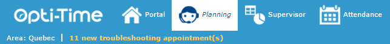
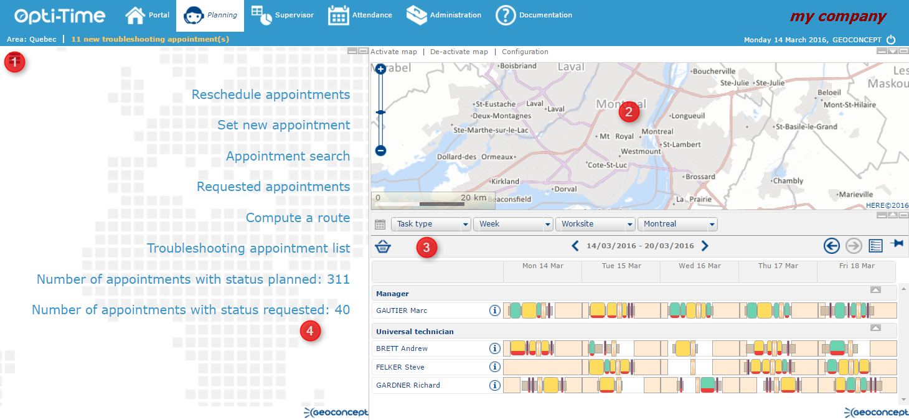

# Planning

## Overview

The Planning module is the NFS module designed for planning personnel, online advisors and personal assistants. Resources working in the field can also use it as a visualization tool. Use it to:

* take appointments manually or in an optimized form;
* modify, reschedule or cancel appointments;
* search for appointments using many different criteria;
* manage customer portfolios with an integrated CRM;
* monitor the consistency of plannings through lists of warnings and alerts;
* save visit reports for appointments, whether they are fulfilled or not;
* save resources' unavailabilities;
* consult plannings for the different structures within the organization;
* download and consult roadbooks;
* manage types of post;
* track vehicles in the field (tracking);
* locate customers, appointments and routes on the map.

## Open the Planning module

Click at the top left of the header bar. For details, see [The Header Bar](../guided-help-nfs-reference-guide-1/README.md).

## Parts of the Planning module

The Planning module is made up of four parts:

1. [Menu](menu.md)
2. [Map](map.md)
3. [The Planning](theplanning.md)
4. [The Information Pane](theinformationpane.md)

[Objects in the Planning Module](objectsintheplanningmodule.md) describes the objects that make up the Planning module.

## Resize the frames

The map, the planning and the information display frames can all be resized with the buttons at the top right of each frame .

*  stretches the frame downwards.
*  stretches the frame upwards.
*  hides the frame.
*  displays the frame in full screen mode.

You can also drag the sides of the frames with the mouse to resize them manually.


The default size of the frames is defined and initialized by the resizing of the cartographic pane in the `Maptool.xml` file. If you resize the frames manually, their sizes are saved in a browser cookie.

