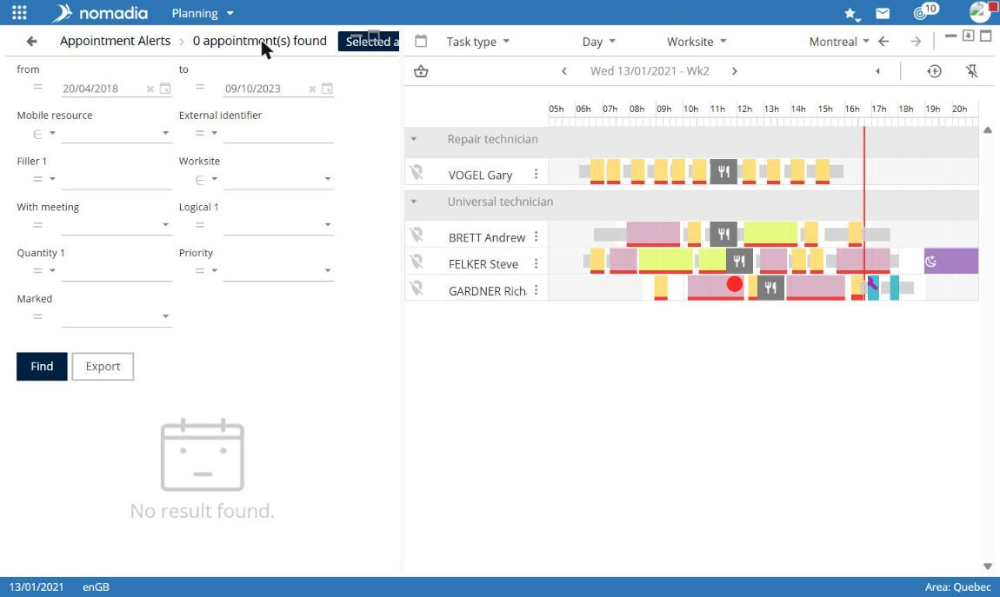

# Follow alerts and messages

The Planning module signals the appointments and customers that require action, and the unread messages.

## View appointment alerts

Appointment alerts list the appointments that meet criteria defined by your administrator, for example a status over a period.

1. Open `Planning > Appointments menu > Appointment Alerts`.
2. Filter by period (**from**, **to**) and, if needed, by **Mobile resource**, **External identifier**, **Worksite**, **With meeting**, **Priority**, **Marked**, and the additional fields such as **Filler 1**, **Logical 1**, and **Quantity 1**.
3. Select **Find**.

The page displays the number of appointments found. Select a row to open the appointment record.

From the list, depending on your rights:

* **Export** produces a CSV file of the result;
* the actions on the selected appointments, such as changing the dates or the field workers, apply to the appointments you select.

The counters on the module home page also show the number of appointments in each list. Select a counter to open the matching list.

## View customers on alert

The triangle-shaped counter in the header shows the number of customers on alert. Select it to display the list, in the same form as a customer search.

You can also open `Planning > Customers menu > List customers with alerts`.

## View application alerts

The **Alerts** entry, at the bottom of the module menu, lists the application alerts that your profile subscribes to. If you do not subscribe to any alert, the message "You have no subscription for application alerts" appears.

Subscriptions are managed by the administrator. For more information, see [Manage profiles and permissions](../administration/manage-profiles-and-permissions.md).

## Read unread messages

The envelope icon in the header shows the number of unread messages. Select it to open the messaging.

<!-- REVIEW: the following were not verified in the application: the Alerts entry at the bottom of the module menu, the triangle counter in the header, the List customers with alerts entry, the subscription message, and the names of the actions on selected appointments. The filters on the Appointment Alerts page differ from the French topic (state and work site): this topic lists the ones displayed in the test environment. -->
