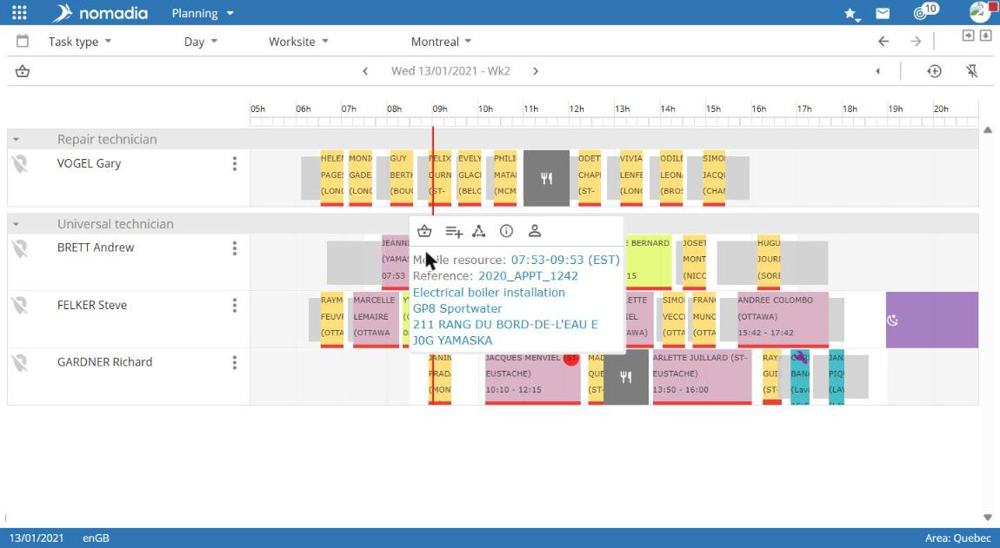
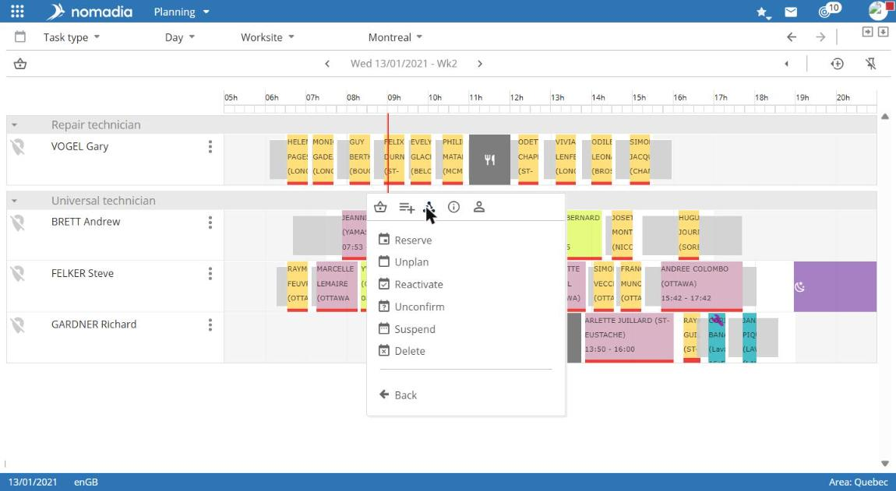

# Manage an appointment from the schedule

The schedule lets you quickly manage an appointment without using search.

## Before you start

Display the schedule for the period containing the appointment. For more information, see [View the schedule](view-the-schedule.md).

## Display appointment actions

Hover over the appointment in the schedule. A window displays the time, intervention type, and customer, as well as these icons:

| Icon                | Action                         |
| ------------------- | ------------------------------ |
| Basket              | Add to basket                  |
| List with plus sign | Add to selection list          |
| Triangle            | Change the intervention status |
| i                   | Open the intervention record   |
| Person              | Open the customer record       |

## Change an appointment status

1. Hover over the appointment in the schedule.
2. Select the **Change intervention status** icon.
3. Select the action to apply: **Book**, **Confirm**, **Unplan**, **Reactivate**, **Suspend**, or **Delete**.

Select **Back** to close the menu without changing the status.

## Result

The schedule updates. For example, after **Confirm**, the appointment appears in dark green.


Check the selected appointment before using **Delete**.


To understand statuses, see [Understand appointment statuses](../introduction/appointment-statuses.md).
