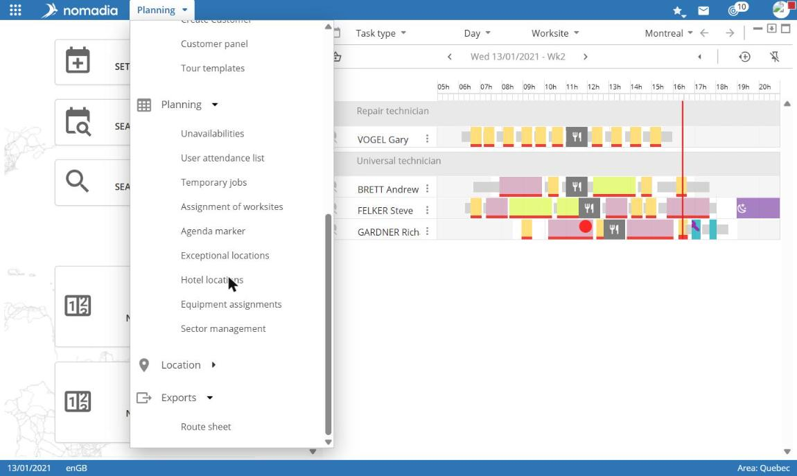
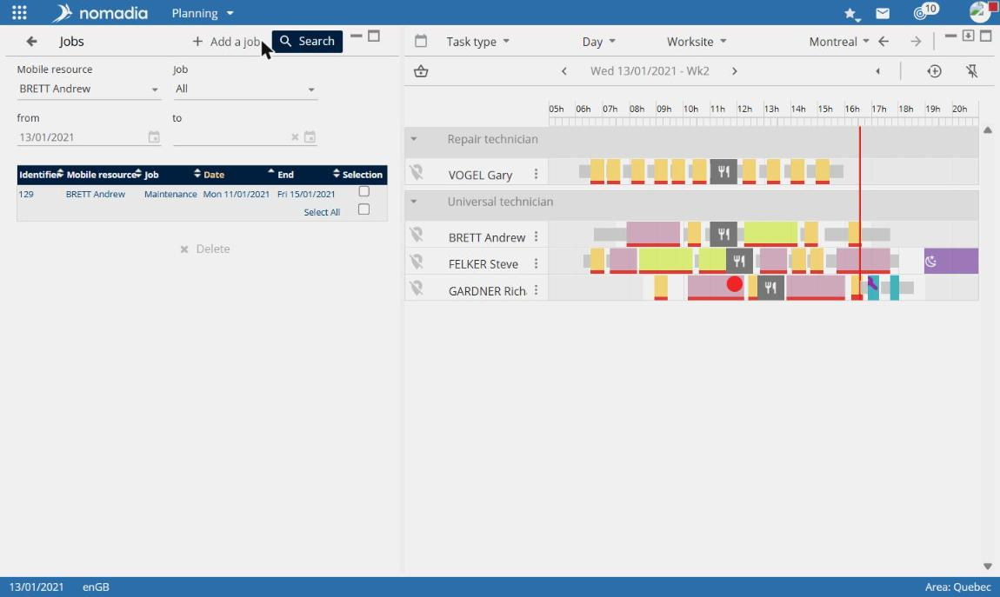
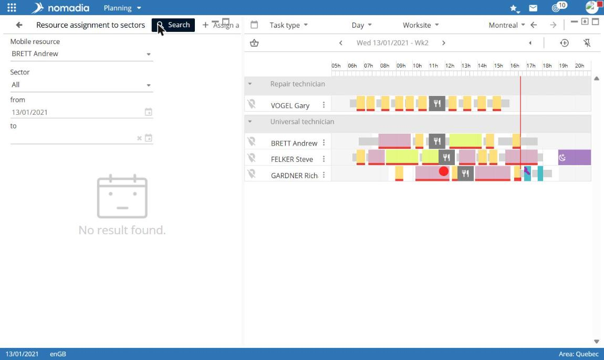
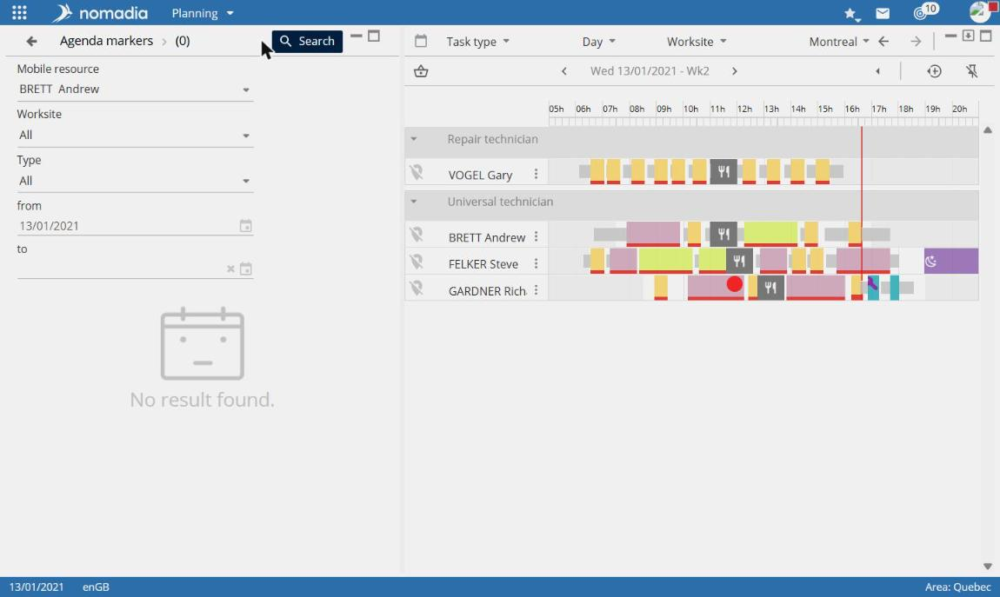
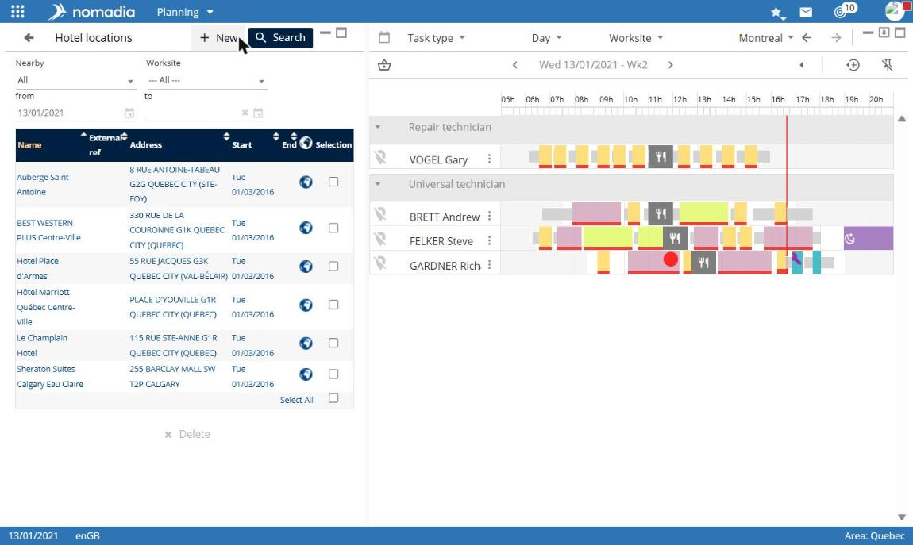
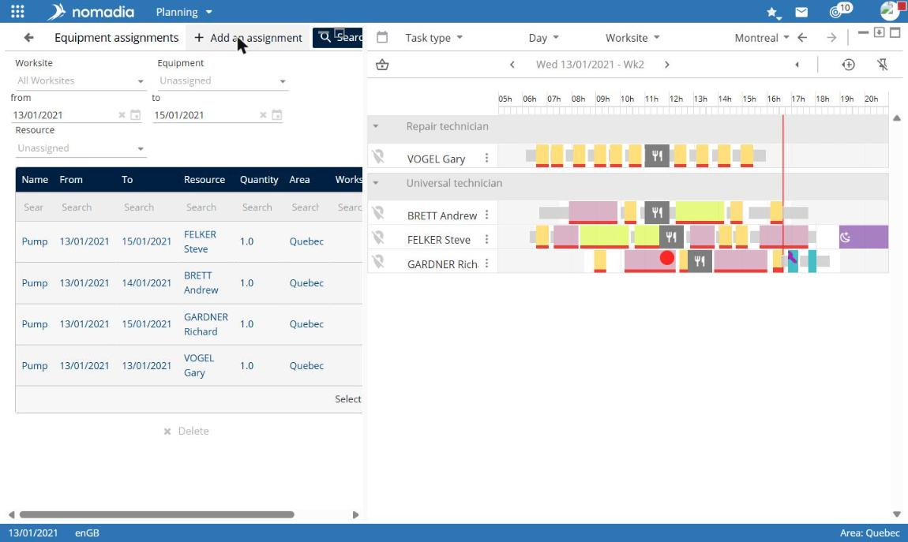
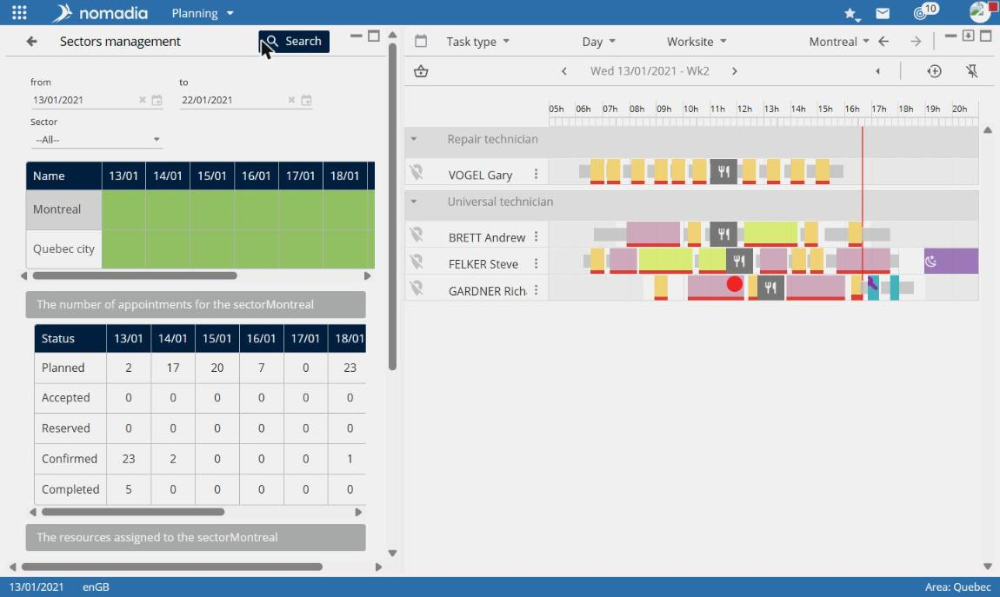

# Manage other planning items

In addition to appointments and unavailabilities, a field worker's planning can contain other items that change what the field worker can do, where, and when. You manage them from the **Planning** section of the module menu.

## Access the feature

**Navigation:** `Planning > Planning menu`, then the entry you want.

Each page has filters, usually **Mobile resource** and a period (**from**, **to**), a **Search** button, and a creation button. The entries displayed depend on your rights.

| Entry                        | Use it to                                                |
| ---------------------------- | -------------------------------------------------------- |
| **Temporary jobs**           | Temporarily replace a field worker's main job            |
| **Assignment of worksites**  | Temporarily assign a sector to a field worker            |
| **Agenda marker**            | Place timestamped markers in the planning                |
| **Exceptional locations**    | Define a temporary start or end location for a route     |
| **Hotel locations**          | Record the hotels that can be used for overnight stays   |
| **Locked day**               | Protect a day against optimization                       |
| **Equipment assignments**    | Assign equipment to a resource                           |
| **Sector management**        | Open or close a sector, day by day                       |

## Assign a temporary job

A field worker's main job defines the intervention types the field worker can perform. A temporary job replaces it for a period. For example, you can allow a maintenance technician to carry out repairs for a busy week.

1. Open **Temporary jobs**.
2. Select **Add a job**.
3. Choose the **Job**, the duration, and the period, then save.

To find existing temporary jobs, filter by **Mobile resource**, **Job**, and period, then select **Search**.

To remove temporary jobs, select them in the **Selection** column, then select **Delete**.

## Assign a sector to a field worker

The **Resource assignment to sectors** page temporarily assigns an additional sector to a field worker, or another sector to replace the field worker's own.

1. Open **Assignment of worksites**.
2. Select **Assign a sector**.
3. Choose the sector and the period, then save.

## Place an agenda marker

An agenda marker is a timestamped reference point in the planning, for example a phone call or a promised appointment. It does not need an address and can overlap other items.

1. Open **Agenda marker**, or select **Place a marker** in an appointment record.
2. Choose the field worker, the **Type** (**Appointment commitment**, **Call**, **Day start**, or **Day end**), the date, and the time.
3. Save.

To find markers, filter by **Mobile resource**, **Worksite**, **Type**, and period, then select **Search**.

## Record a hotel location

Hotel locations let you quickly position an overnight stay when you enter an exceptional location.

1. Open **Hotel locations**.
2. Select **New**.
3. Enter the name, the address, and the availability period, then save.

For exceptional locations, see [Manage exceptional locations](../unavailabilities/manage-exceptional-locations.md).

## Lock a day

A locked day protects a field worker's day against optimization.

1. Open **Locked day**.
2. Select **Lock a day** in the agenda.
3. Choose the field worker, the date, and the **State**, then save.

| State      | Effect                                                                    |
| ---------- | ------------------------------------------------------------------------- |
| **Closed** | No appointment can be added to the day.                                   |
| **Sealed** | No appointment can be added to the day or removed from it.                |
| **Forced** | The day is locked.                                                        |

To unlock days, select them in the list, then use the unlock action.

In the schedule, the **⋮** menu of a field worker offers **Display locked days**.

## Assign equipment

1. Open **Equipment assignments**.
2. Select **Add an assignment**.
3. Choose the equipment, the resource, and the period, then save.

## Open or close a sector

The **Sectors management** page displays, for each sector and each day of the period, the sector's status and the number of appointments.

1. Filter the period (**from**, **to**) and, if needed, the **Sector**, then select **Search**.
2. Select a day's cell to change the sector's status.

<!-- REVIEW: the Assign a sector button and the agenda marker types were verified in the application. The following are translated from the French topic and were not verified: Place a marker (in an appointment record), the Locked day entry and its Closed, Sealed, and Forced states, Lock a day, the unlock action, and the sector cell tooltips. The Locked day entry is not displayed in the test environment's menu, and the Agenda marker page has no creation button for the test profile. -->
