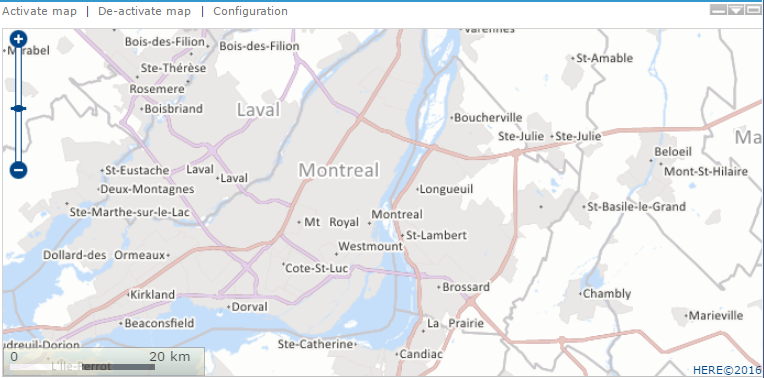
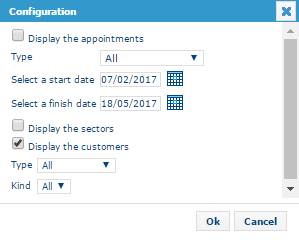
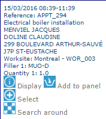
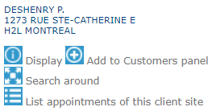

# Map

## Overview

The map is displayed in a frame reserved for it at the top right of the Planning module screen. By default, the background is a route map from the Here geographic database.


The map of France installed by default also includes bordering countries such as Spain, Luxembourg, Switzerland, Germany, Italy and Belgium.


## Navigation

Position the mouse pointer over the map. The cursor changes to a hand, which allows you to **pan** and move around the map.

You can **zoom in or out** with the slider on the left side of the map or with the **mouse wheel**.

A **scale** at the bottom left of the map indicates the current map scale and helps you estimate distances.

## Display

A series of buttons above the map allows you to **activate** or **deactivate** the map.

Use the **Configuration** function to select the information displayed on the map. The displayed information is automatically limited to the **perimeter defined for the user**.


This pane also displays a view from an external application or from an internet site when you click a specific link in the information pane.


### Display the appointments

Select the **Display the appointments** check box to display the appointments on the map. They appear as points, colored according to the legend (see [The Planning](theplanning.md)).

Click an appointment on the map to display the following tooltip:

* The **Display** button displays the appointment form (see [Objects in the Planning Module](objectsintheplanningmodule.md)).
* The **Add to panel** button adds the appointment to the panel (see [The Planning](theplanning.md)).
* The **Select** button adds the appointment to the list of selected appointments.
* The **Search around** button searches for objects nearby (see [Menu](menu.md)) the appointment.

### Display the sectors

Select **Display the sectors** to display the locations of the sectors (see [Company data](../administration/companydata.md)) on the map.


For the display to work, you must have saved the towns as at least one sector (see [Company data](../administration/companydata.md)).


### Display the customers

Select **Display the customers** to display the locations of the customers (see [Objects in the Planning Module](objectsintheplanningmodule.md)) on the map.

Click a customer on the map to display the following tooltip:

* The **Display** button displays the customer form (see [Objects in the Planning Module](objectsintheplanningmodule.md)).
* The **Add to customers panel** button adds the customer to the panel (see [Menu](menu.md)).
* The **Search around** button searches for objects nearby (see [Menu](menu.md)) the customer.
* The **List appointments for this client site** button lists the appointments created using this customer as a starting point.
