# Menu

## Overview

The menu of the Planning module gives access to the main functions of the module. To open it, move the mouse over the  button at the top left of the screen. By default, the button is inactive and the menu is hidden. When you move the mouse over the button, it changes color  and the menu functions are displayed.


Functions can be displayed or hidden by [rights](../administration/userhandling.md). The number of items in the menu therefore varies depending on the current user profile.


The menu contains the following functions:

* Change area
* Set new appointment
* Customers
  * Search for customers
  * Create customer
  * Customers panel
  * Customer alerts list
  * Generate periodic requests
* Resources management
  * Temporary job management
  * Secondary worksites assignments management
  * Display customers
  * On-call duty management
  * Equipment assignments
* Sector management
* Appointment search
* Selected appointment list
* Requested, planned, reserved, confirmed, unplanned, externalized appointments
* My searches
* Links between interventions
* Appointment alerts
* Customer gap
* Alerts on route duration
* Application alerts
* Messaging service
* Modify appointments in the past
* Display planners
* Unavailabilities
* Unavailability search
* Route sheet
* Exceptional locations
* Hotel locations
* Locked day
* Manage agenda markers
* Vehicles tracking
* Compute a route
* Convert coordinates into Lat/Lon
* Search around
* Check traffic for the schedule
* Predefined exports list
* Custom reports

## Change area

This function returns you to the [Change area](../the-header-bar/change-area-nfs-reference-guide.md) function in the header bar.

## Making a new appointment

This function lets you make an appointment without revealing the identity of the customer.

The first page collects the customer information.

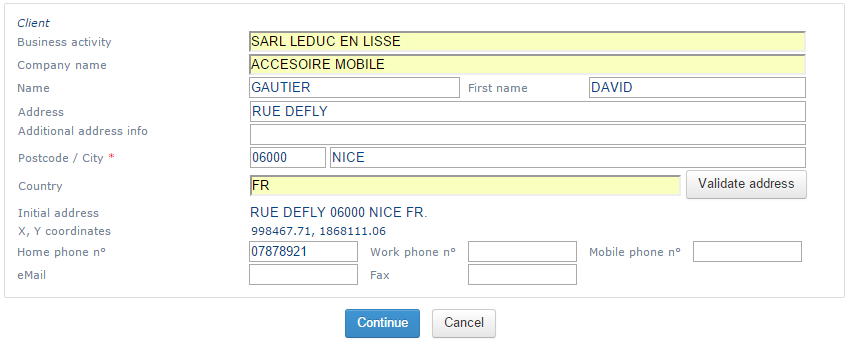

Enter the time information and the information needed to identify the customer:

* the **name** of the customer;
* the **company name**, if needed;
* the **name** and **first name** of a company contact;
* the full **address** of the site of the intended intervention;
* the different **telephone numbers**.
* The validation of the address is described in the geocoding chapter.
* Click **Cancel** to cancel the appointment.
* Click **Continue** to open the [qualification of the appointment](objectsintheplanningmodule.md) window.


The customer is created when the appointment is completed.


## Customers

In some companies, it is common practice to carry out maintenance visits or sales rounds for [customers](objectsintheplanningmodule.md) who are already known to the company. Certain technicians can even be assigned by default to certain [customers](objectsintheplanningmodule.md). To avoid re-entering information that is already known about [customers](objectsintheplanningmodule.md), the application lets you save a [customer](objectsintheplanningmodule.md) database to facilitate making appointments.

The **Customers** menu contains the following options:

* **Customer search**
* **Create customer**
* **Customers panel**
* **Customer alerts list**
* **Generate periodic requests**

### Customer search

This page lets you search for, [create](objectsintheplanningmodule.md) or modify a customer.

* The principle of the search functions is described in the [Search in the Planning module](objectsintheplanningmodule.md) chapter.
* The search fields are described in the [customer form](objectsintheplanningmodule.md).

In the page header, depending on the configuration, a series of links lets you:

* Show Customers panel
* Orderer search
* Customer type search
* Customer kind search

#### Result of the search

After you run the search, the page shows the number of lines found and the number of lines displayed.


The display limit is [configurable](../administration/customization.md).


The table has the same [basic functionalities](objectsintheplanningmodule.md) as the other tables in NFS.


The buttons in the table header apply operations to all objects in the table.


Buttons on each line of the table let you apply actions without opening the customer form. The possible actions include:

* The  button adds the customer to the panel.
* The  button makes an appointment with the customer. You are redirected to the [qualification of the appointment](objectsintheplanningmodule.md) page.
* The  button locates the customer on the [map](map.md).
* The  button lists all the appointments for the customer. The list of appointments for this customer is then displayed:

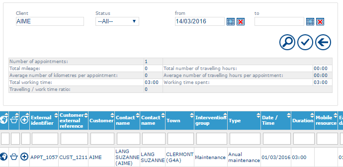

The first part of this page lets you [refine the search](objectsintheplanningmodule.md).

The second part shows statistics on all displayed appointments (**Number of appointments**, **Number of kilometers travelled**, **Working hours**, etc.).

Finally, the list of appointments lets you open the [appointment form](objectsintheplanningmodule.md): click a line of the [result](objectsintheplanningmodule.md).

To open the [customer form](objectsintheplanningmodule.md), click the corresponding line in the table of results.

### Searching for the company orderer

This function lets you [create](objectsintheplanningmodule.md), modify or delete an orderer (see the [customer form](objectsintheplanningmodule.md)).

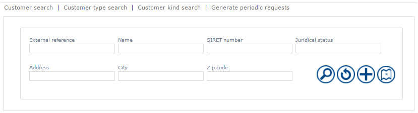

The principle of the search functions is described in the [Search in the Planning module](objectsintheplanningmodule.md) chapter.

The search fields are described in the [orderer form](objectsintheplanningmodule.md).

* Click an [orderer](objectsintheplanningmodule.md) in the list to open the corresponding [form](objectsintheplanningmodule.md).
* Click the  button to open the [orderer form](objectsintheplanningmodule.md) in creation mode.

### Search on a customer type

This function lets you search for, [create](objectsintheplanningmodule.md) or change a customer type.

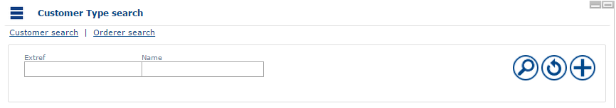

The principle of the search functions is described in the [Search in the Planning module](objectsintheplanningmodule.md) chapter.

The search fields are described in the [customer type form](objectsintheplanningmodule.md).

Click the  button to add a new customer type. The [customer type form](objectsintheplanningmodule.md) opens in creation mode.

### Search on customer kind

This function lets you search for, [create](objectsintheplanningmodule.md) or change a customer kind.

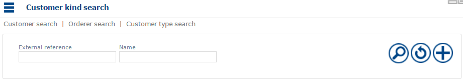

The principle of the search functions is described in the [Search in the Planning module](objectsintheplanningmodule.md) chapter.

The search fields are described in the [customer kind form](objectsintheplanningmodule.md).

Click the  button to add a new customer kind. The [customer kind form](objectsintheplanningmodule.md) opens in creation mode.

### Create customer

This page lets you [create](objectsintheplanningmodule.md) a customer.

In the page header, depending on the configuration, a series of links lets you open:

* Customer search
* Show Customers panel

### Customers panel

This page lets you assign actions to a selection of customers.

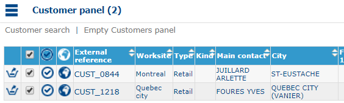

The [search result](objectsintheplanningmodule.md) lists the customers in the panel. Click a line to open the [customer form](objectsintheplanningmodule.md).

* The **Customer search** link takes you back to the customer search function.
* The **Empty panel** link removes the appointments from the customer panel.
* The  button removes an appointment selected in the customer panel.
* The  button deselects appointments.
* The  button makes an appointment with the customer and sends you to the [qualification of the appointment](objectsintheplanningmodule.md) page. If you click this button in the header of the result table, you open the function for making appointments for several customers.
* The  button displays the customers on the map.

### Making appointments for several customers

This function is accessible only from the customer panel.

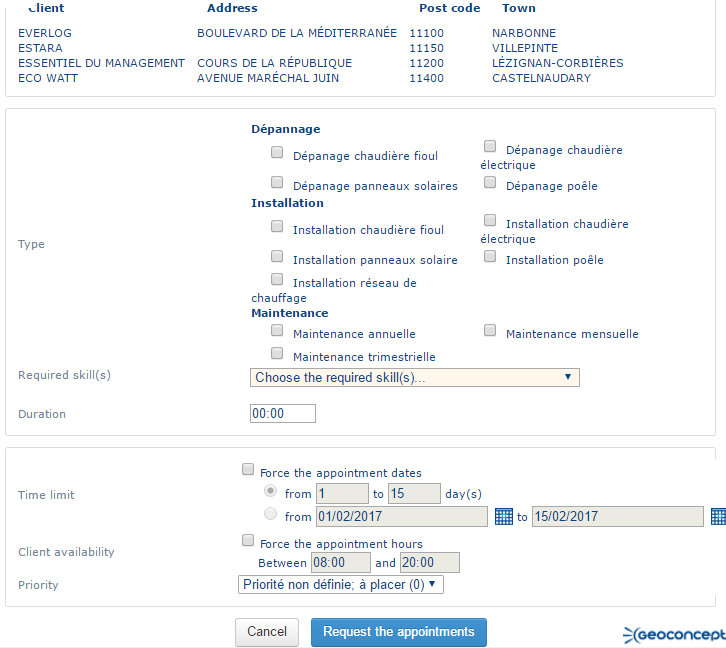

The first section lists the customers concerned.

The second section contains the same fields as the [qualification of the appointment](objectsintheplanningmodule.md).

* Click **Cancel** to return to the customer panel.
* Click **Request appointments** to create appointments with the _Requested_ [status](../introduction/thedifferentstatusesforappointmentsinnfs.md).

A [table](objectsintheplanningmodule.md) summarizes the appointments created.

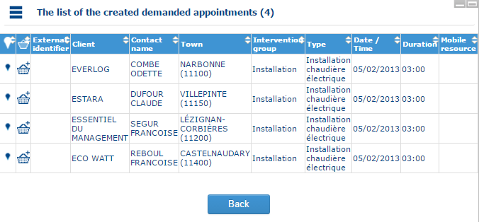

From this list, you can add the requested appointments to the [panel](theplanning.md): click the panel button opposite an appointment, or in the table header.

Click **Back** to return to the customer panel.

### List of customers on alert

See [List of customer alerts](../the-header-bar/guided-help-nfs-reference-guide-1.md) in the header bar.

### Generate periodic requests

This page generates visits automatically for customers according to a predefined visiting period.

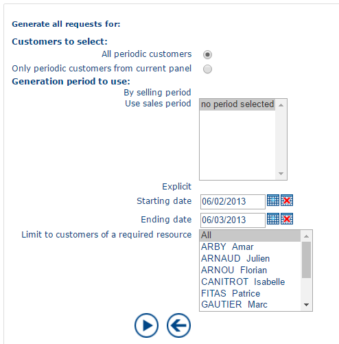

The visit generation page contains the following fields:

* **Customers to select**
  * **All recurring customers** – selects all customers for whom the _recurring customer_ check box is selected in the [customer form](objectsintheplanningmodule.md).
  * **Recurring customers in the panel only** – selects only customers who are in the customer panel and for whom the _regular customer_ check box is selected in the [customer form](objectsintheplanningmodule.md).
* **Generation period to use**
  * **By sales period** – applies the generation to the selected [sales periods](../administration/companydata.md).
  * **Explicit** – generates visits between the **period start date** and the **period end date** you select.
* **Limit to customers of a required resource** – limits the generation to customers who have the selected resource as a required resource in the [customer form](objectsintheplanningmodule.md).

Click the  button to run the generation of visits between the two dates.

Click the  button to return to the previous page.


The generation is applied according to the settings defined in the [customer form](objectsintheplanningmodule.md).


## Managing resources

The resource management part includes the following functions:

* Temporary job management
* Secondary worksites assignments management
* Display customers
* On-call duty management
* Equipment assignments

### Handling of temporary posts

This page lets you search for, [create](objectsintheplanningmodule.md), modify or [delete](objectsintheplanningmodule.md) the [temporary posts](objectsintheplanningmodule.md) of resources.

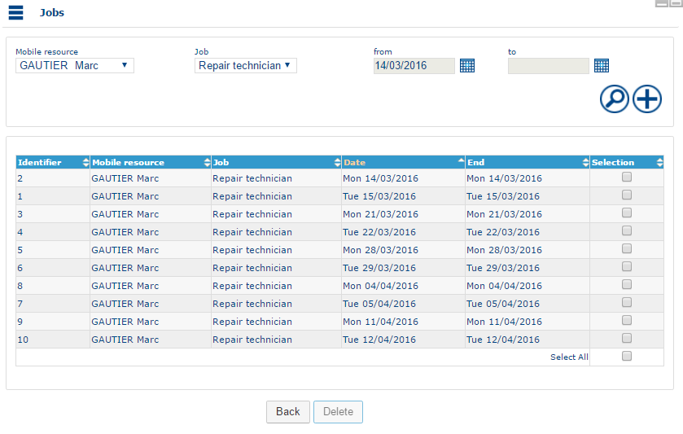

The principle of the search functions is described in the [Search in the Planning module](objectsintheplanningmodule.md) chapter.

The search fields are described in the [temporary post form](objectsintheplanningmodule.md).

Click the  button to add a new temporary post. The [form](objectsintheplanningmodule.md) opens in creation mode.

### Assignment of secondary worksites

This page lets you search for, create, modify or delete the [secondary worksites](objectsintheplanningmodule.md) of resources.

* The search page contains [search](objectsintheplanningmodule.md) fields and a list of worksites that are already saved.
* The search fields are described in the [secondary worksite form](objectsintheplanningmodule.md).
* Click a line in the table to open the [secondary worksite form](objectsintheplanningmodule.md) in modification mode.
* Click the  button to add a new secondary worksite. The [secondary worksite](objectsintheplanningmodule.md) form opens in creation mode.

### View customers

This page shows the customers assigned to the resource selected in the drop-down list.

The search page contains [search](objectsintheplanningmodule.md) fields and a list of on-call duties that are already saved.

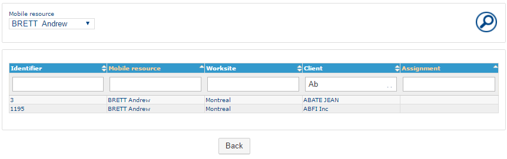

### On-call duty management

This page lets you search for, [create](objectsintheplanningmodule.md), modify or [delete](objectsintheplanningmodule.md) [on-call duty items](objectsintheplanningmodule.md) for resources.

* The search page contains [search](objectsintheplanningmodule.md) fields and a list of on-call duties that are already saved.
* The search fields are described in the [on-call duty form](objectsintheplanningmodule.md).
* Click a line in the table to open the [on-call duty form](objectsintheplanningmodule.md) in modification mode.
* Click the  button to add a new on-call duty. The [on-call duty form](objectsintheplanningmodule.md) opens in creation mode.

### Equipment assignments

This page lets you search for, [create](objectsintheplanningmodule.md), edit or [delete](objectsintheplanningmodule.md) an assignment between previously created [equipment](../administration/companydata.md) and existing [resources](../administration/companydata.md).

The search page contains [search](objectsintheplanningmodule.md) fields and a list of saved assignments.

## Sector management

This page opens or closes sectors.

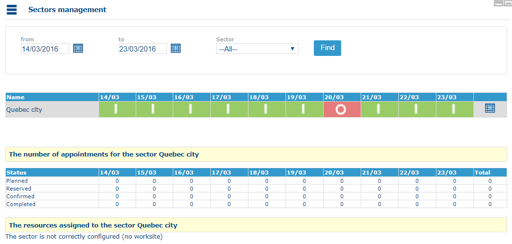

* The first part lets you [refine the search](objectsintheplanningmodule.md) on sectors: select the dates and a sector.
* In the list of sectors, sectors that are closed over the period are red and open sectors are green. To close or open a sector, click an open or closed sector.
* To define an opening or closing timeslot, click the  button. You can then define an opening or closing period:

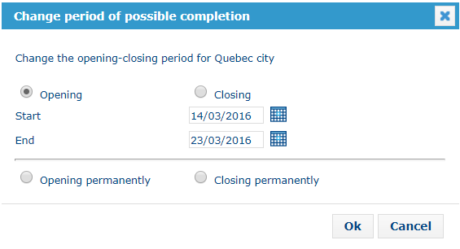

Two tables at the bottom of the page show the number of appointments and resources for the sector selected in the list of sectors.


You cannot plan appointments in a closed sector, except in manual planning mode.


## Searching for an appointment

This page lets you search for one or several [appointments](objectsintheplanningmodule.md) using known data about these appointments.


Only appointments in the same area as the one selected are displayed.



You can save search criteria by clicking **Recent searches** at the top of the page. This tool also lets you reload, delete or rename an earlier search.


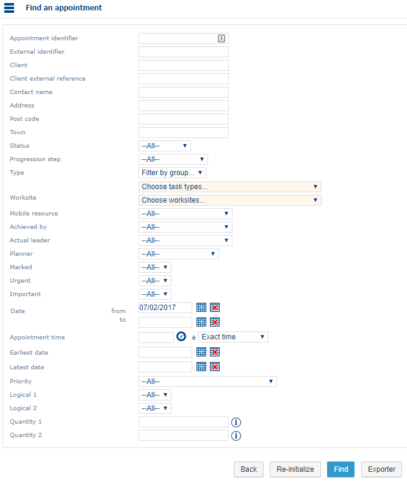

* The principle of the search functions is described in the [Search in the Planning module](objectsintheplanningmodule.md) chapter.
* Search fields can be customized in the [Application Configuration](../administration/customization.md) and are described in the [appointment form](objectsintheplanningmodule.md).

### Result of the search


The buttons in the table header apply various actions to all objects in the table.


Buttons on each line of the table let you apply actions without opening the appointment form. The possible actions include:

* The  button adds the appointment to the list of selected appointments.
* The  button locates the appointment on the [map](map.md).
* The  button adds this intervention to the [panel](theplanning.md).

Click an appointment in the results to open its form.

## List selected appointments

* This function displays all appointments selected in the appointment lists with the  button.
* The [table of results](objectsintheplanningmodule.md) has [buttons common to appointment lists](objectsintheplanningmodule.md).

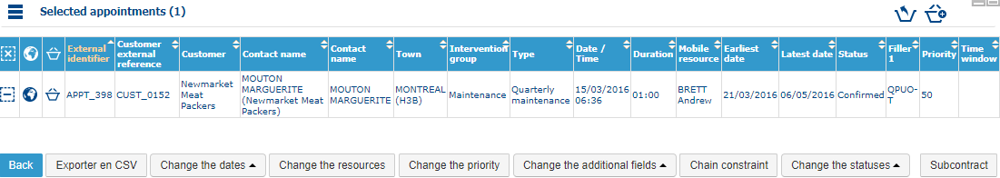

Two buttons are located at the top right of the list:

*  adds all the appointments in the [panel](theplanning.md) to the selection.
*  adds all selected appointments to the [panel](theplanning.md).

## Search for appointments (requested, planned, reserved, confirmed, unplanned, subcontracted)

* Depending on the [rights](../administration/userhandling.md) granted to you, you can access predefined searches or searches filtered on appointment status.
* For example, the **Search on requested appointments** link searches for appointments with the _Requested_ [status](../introduction/thedifferentstatusesforappointmentsinnfs.md).
* Each link opens a first screen that lets you filter on date, resource (or subcontractor), worksite and intervention type.

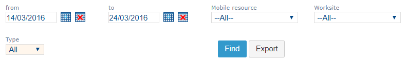

* The principle of the search functions is described in the [Search in the Planning module](objectsintheplanningmodule.md) chapter.
* Click **Search** to display the [list of results](objectsintheplanningmodule.md). Click an appointment in the list to open the [appointment form](objectsintheplanningmodule.md).
* Click **Export** to retrieve a `.csv` file for the search.

## My searches


To access a predefined search, you need the corresponding [right](../administration/userhandling.md) from the NFS administrator.


This menu gives access to the searches configured in the [Configuring the application](../administration/customization.md) menu of the Administration module. Quick access links to these predefined searches can also be displayed in the [information pane](theinformationpane.md).

The table of results is comparable to that of a standard search.

## Links between interventions


To access this menu, you need the corresponding [right](../administration/userhandling.md) from the NFS administrator (`CALLCENTER_SEARCH_CHAIN_CONSTRAINT`).


This function lets you search for appointments associated with [chaining constraints](objectsintheplanningmodule.md).

* Click **Reactivate** to recall the scheduling for all appointments in the selected chain(s).
* Click **Export** to retrieve the `.csv` file for the search.
* Click a result line to open the form for this chaining constraint. You can then edit it, for example to add or delete an appointment, or apply any other action, such as changing the appointment status or editing the dates of selected appointments.

## Appointment alerts

This function returns you to the [appointment counters](theinformationpane.md) function.

## Customer gap

This function lets you [search](objectsintheplanningmodule.md) for [appointments](objectsintheplanningmodule.md) for which the customer recurrence constraint defined in the [customer form](objectsintheplanningmodule.md) is not respected.

The result is a list of appointments. Its fields are defined in the [appointment section](objectsintheplanningmodule.md).

## Alerts on route duration

This function lets you filter on:

* Date
* Mobile resource
* Status
* Worksite
* Maximum journey time or distance (in minutes or km)

The search options are described in the [Search](objectsintheplanningmodule.md) chapter.

The search results show a list of customers.

## Application warning messages

This menu gives access to the application alert messages subscribed to in the Administration module (see [User Handling](../administration/userhandling.md)). These messages form the journal of technical exchanges and background modifications made to the application, for example:

* results of CSV imports (success, error, etc.);
* webservice calls;
* modifications made to optimization parameters;
* etc.

A technical user can use this journal to track and diagnose the events that affect the application.

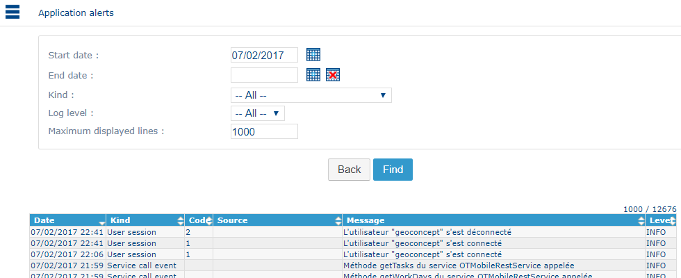

The principle of the search functions is described in the [Search in the Planning module](objectsintheplanningmodule.md) chapter.

## Messaging service

This menu gives access to a full messaging service. You use it to read, write, send or delete messages exchanged between users. To refresh the list at any time, click the  button at the top right of the information pane.

The messaging manager displays messages in a table showing their status: unread, received, sent or all of these (_read_, _answered_, _sent_, _draft_). You can sort each column.

When you click a line, the details of the message appear: sender, recipient, issue date, publication start and end dates, and message body text. You can then apply the following actions to the message:

* mark as unread;
* reply;
* delete.

### Write a new message

1. Click **+ New message**.
2. Enter the recipient(s). Select from the [resources](../administration/companydata.md) and [teams](../administration/companydata.md) of the current area (or from one or several available areas if the area favorites are enabled).
3. (Optional) Enter a notification start date to delay sending.
4. (Optional) Enter a notification end date to apply an expiry date.
5. Enter the body of the message.
6. Send the message or save it as a draft.

## Modify the appointments of the past

This page modifies the characteristics of a past appointment. Notably, you use it to declare that the appointment has been fulfilled and under what conditions.

It also lets you align the past agendas of resources with the routes actually fulfilled, by adding appointments.

### Modify the current status of past plannings

The first window asks you to choose the route to modify, using a resource and a date.

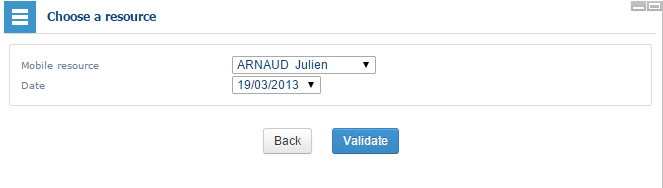

The application searches for and lists the appointments that can be modified.

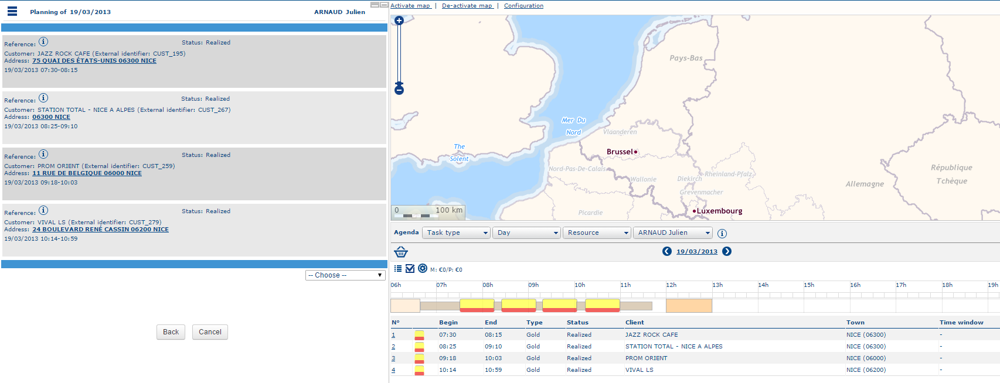

For each appointment, some characteristics are shown for reference, for example the address, date, status and time window. A drop-down menu lets you change the default value **Do nothing**:

* **Do nothing** – does not modify the appointment.
*   **Modify** – lets you modify the timeslot(s).

    

In this mode, you can edit the timeslot times as required.

    * Click the  button to add several time windows.
    * Click the  button to delete time windows.
    * Make any required modifications, then click the  button. You can then cancel all the modifications applied by clicking the  button.
* **Reactivate** – returns the appointment to _Requested_ status.
* **Fulfilled** – signals that the appointment has been fulfilled and lets you enter additional information about its fulfilment (income generated, status of the task, follow-up required, and different comment lines).
* **Unplan** – removes the appointment from the planning.

### Adding an appointment to a past planning

You can add an appointment to the past planning of a resource. For example, an appointment planned for the next day may have been fulfilled ahead of time (emergency, timeslot freed unexpectedly, etc.).

1. In the **Choose** drop-down menu at the bottom of the window, select **Add an appointment**.
2. In the window that opens, define the criteria to find the appointment(s) to add to the planning. You can search on requested, planned and confirmed appointments.
3.  Click **Search** to run the search.

    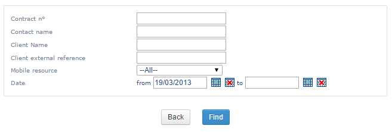
4. In the list of appointments found, click the appointment to add to the past planning.
5. Indicate the time window for the intervention at the customer's premises. Also supply the start and end time of the appointment and, if appropriate, the actual duration.

## Display agendas

This function reinitializes the [planning](theplanning.md).

## Handling unavailabilities

This page lets you [add](objectsintheplanningmodule.md) or [delete](objectsintheplanningmodule.md) [unavailabilities](objectsintheplanningmodule.md) in the plannings you manage. You can create unavailabilities for one or several resources simultaneously (handling of meetings), specify predefined or free appointment times and a recurrence, overwrite an address, add a comment, etc.

This page is described in the [Unavailability form](objectsintheplanningmodule.md) chapter.

## Unavailability search

This page lets you search for, [create](objectsintheplanningmodule.md), modify or [delete](objectsintheplanningmodule.md) [unavailabilities](objectsintheplanningmodule.md).

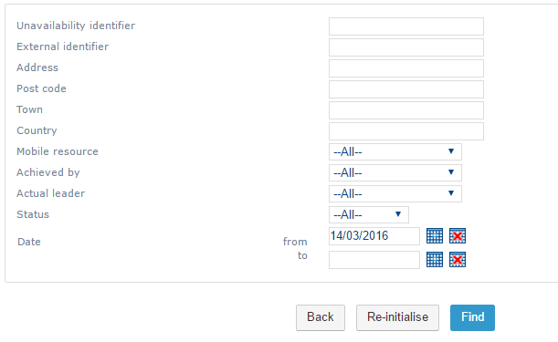

* The search page contains [search](objectsintheplanningmodule.md) fields. Click **Search** to display the [list](objectsintheplanningmodule.md) of unavailabilities.
* The search fields are described in the [unavailabilities](objectsintheplanningmodule.md) form.
* Click a line in the search result to open the [reduced unavailability form](objectsintheplanningmodule.md).


The **Selected unavailabilities** link lists the unavailabilities selected in the result list with the  button.


## Editing the roadbook

This function displays and describes the appointments and scheduled interventions for a chosen duration (day or week) for a connected resource or team.

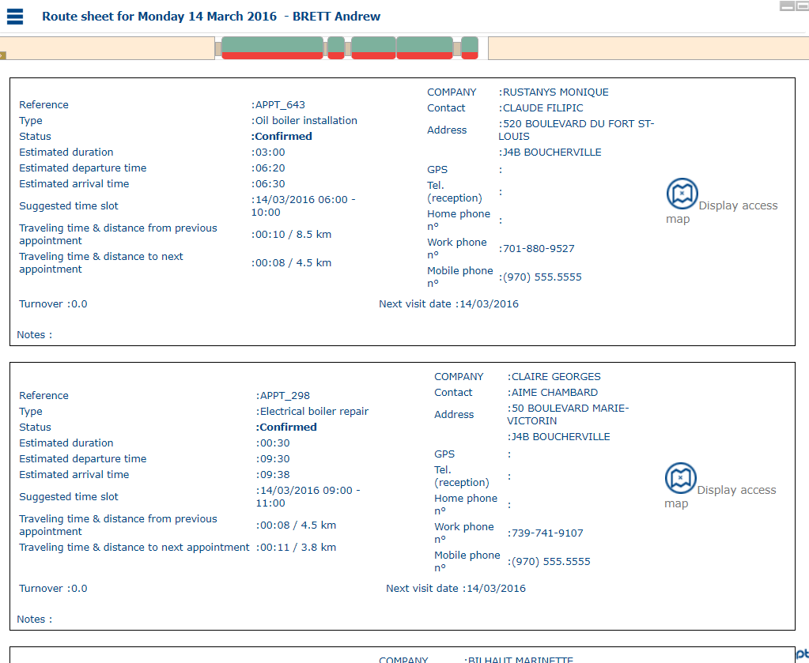

The screen shows the forecast planning for the chosen duration.

The roadbook describes all the interventions of the day by type and in chronological order. For each appointment, the items of information shown vary depending on the type of intervention.

For each event of the day, an access plan is available: click the  button. The access plan opens in a floating window showing the map centered on the event, shown as a circular symbol indicating the appointment time. You can resize this window to match the space you want for the map. Use the vertical bar at the top left of the window to manipulate the map:

* Move the cursor towards **+** to zoom in on the map (you can also use the mouse wheel).
* Move the cursor towards **–** to zoom out on the map (you can also use the mouse wheel).
* Hold down the left mouse button and slide the cursor to pan the map.

### Exporting the roadbook

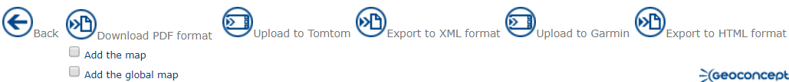

You can generate a `.pdf` file from the roadbook to display it on the screen. Select the **Add detailed maps** check box to insert the maps in the `.pdf` file.


The **Add global map** check box works only if the map display is configured on GCIS, and not on HTC.


You can also generate a file in Garmin, TomTom, HTML or XML format to read the roadbook in a GPS navigation application.

Click **Back** to redisplay the last week's planning you viewed.

## Exceptional locations

This menu lets you search for, [create](objectsintheplanningmodule.md) and [delete](objectsintheplanningmodule.md) [exceptional locations](objectsintheplanningmodule.md).

* The principle of the search functions is described in the [Search in the Planning module](objectsintheplanningmodule.md) chapter.
* The search fields are described in the [exceptional location form](objectsintheplanningmodule.md).
* The  button analyzes the panel of appointments to plan and suggests exceptional locations to fulfil distant appointments.
* Click a line in the result list to open the [exceptional location form](objectsintheplanningmodule.md).
* The **Forced mode** check box makes it possible to ignore journey times when deleting an exceptional location.
* The **Confirm/Unconfirm** button changes the status of the selected exceptional locations from _confirmed_ to _to confirm_ and vice versa.


Unconfirmed exceptional locations can be modified during a [batch optimization](../administration/optimisation.md).


## Hotel locations

This page lets you search for, [create](objectsintheplanningmodule.md) and [delete](objectsintheplanningmodule.md) [hotels](objectsintheplanningmodule.md).

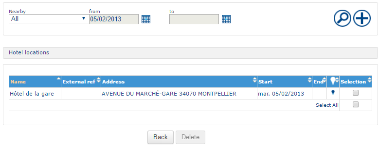

* The principle of the search functions is described in the [Search in the Planning module](objectsintheplanningmodule.md) chapter.
* The **Close to** field filters on towns that include pre-saved hotels.
* The search fields are described in the [hotel location form](objectsintheplanningmodule.md).
* Click a line in the result table to open the [hotel location form](objectsintheplanningmodule.md).

## Locked day

This page lets you search for and [create](objectsintheplanningmodule.md) [locked days](objectsintheplanningmodule.md) in the agendas of resources.

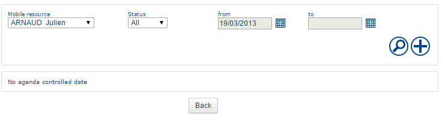

The principle of the search functions is described in the [Search in the Planning module](objectsintheplanningmodule.md) chapter.

The search fields are [configurable](../administration/customization.md) and are described in the [locked day form in the agenda](objectsintheplanningmodule.md).


Before version 8.4, the application handles only the **Closed** status.


* Click a line in the result table to open the corresponding [locked day form](objectsintheplanningmodule.md).
* Click the  button to create a new locked day for the resource selected in the drop-down list. The [locked day form](objectsintheplanningmodule.md) opens in edit mode.

## Manage agenda markers

This page lets you search for, [create](objectsintheplanningmodule.md), modify or [delete](objectsintheplanningmodule.md) [agenda markers](objectsintheplanningmodule.md).

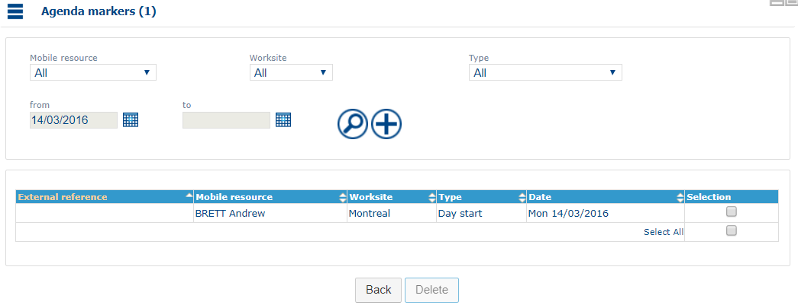

* The principle of the search functions is described in the [Search in the Planning module](objectsintheplanningmodule.md) chapter.
* The search fields are described in the [agenda marker form](objectsintheplanningmodule.md).
* Click a line in the result table to open the [agenda marker form](objectsintheplanningmodule.md).
* Click the  button to create an agenda marker for the resource selected in the drop-down list. The [agenda marker form](objectsintheplanningmodule.md) opens in edit mode.

## Vehicles tracking

For a given worksite, this function lists and maps the last known position of [vehicles](../administration/mobility.md) that have an on-board [tracking device](../administration/mobility.md) [assigned](../administration/mobility.md) to a resource for a given period.

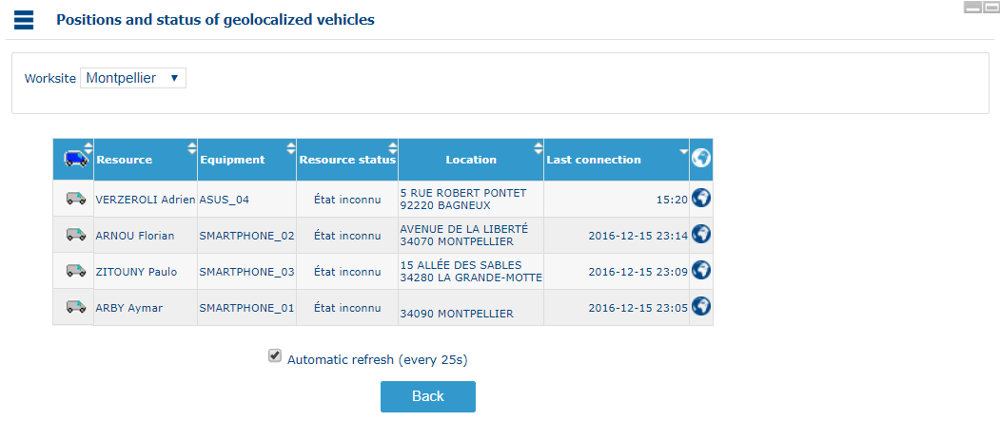


This function requires the application to be configured with a [positions server](../administration/mobility.md).


## Compute a route

This function calculates a route and displays the route sheet or roadbook.

The first page of the function contains the following fields:

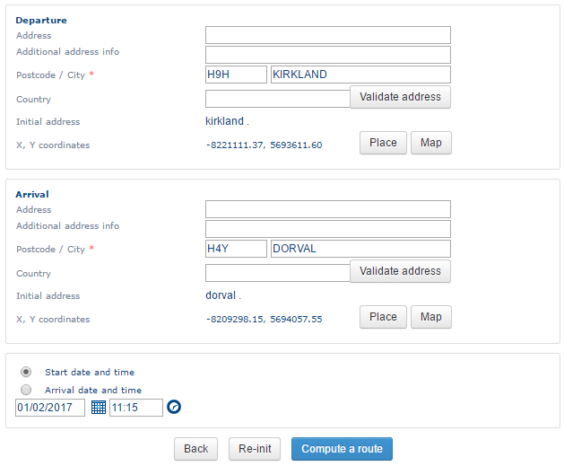

* **Start** – enter the start address.
* **Arrival** – enter the arrival address.
* **start time** or **arrival time** – choose one of the two.
* **vehicle profile** – choose from a variety of preconfigured vehicles (car, truck, light delivery vehicle, delivery truck, bus, emergency vehicle, emergency truck, taxi, bicycle, pedestrian). Their technical specificities (average speeds, access restrictions to various types of road, etc.) are taken into account in the calculation.


The arrival and departure times work only if a suitable graph is used.



NFS lets you define different speeds for defined time windows, so that changing traffic conditions throughout the day can be taken into account. These speed profiles (_Speed Patterns_) must be enabled and defined in the Administration module (Customization > Configuration > Application > Itinerary computation > SmartRouting > `isSpeedPatternUsed` and `allSpeedPatternInterval`). They are then applied here.


* Click **Reset** to reinitialize all fields.
* Click **Compute route** to run the calculation.

The second page contains the result of the route calculation:

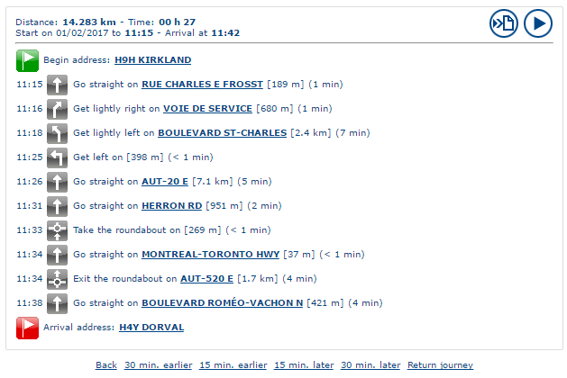

* The  **Export** button exports the results.
* The  **Start** button displays the journey on the map as a series of route steps.
* Click a step of the route to zoom in on it.
* The **Back** link returns you to the first page.
* The **15-30 minutes before / after** link moves the departure times forwards or back (if the installed graph permits it).
* The **Return journey** link returns you to the first page, with the start and arrival addresses reversed.

## Convert coordinates into Lat/Lon

This function calculates the coordinates of an address in latitude/longitude (geographic coordinates).

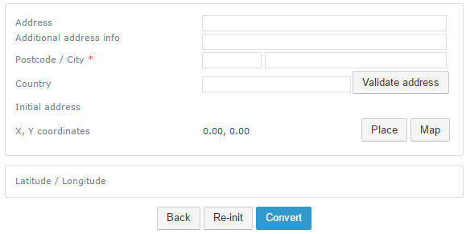

This page contains address fields.

Click **Convert** to run the calculation. The coordinates in latitude/longitude appear in the lower frame.

## Search around

This function displays the worksites, vehicles, customers, hotels or appointments near an address.

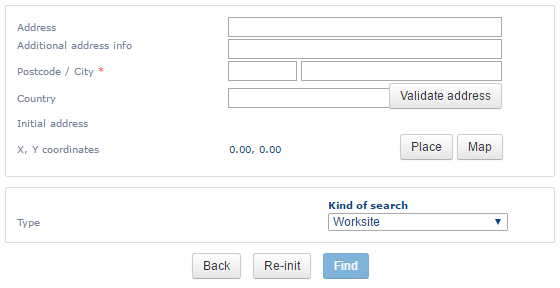

* The page contains an address section.
* A drop-down list lets you select the type of object you want.
* The **Search** button searches for the selected objects around the saved address.
* The following [result list](objectsintheplanningmodule.md) then displays:

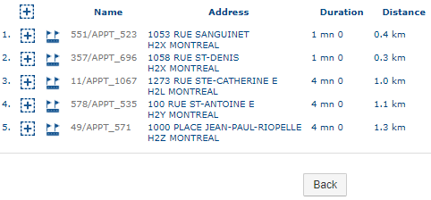

* If the search is applied to customers or appointments, the  button adds the customer to the customer panel, or the appointment to the list of selected appointments, respectively.
* The  button runs a route calculation between the address entered and the corresponding object.
* Click the name of the object to open its [form](objectsintheplanningmodule.md).

## Verify circulation for the planning

This function lets you verify whether the suggested planning is compatible with the current traffic status.

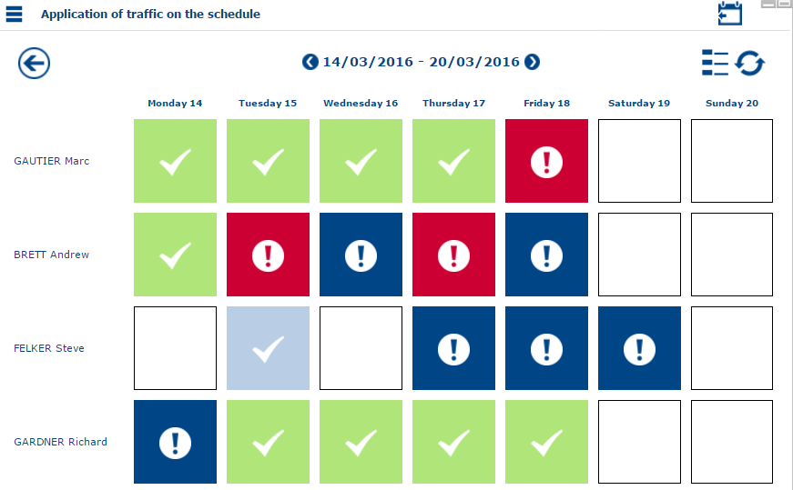

* The  button displays the traffic status corresponding to the view displayed in the [planning](theplanning.md).
* The  button displays the legend for the page:

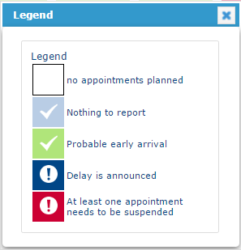

* The  button takes you back to the preceding traffic status.
* The  button refreshes the traffic status.
* Click a check box in the traffic status to open the appointment management page:

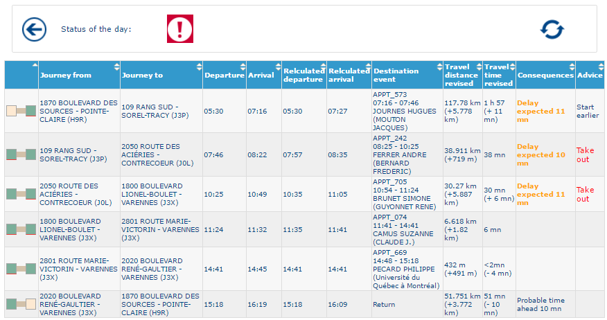

The first column shows the confirmed appointment graphically: the 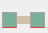 image represents the position of the appointment in the planning. The appointment concerned is the second item in the image.

* **Journey from** – the start address for the mission.
* **Journey to** – the arrival address for the mission.
* **Departure** and **Arrival** – the departure and arrival times for the appointment.
* **Recalculated departure** and **Recalculated arrival** – the departure and arrival times for the appointment after the journey time is recalculated to take traffic into account.
* **Destination event** – the name and address of the next event in the planning.
* **Travel distance revised** and **Travel time revised** – the distance and time of travel, recalculated to take traffic into account.
* **Consequences** – details of any anticipated delay or late arrival.
* **Advice** – any relevant scheduling advice. For example, the **Remove** link lets you remove the appointment from the planning.


Traffic conditions are available only if a graph that permits this is used. The traffic status is calculated statistically and may deviate from the reality on the ground.


## Predefined exports list

Predefined exports let you export data in `.csv` format according to the fields predefined in the [application settings](../administration/customization.md).

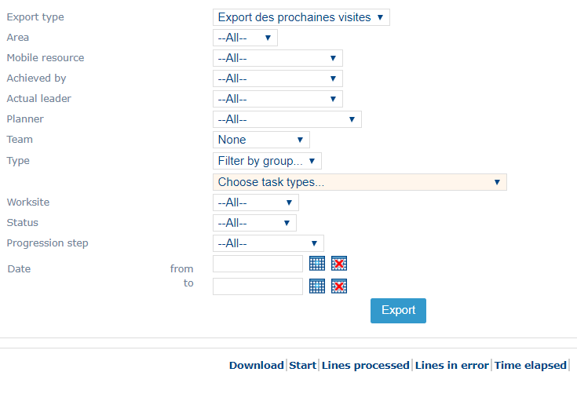

You can filter the predefined export on the following fields:

* **Export type** – list containing the names of any predefined exports
* **area**
* **Mobile resource**
* **Achieved by**
* **Actual leader**
* **planner**
* **team**
* **type**
* **worksite**
* Appointments [**status**](../introduction/thedifferentstatusesforappointmentsinnfs.md)
* Appointments [**progression step**](../introduction/thedifferentstatusesforappointmentsinnfs.md)
* **date**

Click **Export** to retrieve the `.csv` file containing the export.

Below the filters, a table summarizes information about the export (number of lines exported, execution times, etc.).


Some filters are not available, because their use depends on the type of export selected. For example, for an export of the Customer type, the **Status** filter does not work.


## Custom reports

This function is identical to [Predefined exports list](menu.md#predefined-exports-list), except that it is not based on the [application settings](../administration/customization.md), but on the `.sql` files stored in the ad hoc directory on the server.
