# Objects in the Planning Module

## Overview

The Planning module handles the following objects:

* Customer types
* Customer kinds
* Customers
* Orderers
* Appointments
* Unavailabilities
* Exceptional locations
* Temporary posts
* Secondary worksites
* Hotel locations
* Agenda markers
* On-call duties
* Locked days

In principle, the objects in the Planning module include a generic search function. You use it to find an object that already exists in the application, to add new objects, or to delete them.

Each object has a form. The form behavior is described in the following sections.


Other objects are handled in the [Administration](../administration/administration.md) module.


## Forms

The forms include fields that are described in the sections for each object.

In edit mode (creation or modification), a form takes the following format.

Example: Customer type form

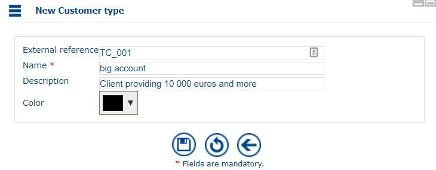

* The  button saves the modifications made in the form.
* The 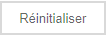 button resets the whole form.
* The 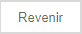 button takes you back to the previous page.


Some forms have additional buttons. They are described in the sections for the corresponding objects.


## Customer types

Customer types are groups of customers arranged to suit your purpose. You do not have to use customer types if they are not appropriate for your organization.

### Customer type form

You access the customer type form after searching for a customer type in the [Menu](menu.md) (**Customer type search**).

Customer type form

The form contains the following fields:

* **External reference**
* **Name** (mandatory)
* **Description**
* **Colour** – gives the customer type a custom color in the plannings. See [Customization](../administration/customization.md).

## Customer kinds

Customer kinds let you categorize customers according to a second level of classification, in addition to the customer types.

### Customer kind form

You access the customer kind form after searching for a customer kind in the [Menu](menu.md) (**Customer kind search**).

The form contains the following fields:

* **External reference**
* **Name**
* **Description**
* **Colour** – assigns a custom color to the customer kind in the plannings. See [Customization](../administration/customization.md).

## Customers

You must have at least one customer to whom you can associate appointments.

Customers can be displayed on the map.

### Customer form

You access the customer form in one of the following ways:

* From the [Menu](menu.md), using **Customer type search**.
* From the appointment form, by clicking the customer info icon.
* From the appointment info-box popup in the planning. See [The Planning](theplanning.md).

The customer form includes seven tabs:

* **Details**
* **Address**
* **Contacts**
* **Project**
* **Assignments**
* **Timetable**
* **Preferences**

The form also provides the following buttons:

* The  button makes an appointment for the selected customer.
* The  button adds the selected customer to the customers panel. See [Menu](menu.md).
* The  button searches for objects nearby the selected customer. See [Menu](menu.md).
* The  button displays the list of appointments associated with the selected customer. See [Menu](menu.md).
* The 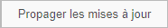 button applies all the modifications made to this customer to all the saved appointment requests for this customer.
* The  button displays the weekly planning for the customer.
* The  button displays the monthly planning for the customer.

### Details tab

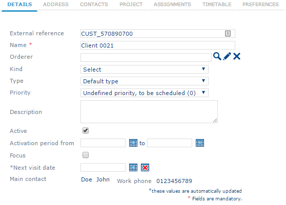

The **Details** tab contains the general information about the customer: external reference, name (mandatory), orderer, kind, type (mandatory), priority and description.


If you do not define a priority, the priority is normal. To give an appointment less priority in scheduling, define a value lower than 50. To give it greater priority, define a value higher than 50.


You cannot fill in the **Orderer** field directly. Search for the orderer with the  button, which runs the orderer search. See [Menu](menu.md). For more about orderers, see [Orderers](objectsintheplanningmodule.md#orderers).

If no orderer details have been saved, you can create them with the  button. This opens the orderer form in edit mode.

To unassign the orderer contact from the customer, click the  button.

Other fields in the tab:

*   **Active** – select this check box for all active customers.

    

When this check box is cleared, automated generation and placement of appointment requests is impossible. However, if requested or planned appointments exist for inactive customers, you can still place them through real-time optimization (RTO).

* **Activation period** – defines a period during which the generation of a visit is possible.
* **Focus** – select this check box to find the customer again more quickly with the search function. See [Menu](menu.md).
* **Last visit** – the date of the last visit.
* **Next visit** – the anticipated date of the next planned, reserved and confirmed appointment.

The information for the main contact is displayed at the bottom of the form.

### Address tab

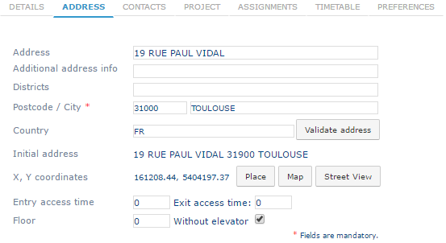

The address fields are described in the geocoding topic.

The **Address** tab contains the following additional fields:

* **Entry access time** – information field giving the time it takes to access the customer (not used in the planning itself).
* **Exit access time** – information field giving the time needed to exit the customer's premises (not used in the planning itself).
* **Floor level** – the customer's floor level.
* **Without elevator** – indicates whether an elevator is available to access the customer.

### Contacts tab

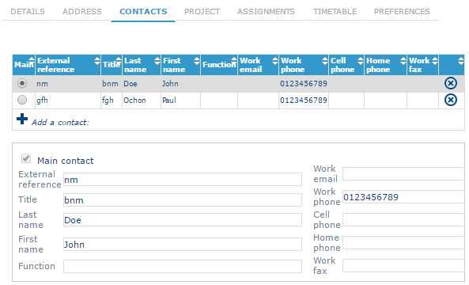

This tab lists the saved contacts and provides a frame for modifying the information of the selected contact.

The contact information is as follows:

* **Main contact** – defines the main contact. This contact receives confirmation emails if the option is enabled under [CSV Files](../administration/csvfiles.md).
* **External reference**
* **Title** – the contact's title (Mrs, Mr, Dr, and so on).
* **Last name** and **First name**
* **Function** – the contact's function in the organization.
* The contact's address details (**Work email**, **Telephone** and **Fax**).

To add one or several contacts to a customer:

1. Click the  button. The contact fields are reset.
2. Enter the contact information.
3. Click the  button to save the contact.

To delete a contact, click the  button.

### Project tab

For a specific customer, you can define appointments in advance that are regular appointments. For example, a salesperson must visit their customer at least twice a month, or a technician must perform security checks at least once a year.

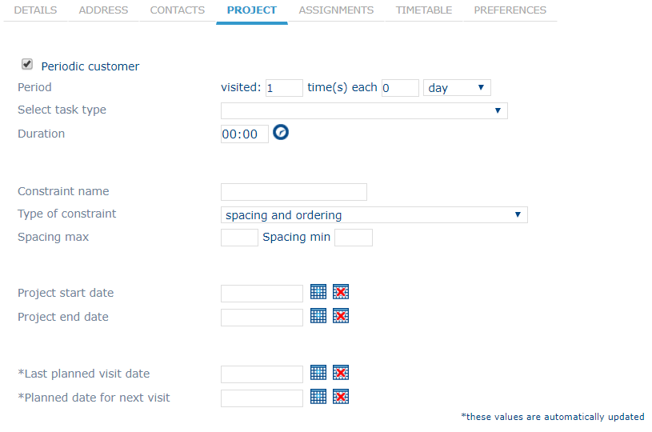

The **Project** tab contains the following fields:

* **Periodic customer** – if you select this check box, the application can generate an appointment automatically on the anniversary date.
* **Periodicity** – defines how often visits are planned for this customer. For example, for a visit that must take place twice per month, enter 2 in the first text field, 1 in the second, and choose "month" in the drop-down list.
* **Task type** – lists all the task types saved in the Administration module. The generated visits are assigned the selected task type. See [Company Data](../administration/companydata.md).
* **Duration** – the duration of the generated visits.
*   **Chaining constraint** – you can also define a chaining constraint linking the appointments associated with this customer site.

    

The name of the constraint identifies the appointments that are concerned by the constraint. It must be unique. Otherwise, appointments that should not be linked can be linked by a constraint.

    

The most frequently used constraints are:
<ul><li><strong>Spacing and ordering</strong> – defines the minimum and maximum gaps that can exist between visits. For example, there must be at least 20 days between two visits on a customer site that must be visited every month.</li><li><strong>Separate day</strong> – for sites visited several times a week, ensures that the visits are not grouped on the same day.</li></ul>

* **Project start and end dates** – the interval within which appointments are generated.
* **Last planned visit date** – the date when an appointment was last generated.
*   **Planned date for the next visit** – the date of the next generation. It is also the earliest date for the generated appointment.

    

The <strong>Last planned visit date</strong> and <strong>Planned date for the next visit</strong> fields are updated automatically according to the last optimization.


If the application configuration allows it (**Display** tab > **CRM** > `crm.customer.project` > `multipleProjects` set to `TRUE`), the **Project** tab lets you create several projects. You can then take appointments with different repeat settings for the same customer. See [Customization](../administration/customization.md).

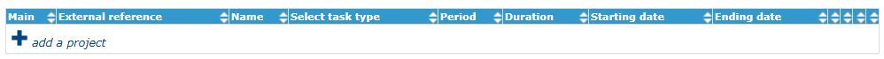

Click the **Add a project** link. The project form includes five tabs:

* **Details** – the same fields as described above for a single project.
* **Extra details**
* **Preferences**
* **Timetable** – defines favorite opening days and times specific to the appointments created for this project.
* **Closings** – associates closing periods with this project.

When data entry is complete, click **Add visit** to make an appointment that is included in the cycle of the current project. The **List visits** button lists the appointments created for this project.


### Assignments tab

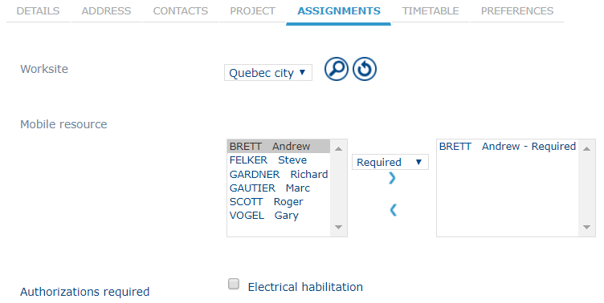

The first part of the tab lets you modify the association of the customer with a worksite.

* The 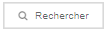 button searches for worksites sorted by distance.
* The  button sets the worksite to **none**.

The second part of the tab lets you define resource preferences for appointments fulfilled with this customer. To define the preferences:

1. Select one or several resources in the left-hand pane.
2. Select the status of the resources in the central list (if the application configuration allows it). See [Customization](../administration/customization.md).
3. Click the right arrow to move the resources to the right-hand pane.


**Required** means a mandatory resource. **Desired** means a preferred resource (the others remain possible). **Undesirable** means that the appointments of this customer are never assigned to this resource.



You can combine statuses. For example:

* **With several resources required** – the appointments are assigned exclusively to one of the required resources, to the exclusion of all others.
* **With one or several resources required and one or several resources desired** – the appointments are assigned preferably to the required resources, and otherwise to the desired resources, to the exclusion of any other.
* **With one or several resources desired** – the appointments are assigned preferably to the desired resources, and otherwise to other resources.


If the application configuration allows it, you can also require that certain authorizations have been granted to the resource, by selecting the relevant check boxes. See [Customization](../administration/customization.md) and [Company Data](../administration/companydata.md).

### Timetable tab

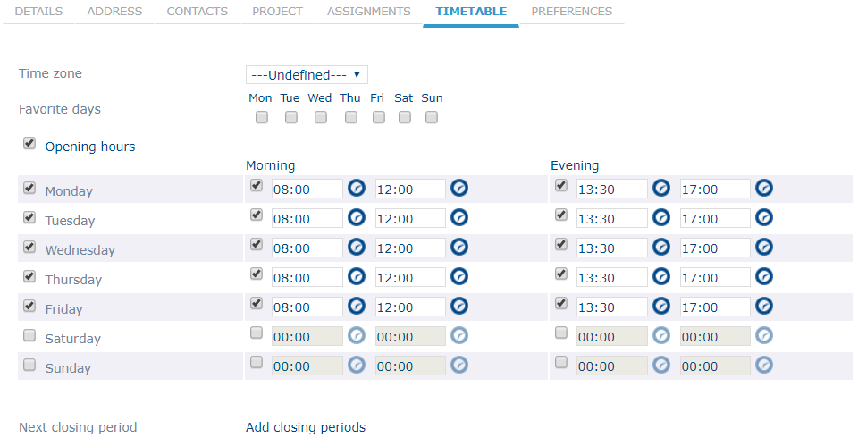

The customer availability constraint is taken into account to improve the quality of appointment taking.

* Select the **local time zone** to which the customer is affiliated.
* The **favorite days** you select are favored by the optimization engine. This does not prevent planning on another day, unlike the closure of a day.
* Select the **Opening hours** check box to define the times the customer is available on each day of the week, including a midday closure. The check box can be selected by default if the application configuration allows it (**Display** tab > **CRM** > `page.crm.openinghours.defaulthours` > `enabled` set to `TRUE`). See [Customization](../administration/customization.md).


For a specific day, if all values are set to 00:00 or if the check box for the day is cleared, the customer is not available that day.


* You can also define **periods of closure** for the customer, for example to handle annual holidays in August.
* If closing periods are already saved for this customer, they appear in this part of the form.
* Click the **Add closing periods** link to open the following page.

Handling periods of closure for a customer

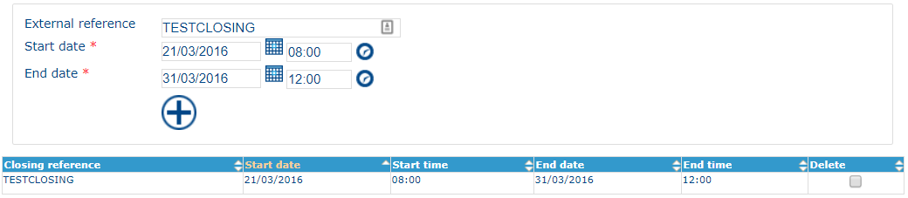


A period of closure is saved automatically when you add it. You do not need to save it again when you return to the customer form.


### Preferences tab

This tab can be configured. It displays the additional fields for the customer. You can show or hide fields in the **Application settings** menu. See [Customization](../administration/customization.md).

You can then enter the fields for each customer.

## Orderers

An orderer can be, for example, a central administration, a referring entity, or a main site. An orderer can have several customers affiliated with it.

### Orderer form

You access the orderer form from the customer form or with the orderer search function. See [Menu](menu.md).

Orderer form in edit mode

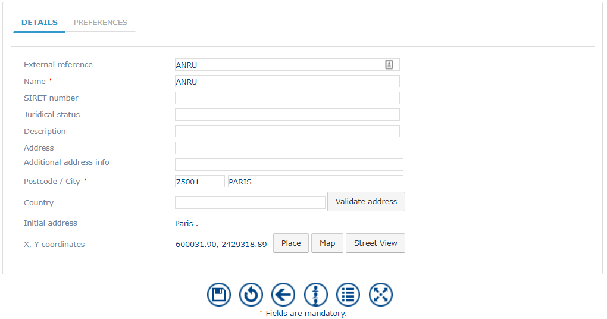

The orderer form includes two tabs:

* **Details**
* **Preferences**

The form also provides the following buttons:

* The  button displays the customer list associated with the selected orderer. See [Menu](menu.md).
* The  button displays the appointment list associated with the selected orderer. See [Menu](menu.md).
* The  button searches for objects nearby the selected orderer. See [Menu](menu.md).

### Orderer form: Details tab

The tab contains the following fields:

* External reference
* Name
* SIRET number
* Juridical status
* Description
* Address fields, which are described in the geocoding topic.


Some items of information are mandatory, such as the **Name** and **Town** fields.


### Orderer form: Preferences tab

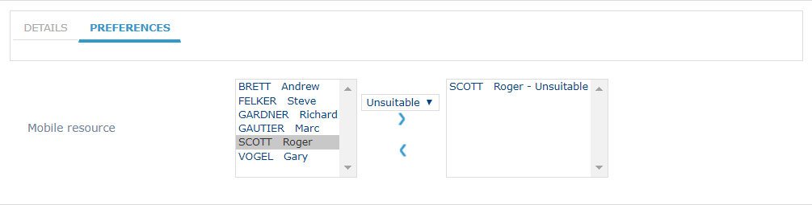

This tab lets you define resource preferences for appointments made with customers associated with this orderer. Select one or several resources in the left-hand pane, then click the right arrow to move them to the right-hand pane.

## Appointments

Appointments are the most important objects for the call center. They are always affiliated with a customer.

They appear in a particular color in the planning and can be displayed on the map.

You make new appointments in one of the following ways:

* With the **Set new appointment** function. See [Menu](menu.md).
* From the customer lists or from the customer form.
* With the empty planning tool-tip. See [The Planning](theplanning.md).

### Appointment form

You access the appointment form from:

* The appointment search. See [Menu](menu.md).
* The appointment search on status. See [Menu](menu.md).
* The customer form.
* The list of urgent appointments. See [The Header Bar](../the-header-bar/guided-help-nfs-reference-guide-1.md).
* The appointment counters. See [The Information Pane](theinformationpane.md).
* The map. See [Map](map.md).
* The appointment information popup in the planning. See [The Planning](theplanning.md).

The form lets you apply actions to appointments. The source describes it as comprising seven parts.

#### General tab

This tab contains information about the intervention, such as its **identifier** (the internal identifier separated from the external identifier by a "/"), and the **Earliest date** and **Latest date**, which indicate the period during which the intervention must be fulfilled.

General

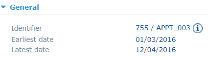


You can display additional information about the resource, in the map itself or in another window, by clicking the  link.


#### Customer tab

This tab summarizes all the relevant information about the customer, such as the customer reference, name, address and contact details.

Customer

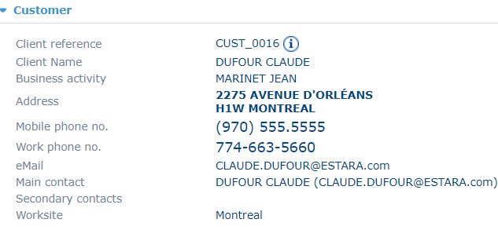


You can access the full customer form by clicking the  link.


#### Communication tab

This tab summarizes the information to communicate about the intervention, such as the time slot, the time, the resource, the type of intervention, and any equipment needed.

Communication

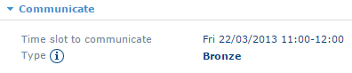


When you click the  button next to the type of intervention, an infobox shows the competencies needed to fulfill the intervention. See [Company Data](../administration/companydata.md).

The button is also available next to the selected resource. It shows information such as the duration of the intervention, the distance and journey time from the previous intervention, and the journey time to the next one.


#### Fulfilment status tab

This tab summarizes the information about the state of play of the intervention and lets you fill in the details of this status.

Fulfilment status

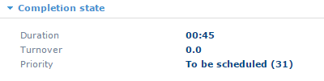

Several statuses are available: **Indeterminate status**, **Unfulfilled**, **Fulfilled** and **Unable to fulfill**. They are described in the "Progression steps" section of [The different statuses for appointments in NFS](../introduction/thedifferentstatusesforappointmentsinnfs.md).


If you select the status **Fulfilled**, you can fill in the **Intervention report**. This option is only available for the fulfilled appointment status.


#### Additional data tab

Depending on the rights granted to you, this tab lets you associate a document with the intervention, as well as various information items such as quantities.

Complementary data tab

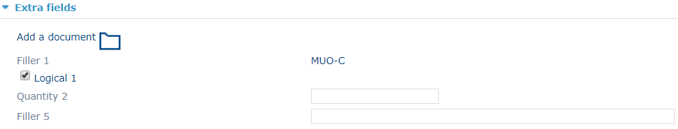

#### Comments tab

This tab lets you add a comment on the intervention. The comment is only available when you consult the planning.

Comments tab

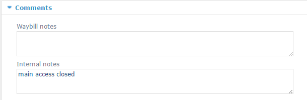

#### Messages tab

This tab lets you consult the messages exchanged about this intervention and create new messages. See [Menu](menu.md).

Messages tab

#### Constraints tab

This tab lets you add a chaining constraint to the intervention by clicking the  button.

Constraints tab

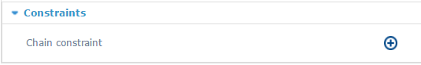

The constraints are described in [Setting up liaisons between appointments](objectsintheplanningmodule.md#setting-up-liaisons-between-appointments).

### Action buttons in the appointment form

A series of action buttons is available.

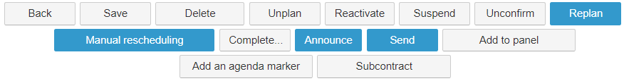

You can apply the following actions from an appointment form:

* **Back** – takes you back to the last screen.
* **Save** – saves all the modifications made to the appointment form.
* **Delete** – deletes the appointment. You must indicate whether the intervention was deleted by the customer or by the company. After you validate the deletion, the appointment takes the status **Cancelled**. See [The different statuses for appointments in NFS](../introduction/thedifferentstatusesforappointmentsinnfs.md).
* **Unplan** – restores the status of the appointment to what it was previously. See [The different statuses for appointments in NFS](../introduction/thedifferentstatusesforappointmentsinnfs.md).
* **Reactivate** – restores the daily planning of the selected appointment. The appointment status changes to **Requested** and the appointment is added to the panel. See [The different statuses for appointments in NFS](../introduction/thedifferentstatusesforappointmentsinnfs.md) and [The Planning](theplanning.md).
* **Suspend** – has the same outcome as unplanning, with one exception: suspended appointments cannot be optimized by the batch optimization or by RTO. See [Glossary](../glossary/glossary.md).
* **Unconfirm** – changes the status of the appointment from **Confirmed** to **Planned**. See [The different statuses for appointments in NFS](../introduction/thedifferentstatusesforappointmentsinnfs.md).
* **Plan/Replan** – takes you to the real-time planning page.
* **Manual scheduling/Manual rescheduling** – takes you to the manual planning page.
*   **Complete…** – changes the appointment status to **Completed**. See [The different statuses for appointments in NFS](../introduction/thedifferentstatusesforappointmentsinnfs.md). You must first fill in the following completion form.

    Completion status form

    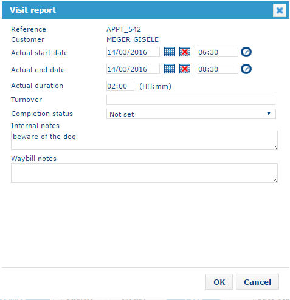
* **Transform** – visible whenever the appointment is requested. Opens a page where you can quickly apply pre-configured modifications, such as modifying the earliest and latest dates.
*   **Modify…** – lets you modify the information items that cannot be edited in the form itself.

    Modify appointment form

    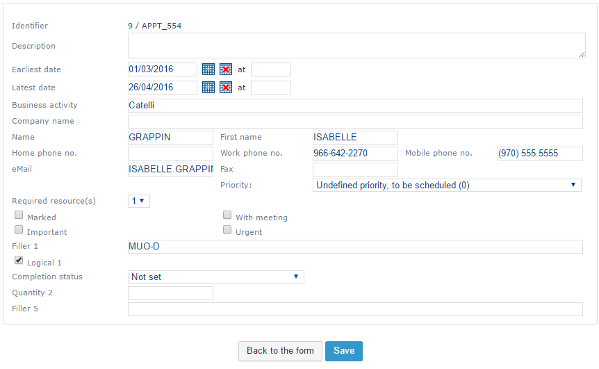

    In this form, **Save** saves the modifications and **Back to the form** takes you back to the appointment form.
* **Announce** – creates a configurable circulation listener, for example when sending a pre-formatted message to all the customer appointment contacts in the list. See [CSV Files](../administration/csvfiles.md).
*   **Send** – signals that the technician has been informed about the appointment. The  icon is displayed next to the name of the resource concerned.

    

The appointment then takes the notification status "sent". See <a href="../introduction/thedifferentstatusesforappointmentsinnfs.md">The different statuses for appointments in NFS</a>.

* **Add to panel** – adds the appointment to the panel. See [The Planning](theplanning.md).
* **Add an agenda marker** – takes you to the function for adding a new agenda marker. See [Menu](menu.md).
* **Visit report** – visible if the appointment is fulfilled. Authorizes the resource to complete the information in the appointment form after it is set up. You fill in any notes, modify the appointment status if it needs updating (fulfilled, unfulfilled) and, if the appointment is fulfilled, write an explanatory report for the visit.
* **Subcontract** – changes the appointment status to **Externalized**. See [The different statuses for appointments in NFS](../introduction/thedifferentstatusesforappointmentsinnfs.md).

## Steps in the scheduling process

The scheduling process is made up of several steps.

### Qualification of the appointment

Qualification is the validation of the solution suggested by the application. When an optimization is performed, several timeslots can be suggested for scheduling the appointment. You can validate the appointment when you set a new appointment or when you make an appointment for an existing customer after performing a customer search. See [Menu](menu.md).

Optimization request

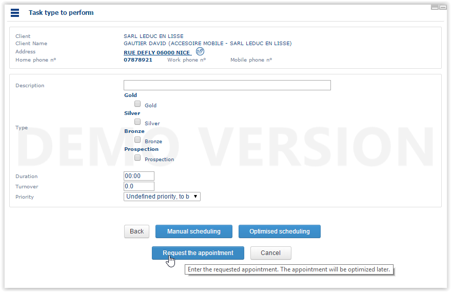

* Qualification consists of filling in at least the **Intervention type**, the **Duration** of the appointment and a **Description**.


You can modify the address by clicking the button beside the address. Address modification is described in the geocoding topic. The address identifies the intervention sector concerned when the associated appointment is scheduled. To enable this, you must enable:

* The **Customization** > **Configuration** > **Display** > **Address** > `address.district.codification` > `cityInDistrictSubstringIndexes` parameter, which generates the INSEE code from the IRIS code returned by geocoding.
* The **Customization** > **Configuration** > **Application** > **Agents** > `appointment.completion.agent.districting` > `codeZoneWorksite` and `codeZoneWorksite.ordering` agent, which uses the INSEE code as a starting point to find the unique correspondence among the towns added to the various saved sectors.

See [Customization](../administration/customization.md).


After you qualify the intervention, you can **request an appointment**, requesting **optimized scheduling** or **manual scheduling** as required.

### Appointment request

Request an appointment with period of fulfilment

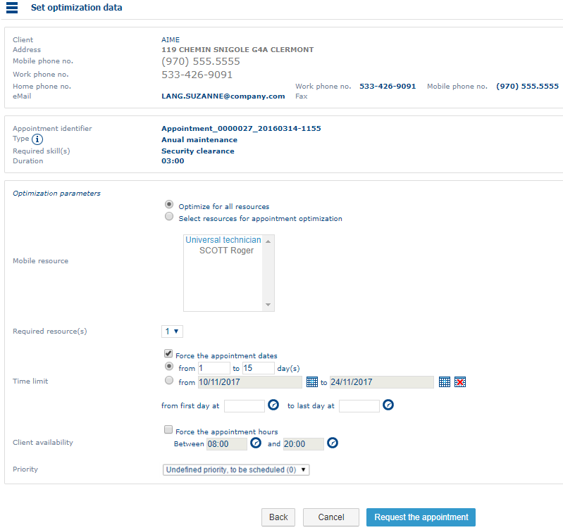

On this screen, you finish qualifying the appointment by filling in the following information:

* **Resource** – forces which mobile resources are assigned to perform the appointment. Select the **Select resources to optimise** option, then select the resources to use.
* **Time limit** – restricts the possible scope for scheduling. First select the **Force the appointment dates** check box. Then select the earliest required date and the latest possible date, either as a number of days or with the popup calendars. You can also define a time on the first (or last) day of the appointment before (or after) which the appointment is not scheduled.
* **Client availability** – sets the times when the customer is available.
*   **Priority** – the more urgent the appointment is, the more likely the application schedules it when the plannings are overloaded.

    

Use a priority of 100 sparingly, and only for the most urgent appointments. A priority of 0 is equivalent to a priority of 50.

You can cancel the appointment request, or confirm it by clicking **Request an appointment**. An appointment is then created with the status **Requested**, so the batch optimization engine can schedule it automatically. See [The different statuses for appointments in NFS](../introduction/thedifferentstatusesforappointmentsinnfs.md).

### Optimized appointment (real time)

After you qualify the appointment, you can ask the application to calculate the best opportunities according to the imposed constraints. These are the optimized, or real-time optimized, functions, as opposed to cold optimization. See [Optimization](../administration/optimisation.md).

Configuration window for the search for an optimized appointment

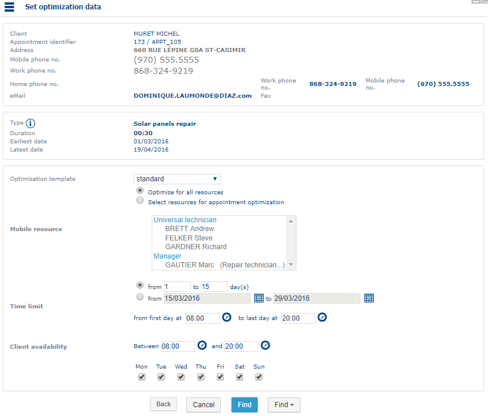

The fields are similar to those for the appointment request.

In addition, you can specify an optimization profile and the days on which the appointment is not scheduled, by clearing those days at the end of the page. See [Optimization](../administration/optimisation.md).

Click **Cancel** to cancel the scheduling.

Click **Search** or **Search +** to run the search for suggestions from the application and display the results.


For a multi-resource appointment, if the **Select resources to optimise** option is activated, you must select as many resources as are necessary to fulfill the appointment. The **Search +** function returns suggestions on timeslots that are already taken, by authorizing the engine to extract from the agendas any appointments that have a planned status.


Result of an optimization with the **Search +** button

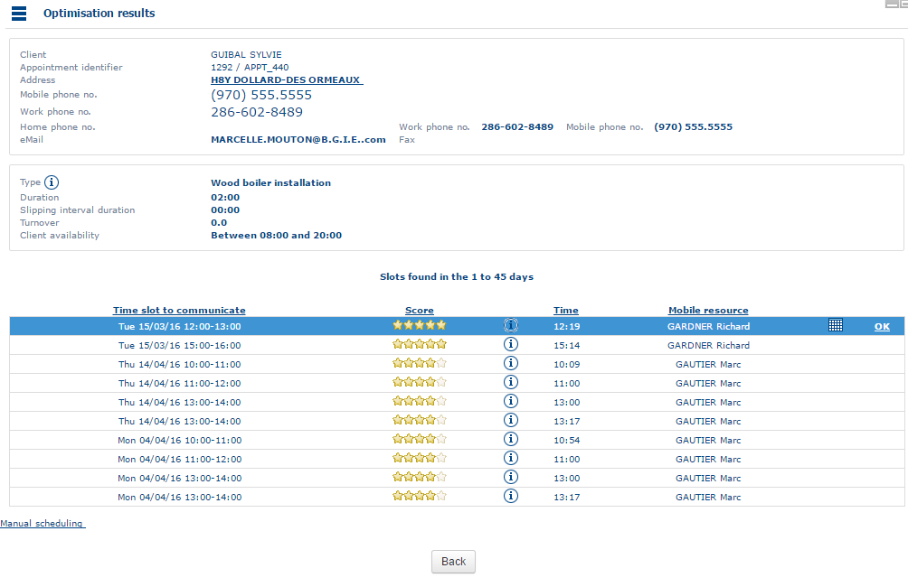


If the table is displayed after you use the **Search +** function, a  symbol indicates that one or several planned appointments must be unplanned once the operation is completed. Move the mouse over the symbol to see the detailed information in a popup.


* The upper part of the screen summarizes the information present in the appointment form.
* Below, a list shows all the appointment opportunities that correspond to the request.
* The list is sorted by cost suitability (the best compromise between the date, the resource's qualification and the journey distance to the appointment). The lower the cost of the route plan suggestion, the higher its suitability, and the better the suggestion.


You can configure a star system to represent this suitability visually. To do this, activate the optimization setting **Display solution cost as a chart**. See [Optimization](../administration/optimisation.md).


* For each potential resource, the table suggests the time window, the cost and the presenting time calculated for the appointment. Move the mouse cursor over the cost to display a popup with the items that explain the cost value (the journey time added in relation to the appointments already fixed, the extra distance, the time needed, and so on).
* The **Agenda** icon on the line of a suggested timeslot displays the agenda for that day and the corresponding resources in the planning section.
* The **OK** link validates the choice of appointment and takes you to the confirmation page.

Confirmation of the suggestion

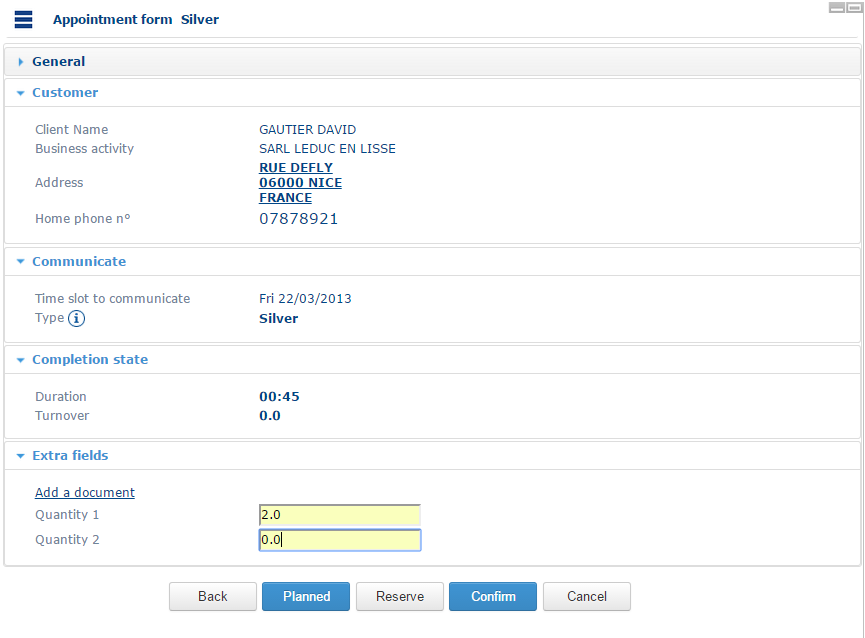

* The information from the appointment form is shown. You can also enter additional notes if necessary.
* Click **Confirm** to confirm the appointment and go to the appointment home page.
* Click **Back** to go back to the previous step.
* Click **Subcontract** to change the appointment status to **Externalized**. See [The different statuses for appointments in NFS](../introduction/thedifferentstatusesforappointmentsinnfs.md).

### Manual appointment

Unlike optimized scheduling, manual scheduling forces the resources used, as well as the date and time of the appointment. You can therefore override some scheduling constraints.

Manual appointment taking

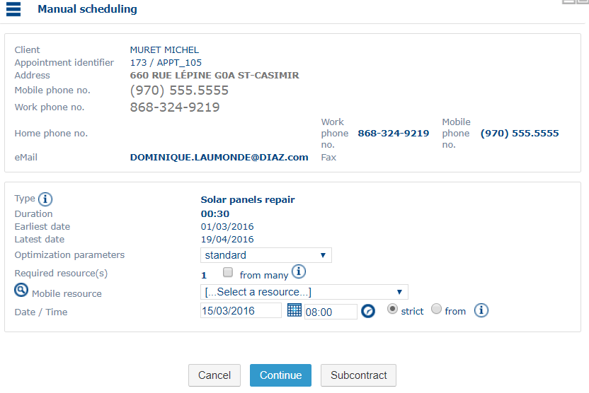

The first part of the manual scheduling function copies the information from the appointment form.

You must specify an optimization profile. See [Optimization](../administration/optimisation.md).

The resource type is adjusted to the type of intervention selected (according to competencies). A drop-down list lets you choose the resource among those assigned to the area where the call taker works. You do not have to choose a specific resource. To let the application choose from all the resources able to make the journey, select the **several** option.

1. Choose a **date** and a **time** for the appointment in the two editable zones.
2. If you choose the **Precise** option, the application verifies whether it can place the intervention at the indicated time. If you choose the **From** option, the application searches for the best solution from the indicated time.


The planning is automatically updated with the planning for the selected resources on the chosen date. See [The Planning](theplanning.md). The call taker can then confirm the availability of the potential resource and modify the three main variables as required: resource, date and day. The button to the left of **resource** refreshes the list of resources according to the chosen date.


Click **Continue** to see which constraints the scheduling forces, or to confirm the solution if constraint override is not used.

Click **Subcontract** to change the appointment status to **Externalized**. See [The different statuses for appointments in NFS](../introduction/thedifferentstatusesforappointmentsinnfs.md).

Displaying forced constraints where override has been used

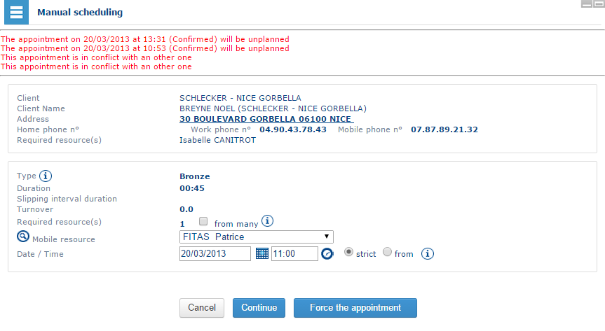

When one or several constraints must be forced to schedule the appointment at the chosen time, a series of warning messages appears in red at the top of the screen.

The messages can concern the unplanning of an appointment or unavailability, a time constraint of the resource or of the customer, or a constraint on the assignment of the resource.


If an appointment is unplanned, the unplanned appointments are displayed automatically in the panel. See [The Planning](theplanning.md).



You can authorize superimposition when you make a positioning action, without unplanning other appointments or unavailabilities. To do this, configure the various **Manual placement with overlap** optimization parameters and the `CALLCENTER_FORCE_IMPOSE_APP_WITH_OVERLAPS` right. An **Overlap the appointment** button then appears. See [Optimization](../administration/optimisation.md).


A confirmation screen lets you complete the appointment-making operation.

## Setting up liaisons between appointments

Liaisons between appointments (appointments that take place simultaneously, that must respect a minimum gap between them, and so on) are modeled by chaining constraints.

A chain is composed of different appointments and has a liaison type.


Except for the **Stapling** liaison type, the chain can be inserted in an incomplete form if some constraints are not suitable. This means that the presence of all the member items of a constraint chain is not guaranteed.


### Types of liaison (chaining constraints)

*   **Spacing and ordering** – guarantees that a certain minimum or maximum delay is respected between one appointment and the next. The delays taken into account are the values defined in the **Minimum delay** and **Maximum delay** fields. This type of constraint also lets the application manage the sequencing in the schedule (the ordering of appointments), using the **Scheduling order** field defined in part 2 of the screen.

    Example 1: all appointments must follow one another with a gap of 1 or 2 days between them. Specify a value of 1 in the **Minimum gap** field and a value of 2 in the **Maximum gap** field.

    Example 2: all appointments must be completed on the same day. Specify a value of 0 in the **Minimum gap** and **Maximum gap** fields.
*   **Same resource** – guarantees that the appointments in the chain are planned on the same resource.

    
<ul><li>If the constraint is not compatible with the required resources, or with resources that are refused, preferred or assigned, the complete chain is rejected.</li><li>This liaison type does not apply in multi-resource mode.</li></ul>

*   **Unbreakable** – guarantees that all appointments are completed one after the other, without other appointments inserted between them.

    

This type of constraint is not applicable in batch optimization mode with Dispatcher. It functions only in pre-scheduling by real-time optimization.

    

This type cannot be selected in the NFS interface.

* **Grouped (maximum spacing from start)** – all appointments in the chain must be completed within a maximum timespan in relation to the first appointment (the maximum timespan between the first appointment and the last). For example, all appointments in the chain must be completed within 2 days counting from the first appointment.
* **Same resource and grouped** – guarantees that the appointments are scheduled one after the other (other appointments can be inserted between them), on the same resource and within the defined maximum time interval.
* **Delayed (Minimum gap in relation to the first)** – all appointments in the chain must take place after a certain timespan starting from the first appointment (the time interval between the first appointment and the following ones). For example, respect an interval of 3 days after the first appointment before scheduling all the following ones.
* **Same resource and delayed** – guarantees that appointments are scheduled one after another (other appointments can be placed between them), on the same resource and with a certain time delay between the first and the following appointments.
*   **Circuit (same resource, unbreakable, grouped)** – guarantees that appointments are scheduled one after the other (without other appointments in between), on the same resource and within the maximum time space defined according to the defined order.

    

For this constraint to function in a batch optimization, activate the pre-optimization phase of circuits in the optimization parameters. See <a href="../administration/optimisation.md">Optimization</a>.

* **Same start time** – guarantees that the appointments in the series are scheduled at the same time (same day, same time).
*   **Separate day** – guarantees that the appointments in the chain are planned on different days.

    

If the chaining constraint is incompatible with the imposed appointment dates, their positioning in the schedule is not guaranteed.

* **Ordered route** – guarantees that the appointments are placed one after another (other appointments can be placed between them), on the same resource and on the same day.
* **Ordered circuit (sequenced route, unbreakable)** – guarantees that appointments are placed one after the other (without other appointments scheduled in between), on the same resource and on the same day.
*   **Stapling** – all the appointments in the series are "stapled together" so they are taken as a single long appointment and scheduled as such. This guarantees that all appointments in the series are scheduled one after another in sequence (without any other appointments in between) on the same resource at the same site.

    

This type of constraint is not applicable in batch optimization mode with Dispatcher. It functions only in pre-scheduling by real-time optimization.

### Linking two appointments in the interface


To create or modify a chaining constraint, you need the corresponding rights assigned by the NFS administrator. See [User Handling](../administration/userhandling.md).


At the bottom of the appointment form, the **Chaining constraints** section shows the existing constraints, if any.

Appointment form

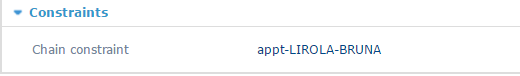

If there are none, you can create one by clicking the  button.


It is preferable to create only one constraint per customer.


The chaining constraint screen has two parts. The first part lets you specify the liaison constraints. The second part lets you specify the constraints specific to each linked appointment.

Creating a new constraint

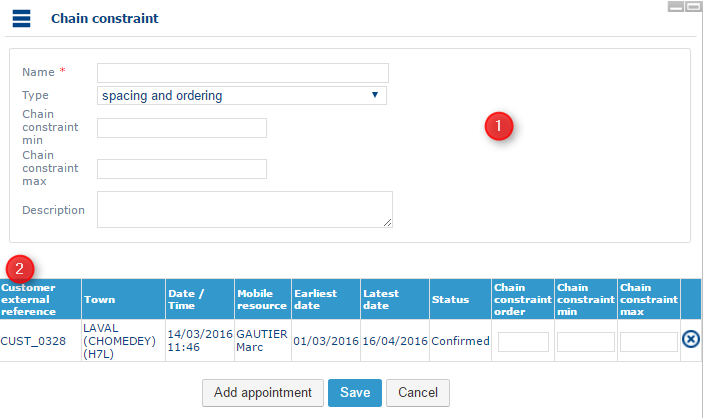

Fill in the following fields.

**Part 1**

* **Name** – unique identifier for the constraint chain (mandatory). Each chain must have a different name, because all the appointments that have a chaining constraint with the same name are linked.
* **Type** – the type of chaining constraint. The types are described in [Types of liaison (chaining constraints)](objectsintheplanningmodule.md#types-of-liaison-chaining-constraints).
* **Minimum gap** – a gap of 0 days means "the same day". The gap takes the first day of the intervention as reference (even for appointments that take place over several days).
* **Description** – text field for describing the chaining constraint.

**Part 2**

Part 2 shows the appointments associated with the constraint chain.

For each associated appointment, the following fields are present:

* **Customer delivered** – external customer reference.
* **Town** – town where the customer is located.
* **Date / Time** – date and time of the appointment in the schedule (if the appointment has been placed there).
* **Resource** – resource assigned to the appointment (if the appointment has been scheduled).
* **Earliest date** – the earliest date for the appointment.
* **Latest date** – the latest scheduling date for the appointment.
* **Status** – completion status of the appointment.
*   **Sequencing order** – order of the appointment in the chain. The application tries to plan appointments in the requested order.

    

Only for chainings of the <strong>Circuit</strong> type.

* **Minimum spacing** – minimum gap between appointments (overrides the value specified in Part 1).
* **Maximum spacing** – maximum gap between appointments (overrides the value specified in Part 1).


When a constraint is not used (placement sequence, minimum or maximum spacing), either leave the corresponding field empty or enter a value of -1.


* To delete appointments from a constraint chain, click the  cross opposite the appointment concerned, on the right of the table, in modification mode.
* To modify the constraints specific to each appointment in the chain, click **Edit**.
* To save the constraint chain, click **Save**.
* To delete the constraint chain, click **Delete** at the bottom of the page.

## Unavailabilities

Unavailabilities appear with a specific color in the planning. They are always geolocated, so they can be displayed on the map.

### Unavailability form

You access the unavailability form from:

* The unavailabilities management form. See [Menu](menu.md).
* The unavailabilities search function. See [Menu](menu.md).
* The unavailability tool-tip. See [The Planning](theplanning.md).

Unavailabilities management page

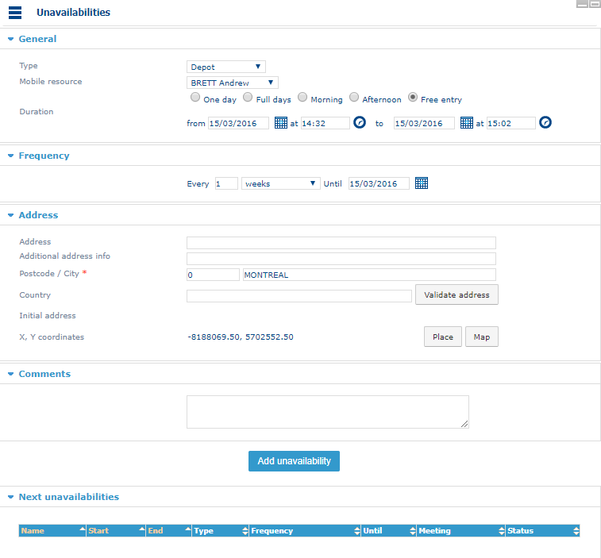

The source describes the page as divided into five sections, but only the **General** section is described.

#### General

Choice of unavailability type

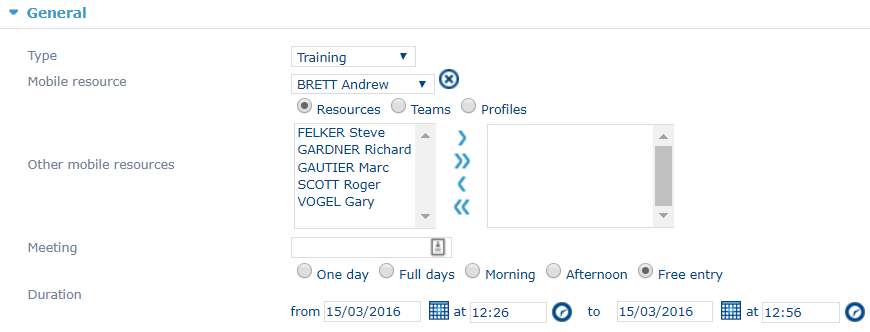

In this section:

* Select the **Unavailability type** in the first drop-down menu. It contains all the unavailability types configured in the Administration module. See [Company Data](../administration/companydata.md).
* Select the **Resource** to which the unavailability is added.


Depending on the configuration of the unavailability type (mono-resource or multi-resource), the user interface offers either a selection of a single resource or a multi-resource selection. See [Company Data](../administration/companydata.md).


To select several resources (only when you choose a multi-resource type of unavailability):

1. Click the  button to the right of the list of resources to activate multiple selection mode.
2. Choose how to add participants to the meeting: one by one (select the **Resources** option), team by team (select the **Team** option) or post profile by post profile (select the **Profile** option).
3. Select an item in the left-hand list and click the  button to add it to the selection list.
4. To add all the items of the left-hand list to the selection, click the  button.
5. To remove an item from the selection list, select it and click the  button.
6. To remove all the resources from the selection list, click the  button.
7. To exit multiple selection mode, click the  button.


A new **Meeting** field is available to give an objective to the meeting.


Next, define the permitted **duration** of the unavailability. Several options are available.

| Option         | Description                                                                                                                                      |
| -------------- | ------------------------------------------------------------------------------------------------------------------------------------------------ |
| **One day**    | The unavailability is created on a complete day, according to the working hours of the resource.                                                 |
| **Full days**  | The unavailability is created over several complete days, according to the working hours of the resource.                                        |
| **Morning**    | The unavailability is created for the morning of the chosen day, from the start time until the start of the lunch break time window.             |
| **Afternoon**  | The unavailability is created for the afternoon of the chosen day, from the end of the lunch break time window until the end of the working day. |
| **Free entry** | You enter the bounds of the unavailability yourself.                                                                                             |


For a multi-resource unavailability, the hours of the first resource in the list are used as the reference in the time constraint methods.



Depending on the option you choose, the calendar or the time picker is greyed out. Otherwise, you can overwrite the initial information items.


#### Frequency

In this part, you can define a recurrence for the unavailability you are creating, so that it is repeated.

The date you enter in the **Up until** field gives an end date to the recurrence of the unavailability.

#### Address

In the **Address** block, you can overwrite the address of the unavailability. The address fields are described in the geocoding topic.


For some types of unavailability, the address can be entered automatically as the home address of the resource or as the address of their main work area.


#### Comments

The field in this block lets you enter a comment line that is visible in the summary form for the unavailability.

#### Next unavailabilities

This section displays the unavailabilities that are already recorded for the selected resources.

Click an entry in the list to open the repeated unavailability form. See [Repeated unavailability form](objectsintheplanningmodule.md#repeated-unavailability-form).

#### Creating the unavailability

Click **Add unavailability** to finish creating an unavailability.


In NFS, an unavailability is a time period during which the resource is not available to fulfill an appointment. Optimizations in progress therefore do not place any intervention in the time windows entered as unavailabilities.



For example, for a lengthy unavailability, clashes can exist in the planning of appointments or with existing unavailabilities.


#### Conflicts with appointments

If there is a conflict between appointments, the application identifies the conflicts and suggests three possible actions.

Handling of conflicts between appointments

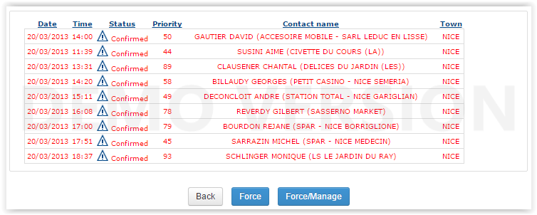

* **Back** – cancels the entry of the unavailability and lets you modify the parameters.
* **Force** – creates the unavailability by taking the appointments out of the planning. Any **planned** appointments are reinstated with their original **requested** status. The **confirmed** appointments are reassigned the status **suspended**.
* **Force/Manage** – creates the unavailability and tries to replace the conflicting appointments, in the same timeslot if possible, or in another timeslot. The **planned** appointments that cannot be replaced are reassigned the status **requested**. The **confirmed** appointments are reassigned the status **suspended**.

#### Conflicts with another unavailability

If there is a conflict with another unavailability, the application suggests a **Force** button that forces the creation of the new unavailability. The new unavailability is then superposed on the unavailability in conflict. This can create inconsistencies in the planning that invalidate the planning process for the day in question.

### Repeated unavailability form

Repeated unavailability form

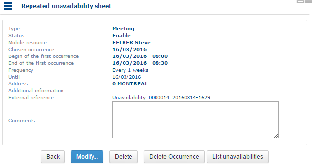

* The fields in the repeated unavailability form are the same as those in the unavailability form.
* **Back** – returns you to the previous page.
* **Modify…** – returns you to the unavailability form.
* **Delete** – deletes the unavailability. For a regular unavailability, all the occurrences are deleted.
* **Delete occurrence** – deletes only the selected occurrence of a repeated unavailability.

## Exceptional locations

Exceptional locations are temporary addresses for the start and end of routes. Typically, nights away are handled here if resources are called on to perform overnight missions.

You can also use exceptional locations to model:

* An exceptional location in the morning only (or the evening).
* A modification to the start and end times of the resource's working day.

They are recorded in the resources' plannings in a custom color. See [The Planning](theplanning.md).


Exceptional locations must have an associated address.


### Exceptional location form

You access the exceptional location form:

* From the exceptional locations search.
* From the exceptional location tool-tip. See [The Planning](theplanning.md).

The form has three parts.

#### Part 1: Usual locations

Exceptional location form - part 1

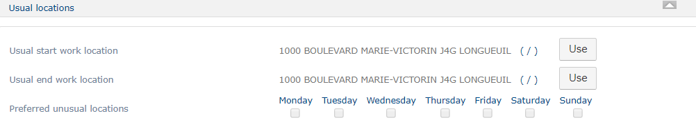

* **Usual start / end work location** – the start and end address of the working day for the resource, as defined in their form. See [Company Data](../administration/companydata.md).
* Click an address to display the location on the map.
* Click **Use** to fill in the address of the location for the night away (part 2) with the corresponding address.

**Nights away** take the values defined in the resource form. See [Company Data](../administration/companydata.md).

#### Part 2: View an exceptional location

Exceptional location form - part 2

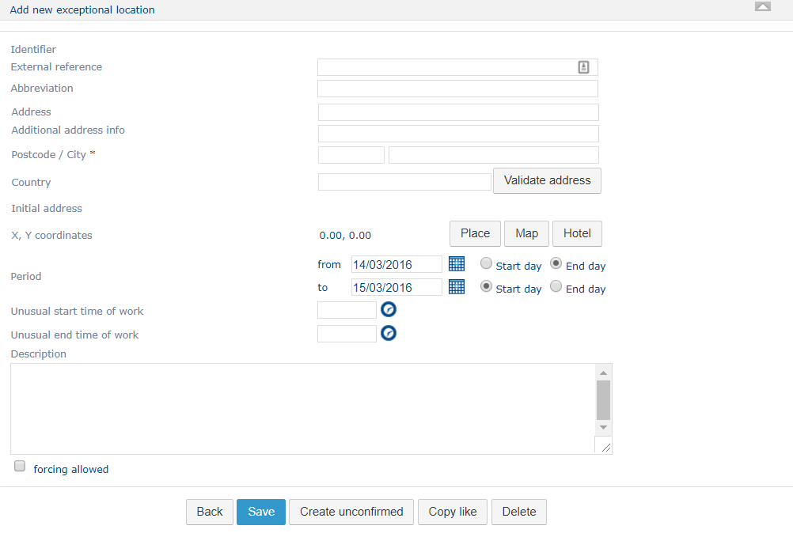

This section contains information about the exceptional location:

* **Identifier** – generated automatically for the exceptional location.
* **External reference** – the external reference of the exceptional location.
* **Abbreviation** – the abbreviation of the exceptional location.
*   **Status** – the status of the exceptional location: confirmed or to confirm.

    

Unconfirmed exceptional locations can be modified when you use batch optimization. See <a href="../administration/optimisation.md">Optimization</a>.

* **Address** section – the **Hotel** button lets you add a hotel by selecting it on the map from a predefined list of hotels.
* The fields for setting the start and end dates and times of the exceptional location.
* **Description**
*   **Forcing allowed** – this mode lets you force the addition of the unavailability if there is a clash in the planning.

    

This mode causes other items in the planning to be unplanned.

Use the following buttons:

* **Save** – creates the exceptional location with the information entered in the form.
* **Confirm/Unconfirm** – changes the status of the exceptional location from confirmed to to confirm and vice versa. Confirmed exceptional locations can no longer be canceled or moved during a future batch optimization. See [Optimization](../administration/optimisation.md).
* **Copy like** – creates a new exceptional location with the information entered in the form.

#### Part 3: Next exceptional locations

This part is a table of the next exceptional locations for the resource.

## Temporary posts

A resource has a main post that defines their default competency profile: the list of intervention types they are competent to perform.

With this functionality, you can temporarily replace the main post with another one. For example, you can authorize a maintenance technician to perform breakdown recovery during a week with a workload peak.

You can create, modify or delete a secondary post.

### Temporary post form

You access the temporary post form:

* From the temporary post management function. See [Menu](menu.md).
* From the post type tool-tip. See [The Planning](theplanning.md).

Temporary post form

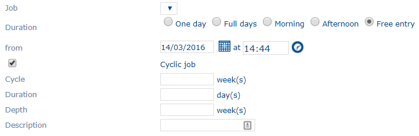

The form contains the following fields:

* **Job** – selects the type of post to assign to the resource. See [Company Data](../administration/companydata.md).
* **Duration**
* **From** – the date from which the resource assumes the secondary post.
* **To** – the end date of the assignment to the temporary post (only if the **Cyclic job** check box is not selected).
* **Daily** (only if the **Cyclical task** check box is selected)
* **Cycle** (only if the **Cyclic job** check box is selected) – the frequency of the assignment, in occurrences per week.
* **Duration** – the duration of the assignment in days.
* **Depth** – the date, in weeks from the start date, at which the assignment stops.


This form applies any changes to the assignment.

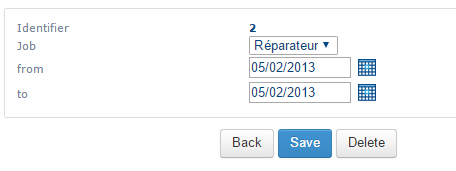


## Secondary worksites

Secondary worksites let you temporarily assign to the resource either an additional worksite, or another worksite that replaces the resource's usual worksite.

### Secondary worksite form

* You access the secondary worksite form with the assign secondary worksites function. See [Menu](menu.md).
* The principle is the same as for temporary posts.
* The fields are described in the resource form and its **Assignment** tab. See [Company Data](../administration/companydata.md).

## Hotel locations

Hotel locations let you position a night away quickly.

### Hotel location form

You access the hotel form with the hotel location function. See [Menu](menu.md).

The form contains the following fields:

* **Identifier** – saved automatically when you create a new hotel location.
* **External reference**
* **Name**
* **Address** fields
* **Period** – the period of availability of the hotel.
* **Description**

## Agenda markers

Agenda markers are items displayed in the planning.

Unlike other items in the planning, an agenda marker does not need an address.

You can use it to define the start and end times for an appointment, or a real appointment time.

Display of agenda markers in the planning

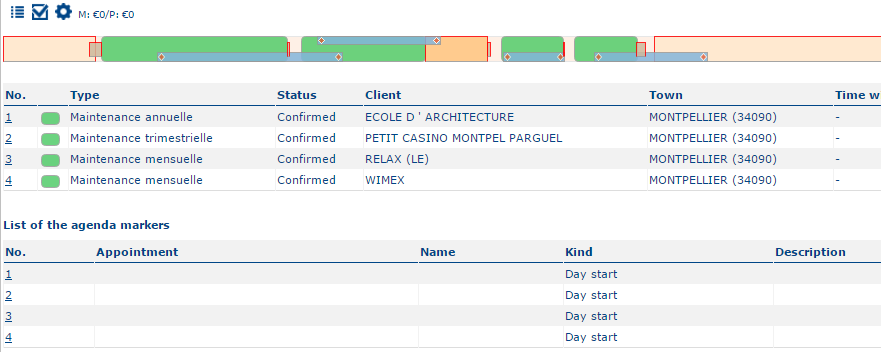

Agenda markers are the purple bars in the planning, with a bullet point at the start and end of the bar.


Agenda markers can overlap.


### Agenda marker form

You access the agenda marker form:

* With the manage agenda markers function. See [Menu](menu.md).
* From the appointment form.

Agenda marker form

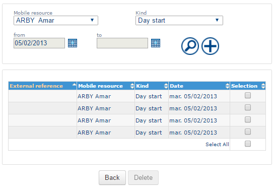

The form contains the following fields:

* **Identifier** – filled automatically when you create the agenda marker.
* **External reference** – the external reference of the agenda marker.
* **Name** – the name of the agenda marker.
* **Resource** – select the name of the resource from a list.
* **Marker type** (information field) – you can select a type of marker from the following values:
  * Day start
  * Day end
  * Appointment commitment
  * Call
  * Minor alert
  * Major alert
  * Date
* **Date** and **Time** of the agenda marker.
* **Duration** of the agenda marker.
* **Description** of the agenda marker.
* **Intervention identifier** – if the marker is linked to an intervention.

## On-call duty

The on-call duty types are defined in the Administration module. See [Company Data](../administration/companydata.md). You find more information about on-call duties in this menu.

### On-call duty form

You access the on-call duty form with the on-call duty management function. See [Menu](menu.md).

Creation page for an on-call duty

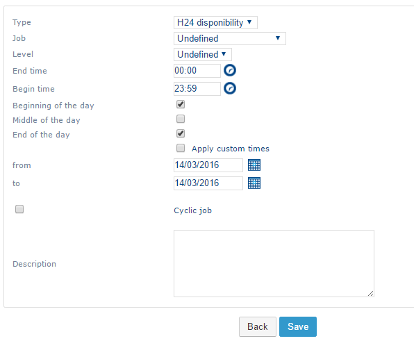

The page contains the following items:

* **Type** – drop-down list of predefined types of on-call duties. See [Company Data](../administration/companydata.md).
* **Post** – the post for which the resource is on duty, containing the predefined functions and job types. See [Company Data](../administration/companydata.md).
* **From** and **To** – the start and end dates of the on-call duty.
*   **Cyclic job** – defines the regularity of the on-call duty if necessary (select the check box).

    Cyclic job

    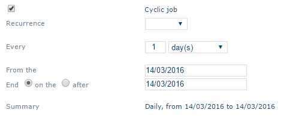

The other fields are defined in the on-call duty day template topic. See [Company Data](../administration/companydata.md).

## Locked days in the agenda

A locked day is a day for which no optimization is possible. Whatever their status, the appointments present are not replayed, and no new appointment can be set automatically.

### Locked day in the agenda

You access the locked day form:

* From the locked day function in the menu.
* From the tool-tip for a non-worked time.

The creation form and the editing form are identical, except that the editing form has a **Delete** button.

Creation page for a locked day

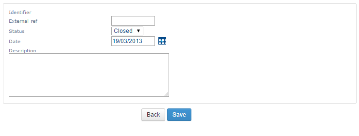

You can give an identifier to the locked day (**External reference**). Then choose the status and the date. You can also enter a description.

Click **Save** to validate the creation of the locked day.


After you create a locked day, the day for the resource is greyed out in the planning and a padlock appears beside its name to indicate that the day is locked.


## Search in the Planning module

* The basic principles are the same for all objects, but the available items can vary according to the object you search for.
* Search filters are configurable. See [Customization](../administration/customization.md).
* The search has a filters part and a result part.

The following table lists the search function for each object in the Planning module.

| Object name           | Search function                                                      |
| --------------------- | -------------------------------------------------------------------- |
| Customer types        | **Search for a customer type**. See [Menu](menu.md).                 |
| Customer kinds        | **Customer kind search**. See [Menu](menu.md).                       |
| Customers             | **Search**. See [Menu](menu.md).                                     |
| Orderers              | **Orderer search**. See [Menu](menu.md).                             |
| Appointments          | **Appointment search**. See [Menu](menu.md).                         |
| Unavailabilities      | **Unavailabilities**. See [Menu](menu.md).                           |
| Exceptional locations | **Exceptional locations**                                            |
| Hotel locations       | **Hotel locations**. See [Menu](menu.md).                            |
| Temporary posts       | **Temporary job management**. See [Menu](menu.md).                   |
| Secondary worksites   | **Secondary worksites assignments management**. See [Menu](menu.md). |
| Agenda markers        | **Manage agenda markers**. See [Menu](menu.md).                      |
| On-call duty          | **On-call duty management**. See [Menu](menu.md).                    |
| Locked days           | **Locked day**                                                       |

### Search filters

The search function has a section with the fields you use to filter the search, and the action buttons.

Example: Customer search

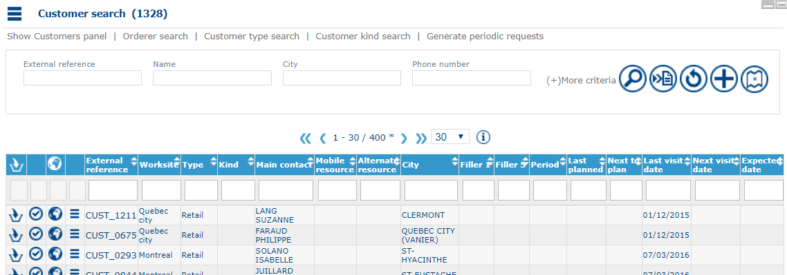

* The  button runs the search and displays the results list.
* The  button exports the table of the search result on customers in `.csv` format.
* The  button resets the search filters.
* The  button creates an object (here, a customer type object).
* The 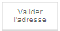 button verifies whether the declared town or post code corresponds to those of the geocoding repository.

Click **(+) More criteria** to search for customers by type (active or not) or by customer priority. You can also search for all customers assigned to a specified resource, or for customers that need periodic visits ("regular customers").

### Search result

* The results are presented in a table with standard browsing and sort functions. A series of action buttons lets you perform actions on part or all of the results.
* Some lists can also be filtered.

Example: List of appointments

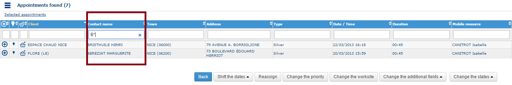

With free text entry in the filter field, you can restrict the table to the elements that match the filter.

This filter is of the `Starting with` type: all the records with a filter field value that starts with the entered value are retained. To escape from characters, include a `*` in the filter parameter.

For example, the search above returns all appointments of the **Installation** type. If you enter the value `*panel` in the **Intervention type** filter, only installations of solar panels are returned.

Click a line in the search results to open the form of the corresponding object.

In some lists, a series of buttons in the result table gives direct access to some functions:

* **Select** – selects items in the list.
* The  button displays the item on the map.
* The  button runs an optimized scheduling operation for the appointment.
* The  button adds the appointment to the panel.

Depending on your rights, a series of buttons is present at the bottom of the results lists:

* **Back** – takes you back to the search form (the parameters in it are stored).
* **Export in CSV** – exports the table as a file (column separator: comma) that you can edit in Excel, for example.
* To delete some objects, select them in the result list (**Selection** column) and click the delete button.

### Additional action buttons for lists of appointments

Action buttons for appointment lists

* **Announce** – creates a configurable circulation listener, for example when sending a pre-formatted message to all the customer appointment contacts in the list. See [CSV Files](../administration/csvfiles.md).
*   **Change the dates** – modifies the start and end dates of the appointments in the list. You can apply the modification in several ways:

    * **Push the earliest start date** – adds the defined number of days to the earliest dates of the appointments in the list.
    * **Advance the earliest start date** – brings the earliest dates forward by a number of days for the appointments in the list.
    * **Change the earliest start date** – defines an earliest date that is applied to all appointments in the list.
    * **Push the latest end date** – defines a latest date that is applied to all the appointments in the list.
    * **Advance the latest end date** – brings forward the latest dates of the appointments in the list by the defined number of days.
    * **Change the latest end date** – adds the defined number of days to the latest dates of the appointments in the list.
    * **Push the planned date** – adds the defined number of days to the scheduled dates of the appointments in the list.
    * **Advance the planned date** – subtracts the defined number of days from the scheduled dates of the appointments in the list.
    * **Change the periode of possible completion** – redefines the earliest and latest possible dates that are applied to all appointments in the list.

    

If the appointments in the list do not have an earliest or latest date defined, today's date is used as a reference.

*   **Modify resources** – defines preferences for the resources (required, desired, refused) assigned to the appointments in the list. The following window is displayed.

    Reassign resources

    

    In this window, you can modify how resources are classified in relation to appointments: desired, required or refused.

    

This function only applies to appointments with the status <strong>Requested</strong>. See <a href="../introduction/thedifferentstatusesforappointmentsinnfs.md">The different statuses for appointments in NFS</a>.

* **Modify priority** – defines a new priority value for the appointments in the list.
*   **Modify worksite** – changes the worksite associated with each appointment in the list. The following window is displayed.

    Modify worksites

    

    In this window, you can change the worksites linked to the appointment.
* **Modify additional data** – modifies the **Miscellaneous**, **Logical**, **Quantity** and **Dates** fields of the appointments in the list.
* **Modify statuses** – modifies the status of the appointments in the list. See [The different statuses for appointments in NFS](../introduction/thedifferentstatusesforappointmentsinnfs.md).
* **Subcontract** – sets the appointments in the list to the status **Externalized**. See [The different statuses for appointments in NFS](../introduction/thedifferentstatusesforappointmentsinnfs.md).


Not all status changes are possible with these actions in batch mode. For example, you cannot move a list of **candidate** appointments to the status **Confirmed** in this way, because they are not in a planning.


### Action buttons on customer lists

*   **Modify dates** – offers two options:

    * **Modify the date of the last visit** – modifies the date of the last visit shown in the customer form.
    * **Modify the date of the next visit** – modifies the date of the next visit shown in the customer form.

    See [Customers](objectsintheplanningmodule.md#customers).
*   **Modify the type** – modifies the customer type. The following window is displayed.

    Change customer type

    
*   **Modify the kind** – modifies the customer kind. The following window is displayed.

    Change customer kind

    
*   **Change the focus** – modifies the customer focus. The following window is displayed.

    Change customer focus

    
* **Change additional data** – changes the **Miscellaneous**, **Logical**, **Quantity** and **Dates** fields of the customers in the list.

## Create an object in the Planning module

You create an object with the search function for that type of object.

Click the  button to create an object.

## Delete an object in the Planning module

Depending on the type of object, you can delete or deactivate it from the object form or with the object search function.

* To delete an object from its form, click **Delete**.
* To delete an object with the search function, select the objects to delete and click **Delete**.

Example: delete an exceptional location


Some objects cannot be deleted or deactivated.

