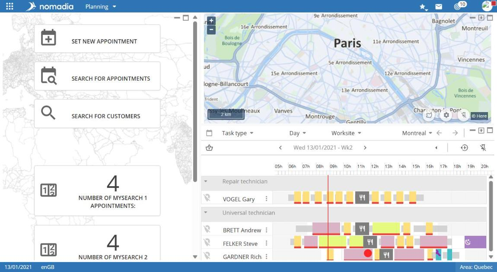
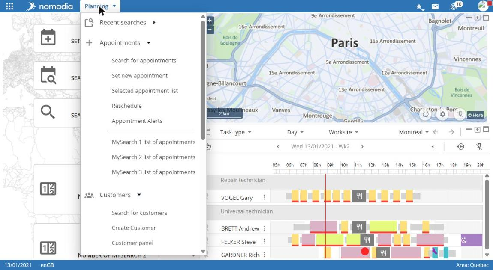

# Planning overview

The Planning module is the main workspace for planners. It brings together appointment booking, search, the map, and field-worker schedules.

## Access the module

**Navigation:** `Application launcher > Planning`

## Home screen

The screen has three panels:

* on the left, the workspace: shortcuts, search forms, and records;
* at the top right, the map;
* at the bottom right, the field-worker schedule.

When opened, the workspace displays:

* the **BOOK A NEW APPOINTMENT**, **SEARCH FOR APPOINTMENTS**, and **SEARCH FOR CUSTOMERS** shortcuts;
* counter cards showing the number of appointments in MySearch views with **Home page** selected: **NUMBER OF MYSEARCH N APPOINTMENTS** for administrator views, or the selected counter name for personal views.

## Module menu

Select **Planning**, next to the logo, to open the module menu.

| Section          | Entries                                                                                                                                                                                                                                                     |
| ---------------- | ----------------------------------------------------------------------------------------------------------------------------------------------------------------------------------------------------------------------------------------------------------- |
| **Appointments** | Search for appointments, Book a new appointment, List selected appointments, Generate recurring appointments, Swap, Replan, Appointment alerts, MySearch 1 to 15 appointment lists, appointment lists by status, personal views                             |
| **Customers**    | Search for customers, Create a customer, List selected customers, Customer discrepancy, List customers with alerts, project searches                                                                                                                        |
| **Planning**     | Search for unavailabilities, Manage unavailabilities, saved unavailability lists, Temporary positions, View customers, Worksite assignment, Manage milestones, Exceptional locations, Hotel locations, Locked day, Equipment assignments, Sector management |
| **Location**     | Search nearby, Calculate route, Convert coordinates to Lat/Lon, Vehicle tracking                                                                                                                                                                            |
| **Exports**      | List predefined exports, Edit route sheet                                                                                                                                                                                                                   |

The menu also contains **Alerts** and **View managers** at the bottom. The latter creates and configures search views (MySearch). See [Manage search views](manage-search-views/).

## In this section

* [View the schedule](view-the-schedule.md)
* [Manage an appointment from the schedule](manage-an-appointment-from-the-schedule.md)
* [Manage search views](manage-search-views/)
* [Resource monitoring](resource-monitoring/)
